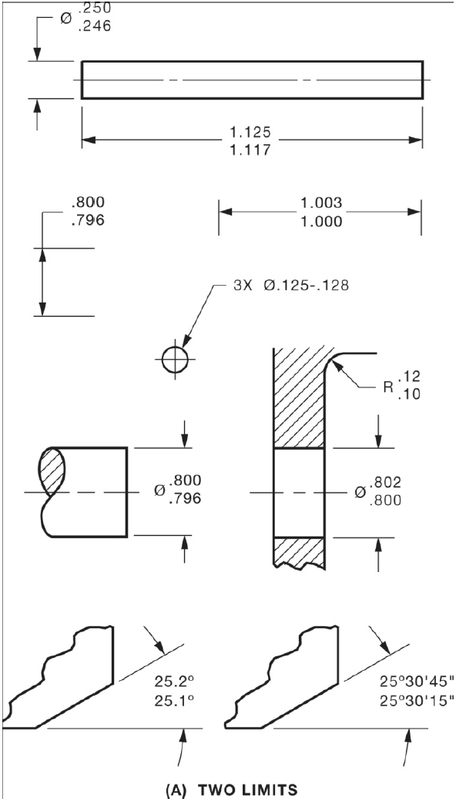
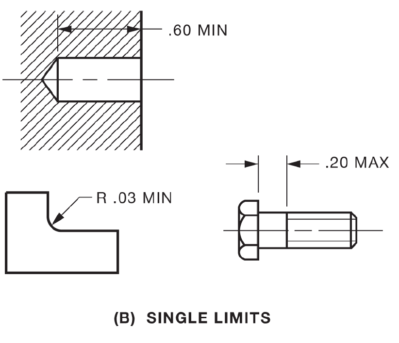

## Tolerances in Mechanical Design {#tolerances}

```{r setup-01-03, include=FALSE}
# Include the helpers.R file for pdf output of youtube on pdfs as a clickable link
source("R/helpers.R")
# Include the required packages to make sure the page can be built
source("R/required_packages.R")
```

### Learning Objectives {-}

By the end of this chapter, you will be able to:

- Define basic size, tolerance, and allowance in mechanical design
- Apply limit dimensioning and plus-minus tolerancing methods
- Distinguish between bilateral and unilateral tolerances
- Interpret single-limit (MAX/MIN) specifications
- Apply correct decimal and zero conventions for metric and imperial units

::: {.callout-think}
**Before You Read:** Why can't we simply manufacture every part to its exact
specified dimension? What factors might cause variation in manufacturing?
:::

In mechanical engineering and manufacturing, no part can be produced to exact
absolute dimensions every single time due to inherent variations in machinery,
material properties, and environmental conditions. Therefore, designers must
specify an acceptable range of variation. This chapter explores the fundamental
concepts of tolerances, basic sizes, and allowances, as defined in standards
such as ASME Y14.5 [@ASME_Y145_2018].

### Fundamental Concepts

To understand tolerancing, we must first define three key terms:

1.  **Basic Size**: The theoretical exact size from which limits of size are derived by the application of allowances and tolerances.
2.  **Tolerance**: The total amount a specific dimension is permitted to vary. It is the difference between the maximum and minimum limits.
3.  **Allowance**: An intentional difference between the maximum material limits of mating parts (e.g., the tightest fit between a shaft and a hole).


Mathematically, if we denote the Upper Limit as $L_{max}$ and the Lower Limit as $L_{min}$, the tolerance $T$ is calculated as:

$$
T = L_{max} - L_{min}
$$

These concepts apply universally, whether designing a cylindrical shaft diameter, a slot width, or the overall length of a prismatic part.

### Tolerancing Methods

There are two primary methods used to express tolerances on technical drawings: **Limit Dimensions** and **Plus-Minus Tolerancing**.

#### Limit Dimensions

In limit dimensioning, the high and low limits are specified directly. The machinist does not need to calculate the limits; they are explicitly stated.

* **Example**: $\begin{matrix} 25.05 \\ 24.95 \end{matrix}$

#### Plus-Minus Tolerancing

This method uses a basic size followed by a permissible variance. This category is further divided based on how the variance is distributed relative to the basic size.

##### Equal Bilateral Tolerance {-}
The variation is permitted equally in both directions (plus and minus) from the basic size.

> **Example**: $25.00 \pm 0.05$

##### Unequal Bilateral Tolerance {-}
The variation is permitted in both directions, but the amount differs.

> **Example**: $25.00 \,\, {}^{+0.05}_{-0.02}$

##### Unilateral Tolerance {-}
The variation is permitted in only one direction (either positive or negative) from the basic size. The limit in the other direction is zero.

> **Example**: $25.00 \,\, {}^{+0.05}_{-0.00}$

### Specifying Limits in Tolerancing

When defining the permissible variation of a part, designers choose between specifying a range (two limits) or a single boundary (one limit) based on the functional requirements of the feature.

#### Tolerance with Two Limits (Limit Dimensioning)

In this method, the maximum and minimum dimensions are specified directly on the drawing. The tolerance is the absolute difference between these two values. This is the most direct method for a machinist to read, as it eliminates the need for mental math to find the boundaries.

* **Format**: The limits are usually placed in a stack, with the high limit on top.
* **Calculation**: $Tolerance = Upper Limit - Lower Limit$
* **Example**: For a dimension specified as $\begin{matrix} 1.505 \\ 1.495 \end{matrix}$
    * The **Upper Limit** is $1.505$
    * The **Lower Limit** is $1.495$
    * The **Tolerance** is $0.010$


```{r, echo=FALSE, out.width="50%", fig.align="center", fig.cap="Allowances with two limits"}

```


#### Tolerance with One Limit (Single Limit)

Single-limit dimensioning is used when the dimension in one direction is not critical, or when the "other" limit is naturally constrained by the geometry or the manufacturing process. These are indicated by the suffixes **MAX** or **MIN**.

* **MAX (Maximum)**: Specifies that the feature must not exceed the given value. The lower limit is often zero or determined by the part's shape. This is commonly used for fillet radii or chamfers to prevent interference with a mating part.
    * *Example*: $R.015 \text{ MAX}$
* **MIN (Minimum)**: Specifies that the feature must be at least the given value. The upper limit is often determined by the material stock or is not functionally critical. This is commonly used for the depth of holes or the width of a bearing surface.
    * *Example*: $.500 \text{ MIN}$ (Full Thread)


```{r, echo=FALSE, out.width="50%", fig.align="center", fig.cap="Allowances with a single limit"}

```


---

#### Comparison Summary

| Method | Syntax | Primary Use Case |
|:---|:---|:---|
| **Two Limits** | $\begin{matrix} High \\ Low \end{matrix}$ | Critical fits (shafts, holes, mating surfaces). |
| **One Limit (MAX)** | $.010 \text{ MAX}$ | Clearance for corners, weight reduction, or edge breaks. |
| **One Limit (MIN)** | $.500 \text{ MIN}$ | Minimum engagement for fasteners or structural thickness. |


#### Visualizing Tolerance Distributions

To better understand how manufactured parts align with these limits, we can visualize a production run. Figure @fig-tolerance-plot below simulates a batch of 1000 shafts manufactured with a target diameter of 25.0 mm and a tolerance of $\pm 0.05$ mm.

```{r fig-tolerance-plot, echo=FALSE, message=FALSE, warning=FALSE, fig.cap="Distribution of manufactured shaft diameters relative to tolerance limits."}
library(ggplot2)
library(dplyr)

## Set seed for reproducibility
set.seed(42)

# Parameters
target_mean <- 25.00
tolerance <- 0.05
upper_limit <- target_mean + tolerance
lower_limit <- target_mean - tolerance

# Generate synthetic data for 1000 parts
parts_data <- data.frame(
  diameter = rnorm(1000, mean = target_mean, sd = 0.015)
)

# Plot the distribution
ggplot(parts_data, aes(x = diameter)) +
  geom_histogram(aes(y = after_stat(density)), binwidth = 0.005,
                 fill = "#69b3a2", color = "white", alpha = 0.8) +
  geom_density(color = "#404080", linewidth = 1) +
  geom_vline(xintercept = lower_limit, linetype = "dashed",
             color = "red", linewidth = 1) +
  geom_vline(xintercept = upper_limit, linetype = "dashed",
             color = "red", linewidth = 1) +
  annotate("text", x = upper_limit + 0.01, y = 5, label = "USL", color = "red") +
  annotate("text", x = lower_limit - 0.01, y = 5, label = "LSL", color = "red") +
  theme_minimal() +
  labs(
    title = "Production Consistency vs. Tolerance Limits",
    x = "Measured Diameter (mm)",
    y = "Density"
  )
```

As seen in Figure @fig-tolerance-plot, the dashed red lines represent the Upper Specification Limit (USL) and Lower Specification Limit (LSL). Parts falling outside these lines would be rejected.

### Drawing Standards: Metric vs. Inch

One of the most critical aspects of technical documentation is adhering to the specific syntax rules for Metric (SI) and Inch (Imperial) units. These rules differ significantly regarding zero suppression and decimal consistency.

#### Metric Rules (SI)

When dimensioning in millimeters, the following rules apply:

* **Leading Zeros**: For dimensions and tolerances less than 1 mm, a leading zero **must** be used.
    * *Correct*: $0.5$
    * *Incorrect*: $.5$
* **Decimal Consistency**: The number of decimal places **can vary** between the dimension and the tolerance.
    * *Example*: $25 \pm 0.25$ (The basic size has 0 decimals; tolerance has 2).
* **Unilateral Zero**: A zero in a unilateral tolerance is written as a single digit "0" without a plus or minus sign.
    * *Example*: $30 \,\, {}^{+0.1}_{0}$

#### Inch Rules (Imperial)

When dimensioning in inches, the conventions are distinct:

* **Leading Zeros**: For dimensions and tolerances less than 1 inch, a leading zero is **never** used.
    * *Correct*: $.500$
    * *Incorrect*: $0.500$
* **Decimal Consistency**: The number of decimal places **must be identical** for the dimension and the tolerance.
    * *Example*: $1.000 \pm .005$ (Both must show 3 decimal places).
* **Zeros in Tolerances**:
    * **Bilateral**: If a tolerance limit is zero, it still requires a plus or
      minus sign and must display the same number of decimal places as the
      dimension to express precision.
    * *Example*: $1.000 \,\, {}^{+.005}_{-.000}$

::: {.callout-industry}
**Industry Application:** In food processing equipment manufacturing, tolerance
specifications must account for sanitary requirements. Parts must fit together
without gaps that could harbor bacteria, yet still allow for disassembly during
cleaning. This requires careful selection of clearance and interference fits.
:::

### Try it yourself {#sec-tryit-tolerances}

These use dimensions that are not in the examples above. Each exercise checks your answer and lets you try again.

#### From deviations to limits {#sec-tryit-limits}

```{r tryit-limits-grid, echo=FALSE, results='asis'}
tl <- data.frame(
  `Basic size (mm)` = c(32.00, 18.50, 60.00, 12.700),
  `Upper deviation` = c(0.05, 0.00, 0.10, 0.003),
  `Lower deviation` = c(-0.02, -0.08, -0.10, 0.000),
  check.names = FALSE
)
tl[["Upper limit (mm)"]] <- tl[["Basic size (mm)"]] + tl[["Upper deviation"]]
tl[["Lower limit (mm)"]] <- tl[["Basic size (mm)"]] + tl[["Lower deviation"]]
tl[["Tolerance (mm)"]]   <- tl[["Upper limit (mm)"]] - tl[["Lower limit (mm)"]]

tryit_grid(
  id = "tolerance-limits",
  title = "Upper limit, lower limit and tolerance",
  data = tl,
  blank = c("Upper limit (mm)", "Lower limit (mm)", "Tolerance (mm)"),
  tol = c(`Upper limit (mm)` = 0.0005, `Lower limit (mm)` = 0.0005, `Tolerance (mm)` = 0.0005),
  hints = c(`Upper limit (mm)` = "Basic size + upper deviation.",
            `Lower limit (mm)` = "Basic size + lower deviation (the deviation is negative or zero).",
            `Tolerance (mm)` = "Tolerance = upper limit - lower limit; it is never negative."),
  digits = 3,
  intro = "Give limits to three decimals.",
  question = paste0(
    "<p>For each dimension (basic size with upper and lower deviation, in mm): 32.00 (+0.05, -0.02); 18.50 (0.00, -0.08); ",
    "60.00 (+0.10, -0.10); 12.700 (+0.003, 0.000). Find the upper limit, the lower limit and the tolerance T = L_max - L_min.</p>")
)
```

<details class="tryit-solution">
<summary>Show the worked solution</summary>

```{r tryit-limits-solution, echo=FALSE}
knitr::kable(tl, digits = c(3, 3, 3, 3, 3, 3), align = "c")
```

Row 2 is a unilateral tolerance (the upper deviation is zero) and row 3 an equal bilateral one. The tolerance is the same total band either way; it only shifts where the band sits against the basic size.

</details>

#### A shaft in a hole {#sec-tryit-allowance}

A hole is specified as $25.000$ to $25.021$ mm and the mating shaft as $24.980$ to $24.993$ mm.

```{r tryit-allowance-number, echo=FALSE, results='asis'}
al <- list(h_max = 25.021, h_min = 25.000, s_max = 24.993, s_min = 24.980)
al$allowance <- al$h_min - al$s_max
al$max_clear <- al$h_max - al$s_min
al$t_hole    <- al$h_max - al$h_min
al$t_shaft   <- al$s_max - al$s_min

tryit_number(
  id = "allowance",
  title = "Allowance, loosest fit and tolerances",
  answers = list(
    tryit_answer("Allowance (tightest fit)", al$allowance, tol = 0.0005, suffix = "mm",
                 hint = "Smallest hole minus largest shaft: the maximum material limits."),
    tryit_answer("Loosest fit (maximum clearance)", al$max_clear, tol = 0.0005, suffix = "mm",
                 hint = "Largest hole minus smallest shaft."),
    tryit_answer("Hole tolerance", al$t_hole, tol = 0.0005, suffix = "mm", hint = "Upper limit minus lower limit of the hole."),
    tryit_answer("Shaft tolerance", al$t_shaft, tol = 0.0005, suffix = "mm", hint = "Upper limit minus lower limit of the shaft.")
  ),
  intro = "Give each to three decimals.",
  question = paste0(
    "<p>A hole has limits 25.000 and 25.021 mm; the mating shaft has limits 24.980 and 24.993 mm. ",
    "The allowance is the difference between the maximum material limits (smallest hole minus largest shaft). ",
    "Find the allowance, the maximum clearance and the tolerance of each part.</p>")
)
```

<details class="tryit-solution">
<summary>Show the worked solution</summary>

Allowance $= 25.000 - 24.993 = `r sprintf("%.3f", al$allowance)`$ mm; loosest fit $= 25.021 - 24.980 = `r sprintf("%.3f", al$max_clear)`$ mm. The hole tolerance is `r sprintf("%.3f", al$t_hole)` mm and the shaft tolerance `r sprintf("%.3f", al$t_shaft)` mm. The clearance varies by the sum of the two tolerances, `r sprintf("%.3f", al$t_hole + al$t_shaft)` mm.

</details>

#### How is the tolerance written? {#sec-tryit-tol-styles}

```{r tryit-tol-style-sort, echo=FALSE, results='asis'}
tryit_sort(
  id = "tolerance-styles",
  title = "Name the tolerancing style",
  bins = c("Equal bilateral", "Unequal bilateral", "Unilateral", "Limit dimensions", "Single limit (MAX/MIN)"),
  cards = data.frame(
    text = c(
      "40.00 \u00b1 0.05",
      "40.00 with +0.05 and -0.02",
      "40.00 with +0.05 and -0.00",
      "40.05 stacked over 39.95",
      "R.020 MAX",
      ".750 MIN (full thread)",
      "12.50 with +0.00 and -0.10",
      "12.50 \u00b1 0.15"
    ),
    bin = c("Equal bilateral", "Unequal bilateral", "Unilateral", "Limit dimensions", "Single limit (MAX/MIN)",
            "Single limit (MAX/MIN)", "Unilateral", "Equal bilateral"),
    why = c(
      "The same variation is allowed on both sides.",
      "Both directions are allowed but by different amounts.",
      "Variation is allowed in one direction only.",
      "The high and low limits are stated directly.",
      "A MAX limit leaves the other limit to the geometry.",
      "A MIN limit leaves the other limit to the stock or geometry.",
      "The plus deviation is zero: one direction only.",
      "The same variation is allowed on both sides."
    )
  ),
  intro = "Look at whether the limits are given directly, as deviations, or as a single boundary.",
  question = "<p>Name the tolerancing style used for each dimension: equal bilateral, unequal bilateral, unilateral, limit dimensions, or single limit (MAX/MIN).</p>"
)
```

### Key Takeaways {-}

- Tolerances define the acceptable range of variation for manufactured parts
- Limit dimensioning explicitly states upper and lower bounds
- Plus-minus tolerancing can be bilateral (equal or unequal) or unilateral
- Metric and imperial systems have different rules for leading zeros and
  decimal places
- Single-limit tolerances (MAX/MIN) are used when only one boundary is critical

::: {.callout-check}
**Quick Check:** Given a dimension of $25.00 \pm 0.05$ mm, what are the upper
limit, lower limit, and total tolerance? How would this be written using limit
dimensioning?
:::
