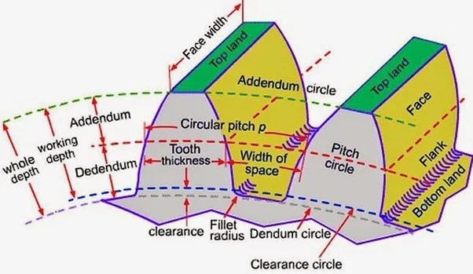
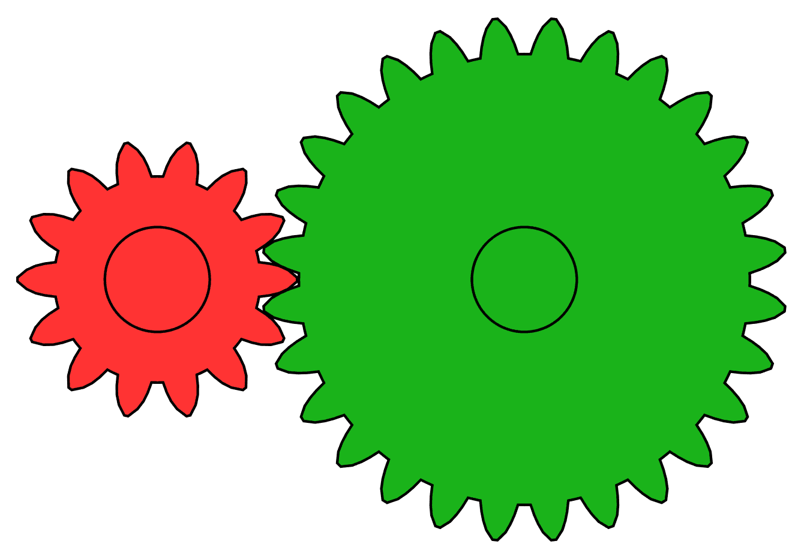
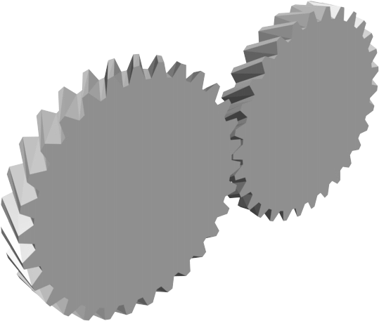
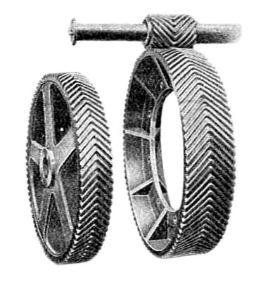
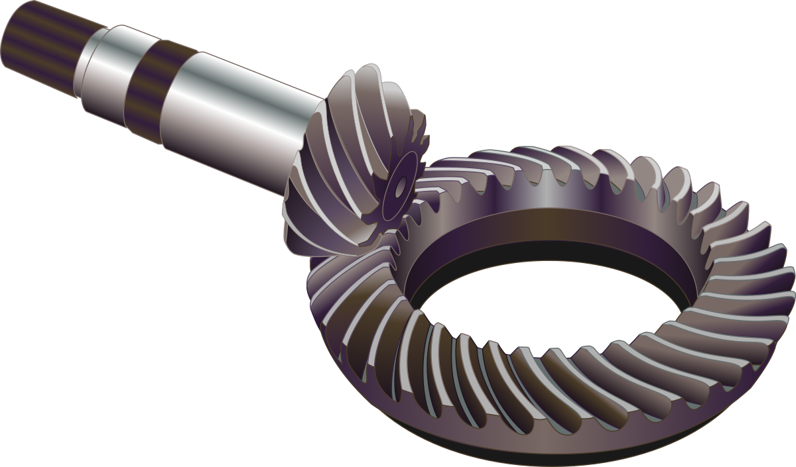
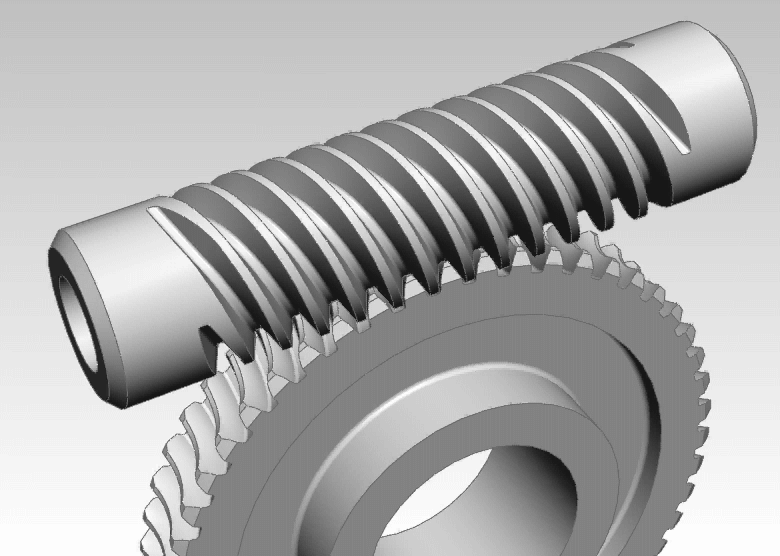
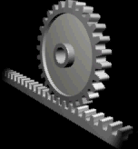

## Gears, Gear Trains, and Transmissions {#sec-chap-02-gears}

```{r setup-04, include=FALSE}
## include the helpers.R file for pdf output of youtube on pdfs as a clickable link
source("R/helpers.R")
## include the required packages to make sure the page can be built.
source("R/required_packages.R")
inject_jquery()

## Set a consistent theme for all plots
theme_gear <- theme_minimal() +
  theme(
    plot.title = element_text(hjust = 0.5, size = 12 * chart_text_scale, face = "bold"),
    plot.subtitle = element_text(hjust = 0.5, size = 10 * chart_text_scale),
    axis.text = element_blank(),
    axis.title = element_blank(),
    axis.ticks = element_blank(),
    panel.grid = element_blank(),
    plot.background = element_rect(fill = "white", color = NA),
    panel.background = element_rect(fill = "white", color = NA)
  )

## Function to create gear tooth profile (simplified involute approximation)
gear_profile <- function(cx, cy, r_pitch, n_teeth, rotation = 0) {
  angles <- seq(0, 2*pi, length.out = n_teeth * 4 + 1) + rotation
  r_outer <- r_pitch * 1.15
  r_inner <- r_pitch * 0.85

  radii <- rep(c(r_outer, r_pitch * 1.05, r_inner, r_pitch * 1.05), n_teeth)
  radii <- c(radii, radii[1])

  data.frame(
    x = cx + radii * cos(angles),
    y = cy + radii * sin(angles)
  )
}
```

### Learning Objectives {#sec-objectives-04}

By the end of this chapter, you will be able to:

1. **Explain** the fundamental principles of gear operation and power transmission
2. **Calculate** gear ratios, speed changes, and torque changes in gear systems
3. **Identify** different gear types and their appropriate applications
4. **Apply** gear terminology including module, diametral pitch, and pressure angle
5. **Analyze** simple, compound and planetary gear trains to determine overall speed ratios
6. **Design** a gear train that meets a speed, torque and size requirement

::: {.callout-think}
**Before You Read:** Your car's engine might spin at 6,000 RPM, but your wheels only turn at about 1,000 RPM at highway speed. How does the transmission accomplish this speed reduction, and why is it necessary?
:::

### Introduction to Gears {#sec-gears-intro}

Gears are toothed mechanical components that transmit **power and motion** between rotating shafts. They are among the oldest and most important machine elements, found in virtually every mechanical system—from wristwatches to wind turbines, from automotive transmissions to industrial robots.

Gears serve four fundamental purposes:

1. **Transmit power** from one shaft to another
2. **Change rotational speed** (increase or decrease RPM)
3. **Change torque** (increase or decrease turning force)
4. **Change direction** of rotation or axis of rotation

### Fundamental Gear Concepts {#sec-gear-fundamentals}

#### The Basic Principle

When two gears mesh, their teeth interlock. As one gear (the **driver** or **pinion**) rotates, it pushes against the teeth of the other gear (the **driven gear**), causing it to rotate.

```{r gear-mesh-basic, echo=FALSE, fig.width=10, fig.height=6, fig.align='center', fig.cap="Basic gear mesh showing driver (pinion) and driven gear."}
## Create two meshing gears
pinion <- gear_profile(3, 4, 1.2, 12, rotation = pi/24)
driven <- gear_profile(6.5, 4, 2, 20, rotation = 0)

ggplot() +
  ## Driven gear (larger)
  geom_polygon(data = driven, aes(x = x, y = y), fill = "steelblue", color = "black", linewidth = 0.5) +
  annotate("point", x = 6.5, y = 4, size = 4, color = "black") +
  annotate("point", x = 6.5, y = 4, size = 2, color = "white") +

  ## Pinion (smaller, driver)
  geom_polygon(data = pinion, aes(x = x, y = y), fill = "orange", color = "black", linewidth = 0.5) +
  annotate("point", x = 3, y = 4, size = 4, color = "black") +
  annotate("point", x = 3, y = 4, size = 2, color = "white") +

  ## Rotation arrows
  annotate("curve", x = 3, xend = 3.6, y = 5.5, yend = 5.8,
             arrow = arrow(length = unit(0.2, "cm"), type = "closed"),
             curvature = -0.3, linewidth = 1, color = "darkorange") +
  annotate("text", x = 3, y = 6.7, label = "Driver\n(Pinion)", fontface = "bold", size = 4.5 * diagram_text_scale) +
  annotate("text", x = 3, y = 2.3, label = "12 teeth\n(input)", size = 3 * diagram_text_scale, color = "darkorange") +

  annotate("curve", x = 6.5, xend = 5.7, y = 6.3, yend = 6.5,
             arrow = arrow(length = unit(0.2, "cm"), type = "closed"),
             curvature = 0.3, linewidth = 1, color = "steelblue") +
  annotate("text", x = 6.5, y = 7.2, label = "Driven\nGear", fontface = "bold", size = 4.5 * diagram_text_scale) +
  annotate("text", x = 8.2, y = 1.9, label = "20 teeth\n(output)", size = 3 * diagram_text_scale, color = "steelblue") +

  ## Pitch circles (dashed)
  annotate("point", x = 4.15, y = 4, size = 3, color = "red") +
  annotate("segment", x = 4.0, xend = 4.12, y = 2.5, yend = 3.85, color = "red", linewidth = 0.5) +
  annotate("text", x = 4.0, y = 2.1, label = "Pitch\nPoint", color = "red", size = 3.5 * diagram_text_scale) +

  ## Key principle box
  annotate("rect", xmin = 0.2, xmax = 6.4, ymin = 0.1, ymax = 1.3, fill = "lightyellow", color = "black") +
  annotate("text", x = 3.3, y = 0.95, label = "KEY PRINCIPLE:", fontface = "bold", size = 3.6 * diagram_text_scale) +
  annotate("text", x = 3.3, y = 0.5, label = "Small gear drives large gear → Speed DOWN, Torque UP", size = 3.2 * diagram_text_scale) +

  coord_fixed(ratio = 1, xlim = c(0, 9), ylim = c(0, 7.5)) +
  labs(title = "Meshing Gears: Driver and Driven") +
  theme_gear
```

#### The Fundamental Law of Gearing

For smooth, constant-velocity power transmission, the **common normal** at the point of contact between gear teeth must always pass through a fixed point called the **pitch point**. This is achieved through the **involute tooth profile**, which is the standard for most modern gears.

---

### Gear Terminology {#sec-gear-terminology}

Understanding gear terminology is essential for specifying, designing, and manufacturing gears.

```{r, echo=FALSE, out.width="70%", fig.align="center", fig.cap="Thread Standards"}

```

#### Essential Gear Formulas

| Parameter | Metric (Module) | Imperial (Diametral Pitch) |
|:----------|:----------------|:---------------------------|
| **Pitch Diameter** | $d = m \times N$ | $d = N / P$ |
| **Circular Pitch** | $p = \pi \times m$ | $p = \pi / P$ |
| **Addendum** | $a = m$ | $a = 1 / P$ |
| **Dedendum** | $b = 1.25 \times m$ | $b = 1.25 / P$ |
| **Outside Diameter** | $d_o = m(N + 2)$ | $d_o = (N + 2) / P$ |
| **Center Distance** | $C = m(N_1 + N_2)/2$ | $C = (N_1 + N_2) / 2P$ |

Where: $m$ = module, $P$ = diametral pitch, $N$ = number of teeth, $d$ = pitch diameter

> **⚠️ Important:** Module (mm) and Diametral Pitch (teeth/inch) are inversely related: $m = 25.4 / P$. **Never mix metric and imperial gears!**

---

**Worked example: a 24-tooth pinion driving a 60-tooth gear, module 2 mm.**

```{r gear-geometry-worked, echo=TRUE}
m  <- 2     # module (mm)
N1 <- 24    # pinion teeth
N2 <- 60    # gear teeth

d1  <- m * N1            # pitch diameters (mm)
d2  <- m * N2
p   <- pi * m           # circular pitch (mm)
do1 <- m * (N1 + 2)     # outside diameters (mm)
do2 <- m * (N2 + 2)
C   <- (d1 + d2) / 2   # centre distance (mm)

cat("Pinion: d =", d1, "mm, outside diameter =", do1, "mm\n")
cat("Gear:   d =", d2, "mm, outside diameter =", do2, "mm\n")
cat("Circular pitch p =", round(p, 2), "mm, addendum =", m, "mm, dedendum =", 1.25 * m, "mm\n")
cat("Centre distance C =", C, "mm, gear ratio =", N2 / N1, ": 1\n")
```

::: {.content-visible when-format="html"}
*Live cell: change the module or either tooth count and watch the two gears resize. The pitch circles always touch at the pitch point.*

```{r calc-gear-geometry, echo=FALSE, results='asis'}
qwebr_calc_card(
  label = "gear-geometry-calc",
  title = "Gear Pair Geometry Calculator",
  icon = "gear",
  inputs = list(
    qwebr_calc_input("m", "Module m", value = 2, min = 0.5, max = 10, step = 0.5, suffix = "mm"),
    qwebr_calc_input("N1", "Pinion teeth N<sub>1</sub>", value = 24, min = 8, max = 120, step = 1),
    qwebr_calc_input("N2", "Gear teeth N<sub>2</sub>", value = 60, min = 20, max = 200, step = 1, type = "slider")
  ),
  goal = "Fit a pair into a gearbox with a centre distance of exactly 90 mm, a ratio of at least 3:1 and a pinion of at least 17 teeth.",
  goal_test = "abs(center_dist - 90) < 1e-9 && ratio >= 3 - 1e-9 && N1 >= 17"
)
```

<details class="qwebr-calc-source">
<summary>Show the live R code behind this calculator</summary>
<p>The card above re-runs this exact webR code every time you change an input, substituting your values for the variables at the top. Edit the code directly and press <strong>Run Code</strong> to experiment further.</p>

```{webr-r}
#| label: gear-geometry-calc
## Edit these values and re-run!
m  <- 2     ## module (mm)
N1 <- 24    ## pinion teeth
N2 <- 60    ## gear teeth

d1  <- m * N1                ## pitch diameters (mm)
d2  <- m * N2
do1 <- m * (N1 + 2)          ## outside diameters (mm)
do2 <- m * (N2 + 2)
p   <- pi * m                ## circular pitch (mm)
center_dist <- (d1 + d2) / 2 ## centre distance (mm)
ratio <- N2 / N1

## Pitch circles (solid) and outside circles (dashed), touching at the pitch point
th <- seq(0, 2 * pi, length.out = 200)
par(mar = c(2, 2, 3, 1), cex.main = 1.3)
plot(NA, xlim = c(-do1 / 2, center_dist + do2 / 2), ylim = c(-do2 / 2, do2 / 2) * 1.05,
     asp = 1, xlab = "", ylab = "", axes = FALSE, main = "Pitch circles touch at the pitch point")
lines(d1 / 2 * cos(th), d1 / 2 * sin(th), lwd = 3, col = "#2c3e50")
lines(do1 / 2 * cos(th), do1 / 2 * sin(th), lty = 2, col = "#7f8c8d")
lines(center_dist + d2 / 2 * cos(th), d2 / 2 * sin(th), lwd = 3, col = "#e67e22")
lines(center_dist + do2 / 2 * cos(th), do2 / 2 * sin(th), lty = 2, col = "#7f8c8d")
points(c(0, center_dist), c(0, 0), pch = 3, cex = 1.5)

cat(sprintf("Centre distance: %.1f mm\n", center_dist))
cat(sprintf("  Pinion pitch diameter       %.1f mm\n", d1))
cat(sprintf("  Gear pitch diameter         %.1f mm\n", d2))
cat(sprintf("  Pinion outside diameter     %.1f mm\n", do1))
cat(sprintf("  Gear outside diameter       %.1f mm\n", do2))
cat(sprintf("  Circular pitch              %.2f mm\n", p))
cat(sprintf("  Gear ratio                  %.2f : 1\n", ratio))
if (N1 >= 17) {
  cat("  Undercut check              OK, pinion has 17 or more teeth\n")
} else {
  cat("  Undercut check              !!undercut risk: fewer than 17 teeth!!\n")
}
```

</details>
:::

Try it yourself: a gear has 40 teeth and a module of 3 mm. Calculate the pitch diameter, the outside diameter and the circular pitch.

```{r tryit-gear-quick, echo=FALSE, results='asis'}
quick_card <- function(m, N, id, title, show = TRUE, question = NULL) {
  tryit_number(
    id = id, title = title, show = show, question = question,
    answers = list(
      tryit_answer("Pitch diameter d", m * N, tol = 0.1, suffix = "mm", hint = "d = m x N."),
      tryit_answer("Outside diameter d_o", m * (N + 2), tol = 0.1, suffix = "mm",
                   hint = "d_o = m (N + 2): the addendum is added on both sides."),
      tryit_answer("Circular pitch p", pi * m, tol = 0.01, suffix = "mm", hint = "p = pi x m.")
    )
  )
}
quick_card(3, 40, "gear-quick-geometry", "Quick calculation: gear geometry")
quick_card(2.5, 32, "gear-quick-geometry-twin", "Quick calculation: gear geometry (graded copy)", show = FALSE,
           question = paste0("<p>A spur gear has 32 teeth and a module of 2.5 mm. Using d = m N, d_o = m (N + 2) and p = pi m, ",
                             "calculate the pitch diameter, the outside diameter and the circular pitch.</p>"))
```

<details class="tryit-solution">
<summary>Show the worked solution</summary>

**(a) Pitch Diameter:**
$$d = m \times N = 3 \times 40 = 120 \text{ mm}$$

**(b) Outside Diameter:**
$$d_o = m(N + 2) = 3(40 + 2) = 126 \text{ mm}$$

**(c) Circular Pitch:**
$$p = \pi \times m = \pi \times 3 = 9.42 \text{ mm}$$

</details>

---

### Types of Gears {#sec-gear-types}

Different gear types are designed for different applications based on shaft orientation, load capacity, speed, and noise requirements.

#### Spur Gears

**Spur gears** have straight teeth parallel to the axis of rotation. They are the simplest, most common, and most economical type.

```{r, echo=FALSE, out.width="70%", fig.align="center", fig.cap="Spur Gear Animation"}
if (knitr::is_html_output()) {
  
} else {
  
}
```
**Advantages:** Simple, Economical, High efficiency (98-99%)

**Disadvantages:** Noisy at high speeds, Limited to parallel shafts, Moderate load capacity

**Applications:** Gearboxes, conveyors, food processing equipment, clocks, printers

---

#### Helical Gears

**Helical gears** have teeth cut at an angle (helix angle) to the shaft axis. This allows gradual tooth engagement, resulting in smoother, quieter operation.

```{r, echo=FALSE, out.width="70%", fig.align="center", fig.cap="Helical Gear Animation"}
if (knitr::is_html_output()) {
  
} else {
  
}
```
**Advantages:** Smoother, quieter, Higher load capacity, Can transmit power between non-parallel shafts
**Disadvantages:** More complex to manufacture, Higher axial thrust, Slightly lower efficiency (97-99%)
**Applications:** Automotive transmissions, industrial gearboxes, machine tools, elevators

#### Herringbone Gears

**Herringbone gears** are a special type of helical gear with two sets of teeth in a V-shaped pattern. This design cancels out axial thrust and allows for very high load capacity.

```{r, echo=FALSE, out.width="70%", fig.align="center", fig.cap="Herringbone Gear"}

```

**Advantages:** No axial thrust, Very high load capacity, Smooth operation

**Disadvantages:** Complex and expensive to manufacture, Large size

**Applications:** Heavy machinery, marine transmissions, power plants, large industrial gearboxes

---

#### Bevel Gears

**Bevel gears** transmit power between shafts that intersect, typically at 90°. The teeth are cut on a conical surface.

```{r, echo=FALSE, out.width="70%", fig.align="center", fig.cap="Bevel Gear"}

```

**Advantages:** Transmit power between intersecting shafts, Can achieve high reduction ratios, Smooth operation

**Disadvantages:** More complex to design and manufacture, Higher cost, Moderate efficiency (97-99%)

**Applications:** Automotive differentials, hand tools, food mixers, rotorcraft transmissions


---

#### Worm Gears

**Worm gears** consist of a worm (screw-like) driving a worm wheel. They provide very high reduction ratios in a compact space and can be self-locking.

```{r, echo=FALSE, out.width="70%", fig.align="center", fig.cap="Worm Gear"}
if (knitr::is_html_output()) {
  
} else {
  
}
```

**Advantages:** Very high reduction ratios, Compact design, Self-locking capability, Quiet operation

**Disadvantages:** Low efficiency (40-90%), High sliding friction, More wear, Limited to right-angle shafts

**Applications:** Conveyor drives, elevator lifts, tuning mechanisms, steering systems

---

#### Rack and Pinion

**Rack and pinion** converts rotational motion to linear motion (or vice versa). The rack is essentially a gear with infinite radius.

```{r, echo=FALSE, out.width="70%", fig.align="center", fig.cap="Rack and Pinion"}
if (knitr::is_html_output()) {
  
} else {
  
}
```
**Advantages:** Simple, Precise linear motion, Can achieve high forces, Compact

**Disadvantages:** Limited to linear applications, Moderate efficiency (97-99%), Wear on rack teeth

**Applications:** Automotive steering, CNC machines, actuators, stairlifts

---

#### Gear Type Comparison

| Gear Type | Shaft Arrangement | Ratio Range | Efficiency | Noise Level | Cost |
|:----------|:------------------|:------------|:-----------|:------------|:-----|
| **Spur** | Parallel | 1:1 to 6:1 | 98-99% | High | Low |
| **Helical** | Parallel | 1:1 to 10:1 | 97-99% | Low | Medium |
| **Bevel** | Intersecting (90°) | 1:1 to 5:1 | 97-99% | Medium | High |
| **Worm** | Right angle (non-intersecting) | 5:1 to 100:1 | 40-90% | Low | Medium |
| **Rack & Pinion** | Rotary to linear | N/A | 97-99% | Medium | Medium |

> **🤔 Design Decision:** A food packaging machine requires a 25:1 speed reduction in a compact space. The drive must be self-locking to prevent the load from back-driving the motor when power is off. Which gear type would you recommend?

<details>
<summary>Click to reveal analysis</summary>

**Recommended: Worm Gear**

Reasons:

1. **High ratio** - 25:1 is within the typical worm gear range (5:1 to 100:1)
2. **Compact** - Achieves high ratio in single stage
3. **Self-locking** - When lead angle < friction angle (typically < 5°), the worm gear cannot be back-driven
4. **Quiet operation** - Important in food processing environments

**Trade-offs to consider:**

- Lower efficiency (70-85% at this ratio) means more heat and energy loss
- May require cooling or lubrication considerations
- Higher sliding friction causes wear - use appropriate materials (bronze wheel, hardened steel worm)

</details>

---

### Gear Ratios and Calculations {#sec-gear-ratios}

#### Speed and Torque Relationships

The **gear ratio** is the fundamental relationship between meshing gears:

$$\text{Gear Ratio} = \frac{N_{driven}}{N_{driver}} = \frac{\omega_{driver}}{\omega_{driven}} = \frac{T_{driven}}{T_{driver}}$$

Where: $N$ = number of teeth, $\omega$ = angular velocity, $T$ = torque

```{r gear-ratio-visual, echo=FALSE, fig.width=10, fig.height=6, fig.align='center', fig.cap="Gear ratio demonstration: speed reduction and torque multiplication."}
small_gear <- gear_profile(2.5, 3.5, 1, 15, 0)
large_gear <- gear_profile(6.5, 3.5, 2, 30, pi/30)

ggplot() +
  ## Small gear (driver)
  geom_polygon(data = small_gear, aes(x = x, y = y), fill = "orange", color = "black", linewidth = 0.5) +
  annotate("point", x = 2.5, y = 3.5, size = 4, color = "black") +

  ## Large gear (driven)
  geom_polygon(data = large_gear, aes(x = x, y = y), fill = "steelblue", color = "black", linewidth = 0.5) +
  annotate("point", x = 6.5, y = 3.5, size = 5, color = "black") +

  ## Input arrow
  annotate("segment", x = 0.5, xend = 1.3, y = 3.5, yend = 3.5,
               arrow = arrow(length = unit(0.25, "cm"), type = "closed"),
               linewidth = 1.5, color = "red") +

  ## Output arrow
  annotate("segment", x = 8.7, xend = 9.5, y = 3.5, yend = 3.5,
               arrow = arrow(length = unit(0.25, "cm"), type = "closed"),
               linewidth = 1.5, color = "darkgreen") +

  ## Input specifications
  annotate("rect", xmin = 0.3, xmax = 3.3, ymin = 6.1, ymax = 8.2, fill = "mistyrose", color = "black") +
  annotate("text", x = 1.8, y = 7.9, label = "INPUT (Driver)", fontface = "bold", size = 3.2 * diagram_text_scale) +
  annotate("text", x = 1.8, y = 7.55, label = "15 teeth", size = 2.8 * diagram_text_scale) +
  annotate("text", x = 1.8, y = 7.2, label = "1000 RPM", size = 2.8 * diagram_text_scale, color = "red") +
  annotate("text", x = 1.8, y = 6.85, label = "10 N·m torque", size = 2.8 * diagram_text_scale) +

  ## Output specifications
  annotate("rect", xmin = 6.7, xmax = 9.9, ymin = 6.1, ymax = 8.2, fill = "honeydew", color = "black") +
  annotate("text", x = 8.3, y = 7.9, label = "OUTPUT (Driven)", fontface = "bold", size = 3.2 * diagram_text_scale) +
  annotate("text", x = 8.3, y = 7.55, label = "30 teeth", size = 2.8 * diagram_text_scale) +
  annotate("text", x = 8.3, y = 7.2, label = "500 RPM", size = 2.8 * diagram_text_scale, color = "darkgreen") +
  annotate("text", x = 8.3, y = 6.85, label = "20 N·m torque*", size = 2.8 * diagram_text_scale) +

  ## Gear ratio calculation
  annotate("rect", xmin = 3, xmax = 7, ymin = -1.6, ymax = 0, fill = "lightyellow", color = "black") +
  annotate("text", x = 5, y = -0.3, label = "Gear Ratio = 30/15 = 2:1", fontface = "bold", size = 3.6 * diagram_text_scale) +
  annotate("text", x = 5, y = -0.8, label = "Speed: ÷2    Torque: ×2", size = 3.2 * diagram_text_scale) +
  annotate("text", x = 5, y = -1.3, label = "*Assuming 100% efficiency", size = 2.6 * diagram_text_scale, fontface = "italic") +

  coord_fixed(ratio = 1, xlim = c(0, 10), ylim = c(-1.8, 8.4)) +
  labs(title = "Gear Ratio: 2:1 Speed Reduction") +
  theme_gear
```

#### Key Relationships

**For a simple gear pair:**

| If the driven gear is... | Then speed is... | And torque is... |
|:-------------------------|:-----------------|:-----------------|
| **Larger** (more teeth) | **Reduced** | **Increased** |
| **Smaller** (fewer teeth) | **Increased** | **Reduced** |
| **Same size** | **Same** | **Same** |

**Power relationship (accounting for efficiency):**

$$P_{out} = P_{in} \times \eta$$

$$T_{out} \times \omega_{out} = T_{in} \times \omega_{in} \times \eta$$

Where $\eta$ = efficiency (typically 0.97-0.99 per gear mesh)

---

A motor runs at 1750 RPM and delivers 5 kW. It drives a gear with 20 teeth meshed with a gear having 80 teeth. Calculate the gear ratio, the output speed, the input torque and the output torque (assume 98% efficiency).

```{r tryit-gear-pair, echo=FALSE, results='asis'}
pair_card <- function(n_in, P_kW, Nd, Nn, eta, id, title, show = TRUE, question = NULL) {
  GR <- Nn / Nd
  T_in <- P_kW * 1000 / (n_in * 2 * pi / 60)
  tryit_number(
    id = id, title = title, show = show, question = question,
    answers = list(
      tryit_answer("Gear ratio", GR, tol = 0.01, suffix = ": 1", hint = "Driven teeth divided by driver teeth."),
      tryit_answer("Output speed", n_in / GR, tol = 0.5, suffix = "rpm", hint = "Input speed divided by the gear ratio."),
      tryit_answer("Input torque", T_in, tol = 0.1, suffix = "N m",
                   hint = "T = P / omega, with omega = n x 2 pi / 60 in rad/s."),
      tryit_answer("Output torque", T_in * GR * eta, tol = 1, suffix = "N m",
                   hint = "Multiply the input torque by the ratio and by the efficiency.")
    )
  )
}
pair_card(1750, 5, 20, 80, 0.98, "gear-pair-torque", "Speed and torque through a gear pair")
pair_card(1450, 7.5, 18, 63, 0.97, "gear-pair-torque-twin", "Speed and torque through a gear pair (graded copy)", show = FALSE,
          question = paste0("<p>A motor runs at 1450 RPM and delivers 7.5 kW. It drives a 18-tooth pinion meshed with a 63-tooth gear. ",
                            "The mesh efficiency is 97%. Calculate the gear ratio, the output speed, the input torque (T = P / omega) ",
                            "and the output torque (input torque x ratio x efficiency).</p>"))
```

<details class="tryit-solution">
<summary>Show the worked solution</summary>

**Gear ratio:**
$$GR = \frac{N_{driven}}{N_{driver}} = \frac{80}{20} = 4:1$$

**Output speed:**
$$n_{out} = \frac{n_{in}}{GR} = \frac{1750}{4} = 437.5 \text{ RPM}$$

**Input torque:**
$$T_{in} = \frac{P}{\omega_{in}} = \frac{5000}{1750 \times \frac{2\pi}{60}} = \frac{5000}{183.3} = 27.3 \text{ N·m}$$

**Output torque:**
$$T_{out} = T_{in} \times GR \times \eta = 27.3 \times 4 \times 0.98 = 107 \text{ N·m}$$

Or verify using power:
$$T_{out} = \frac{P_{out}}{\omega_{out}} = \frac{5000 \times 0.98}{437.5 \times \frac{2\pi}{60}} = \frac{4900}{45.8} = 107 \text{ N·m}$$

</details>

::: {.content-visible when-format="html"}
*Live cell: change the tooth counts and the efficiency. Notice that power never changes, so every gain in torque is paid for in speed.*

```{r calc-gear-pair, echo=FALSE, results='asis'}
qwebr_calc_card(
  label = "gear-pair-calc",
  title = "Gear Pair: Speed and Torque",
  icon = "gauge-high",
  inputs = list(
    qwebr_calc_input("n_in", "Motor speed", value = 1750, min = 500, max = 3600, step = 50, suffix = "rpm"),
    qwebr_calc_input("P_kW", "Input power", value = 5, min = 0.5, max = 30, step = 0.5, suffix = "kW"),
    qwebr_calc_input("N_driver", "Driver teeth", value = 20, min = 12, max = 60, step = 1),
    qwebr_calc_input("N_driven", "Driven teeth", value = 80, min = 12, max = 250, step = 1, type = "slider"),
    qwebr_calc_input("eta_pct", "Mesh efficiency", value = 98, min = 90, max = 99, step = 1, suffix = "%")
  ),
  goal = "With the motor still at 1750 rpm and 5 kW, get at least 250 N m at the output while the output turns at 100 rpm or faster.",
  goal_test = "T_out >= 250 && n_out >= 100 && n_in == 1750 && P_kW == 5 && eta_pct <= 98"
)
```

<details class="qwebr-calc-source">
<summary>Show the live R code behind this calculator</summary>
<p>The card above re-runs this exact webR code every time you change an input, substituting your values for the variables at the top. Edit the code directly and press <strong>Run Code</strong> to experiment further.</p>

```{webr-r}
#| label: gear-pair-calc
## Edit these values and re-run!
n_in     <- 1750   ## motor speed (rpm)
P_kW     <- 5      ## input power (kW)
N_driver <- 20     ## driver teeth
N_driven <- 80     ## driven teeth
eta_pct  <- 98     ## mesh efficiency (%)

GR    <- N_driven / N_driver
n_out <- n_in / GR
T_in  <- P_kW * 1000 / (n_in * 2 * pi / 60)
T_out <- T_in * GR * eta_pct / 100
P_lost <- P_kW * 1000 * (1 - eta_pct / 100)

## Output torque against output speed for ratios from 1:1 to 20:1 (constant power)
gr_seq <- seq(1, 20, by = 0.25)
T_seq  <- T_in * gr_seq * eta_pct / 100
par(mar = c(5, 5, 3, 1), cex.main = 1.3, cex.lab = 1.2, cex.axis = 1.1)
plot(n_in / gr_seq, T_seq, type = "l", lwd = 4, col = "#2c3e50",
     xlab = "Output speed (rpm)", ylab = "Output torque (N m)",
     main = "Trading Speed for Torque")
points(n_out, T_out, pch = 19, cex = 2.2, col = "#e74c3c")

cat(sprintf("Output: %.1f rpm at %.0f N m\n", n_out, T_out))
cat(sprintf("  Gear ratio             %.2f : 1\n", GR))
cat(sprintf("  Input torque           %.1f N m\n", T_in))
cat(sprintf("  Output power           %.0f W\n", P_kW * 1000 - P_lost))
cat(sprintf("  Lost as heat           %.0f W\n", P_lost))
```

</details>
:::

---

### Gear Trains {-}

A **gear train** is a combination of two or more gears used to transmit power from one shaft to another. Gear trains allow for larger speed ratios and more complex motion transmission than a single gear pair.

#### Simple Gear Train

In a **simple gear train**, each shaft carries only one gear. The intermediate gears are called **idlers** and do not affect the overall gear ratio—they only change the direction of rotation.

```{r simple-gear-train, echo=FALSE, fig.width=12, fig.height=5, fig.align='center', fig.cap="Simple gear train with idler gear."}
gear1 <- gear_profile(2, 3, 1.2, 20, 0)
gear2 <- gear_profile(5, 3, 1, 16, pi/32)
gear3 <- gear_profile(8, 3, 1.5, 24, 0)

ggplot() +
  ## Gear 1 (Driver)
  geom_polygon(data = gear1, aes(x = x, y = y), fill = "orange", color = "black", linewidth = 0.5) +
  annotate("point", x = 2, y = 3, size = 4, color = "black") +
  annotate("text", x = 2, y = 4.8, label = "Driver\n20 teeth", size = 3 * diagram_text_scale, fontface = "bold") +

  ## Rotation arrow 1
  annotate("curve", x = 2.7, xend = 2.9, y = 4.2, yend = 3.6,
             arrow = arrow(length = unit(0.15, "cm")), curvature = 0.4, color = "darkorange") +
  annotate("text", x = 3.2, y = 4.2, label = "CW", size = 3 * diagram_text_scale) +

  ## Gear 2 (Idler)
  geom_polygon(data = gear2, aes(x = x, y = y), fill = "gray70", color = "black", linewidth = 0.5) +
  annotate("point", x = 5, y = 3, size = 4, color = "black") +
  annotate("text", x = 5, y = 4.5, label = "Idler\n16 teeth", size = 3 * diagram_text_scale, fontface = "bold") +

  ## Rotation arrow 2
  annotate("curve", x = 5.6, xend = 5.4, y = 3.9, yend = 3.3,
             arrow = arrow(length = unit(0.15, "cm")), curvature = 0.4, color = "gray50") +
  annotate("text", x = 6.5, y = 4.4, label = "CCW", size = 3 * diagram_text_scale) +

  ## Gear 3 (Driven)
  geom_polygon(data = gear3, aes(x = x, y = y), fill = "steelblue", color = "black", linewidth = 0.5) +
  annotate("point", x = 8, y = 3, size = 5, color = "black") +
  annotate("text", x = 8, y = 5, label = "Driven\n24 teeth", size = 3 * diagram_text_scale, fontface = "bold") +

  ## Rotation arrow 3
  annotate("curve", x = 8.9, xend = 9.1, y = 4.5, yend = 3.8,
             arrow = arrow(length = unit(0.15, "cm")), curvature = 0.4, color = "steelblue") +
  annotate("text", x = 9.5, y = 4.3, label = "CW", size = 3 * diagram_text_scale) +

  ## Formula box
  annotate("rect", xmin = 0.5, xmax = 5.5, ymin = 0.3, ymax = 1.8, fill = "lightyellow", color = "black") +
  annotate("text", x = 3, y = 1.5, label = "Simple Gear Train Ratio:", fontface = "bold", size = 3.5 * diagram_text_scale) +
  annotate("text", x = 3, y = 1, label = "GR = N_driven / N_driver = 24/20 = 1.2:1", size = 3 * diagram_text_scale) +
  annotate("text", x = 3, y = 0.5, label = "(Idler teeth don't affect ratio!)", size = 2.8 * diagram_text_scale, fontface = "italic") +

  ## Direction note
  annotate("rect", xmin = 6, xmax = 10.5, ymin = 0.3, ymax = 1.5, fill = "mistyrose", color = "black") +
  annotate("text", x = 8.25, y = 1.2, label = "Odd # of gears: Same direction", size = 2.8 * diagram_text_scale) +
  annotate("text", x = 8.25, y = 0.7, label = "Even # of gears: Opposite direction", size = 2.8 * diagram_text_scale) +

  coord_fixed(ratio = 1, xlim = c(0, 11), ylim = c(0, 5.5)) +
  labs(title = "Simple Gear Train") +
  theme_gear
```

**Simple gear train ratio:**
$$GR = \frac{N_{driven}}{N_{driver}} = \frac{N_{last}}{N_{first}}$$

The idler gears only affect **direction of rotation**, not the gear ratio.

---

#### Compound Gear Train

In a **compound gear train**, two or more gears are mounted on the same shaft, rotating together. This allows for much higher gear ratios in a compact space.

```{r compound-gear-train, echo=FALSE, fig.width=12, fig.height=6, fig.align='center', fig.cap="Compound gear train: higher ratios in less space."}
gear_a <- gear_profile(2, 3.5, 1, 16, 0)
gear_b <- gear_profile(4.5, 3.5, 1.5, 24, pi/48)
gear_c <- gear_profile(4.5, 3.5, 0.7, 12, pi/24)
gear_d <- gear_profile(7.3, 3.5, 2, 32, 0)

ggplot() +
  ## Gear A (Driver)
  geom_polygon(data = gear_a, aes(x = x, y = y), fill = "orange", color = "black", linewidth = 0.5) +
  annotate("point", x = 2, y = 3.5, size = 4, color = "black") +
  annotate("text", x = 2, y = 5, label = "Gear A\n16 teeth", size = 3 * diagram_text_scale, fontface = "bold", color = "darkorange") +

  ## Gear B (on compound shaft)
  geom_polygon(data = gear_b, aes(x = x, y = y), fill = "forestgreen", color = "black", linewidth = 0.5) +

  ## Gear C (on same shaft as B, smaller)
  geom_polygon(data = gear_c, aes(x = x, y = y), fill = "lightgreen", color = "black", linewidth = 0.5) +
  annotate("point", x = 4.5, y = 3.5, size = 4, color = "black") +
  annotate("text", x = 4.5, y = 5.5, label = "Gear B: 24 teeth\nGear C: 12 teeth", size = 3 * diagram_text_scale, fontface = "bold", color = "darkgreen") +
  annotate("text", x = 4.5, y = 1.5, label = "COMPOUND\nSHAFT", size = 3 * diagram_text_scale, fontface = "bold") +

  ## Gear D (Output)
  geom_polygon(data = gear_d, aes(x = x, y = y), fill = "steelblue", color = "black", linewidth = 0.5) +
  annotate("point", x = 7.3, y = 3.5, size = 5, color = "black") +
  annotate("text", x = 7.3, y = 6, label = "Gear D\n32 teeth", size = 3 * diagram_text_scale, fontface = "bold", color = "steelblue") +

  ## Shaft connection indicator
  annotate("segment", x = 4.5, xend = 4.5, y = 2, yend = 2.5, linewidth = 4, color = "gray40") +

  ## Input/Output labels
  annotate("segment", x = 0.5, xend = 1.2, y = 3.5, yend = 3.5,
               arrow = arrow(length = unit(0.2, "cm"), type = "closed"), linewidth = 1.2, color = "red") +
  annotate("text", x = 0.5, y = 3, label = "Input", color = "red", fontface = "bold", size = 3 * diagram_text_scale) +

  annotate("segment", x = 9.3, xend = 10, y = 3.5, yend = 3.5,
               arrow = arrow(length = unit(0.2, "cm"), type = "closed"), linewidth = 1.2, color = "darkgreen") +
  annotate("text", x = 10, y = 3, label = "Output", color = "darkgreen", fontface = "bold", size = 3 * diagram_text_scale) +

  ## Formula box
  annotate("rect", xmin = 0.3, xmax = 5.5, ymin = -0.3, ymax = 1.2, fill = "lightyellow", color = "black") +
  annotate("text", x = 2.9, y = 0.9, label = "Compound Gear Train Ratio:", fontface = "bold", size = 3 * diagram_text_scale) +
  annotate("text", x = 2.9, y = 0.4, label = "GR = (N_B/N_A) × (N_D/N_C)", size = 3 * diagram_text_scale) +
  annotate("text", x = 2.9, y = -0.1, label = "GR = (24/16) × (32/12) = 1.5 × 2.67 = 4:1", size = 3 * diagram_text_scale) +

  ## Advantage note
  annotate("rect", xmin = 6, xmax = 10.5, ymin = -0.3, ymax = 0.8, fill = "honeydew", color = "black") +
  annotate("text", x = 8.25, y = 0.5, label = "Advantage: 4:1 ratio in", size = 2.8 * diagram_text_scale) +
  annotate("text", x = 8.25, y = 0, label = "compact space!", size = 2.8 * diagram_text_scale, fontface = "bold") +

  coord_fixed(ratio = 1, xlim = c(0, 11), ylim = c(-0.5, 6.5)) +
  labs(title = "Compound Gear Train") +
  theme_gear
```

**Compound gear train ratio:**
$$GR = \frac{N_{B}}{N_{A}} \times \frac{N_{D}}{N_{C}} = \frac{\text{Product of driven teeth}}{\text{Product of driver teeth}}$$

**Design it yourself.** The food-packaging drive in the case study later in this chapter needs 45 rpm (plus or minus 2%) from an 1800 rpm motor. A pinion with fewer than 17 teeth risks undercutting, and a gear larger than 120 teeth will not fit the housing.

::: {.content-visible when-format="html"}
*Live cell: pick tooth counts for the two stages until the output speed lands in the window.*

```{r calc-compound-train, echo=FALSE, results='asis'}
qwebr_calc_card(
  label = "compound-train-calc",
  title = "Two-Stage Compound Gear Train",
  icon = "gears",
  inputs = list(
    qwebr_calc_input("n_in", "Motor speed", value = 1800, min = 600, max = 3600, step = 100, suffix = "rpm"),
    qwebr_calc_input("N1", "Stage 1 pinion teeth", value = 18, min = 12, max = 40, step = 1),
    qwebr_calc_input("N2", "Stage 1 gear teeth", value = 72, min = 20, max = 130, step = 1, type = "slider"),
    qwebr_calc_input("N3", "Stage 2 pinion teeth", value = 20, min = 12, max = 40, step = 1),
    qwebr_calc_input("N4", "Stage 2 gear teeth", value = 60, min = 20, max = 130, step = 1, type = "slider")
  ),
  goal = "Keep the motor at 1800 rpm and land the output within 2% of 45 rpm, with both pinions at 17 teeth or more and both gears at 120 teeth or fewer.",
  goal_test = "n_out >= 44.1 && n_out <= 45.9 && min(N1, N3) >= 17 && max(N2, N4) <= 120 && n_in == 1800"
)
```

<details class="qwebr-calc-source">
<summary>Show the live R code behind this calculator</summary>
<p>The card above re-runs this exact webR code every time you change an input, substituting your values for the variables at the top. Edit the code directly and press <strong>Run Code</strong> to experiment further.</p>

```{webr-r}
#| label: compound-train-calc
## Edit these values and re-run!
n_in <- 1800   ## motor speed (rpm)
N1   <- 18     ## stage 1 pinion teeth
N2   <- 72     ## stage 1 gear teeth
N3   <- 20     ## stage 2 pinion teeth
N4   <- 60     ## stage 2 gear teeth

m <- 3                         ## module for both stages (mm)
GR1 <- N2 / N1
GR2 <- N4 / N3
GR  <- GR1 * GR2
n_mid <- n_in / GR1
n_out <- n_in / GR
C1 <- m * (N1 + N2) / 2        ## centre distances (mm)
C2 <- m * (N3 + N4) / 2

par(mar = c(5, 5, 3, 1), cex.main = 1.3, cex.lab = 1.2, cex.axis = 1.1)
bp <- barplot(c(n_in, n_mid, n_out), names.arg = c("Motor", "Middle shaft", "Output"),
              col = c("#2c3e50", "#7f8c8d", "#e67e22"), ylab = "Shaft speed (rpm)",
              main = "Speed Falls Stage by Stage")
text(bp, c(n_in, n_mid, n_out), labels = round(c(n_in, n_mid, n_out), 1), pos = 3)

if (n_out >= 44.1 && n_out <= 45.9) {
  cat(sprintf("Output speed: %.1f rpm - inside the 45 rpm +/- 2%% window\n", n_out))
} else {
  cat(sprintf("Output speed: %.1f rpm - !!outside the 45 rpm +/- 2%% window!!\n", n_out))
}
cat(sprintf("  Stage 1 ratio               %.2f : 1\n", GR1))
cat(sprintf("  Stage 2 ratio               %.2f : 1\n", GR2))
cat(sprintf("  Overall ratio               %.2f : 1\n", GR))
cat(sprintf("  Stage 1 centre distance     %.1f mm\n", C1))
cat(sprintf("  Stage 2 centre distance     %.1f mm\n", C2))
if (min(N1, N3) < 17) {
  cat("  Undercut check              !!a pinion has fewer than 17 teeth!!\n")
} else {
  cat("  Undercut check              OK\n")
}
```

</details>
:::


---

#### Planetary (Epicyclic) Gear Train

**Planetary gear systems** are compact, high-ratio gear trains widely used in automatic transmissions, power tools, and aerospace applications.

```{r planetary-gear, echo=FALSE, fig.width=10, fig.height=8, fig.align='center', fig.cap="Planetary gear system components and arrangement."}
## Sun gear
sun <- gear_profile(5, 4, 0.8, 18, 0)

## Planet gears — equally spaced at 120° (90°, 210°, 330°) on orbit radius = 2
planet1 <- gear_profile(5,    6,    0.6, 12, pi/24)  # 90°
planet2 <- gear_profile(6.73, 3,    0.6, 12, pi/24)  # 330°
planet3 <- gear_profile(3.27, 3,    0.6, 12, pi/24)  # 210°

## Ring gear (internal teeth - simplified)
theta <- seq(0, 2*pi, length.out = 100)
ring_outer <- data.frame(x = 5 + 3   * cos(theta), y = 4 + 3   * sin(theta))
ring_inner <- data.frame(x = 5 + 2.4 * cos(theta), y = 4 + 2.4 * sin(theta))

ggplot() +
  ## Ring gear (outer circle)
  geom_polygon(data = ring_outer, aes(x = x, y = y), fill = "gray60", color = "black", linewidth = 1) +
  ## Ring gear (inner circle - makes it hollow)
  geom_polygon(data = ring_inner, aes(x = x, y = y), fill = "white", color = "black", linewidth = 0.5) +

  ## Internal teeth suggestion
  annotate("point", x = 5 + 2.35 * cos(seq(0, 2*pi, length.out = 37)[-37]),
                 y = 4 + 2.35 * sin(seq(0, 2*pi, length.out = 37)[-37]),
             size = 1.5, color = "gray40") +

  ## Planet carrier (circle)
  annotate("point", x = 5, y = 4, size = 50, color = "tan", shape = 16, alpha = 0.3) +

  ## Sun gear
  geom_polygon(data = sun, aes(x = x, y = y), fill = "orange", color = "black", linewidth = 0.5) +
  annotate("point", x = 5, y = 4, size = 4, color = "black") +

  ## Planet gear 1 — top (90°)
  geom_polygon(data = planet1, aes(x = x, y = y), fill = "steelblue", color = "black", linewidth = 0.5) +
  annotate("point", x = 5, y = 6, size = 2, color = "black") +

  ## Planet gear 2 — bottom-right (330°)
  geom_polygon(data = planet2, aes(x = x, y = y), fill = "steelblue", color = "black", linewidth = 0.5) +
  annotate("point", x = 6.73, y = 3, size = 2, color = "black") +

  ## Planet gear 3 — bottom-left (210°)
  geom_polygon(data = planet3, aes(x = x, y = y), fill = "steelblue", color = "black", linewidth = 0.5) +
  annotate("point", x = 3.27, y = 3, size = 2, color = "black") +

  ## Labels
  annotate("label", x = 5,    y = 4,   label = "SUN",    fontface = "bold", size = 2.4 * diagram_text_scale, fill = "white", linewidth = 0, color = "darkorange4") +
  annotate("text", x = 5,    y = 7.35, label = "Planet gears", size = 2.8 * diagram_text_scale,        color = "steelblue") +
  annotate("text", x = 0.7,  y = 4,   label = "Ring\n(Annulus)", fontface = "bold", size = 3 * diagram_text_scale, color = "gray40") +

  ## Carrier indication
  annotate("curve", x = 8.6, xend = 6.2, y = 5.6, yend = 4.9,
             arrow = arrow(length = unit(0.15, "cm")), curvature = 0.2, color = "tan4") +
  annotate("text", x = 10.2, y = 5.8, label = "Carrier\n(holds planets)", size = 2.8 * diagram_text_scale, color = "tan4") +

  ## Title
  annotate("text", x = 5, y = 8, label = "PLANETARY GEAR SYSTEM", fontface = "bold", size = 5 * diagram_text_scale) +

  ## Operating modes table
  annotate("rect", xmin = 8.5, xmax = 12.5, ymin = 0.5, ymax = 4, fill = "white", color = "black") +
  annotate("text", x = 10.5, y = 3.7, label = "Operating Modes:", fontface = "bold", size = 3 * diagram_text_scale) +
  annotate("text", x = 8.7,  y = 3.2, label = "Input   Fixed   Output  Ratio",         size = 2.5 * diagram_text_scale, hjust = 0) +
  annotate("text", x = 8.7,  y = 2.7, label = "Sun     Ring    Carrier  Reduction",     size = 2.5 * diagram_text_scale, hjust = 0) +
  annotate("text", x = 8.7,  y = 2.2, label = "Carrier Ring    Sun     Increase",       size = 2.5 * diagram_text_scale, hjust = 0) +
  annotate("text", x = 8.7,  y = 1.7, label = "Sun     Carrier Ring    Reduction",      size = 2.5 * diagram_text_scale, hjust = 0) +
  annotate("text", x = 8.7,  y = 1.2, label = "Ring    Carrier Sun     Reverse",        size = 2.5 * diagram_text_scale, hjust = 0) +
  annotate("text", x = 8.7,  y = 0.7, label = "All connected: Direct (1:1)",            size = 2.5 * diagram_text_scale, hjust = 0) +

  ## Advantages
  annotate("rect", xmin = -1.5, xmax = 2, ymin = 0.5, ymax = 2.5, fill = "honeydew", color = "black") +
  annotate("text", x = 0.25, y = 2.2, label = "Advantages:", fontface = "bold", size = 3 * diagram_text_scale) +
  annotate("text", x = -1.3, y = 1.7, label = "• Compact",             size = 2.8 * diagram_text_scale, hjust = 0) +
  annotate("text", x = -1.3, y = 1.2, label = "• High torque capacity", size = 2.8 * diagram_text_scale, hjust = 0) +
  annotate("text", x = -1.3, y = 0.7, label = "• Multiple ratios",      size = 2.8 * diagram_text_scale, hjust = 0) +

  coord_fixed(ratio = 1, xlim = c(-2, 13), ylim = c(0, 8.5)) +
  theme_gear
```

**Planetary gear ratio** (sun input, carrier output, ring fixed):
$$GR = 1 + \frac{N_{ring}}{N_{sun}}$$

**Applications:**

- **Automotive:** Automatic transmissions, hybrid drives, transfer cases
- **Aerospace:** Helicopter transmissions, jet engine gearboxes
- **Industrial:** Wind turbines, conveyors, hoists

::: {.content-visible when-format="html"}
*Live cell: change the sun and ring tooth counts. The planet gears fill the gap, so the ring minus the sun must be an even number.*

```{r calc-planetary, echo=FALSE, results='asis'}
qwebr_calc_card(
  label = "planetary-calc",
  title = "Planetary Gear Set",
  icon = "gear",
  inputs = list(
    qwebr_calc_input("n_sun", "Sun input speed", value = 500, min = 100, max = 3000, step = 100, suffix = "rpm"),
    qwebr_calc_input("N_sun", "Sun teeth", value = 30, min = 12, max = 60, step = 1),
    qwebr_calc_input("N_ring", "Ring teeth", value = 60, min = 40, max = 150, step = 1, type = "slider")
  ),
  goal = "With the sun at 500 rpm, ring fixed and carrier as output, slow the carrier to 80 rpm or less using a sun of 17 teeth or more and whole-number planet teeth.",
  goal_test = "n_carrier <= 80 + 1e-9 && N_sun >= 17 && n_sun == 500 && (N_ring - N_sun) / 2 == round((N_ring - N_sun) / 2)"
)
```

<details class="qwebr-calc-source">
<summary>Show the live R code behind this calculator</summary>
<p>The card above re-runs this exact webR code every time you change an input, substituting your values for the variables at the top. Edit the code directly and press <strong>Run Code</strong> to experiment further.</p>

```{webr-r}
#| label: planetary-calc
## Edit these values and re-run!
n_sun  <- 500   ## sun input speed (rpm)
N_sun  <- 30    ## sun gear teeth
N_ring <- 60    ## ring gear teeth

N_planet <- (N_ring - N_sun) / 2       ## planets must fill the gap between sun and ring
GR_a <- 1 + N_ring / N_sun             ## sun in, carrier out, ring fixed
n_carrier <- n_sun / GR_a
n_ring_rev <- -n_sun * N_sun / N_ring  ## sun in, ring out, carrier fixed (reverse)
n_sun_up   <- n_sun * GR_a             ## carrier in at n_sun, sun out, ring fixed

par(mar = c(5, 5, 3, 1), cex.main = 1.3, cex.lab = 1.2, cex.axis = 1.1)
vals <- c(n_sun, n_carrier, n_ring_rev)
bp <- barplot(vals, names.arg = c("Sun in", "Carrier out", "Ring out\n(carrier fixed)"),
              col = c("#2c3e50", "#e67e22", "#c0392b"), ylab = "Speed (rpm)",
              main = "Three Ways to Use One Gear Set")
text(bp, vals, labels = round(vals, 1), pos = ifelse(vals >= 0, 3, 1))

cat(sprintf("Carrier speed: %.1f rpm (ratio %.2f : 1)\n", n_carrier, GR_a))
if (N_planet == round(N_planet)) {
  cat(sprintf("  Planet gear teeth                %d\n", N_planet))
} else {
  cat("  Planet gear teeth                !!not a whole number: ring minus sun must be even!!\n")
}
cat(sprintf("  Ring out, carrier fixed          %.1f rpm (reversed)\n", n_ring_rev))
cat(sprintf("  Carrier in at %g rpm, sun out    %.1f rpm (speed increase)\n", n_sun, n_sun_up))
```

</details>
:::

> **🤔 Automotive Connection:** Why do automatic transmissions use planetary gear sets instead of conventional gear trains?

<details>
<summary>Click to reveal explanation</summary>

**Planetary gears in automatic transmissions offer several advantages:**

1. **Multiple ratios from one gear set** - By holding different elements (sun, ring, or carrier) stationary using clutches and bands, different gear ratios are achieved without physically moving gears

2. **Constant mesh** - All gears remain engaged; ratio changes are smooth and fast

3. **Compact design** - High power density; fits in limited space

4. **Load sharing** - Multiple planet gears share the load (typically 3-5 planets)

5. **Coaxial input/output** - Input and output shafts can be on the same axis

A typical 6-speed automatic uses 2-3 planetary gear sets with multiple clutches to achieve all forward gears plus reverse.

</details>

**From gear ratio to engine speed.** A vehicle's road speed ties the engine, the transmission, the final drive and the tyre together:

$$n_{engine} = \frac{v}{2\pi r_{tyre}} \times 60 \times i_{gear} \times i_{final}$$

where $v$ is in m/s, $r_{tyre}$ in m and $i$ are the ratios of the selected gear and the final drive.

::: {.content-visible when-format="html"}
*Live cell: find the overdrive ratio that keeps the engine relaxed at motorway speed.*

```{r calc-vehicle-cruise, echo=FALSE, results='asis'}
qwebr_calc_card(
  label = "vehicle-cruise-calc",
  title = "Cruising Engine Speed",
  icon = "car",
  inputs = list(
    qwebr_calc_input("road_speed", "Road speed", value = 120, min = 40, max = 200, step = 5, suffix = "km/h"),
    qwebr_calc_input("gear_ratio", "Transmission ratio", value = 1, min = 0.5, max = 4, step = 0.01, type = "slider"),
    qwebr_calc_input("final_drive", "Final drive ratio", value = 3.73, min = 2.5, max = 5, step = 0.01),
    qwebr_calc_input("tire_r", "Tyre rolling radius", value = 0.34, min = 0.28, max = 0.40, step = 0.01, suffix = "m")
  ),
  goal = "Cruise at 120 km/h with the engine at 2600 rpm or less, using a tyre radius of 0.36 m or less and a final drive of 3.0 or more.",
  goal_test = "engine_rpm <= 2600 && road_speed == 120 && tire_r <= 0.36 && final_drive >= 3"
)
```

<details class="qwebr-calc-source">
<summary>Show the live R code behind this calculator</summary>
<p>The card above re-runs this exact webR code every time you change an input, substituting your values for the variables at the top. Edit the code directly and press <strong>Run Code</strong> to experiment further.</p>

```{webr-r}
#| label: vehicle-cruise-calc
## Edit these values and re-run!
road_speed  <- 120    ## road speed (km/h)
gear_ratio  <- 1      ## transmission ratio of the selected gear
final_drive <- 3.73   ## final drive (differential) ratio
tire_r      <- 0.34   ## tyre rolling radius (m)

v_ms        <- road_speed / 3.6
wheel_rpm   <- v_ms / (2 * pi * tire_r) * 60
engine_rpm  <- wheel_rpm * gear_ratio * final_drive

## Engine speed against road speed for the chosen ratios
v_seq <- seq(40, 200, by = 5)
rpm_seq <- v_seq / 3.6 / (2 * pi * tire_r) * 60 * gear_ratio * final_drive
par(mar = c(5, 5, 3, 1), cex.main = 1.3, cex.lab = 1.2, cex.axis = 1.1)
plot(v_seq, rpm_seq, type = "l", lwd = 4, col = "#2c3e50",
     xlab = "Road speed (km/h)", ylab = "Engine speed (rpm)", main = "Engine Speed vs. Road Speed")
abline(h = 2600, lty = 2, col = "#bdc3c7")
points(road_speed, engine_rpm, pch = 19, cex = 2.2, col = "#e74c3c")

fmt <- function(x) format(round(x), big.mark = " ", scientific = FALSE)
if (engine_rpm <= 2600) {
  cat(sprintf("Engine speed: %s rpm - relaxed cruise\n", fmt(engine_rpm)))
} else {
  cat(sprintf("Engine speed: %s rpm - !!above the 2600 rpm cruise target!!\n", fmt(engine_rpm)))
}
cat(sprintf("  Wheel speed                  %s rpm\n", fmt(wheel_rpm)))
cat(sprintf("  Overall ratio, engine/wheel  %.2f : 1\n", gear_ratio * final_drive))
```

</details>
:::


---

### Industry Applications {-}

#### Automotive Industry

```{r automotive-gears, echo=FALSE, fig.width=12, fig.height=5, fig.align='center', fig.cap="Gear applications in automotive systems."}
ggplot() +
  ## Manual Transmission
  annotate("rect", xmin = 0.5, xmax = 4, ymin = 1, ymax = 4.5, fill = "lightgray", color = "black", linewidth = 1) +
  annotate("text", x = 2.25, y = 4.8, label = "Manual Transmission", fontface = "bold", size = 3.5 * diagram_text_scale) +

  ## Simplified gear arrangement
  annotate("rect", xmin = 0.8, xmax = 3.7, ymin = 2.8, ymax = 3.2, fill = "gray50", color = "black") +
  annotate("rect", xmin = 0.8, xmax = 3.7, ymin = 1.8, ymax = 2.2, fill = "gray50", color = "black") +
  annotate("point", x = c(1.3, 2, 2.7, 3.4), y = rep(3, 4), size = c(6, 8, 10, 12), color = "steelblue") +
  annotate("point", x = c(1.3, 2, 2.7, 3.4), y = rep(2, 4), size = c(12, 10, 8, 6), color = "orange") +
  annotate("text", x = 2.25, y = 1.3, label = "Helical gears\nMultiple ratios", size = 2.5 * diagram_text_scale) +

  ## Differential
  annotate("rect", xmin = 4.5, xmax = 8, ymin = 1, ymax = 4.5, fill = "lightgray", color = "black", linewidth = 1) +
  annotate("text", x = 6.25, y = 4.8, label = "Differential", fontface = "bold", size = 3.5 * diagram_text_scale) +

  ## Ring and pinion representation
  annotate("point", x = 6.25, y = 2.8, size = 25, color = "steelblue") +
  annotate("point", x = 5.5, y = 2.8, size = 8, color = "orange") +
  annotate("segment", x = 4.5, xend = 5.3, y = 2.8, yend = 2.8, linewidth = 3, color = "gray40") +
  annotate("text", x = 6.25, y = 1.3, label = "Spiral bevel/Hypoid\nFinal drive ratio", size = 2.5 * diagram_text_scale) +

  ## Steering
  annotate("rect", xmin = 8.5, xmax = 12, ymin = 1, ymax = 4.5, fill = "lightgray", color = "black", linewidth = 1) +
  annotate("text", x = 10.25, y = 4.8, label = "Steering System", fontface = "bold", size = 3.5 * diagram_text_scale) +

  ## Rack and pinion
  annotate("rect", xmin = 8.8, xmax = 11.7, ymin = 2.5, ymax = 3, fill = "steelblue", color = "black") +
  annotate("point", x = 10.25, y = 3.5, size = 10, color = "orange") +
  annotate("segment", x = 10.25, xend = 10.25, y = 3.8, yend = 4.3, linewidth = 3, color = "gray40") +
  annotate("text", x = 10.25, y = 1.3, label = "Rack and pinion\nPrecise control", size = 2.5 * diagram_text_scale) +

  coord_cartesian(xlim = c(0, 12.5), ylim = c(0.8, 5.3)) +
  labs(title = "Automotive Gear Applications") +
  theme_gear
```

**Key automotive gear applications:**

| System | Gear Types | Purpose |
|:-------|:-----------|:--------|
| Manual Transmission | Helical, synchronizer | Multiple speed ratios |
| Automatic Transmission | Planetary, helical | Smooth ratio changes |
| Differential | Spiral bevel, hypoid | Final drive, allows wheel speed difference |
| Transfer Case | Spur, chain/gear | 4WD/AWD power distribution |
| Steering | Rack and pinion, recirculating ball | Convert rotation to linear |
| Starter Motor | Spur, planetary | High reduction for cranking torque |

---

#### Food Processing Industry

```{r food-industry-gears, echo=FALSE, fig.width=12, fig.height=5, fig.align='center', fig.cap="Gear applications in food processing equipment: a worm-gear conveyor drive, a planetary mixer head and a gear-driven packaging indexer."}
a_ring <- seq(0, 2 * pi, length.out = 81)
disc <- function(cx, cy, r, fill = "white", color = "black", lw = 0.6) {
  annotate("polygon", x = cx + r * cos(a_ring), y = cy + r * sin(a_ring),
           fill = fill, color = color, linewidth = lw)
}
ellipse_poly <- function(cx, cy, a, b, fill, lw = 0.6) {
  annotate("polygon", x = cx + a * cos(a_ring), y = cy + b * sin(a_ring),
           fill = fill, color = "black", linewidth = lw)
}
gear_poly <- function(cx, cy, r, n, fill, rot = 0) {
  g <- gear_profile(cx, cy, r, n, rot)
  annotate("polygon", x = g$x, y = g$y, fill = fill, color = "black", linewidth = 0.5)
}
panel_frame <- function(x0, title) {
  list(annotate("rect", xmin = x0, xmax = x0 + 4, ymin = 1, ymax = 4.4,
                fill = "white", color = "black", linewidth = 1),
       annotate("text", x = x0 + 2, y = 4.75, label = title, fontface = "bold",
                size = 3.5 * diagram_text_scale))
}
caption <- function(x0, txt) {
  annotate("text", x = x0 + 2, y = 0.5, label = txt, size = 2.8 * diagram_text_scale, lineheight = 0.95)
}
tag <- function(x, y, txt, ...) {
  annotate("text", x = x, y = y, label = txt, size = 2.3 * diagram_text_scale, lineheight = 0.9, ...)
}

mix_t <- seq(pi, 2 * pi, length.out = 40)
th_planet <- 35 * pi / 180
planet_c  <- c(7.25 + 0.5 * cos(th_planet), 2.75 + 0.5 * sin(th_planet))
th_arrow  <- seq(110, 170, length.out = 20) * pi / 180
pocket_a  <- seq(0, 2 * pi, length.out = 7)[-7]

ggplot() +
  ## ---- Conveyor drive: motor + worm gearbox turning the drive roller ----
  panel_frame(0.1, "Conveyor drive") +
  annotate("segment", x = 0.75, xend = 2.5, y = 2.72, yend = 2.72, linewidth = 2.5, color = "gray30") +
  annotate("segment", x = 0.75, xend = 2.5, y = 1.78, yend = 1.78, linewidth = 2.5, color = "gray30") +
  disc(0.75, 2.25, 0.47, "gray85") +
  disc(2.5, 2.25, 0.47, "gray85") +
  gear_poly(2.5, 2.25, 0.28, 12, "orange") +
  annotate("rect", xmin = c(1.0, 1.7), xmax = c(1.45, 2.15), ymin = 2.8, ymax = 3.25,
           fill = "burlywood3", color = "black") +
  annotate("segment", x = 1.0, xend = 2.2, y = 3.6, yend = 3.6, linewidth = 1,
           arrow = arrow(length = unit(0.2, "cm"), type = "closed"), color = "gray30") +
  tag(1.6, 3.9, "Product flow") +
  annotate("segment", x = 2.97, xend = 3.2, y = 2.25, yend = 2.25, linewidth = 3, color = "gray40") +
  annotate("rect", xmin = 3.2, xmax = 4.0, ymin = 1.9, ymax = 2.6, fill = "gray70", color = "black") +
  tag(3.6, 2.25, "Worm\ngearbox") +
  annotate("rect", xmin = 3.2, xmax = 4.0, ymin = 2.6, ymax = 3.4, fill = "lightsteelblue", color = "black") +
  tag(3.6, 3.0, "Motor") +
  caption(0.1, "Worm gearbox: high ratio,\nself-locking holds the belt") +

  ## ---- Planetary mixer: side view of the head and a top view of the orbit ----
  panel_frame(4.3, "Planetary mixer") +
  annotate("rect", xmin = 4.55, xmax = 5.75, ymin = 3.75, ymax = 4.2, fill = "gray70", color = "black") +
  tag(5.15, 3.98, "Gear head") +
  annotate("polygon", x = 5.15 + 0.9 * cos(mix_t), y = 3.05 + 0.9 * sin(mix_t),
           fill = "gray90", color = "black", linewidth = 0.8) +
  annotate("segment", x = 5.15, xend = 5.15, y = 3.75, yend = 2.5, linewidth = 3, color = "gray40") +
  annotate("rect", xmin = 4.95, xmax = 5.35, ymin = 2.3, ymax = 2.7, fill = "steelblue", color = "black") +
  disc(7.25, 2.75, 0.9, "gray95", lw = 0.8) +
  annotate("path", x = 7.25 + 0.5 * cos(a_ring), y = 2.75 + 0.5 * sin(a_ring),
           linetype = "dashed", color = "gray50") +
  gear_poly(7.25, 2.75, 0.3, 12, "orange") +
  annotate("segment", x = planet_c[1] - 0.3 * sin(th_planet), xend = planet_c[1] + 0.3 * sin(th_planet),
           y = planet_c[2] + 0.3 * cos(th_planet), yend = planet_c[2] - 0.3 * cos(th_planet),
           linewidth = 2, color = "gray30") +
  gear_poly(planet_c[1], planet_c[2], 0.2, 8, "steelblue") +
  annotate("path", x = 7.25 + 0.7 * cos(th_arrow), y = 2.75 + 0.7 * sin(th_arrow),
           arrow = arrow(length = unit(0.18, "cm"), type = "closed"), color = "firebrick", linewidth = 1) +
  caption(4.3, "Planetary mixer: the beater gear\norbits the fixed sun gear\n(orange = sun, blue = planet)") +

  ## ---- Packaging indexer: pinion steps a pocketed index table ----
  panel_frame(8.5, "Packaging indexer") +
  gear_poly(10.15, 2.7, 0.85, 36, "steelblue") +
  annotate("polygon", x = rep(10.15 + 0.5 * cos(pocket_a), each = length(a_ring)) +
             rep(0.15 * cos(a_ring), times = 6),
           y = rep(2.7 + 0.5 * sin(pocket_a), each = length(a_ring)) +
             rep(0.15 * sin(a_ring), times = 6),
           group = rep(1:6, each = length(a_ring)), fill = "white", color = "black") +
  gear_poly(11.3, 2.7, 0.3, 10, "orange") +
  annotate("rect", xmin = 11.7, xmax = 12.4, ymin = 2.45, ymax = 2.95, fill = "lightsteelblue", color = "black") +
  tag(12.05, 2.7, "Motor") +
  annotate("segment", x = 11.6, xend = 11.7, y = 2.7, yend = 2.7, linewidth = 3, color = "gray40") +
  tag(10.15, 3.85, "Index table") +
  caption(8.5, "Packaging indexer: the pinion steps\nthe table one pocket per cycle") +

  coord_fixed(ratio = 1, xlim = c(0, 12.6), ylim = c(0, 5.1)) +
  labs(title = "Food Processing Gear Applications") +
  theme_gear
```

**Food industry gear requirements:**

- **Stainless steel** or **food-grade materials** for hygiene
- **Sealed gearboxes** to prevent lubricant contamination
- **Washdown capability** for sanitation
- **Smooth operation** to prevent product damage
- **Variable speed** capability for different products

---

#### Defense Industry

```{r defense-gears, echo=FALSE, fig.width=12, fig.height=5, fig.align='center', fig.cap="Gear applications in defense systems: a vehicle drivetrain, a gear-driven turret ring and a harmonic drive actuator."}
a_ring <- seq(0, 2 * pi, length.out = 81)
disc <- function(cx, cy, r, fill = "white", color = "black", lw = 0.6) {
  annotate("polygon", x = cx + r * cos(a_ring), y = cy + r * sin(a_ring),
           fill = fill, color = color, linewidth = lw)
}
ellipse_poly <- function(cx, cy, a, b, fill, lw = 0.6) {
  annotate("polygon", x = cx + a * cos(a_ring), y = cy + b * sin(a_ring),
           fill = fill, color = "black", linewidth = lw)
}
gear_poly <- function(cx, cy, r, n, fill, rot = 0) {
  g <- gear_profile(cx, cy, r, n, rot)
  annotate("polygon", x = g$x, y = g$y, fill = fill, color = "black", linewidth = 0.5)
}
panel_frame <- function(x0, title) {
  list(annotate("rect", xmin = x0, xmax = x0 + 4, ymin = 1, ymax = 4.4,
                fill = "white", color = "black", linewidth = 1),
       annotate("text", x = x0 + 2, y = 4.75, label = title, fontface = "bold",
                size = 3.5 * diagram_text_scale))
}
caption <- function(x0, txt) {
  annotate("text", x = x0 + 2, y = 0.5, label = txt, size = 2.8 * diagram_text_scale, lineheight = 0.95)
}
tag <- function(x, y, txt, ...) {
  annotate("text", x = x, y = y, label = txt, size = 2.3 * diagram_text_scale, lineheight = 0.9, ...)
}

ring_t <- seq(0, 2 * pi, length.out = 81)

ggplot() +
  ## ---- Vehicle drivetrain, top view ----
  panel_frame(0.1, "Vehicle drivetrain") +
  annotate("rect", xmin = 0.45, xmax = 3.75, ymin = 2.0, ymax = 3.6, fill = "#e3ead2", color = "black") +
  annotate("rect", xmin = rep(c(0.7, 3.1), 2), xmax = rep(c(1.1, 3.5), 2),
           ymin = c(1.45, 1.45, 3.6, 3.6), ymax = c(2.0, 2.0, 4.15, 4.15), fill = "gray25", color = "black") +
  annotate("segment", x = c(0.9, 3.3), xend = c(0.9, 3.3), y = 1.8, yend = 3.8, linewidth = 2, color = "gray40") +
  annotate("segment", x = c(1.3, 2.8), xend = c(1.1, 3.1), y = 2.8, yend = 2.8, linewidth = 3, color = "gray40") +
  annotate("rect", xmin = 1.3, xmax = 2.0, ymin = 2.45, ymax = 3.15, fill = "gray65", color = "black") +
  tag(1.65, 2.8, "Engine") +
  annotate("rect", xmin = 2.1, xmax = 2.8, ymin = 2.45, ymax = 3.15, fill = "#9bb86a", color = "black") +
  tag(2.45, 2.8, "Gearbox") +
  gear_poly(0.9, 2.8, 0.2, 10, "orange") +
  gear_poly(3.3, 2.8, 0.2, 10, "orange") +
  caption(0.1, "4x4 drivetrain: planetary gearbox\nand a differential on each axle") +

  ## ---- Turret traverse: motor pinion driving the turret ring gear ----
  panel_frame(4.3, "Turret traverse") +
  gear_poly(6.2, 2.75, 0.95, 40, "#6b8e23") +
  disc(6.2, 2.75, 0.75, "white") +
  annotate("segment", x = 6.75, xend = 8.1, y = 2.75, yend = 2.75, linewidth = 3.5, color = "gray20") +
  annotate("rect", xmin = 5.65, xmax = 6.75, ymin = 2.35, ymax = 3.15, fill = "gray55", color = "black") +
  tag(6.2, 2.75, "Turret") +
  gear_poly(6.2, 1.55, 0.25, 10, "orange") +
  annotate("segment", x = 6.45, xend = 6.55, y = 1.55, yend = 1.55, linewidth = 3, color = "gray40") +
  annotate("rect", xmin = 6.55, xmax = 7.25, ymin = 1.3, ymax = 1.8, fill = "lightsteelblue", color = "black") +
  tag(6.9, 1.55, "Motor") +
  annotate("segment", x = 7.35, xend = 6.98, y = 3.6, yend = 3.38, color = "gray30") +
  tag(7.55, 3.75, "Ring gear") +
  caption(4.3, "Turret traverse: a motor pinion drives\nthe ring gear for precise aiming") +

  ## ---- Harmonic drive actuator ----
  panel_frame(8.5, "Harmonic actuator") +
  gear_poly(10.4, 2.75, 0.9, 36, "gray60") +
  disc(10.4, 2.75, 0.7, "white") +
  ellipse_poly(10.4, 2.75, 0.62, 0.5, "steelblue") +
  ellipse_poly(10.4, 2.75, 0.5, 0.3, "orange") +
  disc(10.4, 2.75, 0.1, "white") +
  annotate("segment", x = 11.6, xend = 11.1, y = 3.55, yend = 3.3, color = "gray30") +
  tag(11.85, 3.8, "Circular\nspline") +
  annotate("segment", x = 11.6, xend = 10.9, y = 1.95, yend = 2.45, color = "gray30") +
  tag(11.85, 1.65, "Flex\nspline") +
  annotate("segment", x = 9.45, xend = 10.05, y = 3.6, yend = 3.0, color = "gray30") +
  tag(9.15, 3.8, "Wave\ngenerator") +
  caption(8.5, "Harmonic drive: the wave generator\nflexes the spline, zero backlash") +

  coord_fixed(ratio = 1, xlim = c(0, 12.6), ylim = c(0, 5.1)) +
  labs(title = "Defense Industry Gear Applications") +
  theme_gear
```

**Defense gear requirements:**

- **Extreme reliability** - Mission critical, no field repair
- **High strength-to-weight ratio** - Often use aerospace-grade materials
- **Environmental resistance** - Temperature extremes, dust, water
- **Zero or minimal backlash** - Precision positioning systems
- **Noise reduction** - Stealth requirements
- **Shock loading capability** - Combat conditions

---

### Gear Design Considerations {#sec-gear-design}

#### Material Selection

| Material | Applications | Advantages | Limitations |
|:---------|:-------------|:-----------|:------------|
| **Carbon Steel** (1045, 4140) | General purpose, automotive | Good strength, economical | Requires heat treatment |
| **Alloy Steel** (4340, 8620) | High-load applications | High strength, hardenable | More expensive |
| **Cast Iron** | Low-speed, low-load | Good damping, economical | Brittle, low strength |
| **Bronze** | Worm wheels, low-speed | Good wear with steel | Lower strength |
| **Nylon/Acetal** | Light loads, quiet operation | Self-lubricating, quiet | Limited load, temperature |
| **Stainless Steel** | Food, medical, marine | Corrosion resistant | Lower hardness possible |

#### Common Failure Modes

```{r gear-failures, echo=FALSE, fig.width=12, fig.height=5, fig.align='center', fig.cap="Common gear failure modes."}
ggplot() +
  ## Bending Fatigue
  annotate("rect", xmin = 0.5, xmax = 3.5, ymin = 1, ymax = 4, fill = "white", color = "black", linewidth = 1) +
  annotate("text", x = 2, y = 4.3, label = "Bending Fatigue", fontface = "bold", size = 3.5 * diagram_text_scale) +
  ## Tooth with crack
  annotate("polygon", x = c(1.5, 2, 2.5, 2.3, 2, 1.7), y = c(1.8, 3.5, 1.8, 1.8, 1.5, 1.8),
               fill = "steelblue", color = "black") +
  ## Crack
  annotate("path", x = c(1.7, 1.85, 1.75, 1.9), y = c(1.8, 2.2, 2.4, 2.6), color = "red", linewidth = 1.5) +
  annotate("text", x = 2, y = 1.3, label = "Crack at root fillet\nfrom cyclic loading", size = 2.5 * diagram_text_scale) +

  ## Pitting
  annotate("rect", xmin = 4, xmax = 7, ymin = 1, ymax = 4, fill = "white", color = "black", linewidth = 1) +
  annotate("text", x = 5.5, y = 4.3, label = "Surface Pitting", fontface = "bold", size = 3.5 * diagram_text_scale) +
  ## Tooth with pits
  annotate("polygon", x = c(5, 5.5, 6, 5.8, 5.5, 5.2), y = c(1.8, 3.5, 1.8, 1.8, 1.5, 1.8),
               fill = "steelblue", color = "black") +
  ## Pits
  annotate("point", x = c(5.3, 5.5, 5.7, 5.4, 5.6), y = c(2.5, 2.8, 2.4, 3, 2.2),
             size = 2, color = "black") +
  annotate("text", x = 5.5, y = 1.3, label = "Surface fatigue\nfrom contact stress", size = 2.5 * diagram_text_scale) +

  ## Wear
  annotate("rect", xmin = 7.5, xmax = 10.5, ymin = 1, ymax = 4, fill = "white", color = "black", linewidth = 1) +
  annotate("text", x = 9, y = 4.3, label = "Adhesive Wear", fontface = "bold", size = 3.5 * diagram_text_scale) +
  ## Normal tooth (dashed)
  annotate("polygon", x = c(8.5, 9, 9.5, 9.3, 9, 8.7), y = c(1.8, 3.5, 1.8, 1.8, 1.5, 1.8),
               fill = NA, color = "gray50", linetype = "dashed") +
  ## Worn tooth
  annotate("polygon", x = c(8.5, 9, 9.5, 9.25, 9, 8.75), y = c(1.8, 3.2, 1.8, 1.8, 1.6, 1.8),
               fill = "steelblue", color = "black") +
  annotate("text", x = 9, y = 1.3, label = "Material loss from\ninsufficient lubrication", size = 2.5 * diagram_text_scale) +

  coord_cartesian(xlim = c(0, 11), ylim = c(0.8, 4.8)) +
  labs(title = "Common Gear Failure Modes") +
  theme_gear
```

#### Design Guidelines

1. **Minimum teeth:** To avoid undercut (20° pressure angle):
   - Minimum pinion teeth ≈ 17 for standard gears
   - Use profile shift for fewer teeth

2. **Contact ratio:** Should be > 1.2 for smooth operation
   $$\text{Contact Ratio} = \frac{\text{Arc of Action}}{\text{Circular Pitch}}$$

3. **Face width:** Typically 9-13 × module for spur gears

4. **Backlash:** Small clearance between teeth (typically 0.04-0.10 × module)

5. **Lubrication:** Critical for all enclosed gear systems

---

### Design Checklist for Gears {-}

#### Gear Specification
- [ ] Gear type selected based on shaft arrangement
- [ ] Module/diametral pitch specified
- [ ] Number of teeth determined for required ratio
- [ ] Pressure angle specified (typically 20°)
- [ ] Face width determined
- [ ] Material selected based on load and environment

#### Strength Verification
- [ ] Bending stress calculated and within limits
- [ ] Contact (Hertzian) stress calculated and within limits
- [ ] Service factors applied for shock loading
- [ ] Safety factor adequate (typically 1.5-2.5)

#### Gear Train Design
- [ ] Overall ratio achieved
- [ ] Intermediate shafts and bearings specified
- [ ] Center distances calculated
- [ ] Shaft alignment considered
- [ ] Housing/mounting provisions adequate

#### Manufacturing and Assembly
- [ ] Gear quality grade specified (AGMA or ISO)
- [ ] Surface finish requirements defined
- [ ] Heat treatment specified if required
- [ ] Assembly procedure considered
- [ ] Lubrication system designed

---

### Case Study: Food Packaging Line Drive {-}

**Design Requirements:**

A food packaging machine requires a gear drive with the following specifications:

* Motor speed: 1800 RPM
* Output speed: 45 RPM (±2%)
* Output torque: 200 N·m
* Must fit in 300 mm × 200 mm envelope
* Food-safe requirements (no contamination risk)
* 16 hours/day operation, 6 days/week

> **🤔 Your Turn:** Design a gear train to meet these requirements. Consider gear types, stages, materials, and food safety.

<details>
<summary>Click to reveal design solution</summary>

**1. Calculate Required Ratio:**
$$GR = \frac{1800}{45} = 40:1$$

**2. Select Gear Train Configuration:**

**Option A: Two-stage helical** (preferred for food industry)

- Stage 1: 6.3:1 (16T pinion, 101T gear - round to 100T) → actual 6.25:1
- Stage 2: 6.4:1 (15T pinion, 96T gear) → actual 6.4:1
- Total: 6.25 × 6.4 = **40:1** ✓

**Option B: Worm + Helical**

- Worm stage: 20:1
- Helical stage: 2:1
- Total: 40:1
- Self-locking feature may be beneficial

**3. Material Selection:**

- Gears: **Stainless steel 17-4 PH** (food-safe, hardenable)
- Alternative: Carbon steel with **food-grade coating**
- Housing: Cast aluminum with epoxy coating

**4. Food Safety Features:**

- **Sealed gearbox** with NSF-approved seals
- **Food-grade synthetic lubricant** (NSF H1)
- **Smooth exterior** for easy cleaning
- **Stainless fasteners**

**5. Verify Size:**

- Module 3 for both stages
- Stage 1 center distance: 3 × (16 + 100) / 2 = 174 mm
- Stage 2 center distance: 3 × (15 + 96) / 2 = 166.5 mm
- Fits within 300 × 200 mm envelope ✓

**6. Efficiency Check:**

- Two-stage helical: ~97% × 97% = 94%
- Input power: (200 × 45 × 2π/60) / 0.94 = 1003 W
- Motor rating: 1.1 kW minimum ✓

</details>

---

### Try it yourself {#sec-gear-tryit}

These use gear trains that are not in the worked examples. Each exercise checks your answer and lets you try again.

#### Try it yourself: follow the speed through a compound and planetary train {#sec-tryit-train}

A motor turns shaft 1 at $1500$ rpm. Gear A (18 teeth) on shaft 1 drives gear B (54 teeth); gear C (20 teeth) is on the same shaft as B and drives gear D (60 teeth) on shaft 3. Shaft 3 is the sun gear input of a planetary stage with $N_{sun} = 24$ and $N_{ring} = 72$, with the ring fixed and the carrier as output.

```{r tryit-train-diagram, echo=FALSE, results='asis'}
train_vals <- function(n_in, A, B, C, D, Ns, Nr) {
  g <- list(n_in = n_in, A = A, B = B, C = C, D = D, Ns = Ns, Nr = Nr)
  g$n2    <- n_in * A / B
  g$n3    <- g$n2 * C / D
  g$GRp   <- 1 + Nr / Ns
  g$n_out <- g$n3 / g$GRp
  g$GR    <- n_in / g$n_out
  g
}
train_card <- function(g, id, title, show = TRUE, question = NULL) {
  tryit_diagram(
    id = id, title = title, direction = "right", show = show, question = question, wide = FALSE,
    nodes = list(
      tryit_node("s1", "Shaft 1 (motor)", 1, given = c("Gear A" = paste(g$A, "teeth"), "Speed" = paste(g$n_in, "rpm"))),
      tryit_node("s2", "Shaft 2", 2, given = c("Gear B" = paste(g$B, "teeth"), "Gear C" = paste(g$C, "teeth")),
                 blank = list(tryit_answer("Speed", g$n2, tol = 1, suffix = "rpm",
                                           hint = sprintf("A drives B: shaft 2 speed = %g x %g / %g.", g$n_in, g$A, g$B)))),
      tryit_node("s3", "Shaft 3 (sun input)", 3, given = c("Gear D" = paste(g$D, "teeth")),
                 blank = list(tryit_answer("Speed", g$n3, tol = 1, suffix = "rpm",
                                           hint = sprintf("C drives D: shaft 3 speed = shaft 2 speed x %g / %g.", g$C, g$D)))),
      tryit_node("out", "Carrier (output)", 4, given = c("N_sun" = g$Ns, "N_ring" = paste(g$Nr, "(fixed)")),
                 blank = list(tryit_answer("Speed", g$n_out, tol = 0.5, suffix = "rpm",
                                           hint = "Ring fixed, sun in, carrier out: GR = 1 + N_ring / N_sun.")))
    ),
    edges = list(c("s1", "s2"), c("s2", "s3"), c("s3", "out")),
    answers = list(
      tryit_answer("Overall ratio, motor to carrier", g$GR, tol = 0.1, suffix = ": 1",
                   hint = "Input speed divided by output speed.")
    ),
    intro = "Each mesh divides the speed by driven teeth / driver teeth."
  )
}

gt  <- train_vals(1500, 18, 54, 20, 60, 24, 72)
gt2 <- train_vals(1200, 16, 48, 15, 75, 20, 80)
train_card(gt, "gear-train", "Speeds along the gear train")
train_card(gt2, "gear-train-twin", "Speeds along the gear train (graded copy)", show = FALSE,
  question = paste0(
    "<p>Shaft 1 turns at 1200 rpm and carries gear A (16 teeth), which drives gear B (48 teeth). Gear C (15 teeth) on the same shaft as B ",
    "drives gear D (75 teeth) on shaft 3. Shaft 3 is the sun input of a planetary stage with N_sun = 20 and N_ring = 80, ring fixed, ",
    "carrier output, for which GR = 1 + N_ring / N_sun. Give the speed of shafts 2 and 3, the carrier speed and the overall ratio.</p>"))
```

<details class="tryit-solution">
<summary>Show the worked solution</summary>

$$n_2 = 1500 \times \frac{18}{54} = `r sprintf("%.0f", gt$n2)` \text{ rpm}, \qquad n_3 = `r sprintf("%.0f", gt$n2)` \times \frac{20}{60} = `r sprintf("%.1f", gt$n3)` \text{ rpm}$$

$$GR_{planetary} = 1 + \frac{72}{24} = `r sprintf("%.0f", gt$GRp)`, \qquad n_{out} = \frac{`r sprintf("%.1f", gt$n3)`}{`r sprintf("%.0f", gt$GRp)`} = `r sprintf("%.2f", gt$n_out)` \text{ rpm}, \qquad GR_{total} = `r sprintf("%.0f", gt$GR)`:1$$

The overall ratio is the product of the stage ratios: $3 \times 3 \times 4 = `r gt$GR`$.

</details>

#### Try it yourself: gear terminology table {#sec-tryit-gear-terms}

Fill in the pitch diameter, circular pitch and outside diameter of each spur gear.

```{r tryit-gear-grid, echo=FALSE, results='asis'}
gear_terms <- function(m, N) {
  d <- data.frame(`Module m (mm)` = m, `Teeth N` = N, check.names = FALSE)
  d[["Pitch diameter d (mm)"]]      <- d[["Module m (mm)"]] * d[["Teeth N"]]
  d[["Circular pitch p (mm)"]]      <- pi * d[["Module m (mm)"]]
  d[["Outside diameter d_o (mm)"]]  <- d[["Module m (mm)"]] * (d[["Teeth N"]] + 2)
  d
}
terms_card <- function(d, id, title, show = TRUE, question = NULL) {
  tryit_grid(
    id = id, title = title, data = d, show = show, question = question,
    blank = c("Pitch diameter d (mm)", "Circular pitch p (mm)", "Outside diameter d_o (mm)"),
    tol = c(`Pitch diameter d (mm)` = 0.1, `Circular pitch p (mm)` = 0.02, `Outside diameter d_o (mm)` = 0.1),
    hints = c(`Pitch diameter d (mm)` = "d = m x N.",
              `Circular pitch p (mm)` = "p = pi x m.",
              `Outside diameter d_o (mm)` = "d_o = m (N + 2): the addendum is added twice."),
    digits = 1,
    intro = "Give p to two decimals and the diameters to one."
  )
}
gg  <- gear_terms(c(2.5, 4, 1.5, 6), c(36, 21, 48, 17))
gg2 <- gear_terms(c(3, 1.25, 5, 2), c(28, 64, 18, 45))
terms_card(gg, "gear-terms", "Pitch diameter, circular pitch and outside diameter")
terms_card(gg2, "gear-terms-twin", "Pitch diameter, circular pitch and outside diameter (graded copy)", show = FALSE,
  question = paste0(
    "<p>For each spur gear (module m in mm, number of teeth N) calculate the pitch diameter d = m N, the circular pitch p = pi m ",
    "and the outside diameter d_o = m (N + 2). Rows: (m = 3, N = 28), (m = 1.25, N = 64), (m = 5, N = 18), (m = 2, N = 45).</p>"))
```

<details class="tryit-solution">
<summary>Show the worked solution</summary>

```{r tryit-gear-solution, echo=FALSE}
knitr::kable(gg, digits = c(1, 0, 1, 2, 1), align = "c")
```

</details>

#### Try it yourself: which gear type? {#sec-tryit-gear-types}

```{r tryit-gear-type-sort, echo=FALSE, results='asis'}
gear_bins <- c("Spur", "Helical", "Bevel", "Worm", "Rack and pinion")
tryit_sort(
  id = "gear-types",
  title = "Match the requirement to the gear type",
  bins = gear_bins,
  cards = data.frame(
    text = c(
      "Parallel shafts, simple and cheap, and noise is not a concern",
      "Parallel shafts at high speed where quiet running matters, accepting some axial thrust",
      "Shafts that intersect at 90 degrees, such as the differential's ring and pinion",
      "A single-stage ratio of 25:1 that must also hold its load without back-driving",
      "Converting the rotation of a motor into straight-line motion of a carriage",
      "A packaging line gearbox where the cheapest gear form is acceptable at moderate speed",
      "A transmission where smooth, gradual tooth engagement reduces whine",
      "A lift or hoist that must not run backwards when the motor is off"
    ),
    bin = c("Spur", "Helical", "Bevel", "Worm", "Rack and pinion", "Spur", "Helical", "Worm"),
    why = c(
      "Spur gears have straight teeth and parallel shafts: simple and inexpensive.",
      "Angled teeth engage gradually; the angle creates axial thrust.",
      "Bevel gears connect intersecting shafts.",
      "Worm sets reach high ratios and can be self-locking.",
      "A rack is a gear unrolled into a straight line.",
      "Spur gears are the economical choice.",
      "Helical teeth engage progressively.",
      "Self-locking is a worm gear property when the lead angle is below the friction angle."
    )
  ),
  intro = "Pick the gear type whose properties fit each requirement.",
  question = NULL
)

# Graded copy: different situations, same bins
tryit_sort(
  id = "gear-types-twin",
  title = "Match the requirement to the gear type (graded copy)",
  bins = gear_bins,
  show = FALSE,
  cards = data.frame(
    text = c(
      "A slow, light-duty conveyor drive on parallel shafts where cost matters most",
      "A high-speed gearbox on parallel shafts where whine must be kept low",
      "A right-angle drive between two intersecting shafts on a hand drill",
      "A steering box that turns a high ratio into a self-locking motion",
      "A garage-door opener that pushes a carriage in a straight line along a rail",
      "A hand-cranked mixer where tooth noise is irrelevant and cost is key",
      "An engine timing drive that must mesh progressively at high speed",
      "A stage lift that must hold a load with the motor switched off"
    ),
    bin = c("Spur", "Helical", "Bevel", "Worm", "Rack and pinion", "Spur", "Helical", "Worm"),
    why = rep("See the gear type comparison table in this chapter.", 8)
  ),
  question = "<p>Match each requirement to the gear type that fits it best: spur, helical, bevel, worm, or rack and pinion.</p>"
)
```

### Key Takeaways {#sec-gear-takeaways}

- The gear ratio is driven teeth over driver teeth. It divides speed and multiplies torque, and power stays constant apart from the mesh losses.
- Module and diametral pitch are inverse measures of tooth size, and meshing gears must share the same one.
- Idlers change direction, not ratio. Compound trains multiply stage ratios in a compact space.
- A planetary set with the ring fixed, sun input and carrier output gives $1 + N_{ring}/N_{sun}$.
- Pick the gear type from the shaft arrangement, speed, noise and whether the drive must self-lock.

### Practice Problems {#sec-gear-problems}

**Problem 1:** A spur gear has 24 teeth and a module of 4 mm. Calculate the pitch diameter, circular pitch, addendum and outside diameter.

```{r tryit-gear-p1, echo=FALSE, results='asis'}
p1_card <- function(m, N, id, title, show = TRUE, question = NULL) {
  tryit_number(
    id = id, title = title, show = show, question = question,
    answers = list(
      tryit_answer("Pitch diameter", m * N, tol = 0.1, suffix = "mm", hint = "d = m x N."),
      tryit_answer("Circular pitch", pi * m, tol = 0.01, suffix = "mm", hint = "p = pi x m."),
      tryit_answer("Addendum", m, tol = 0.01, suffix = "mm", hint = "For a standard tooth the addendum equals the module."),
      tryit_answer("Outside diameter", m * (N + 2), tol = 0.1, suffix = "mm", hint = "d_o = m (N + 2).")
    )
  )
}
p1_card(4, 24, "gear-p1", "Problem 1: spur gear geometry")
p1_card(5, 30, "gear-p1-twin", "Problem 1: spur gear geometry (graded copy)", show = FALSE,
        question = paste0("<p>A spur gear has 30 teeth and a module of 5 mm. Calculate the pitch diameter (d = m N), ",
                          "the circular pitch (p = pi m), the addendum (a = m) and the outside diameter (d_o = m (N + 2)).</p>"))
```

<details class="tryit-solution">
<summary>Show the worked solution</summary>

**(a) Pitch Diameter:**
$$d = m \times N = 4 \times 24 = 96 \text{ mm}$$

**(b) Circular Pitch:**
$$p = \pi \times m = \pi \times 4 = 12.57 \text{ mm}$$

**(c) Addendum:**
$$a = m = 4 \text{ mm}$$

**(d) Outside Diameter:**
$$d_o = m(N + 2) = 4(24 + 2) = 104 \text{ mm}$$

</details>

---

**Problem 2:** A compound gear train has: Gear A (20 teeth) driving Gear B (50 teeth), which is on the same shaft as Gear C (18 teeth), which drives Gear D (72 teeth). Calculate the overall gear ratio and output speed if the input is 1200 RPM.

```{r tryit-gear-p2, echo=FALSE, results='asis'}
p2_card <- function(A, B, C, D, n_in, id, title, show = TRUE, question = NULL) {
  GR <- (B / A) * (D / C)
  tryit_number(
    id = id, title = title, show = show, question = question,
    answers = list(
      tryit_answer("Overall gear ratio", GR, tol = 0.01, suffix = ": 1",
                   hint = "Multiply the stage ratios: (N_B / N_A) x (N_D / N_C)."),
      tryit_answer("Output speed", n_in / GR, tol = 0.5, suffix = "rpm", hint = "Input speed divided by the overall ratio.")
    )
  )
}
p2_card(20, 50, 18, 72, 1200, "gear-p2", "Problem 2: compound gear train")
p2_card(16, 48, 15, 60, 1500, "gear-p2-twin", "Problem 2: compound gear train (graded copy)", show = FALSE,
        question = paste0("<p>A compound gear train has gear A (16 teeth) driving gear B (48 teeth). Gear C (15 teeth) is on the same shaft as B ",
                          "and drives gear D (60 teeth). Calculate the overall gear ratio and the output speed if the input is 1500 RPM.</p>"))
```

<details class="tryit-solution">
<summary>Show the worked solution</summary>

**Gear Ratio:**
$$GR = \frac{N_B}{N_A} \times \frac{N_D}{N_C} = \frac{50}{20} \times \frac{72}{18} = 2.5 \times 4 = 10:1$$

**Output Speed:**
$$n_{out} = \frac{n_{in}}{GR} = \frac{1200}{10} = 120 \text{ RPM}$$

</details>

---

**Problem 3:** A planetary gear set has a sun gear with 20 teeth and a ring gear with 80 teeth. If the ring is held stationary and the sun is the input at 500 RPM, what is the carrier (output) speed?

```{r tryit-gear-p3, echo=FALSE, results='asis'}
p3_card <- function(Ns, Nr, n_sun, id, title, show = TRUE, question = NULL) {
  GR <- 1 + Nr / Ns
  tryit_number(
    id = id, title = title, show = show, question = question,
    answers = list(
      tryit_answer("Planetary gear ratio", GR, tol = 0.01, suffix = ": 1", hint = "GR = 1 + N_ring / N_sun."),
      tryit_answer("Carrier speed", n_sun / GR, tol = 0.5, suffix = "rpm", hint = "Sun speed divided by the ratio.")
    )
  )
}
p3_card(20, 80, 500, "gear-p3", "Problem 3: planetary gear set")
p3_card(16, 72, 750, "gear-p3-twin", "Problem 3: planetary gear set (graded copy)", show = FALSE,
        question = paste0("<p>A planetary gear set has a sun gear with 16 teeth and a ring gear with 72 teeth. The ring is held stationary ",
                          "and the sun is the input at 750 RPM. Using GR = 1 + N_ring / N_sun, calculate the gear ratio and the carrier (output) speed.</p>"))
```

<details class="tryit-solution">
<summary>Show the worked solution</summary>

For sun input, carrier output, ring fixed:

$$GR = 1 + \frac{N_{ring}}{N_{sun}} = 1 + \frac{80}{20} = 1 + 4 = 5:1$$

**Carrier Speed:**
$$n_{carrier} = \frac{n_{sun}}{GR} = \frac{500}{5} = 100 \text{ RPM}$$

</details>

---

### Further Reading {#sec-gear-resources}

[AGMA Gear Standards](https://www.agma.org/)

[Gear Technology Magazine](https://www.geartechnology.com/)

[KHK Gear Technical Reference](https://khkgears.net/new/gear_knowledge/)

[Machinery's Handbook - Gearing Section](https://www.industrialpress.com/)

---

### Supplemental Videos {-}

#### How Gear Ratios Work

```{r video-gear-ratios, echo=FALSE, results='asis'}
embed_youtube("JOLtS4VUcvQ", "How Gear Ratios Work")
```

#### Planetary Gears Explained

```{r video-planetary-gears, echo=FALSE, results='asis'}
embed_youtube("ARd-Om2VyiE", "Planetary Gears Explained")
```

#### How Manual Transmissions Work

```{r video-manual-transmission, echo=FALSE, results='asis'}
embed_youtube("wCu9W9xNwtI", "Manual Transmission Explained")
```

#### How Differentials Work

```{r video-differentials, echo=FALSE, results='asis'}
embed_youtube("yYAw79386WI", "How Differentials Work")
```

---

### References {-}

1. Shigley, J. E., & Mischke, C. R. (2011). *Mechanical Engineering Design* (10th ed.). McGraw-Hill.

2. Dudley, D. W. (1994). *Handbook of Practical Gear Design*. CRC Press.

3. AGMA. (2019). *AGMA 2001-D04: Fundamental Rating Factors and Calculation Methods for Involute Spur and Helical Gear Teeth*. American Gear Manufacturers Association.

4. Radzevich, S. P. (2012). *Dudley's Handbook of Practical Gear Design and Manufacture* (2nd ed.). CRC Press.

5. Jelaska, D. (2012). *Gears and Gear Drives*. Wiley.
