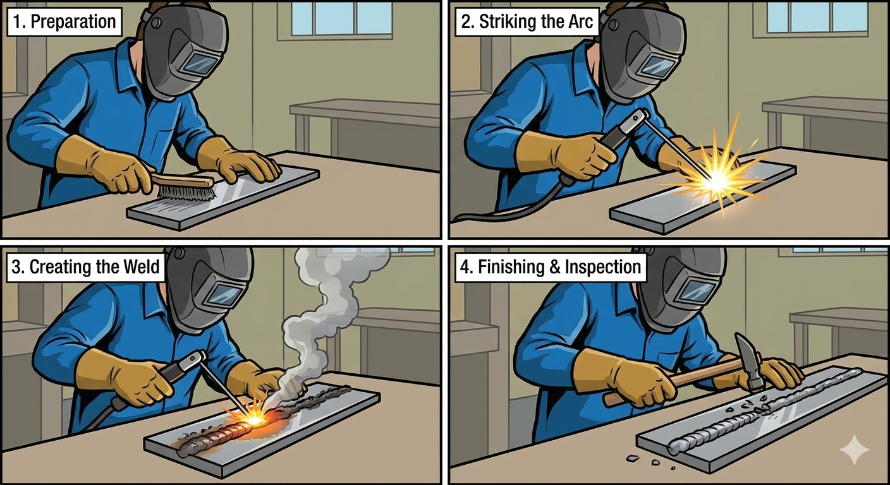
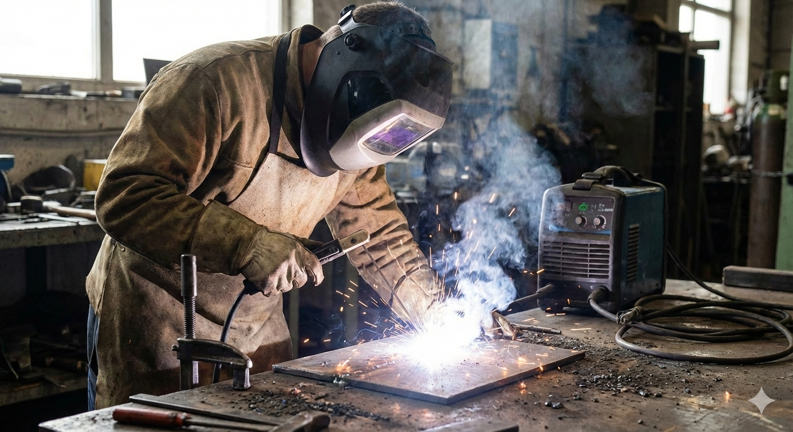
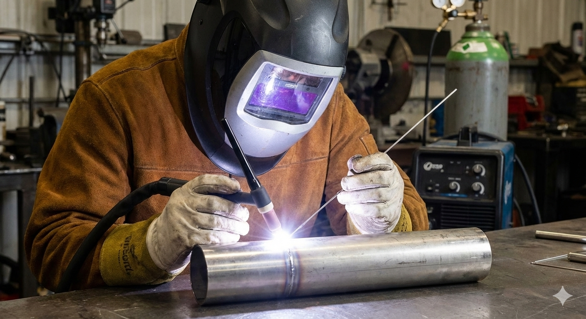
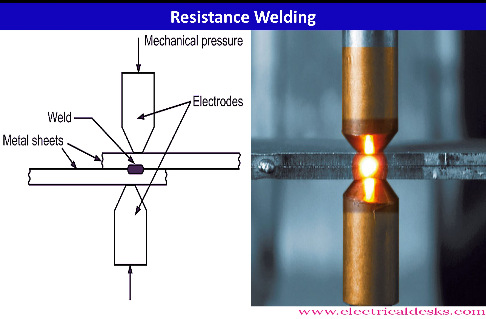

## Design for Joining {#chap-joining}

```{r setup-02, include=FALSE}
## include the helpers.R file for pdf output of youtube on pdfs as a clickable link
source("R/helpers.R")
## include the required packages to make sure the page can be built.
source("R/required_packages.R")
```

### Learning Objectives {#sec-objectives-02}

By the end of this chapter, you will be able to:

1. **Classify** joining methods by their bonding mechanism (fusion, filler, mechanical)
2. **Explain** the principles and applications of welding, brazing, and soldering
3. **Identify** appropriate joining methods for different material combinations and applications
4. **Compare** the advantages and limitations of permanent vs. non-permanent joining methods
5. **Evaluate** when to choose welding over mechanical fastening or adhesive bonding

::: {.callout-think}
**Before You Read:** Consider the products around you—your phone, car, furniture, and buildings. Each is made of multiple parts joined together. What different methods might have been used to join these parts, and why might engineers have chosen those particular methods?
:::

### Joining Processes: Uniting Materials for Function {#sec-joining-intro}

#### Introduction {#sec-joining-overview}

The ability to permanently or temporarily unite two or more separate material components is fundamental to nearly every branch of engineering and manufacturing. Whether creating the fuselage of an aircraft, the circuitry of a smartphone, or the frame of a bicycle, **joining processes** are essential for assembling parts into functional products. 

Joining processes can be broadly categorized based on the method used to create the bond: those that use **heat and fusion** (welding), those that use **fillers** (brazing and soldering), those that use **chemical agents** (adhesives), and those that rely on **mechanical force** (fasteners). The selection of the appropriate joining method is a critical design decision, dictated by the materials being joined, the required strength, the operating environment (e.g., temperature, corrosion), and cost considerations.

---

#### Classification of Joining Methods

Joining techniques are typically classified into three main groups based on how the bond is established:

##### Fusion and Cohesion

These processes create a continuous, strong bond by achieving atomic or molecular cohesion between the joined parts, often involving melting the base materials.

* **Welding:** This is a permanent joining process that involves heating the base metal parts to their melting point and allowing them to fuse together, often with the addition of a filler metal. Welding creates a joint that can be as strong, or even stronger, than the parent material itself. It is widely used in heavy industries like construction, shipbuilding, and pipe fabrication.

##### Chemical/Metallurgical Bonding with Fillers

These processes use a separate material (a filler) to create the bond between two materials without melting the base materials.

* **Brazing:** A joining process where a non-ferrous filler metal is melted and drawn into the joint gap by capillary action. The filler metal has a melting point **above $450^\circ\text{C}$ ($840^\circ\text{F}$)**, but below the melting point of the base metals. Brazing creates strong, leak-tight joints with minimal thermal distortion to the base parts.
* **Soldering:** Similar to brazing, soldering uses a filler metal (solder) that melts at a temperature **below $450^\circ\text{C}$ ($840^\circ\text{F}$)**. This process is primarily used in electronics and sheet metal work where strong mechanical bonds are less critical than electrical conductivity or a leak-proof seal.

##### Mechanical and Chemical Adhesion

These methods rely on either a sticky substance or physical interlocking to hold parts together.

* **Adhesive Joining:** This method uses chemical compounds (adhesives, glues, epoxies) that cure to form a chemical bond between the surfaces. Adhesives can join dissimilar materials (like metal to plastic), distribute stress over a wide area, and provide excellent sealing.
* **Mechanical Fasteners:** These are non-permanent methods that use hardware to hold materials together. This category includes common items like **bolts, screws, rivets, nuts, pins, and clips**. The primary advantage of mechanical fasteners is that they allow for easy disassembly and reassembly for maintenance or repair.

### The Welding Process {#sec-welding-process}

#### Introduction to Welding

Welding is a **fusion joining process** that creates a permanent, monolithic bond between two or more separate metal parts. Unlike brazing or soldering, welding typically involves heating the base metal parts to their melting temperature and allowing them to fuse together, often with the addition of a **filler material** 

```{r, echo=FALSE, out.width="50%", fig.align="center", fig.cap="Welding"}

```

The primary goal of welding is to create a joint that is as strong as, or even stronger than, the original parent materials. This makes it an indispensable process in heavy fabrication and structural engineering, including the construction of ships, bridges, pipelines, and pressure vessels.

How is it possible that a weld is stronger than the original parent materials?

---

#### Classification and Types of Welding Processes

Welding processes are broadly classified based on the source of energy used to achieve the necessary heat for fusion. The three major categories are:

##### Arc Welding

Arc welding is the most common category, utilizing an electrical arc to generate the heat required to melt the metals. A power source creates an arc between an electrode and the base metal, generating temperatures high enough to melt both.

* **Shielded Metal Arc Welding (SMAW or Stick Welding):** Uses a consumable electrode coated with flux. The flux vaporizes during welding, creating a protective gas shield and slag, which prevents atmospheric contamination of the molten weld pool. It is highly versatile and used widely for structural steel. 

```{r, echo=FALSE, out.width="50%", fig.align="center", fig.cap="Shielded Metal Arc Welding (SMAW)"}

```

* **Gas Metal Arc Welding (GMAW or MIG Welding):** Uses a continuous, consumable wire electrode fed through a welding gun, while an externally supplied shielding gas (e.g., Argon, $\text{CO}_2$) protects the arc and weld pool. It is known for its speed and suitability for automated systems. 
* **Gas Tungsten Arc Welding (GTAW or TIG Welding):** Uses a non-consumable tungsten electrode and an inert shielding gas (usually Argon). It typically requires a separate filler rod. TIG welding produces the highest quality welds, often used for critical applications and joining thin metals or reactive metals like aluminum and titanium. 

```{r, echo=FALSE, out.width="50%", fig.align="center", fig.cap="Gas Tungsten Arc Welding (GATW)"}

```


##### Resistance Welding

Resistance welding uses the heat generated by the electrical resistance of the materials themselves when a current is passed through them under pressure.

* **Spot Welding:** The most common resistance method. It uses two electrodes to clamp sheets of metal together. A high current is passed through, locally heating and fusing the metal at a small "spot." It is widely used in the automotive industry for joining body panels.

```{r, echo=FALSE, out.width="50%", fig.align="center", fig.cap="Spot Welding"}

```

##### High-Energy Beam Welding

These advanced processes use highly concentrated energy sources for deep, narrow, and precise welds.

* **Laser Beam Welding (LBW):** Uses a focused beam of coherent light (laser) to heat and fuse the materials. It is excellent for high-speed, precise welding in mass production.
* **Electron Beam Welding (EBW):** Uses a beam of high-velocity electrons to provide the heat source. This process requires a vacuum chamber, but produces extremely high-quality welds with very low heat input, ideal for aerospace and nuclear components.

---

#### When to Choose Welding

Welding is not always the best solution, but it is the superior choice over other joining processes like mechanical fastening, brazing, or adhesives in several key scenarios:

1.  **Requirement for Monolithic Strength:**
    * **Permanent Joint:** Welding creates a permanent, continuous metallurgical bond, effectively making the joint an integral part of the structure.
    * **High Load/Stress:** For applications subjected to high dynamic or static loads (e.g., bridge structures, pressure vessels, vehicle chassis), the strength and rigidity offered by a fully fused weld joint are unmatched by mechanical fasteners or adhesives.

2.  **Structural Integrity and Sealing:**
    * **Leak-Proof Seals:** Welding is essential for creating completely leak-proof joints, which is critical for containers, tanks, and pipelines holding liquids or gases under pressure.
    * **Weight Reduction:** By eliminating overlapping flanges or bolted plates, welding can often result in lighter overall structures compared to mechanical fastening.

3.  **Specific Material and Geometry Requirements:**
    * **Thick Sections:** Welding is highly effective for joining very thick metal plates, where fasteners would be impractical or structurally insufficient.
    * **Material Compatibility:** While welding *can* join dissimilar metals, it is best suited for scenarios where the material properties of the filler metal can be carefully matched to the base metals to maintain structural and chemical properties.

##### Comparison to Other Processes:

| Process | Primary Advantage Over Welding | Why Welding is Chosen Instead |
| :--- | :--- | :--- |
| **Mechanical Fasteners** | Allows for **disassembly** and repair. | When a joint must be **permanent** and transmit **structural forces** without the risk of loosening under vibration. |
| **Brazing / Soldering** | Lower heat input prevents distortion/damage to base metal. | When the joint needs the **full strength** of the parent metal, and the service temperature exceeds the filler metal's melting point. |
| **Adhesive Bonding** | Joins dissimilar materials; distributes stress over a wide area. | When high strength is required in **high-temperature environments** where most adhesives would degrade, or when a **rapidly cured joint** is necessary. |

::: {.callout-industry}
**Automotive Application:** Modern vehicle bodies use a combination of joining methods. The body-in-white (unpainted body structure) typically uses over 4,000 spot welds, supplemented by structural adhesives at critical joints and mechanical fasteners for panels that may need replacement.
:::

---

### Brazing and Soldering {#sec-brazing-soldering}

Both brazing and soldering use a filler metal to join parts without melting the base materials. The key difference is the filler metal's melting temperature.

#### Brazing

**Brazing** uses filler metals that melt above 450°C (840°F). The process relies on **capillary action** to draw the molten filler into the joint gap.

```{r fig-brazing-process, echo=FALSE, fig.cap="Capillary action draws brazing filler metal into the joint gap.", fig.align='center', fig.width=8, fig.height=5}
library(ggplot2)

ggplot() +
  # Base parts
  geom_rect(aes(xmin = 1, xmax = 4, ymin = 2, ymax = 3), fill = "steelblue", color = "black", linewidth = 1) +
  geom_rect(aes(xmin = 1, xmax = 4, ymin = 3.1, ymax = 4.1), fill = "steelblue", color = "black", linewidth = 1) +

  # Gap (exaggerated for visibility)
  geom_rect(aes(xmin = 1, xmax = 3.5, ymin = 3, ymax = 3.1), fill = "darkorange", color = "darkorange") +

  # Filler metal source
  geom_polygon(aes(x = c(3.5, 4.2, 4.2), y = c(3.05, 2.5, 3.6)), fill = "darkorange", color = "black") +

  # Labels
  annotate("text", x = 2.5, y = 2.5, label = "Base Metal", color = "white", fontface = "bold") +
  annotate("text", x = 2.5, y = 3.6, label = "Base Metal", color = "white", fontface = "bold") +
  annotate("text", x = 4.8, y = 3.05, label = "Filler Metal\n(Brazing Alloy)", size = 3.5 * diagram_text_scale) +
  annotate("text", x = 2.25, y = 3.05, label = "Capillary Flow", color = "darkorange", size = 3 * diagram_text_scale, fontface = "italic") +

  # Flow arrows
  geom_segment(aes(x = 3.3, xend = 2, y = 3.05, yend = 3.05),
               arrow = arrow(length = unit(0.15, "cm")), color = "red", linewidth = 1) +

  # Gap dimension
  geom_segment(aes(x = 0.5, xend = 0.5, y = 3, yend = 3.1),
               arrow = arrow(length = unit(0.1, "cm"), ends = "both"), linewidth = 0.5) +
  annotate("text", x = 0.2, y = 3.05, label = "Gap\n0.05-0.15mm", size = 2.5 * diagram_text_scale) +

  coord_fixed(ratio = 1, xlim = c(-0.5, 6), ylim = c(1.5, 4.5)) +
  theme_void() +
  labs(title = "Brazing: Capillary Action Fills the Joint") +
  theme(plot.title = element_text(hjust = 0.5, face = "bold", size = 12 * chart_text_scale))
```

**Key Brazing Parameters:**

- **Joint clearance:** 0.05–0.15 mm for optimal capillary action
- **Common filler metals:** Silver alloys, copper-phosphorus, nickel alloys
- **Flux:** Required to remove oxides and promote wetting (unless using a controlled atmosphere)

**Applications:** HVAC systems (copper tubing), bicycle frames, carbide tool tips, heat exchangers

#### Soldering

**Soldering** uses filler metals that melt below 450°C (840°F). It creates joints with lower mechanical strength but excellent electrical conductivity.

**Common Solder Alloys:**

| Alloy | Melting Point | Application |
|:------|:--------------|:------------|
| Sn63/Pb37 | 183°C | Traditional electronics (leaded) |
| SAC305 (Sn96.5/Ag3/Cu0.5) | 217-220°C | Lead-free electronics |
| Sn/Pb/Ag | 179°C | Plumbing, high-reliability electronics |

::: {.callout-check}
**Quick Check:** A joint will operate at 300°C. Should you use brazing or soldering? Why?
:::

---

### Adhesive Bonding {#sec-adhesive-bonding}

Adhesive bonding uses chemical compounds that cure to form a bond between surfaces. Modern structural adhesives can achieve remarkable strength while offering unique advantages.

#### Advantages of Adhesive Bonding

- **Joins dissimilar materials** (metal to plastic, glass to composite)
- **Distributes stress** over large areas (no stress concentration at holes)
- **Seals and bonds** simultaneously
- **Minimal thermal distortion** (no heat required for many adhesives)
- **Electrical and thermal insulation** between parts

#### Limitations

- **Surface preparation** is critical (cleaning, roughening, priming)
- **Cure time** can be long (minutes to hours)
- **Temperature limitations** (most degrade above 150-200°C)
- **Difficult to inspect** non-destructively
- **Limited peel and cleavage strength** compared to tensile shear

#### Common Structural Adhesive Types

| Type | Cure Mechanism | Typical Applications |
|:-----|:---------------|:---------------------|
| **Epoxy** | Two-part chemical reaction | Aerospace structures, automotive bonding |
| **Acrylic** | Two-part or anaerobic | Metal bonding, threadlocking |
| **Polyurethane** | Moisture or two-part | Automotive glass, flexible joints |
| **Cyanoacrylate** | Moisture (instant) | Small parts, rapid assembly |

::: {.callout-industry}
**Aerospace Application:** The Boeing 787 Dreamliner uses structural adhesives extensively to bond composite panels, reducing weight and improving fatigue resistance compared to mechanical fasteners alone.
:::

---

### Mechanical Fastening {#sec-mechanical-fastening}

Mechanical fasteners provide non-permanent joining that allows for disassembly. For detailed coverage of bolted joints, see Chapter @sec-chap-03-bolts.

#### Categories of Mechanical Fasteners

```{r fig-fastener-types, echo=FALSE, fig.cap="Categories of mechanical fasteners and their characteristics.", fig.align='center', fig.width=10, fig.height=5}
library(ggplot2)

fasteners <- data.frame(
  type = c("Bolts/Screws", "Rivets", "Pins", "Clips/Retainers"),
  removable = c(10, 2, 8, 7),
  strength = c(9, 8, 6, 4),
  cost = c(5, 7, 8, 9)
)

library(tidyr)
fasteners_long <- pivot_longer(fasteners, cols = c(removable, strength, cost),
                                names_to = "attribute", values_to = "value")

ggplot(fasteners_long, aes(x = type, y = value, fill = attribute)) +
  geom_col(position = "dodge", width = 0.7) +
  scale_fill_manual(values = c("removable" = "steelblue", "strength" = "coral", "cost" = "forestgreen"),
                    labels = c("Cost Effectiveness", "Removability", "Strength")) +
  labs(
    title = "Fastener Comparison",
    x = "Fastener Type",
    y = "Rating (1-10)",
    fill = "Attribute"
  ) +
  theme_minimal() +
  theme(
    plot.title = element_text(hjust = 0.5, face = "bold"),
    axis.text.x = element_text(angle = 15, hjust = 1)
  )
```

::: {.callout-think}
**Design Decision:** You need to join aluminum panels on an aircraft. The joint must be inspectable, repairable, and resist fatigue loading. Would you choose adhesive bonding, riveting, or a combination? Justify your choice.
:::

---

### Joining Process Selection Guide {#sec-joining-selection}

Selecting the right joining process requires considering multiple factors:

```{r fig-joining-selection, echo=FALSE, fig.cap="Decision factors for joining process selection.", fig.align='center', fig.width=10, fig.height=6}
library(ggplot2)

# Create comparison matrix
processes <- c("Welding", "Brazing", "Soldering", "Adhesive", "Bolts", "Rivets")
criteria <- c("Permanent", "High Temp", "Dissimilar\nMaterials", "Thin Sheet", "Removable", "Low Cost")

# Score matrix (1-5)
scores <- matrix(c(
  5, 5, 2, 3, 1, 3,  # Welding
  4, 4, 3, 4, 1, 4,  # Brazing
  3, 1, 3, 5, 1, 5,  # Soldering
  4, 1, 5, 5, 1, 4,  # Adhesive
  2, 5, 4, 2, 5, 3,  # Bolts
  5, 4, 3, 4, 2, 4   # Rivets
), nrow = 6, byrow = TRUE)

# Create data frame
selection_data <- expand.grid(Process = processes, Criterion = criteria)
selection_data$Score <- as.vector(t(scores))

ggplot(selection_data, aes(x = Criterion, y = Process, fill = Score)) +
  geom_tile(color = "white", linewidth = 0.5) +
  geom_text(aes(label = Score), color = "white", fontface = "bold", size = 4 * diagram_text_scale) +
  scale_fill_gradient(low = "coral", high = "forestgreen", limits = c(1, 5)) +
  labs(
    title = "Joining Process Selection Matrix",
    subtitle = "Scores: 1 (Poor) to 5 (Excellent)",
    x = "",
    y = "",
    fill = "Score"
  ) +
  theme_minimal() +
  theme(
    plot.title = element_text(hjust = 0.5, face = "bold"),
    plot.subtitle = element_text(hjust = 0.5),
    axis.text.x = element_text(angle = 45, hjust = 1),
    panel.grid = element_blank()
  )
```

---

### Try it yourself {#sec-joining-tryit}

#### Weight the selection matrix {#sec-tryit-joining-matrix}

The selection matrix above scores each process from 1 (poor) to 5 (excellent). A designer needs a joint on a machine guard that must be **removable**, will see some heat, and must be cheap. The weights are: high temperature $0.20$, dissimilar materials $0.20$, removable $0.40$, low cost $0.20$.

```{r tryit-joining-grid, echo=FALSE, results='asis'}
jm <- data.frame(
  `Process` = c("Welding", "Brazing", "Soldering", "Adhesive", "Bolts", "Rivets"),
  `High temp` = c(5, 4, 1, 1, 5, 4),
  `Dissimilar materials` = c(2, 3, 3, 5, 4, 3),
  `Removable` = c(1, 1, 1, 1, 5, 2),
  `Low cost` = c(3, 4, 5, 4, 3, 4),
  check.names = FALSE
)
w <- c(0.20, 0.20, 0.40, 0.20)
jm[["Weighted score"]] <- as.matrix(jm[, 2:5]) %*% w
jm_best <- max(jm[["Weighted score"]])

tryit_grid(
  id = "joining-matrix",
  title = "Weighted score of each joining process",
  data = jm,
  blank = "Weighted score",
  tol = c(`Weighted score` = 0.02),
  hints = c(`Weighted score` = "Multiply each score by its weight (0.20, 0.20, 0.40, 0.20) and add the four products."),
  digits = 0,
  answers = list(
    tryit_answer("Highest weighted score", jm_best, tol = 0.02, hint = "Which process wins when removability carries the largest weight?")
  ),
  intro = "Give each score to two decimals.",
  question = paste0(
    "<p>Using the chapter's joining process selection matrix (scores 1 to 5): welding (high temp 5, dissimilar 2, removable 1, low cost 3), ",
    "brazing (4, 3, 1, 4), soldering (1, 3, 1, 5), adhesive (1, 5, 1, 4), bolts (5, 4, 5, 3), rivets (4, 3, 2, 4). ",
    "The weights are high temperature 0.20, dissimilar materials 0.20, removable 0.40 and low cost 0.20. ",
    "Weighted score = sum of weight x score. Find the weighted score of each process and the highest.</p>")
)
```

<details class="tryit-solution">
<summary>Show the worked solution</summary>

```{r tryit-joining-solution, echo=FALSE}
knitr::kable(jm, digits = c(0, 0, 0, 0, 0, 2), align = "c")
```

Bolts win (`r sprintf("%.2f", jm_best)`) because the removable criterion carries 40% of the weight and bolts are the only process that scores well on it. Change the weights toward "permanent" and the answer would flip: the matrix is a tool for making the priorities explicit, not a lookup of one right answer.

</details>

#### Welding or bolting: where does the cost cross? {#sec-tryit-joining-cost}

A bracket has 4 joints. **Welding** needs a jig costing \$1800 and then \$1.10 per joint. **Bolting** needs no jig; each joint costs \$0.45 of labor plus \$1.35 of hardware.

```{r tryit-joining-cost-number, echo=FALSE, results='asis'}
jc <- list(jig = 1800, weld = 1.10, bolt = 0.45 + 1.35, joints = 4, n = 2000)
jc$weld_each <- jc$weld * jc$joints
jc$bolt_each <- jc$bolt * jc$joints
jc$n_star    <- jc$jig / (jc$bolt_each - jc$weld_each)
jc$weld_n    <- jc$jig + jc$weld_each * jc$n
jc$bolt_n    <- jc$bolt_each * jc$n

tryit_number(
  id = "joining-cost",
  title = "Cost per bracket and break-even volume",
  answers = list(
    tryit_answer("Variable cost per welded bracket", jc$weld_each, tol = 0.01, prefix = "$",
                 hint = "4 joints x $1.10."),
    tryit_answer("Cost per bolted bracket", jc$bolt_each, tol = 0.01, prefix = "$",
                 hint = "4 joints x ($0.45 + $1.35)."),
    tryit_answer("Break-even number of brackets", jc$n_star, tol = 1, suffix = "brackets",
                 hint = "Jig cost divided by the saving per bracket."),
    tryit_answer("Total cost of 2000 welded brackets", jc$weld_n, tol = 1, prefix = "$",
                 hint = "Jig plus 2000 x the welded cost per bracket."),
    tryit_answer("Total cost of 2000 bolted brackets", jc$bolt_n, tol = 1, prefix = "$",
                 hint = "2000 x the bolted cost per bracket.")
  ),
  intro = "Then decide: above which volume does welding win, and what does it give up?",
  question = paste0(
    "<p>A bracket has 4 joints. Welding needs a jig costing $1800 and then $1.10 per joint. Bolting needs no jig; each joint costs $0.45 ",
    "of labor and $1.35 of hardware. Find the variable cost per bracket for each method, the number of brackets at which the total costs are equal, ",
    "and the total cost of 2000 brackets by each method.</p>")
)
```

<details class="tryit-solution">
<summary>Show the worked solution</summary>

Welded: $4 \times 1.10 = \$`r sprintf("%.2f", jc$weld_each)`$ per bracket; bolted: $4 \times 1.80 = \$`r sprintf("%.2f", jc$bolt_each)`$.

Break-even: $1800 / (`r sprintf("%.2f", jc$bolt_each)` - `r sprintf("%.2f", jc$weld_each)`) = `r sprintf("%.0f", jc$n_star)`$ brackets. At 2000 brackets, welding costs \$`r format(jc$weld_n, big.mark = ",")` and bolting \$`r format(jc$bolt_n, big.mark = ",")`: a saving of \$`r format(jc$bolt_n - jc$weld_n, big.mark = ",")` for welding. Below the break-even volume bolting is cheaper, and bolted joints can also be taken apart.

</details>

#### Pick the joining method {#sec-tryit-joining-sort}

```{r tryit-joining-sort, echo=FALSE, results='asis'}
tryit_sort(
  id = "joining-methods",
  title = "Which joining method fits?",
  bins = c("Welding", "Brazing", "Soldering", "Adhesive bonding", "Mechanical fasteners"),
  cards = data.frame(
    text = c(
      "Seams of a pressurized tank that must be leak-proof and carry high loads",
      "Surface-mount components on a heat-sensitive circuit board",
      "A service panel that must come off for maintenance",
      "Joining a thin aluminum sheet to a plastic panel, spreading the stress over a wide area",
      "A joint of dissimilar metals using a filler that melts above 450 degrees C without melting the base metals",
      "A pipeline needing the full strength of the parent metal at high service temperature",
      "An electrical connection made with a filler that melts below 450 degrees C",
      "A structure that may need repair by disassembly and must not loosen under vibration"
    ),
    bin = c("Welding", "Soldering", "Mechanical fasteners", "Adhesive bonding", "Brazing", "Welding", "Soldering", "Mechanical fasteners"),
    why = c(
      "Welding gives leak-proof, monolithic strength.",
      "Soldering uses low temperature that protects components.",
      "Fasteners allow disassembly.",
      "Adhesives join dissimilar materials and distribute stress.",
      "Above 450 degrees C it is brazing, below it soldering.",
      "Welding keeps full strength where adhesives and solders would degrade.",
      "Below 450 degrees C the process is soldering.",
      "Fasteners can be removed and, with locking features, resist loosening."
    )
  ),
  intro = "The 450 degrees C boundary separates brazing from soldering.",
  question = "<p>Match each requirement to the joining method that suits it: welding, brazing, soldering, adhesive bonding or mechanical fasteners.</p>"
)
```

### Practice Problems {#sec-joining-practice}

::: {.question}
**Problem 1:** A food processing plant needs to join stainless steel pipes carrying hot (90°C) acidic liquids. The joints must be leak-proof and cleanable. Which joining method would you recommend?
:::

::: {.answer}
**Recommendation: Welding (TIG/GTAW)**

**Reasoning:**

- Creates smooth, crevice-free joints for hygiene
- Provides leak-proof seal for liquid containment
- Stainless steel is readily weldable with proper technique
- Service temperature (90°C) is well within weld capability
- No filler metals or adhesives that could contaminate product

Orbital TIG welding would be ideal for consistent, high-quality pipe joints.
:::

::: {.question}
**Problem 2:** An electronics manufacturer needs to attach small surface-mount components to a PCB. Components are heat-sensitive. What joining method should be used?
:::

::: {.answer}
**Recommendation: Soldering (Reflow)**

**Reasoning:**

- Low temperature (< 250°C peak) protects heat-sensitive components
- Provides excellent electrical conductivity
- Industry-standard process for PCB assembly
- Can be automated for high-volume production
- Lead-free solder (SAC305) meets environmental regulations
:::

::: {.question}
**Problem 3:** Compare the total cost of joining 1000 brackets using (a) welding and (b) bolted connections. Each bracket requires 4 joints. Welding costs $2 per joint but requires no additional hardware. Bolting costs $0.50 per joint in labor but requires $1.50 in hardware per joint.
:::

::: {.answer}
**Welding:**

- Cost per bracket: 4 joints × $2/joint = $8
- Total cost: 1000 × $8 = **$8,000**

**Bolting:**

- Labor per bracket: 4 joints × $0.50/joint = $2
- Hardware per bracket: 4 joints × $1.50/joint = $6
- Cost per bracket: $2 + $6 = $8
- Total cost: 1000 × $8 = **$8,000**

**Analysis:** In this case, the costs are equal. However, welding provides a permanent joint with no risk of loosening, while bolting allows for future disassembly. The choice depends on whether the brackets will ever need to be removed.
:::

---

### Key Takeaways {#sec-joining-takeaways}

1. **Process classification:** Joining methods are classified by bonding mechanism—fusion (welding), filler metals (brazing/soldering), adhesion (adhesives), or mechanical (fasteners).

2. **Temperature threshold:** The 450°C boundary distinguishes brazing (above) from soldering (below), affecting joint strength and service temperature.

3. **No universal solution:** Each joining method has strengths and limitations. The best choice depends on materials, strength requirements, operating conditions, and cost.

4. **Combination approaches:** Modern designs often combine multiple joining methods (e.g., weld-bonding, rivet-bonding) to leverage the advantages of each.

5. **Design integration:** Consider joining requirements early in the design process. Joint accessibility, material selection, and production volume all influence process selection.

---

### Further Resources {#sec-joining-resources}

**Videos:**
```{r video-welding-basics, echo=FALSE, results='asis'}
embed_youtube("2CIcvB72dmk", "Welding Process Overview")
```

**Reading:**

- AWS D1.1 Structural Welding Code - Steel
- ASM Handbook Volume 6: Welding, Brazing, and Soldering
- Adhesive Bonding of Aluminum Alloys (EAA/AA)