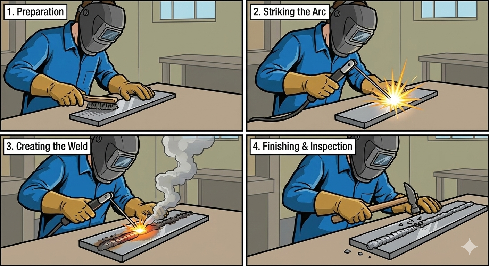
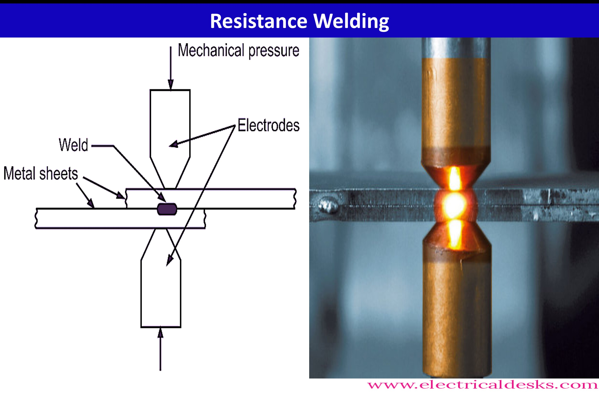

# Design for Welding {#chap-welding}

```{r setup-06, include=FALSE}
## include the helpers.R file for pdf output of youtube on pdfs as a clickable link
source("R/helpers.R")
## drawing primitives for the welding-symbol figures below
source("R/weld_draw.R")
## include the required packages to make sure the page can be built.
source("R/required_packages.R")

## Set a consistent theme for all plots
theme_welding <- theme_minimal() +
  theme(
    plot.title = element_text(hjust = 0.5, size = 12 * chart_text_scale, face = "bold"),
    plot.subtitle = element_text(hjust = 0.5, size = 10 * chart_text_scale),
    axis.text = element_blank(),
    axis.title = element_blank(),
    axis.ticks = element_blank(),
    panel.grid = element_blank(),
    plot.background = element_rect(fill = "white", color = NA),
    panel.background = element_rect(fill = "white", color = NA)
  )
```

## Learning Objectives {#sec-objectives-06}

By the end of this chapter, you will be able to:

1. **Identify** the key components and zones of a fusion weld
2. **Select** appropriate weld joint types and weld types for different applications
3. **Apply** weld sizing principles for fillet and groove welds
4. **Calculate** fillet weld strength and required weld sizes
5. **Implement** design guidelines to minimize distortion and improve weld quality

::: {.callout-think}
**Before You Read:** Consider a bicycle frame, a ship's hull, and a skyscraper's steel structure. What do they all have in common? They all rely heavily on welded connections. Why do you think welding was chosen over bolting or riveting for these applications?
:::

## Introduction to Design for Welding {#sec-welding-intro}

Welding is the most widely used method for permanently joining metals in structural, mechanical, and industrial applications. Unlike mechanical fastening, welding creates a **metallurgical bond** between components, resulting in joints that can be as strong as—or stronger than—the base materials themselves.

Designing for welding requires careful consideration of joint geometry, material selection, thermal effects, and accessibility. A well-designed weldment minimizes fabrication costs, ensures structural integrity, and reduces the likelihood of defects.

---

## Welding Processes and When to Use Them {#sec-welding-process}

### Welding as a Fusion Process

Unlike brazing or soldering, welding heats the base metal parts to their melting temperature so they fuse together, often with the addition of a **filler material**.

```{r, echo=FALSE, out.width="50%", fig.align="center", fig.cap="Welding"}

```

This makes welding indispensable in heavy fabrication and structural engineering, including ships, bridges, pipelines, and pressure vessels.

How is it possible that a weld is stronger than the original parent materials?

---

### Classification and Types of Welding Processes

Welding processes are broadly classified based on the source of energy used to achieve the necessary heat for fusion. The three major categories are:

#### Arc Welding

Arc welding is the most common category, utilizing an electrical arc to generate the heat required to melt the metals. A power source creates an arc between an electrode and the base metal, generating temperatures high enough to melt both.

* **Shielded Metal Arc Welding (SMAW or Stick Welding):** Uses a consumable electrode coated with flux. The flux vaporizes during welding, creating a protective gas shield and slag, which prevents atmospheric contamination of the molten weld pool. It is highly versatile and used widely for structural steel. 

```{r, echo=FALSE, out.width="50%", fig.align="center", fig.cap="Shielded Metal Arc Welding (SMAW)"}

```

* **Gas Metal Arc Welding (GMAW or MIG Welding):** Uses a continuous, consumable wire electrode fed through a welding gun, while an externally supplied shielding gas (e.g., Argon, $\text{CO}_2$) protects the arc and weld pool. It is known for its speed and suitability for automated systems. 
* **Gas Tungsten Arc Welding (GTAW or TIG Welding):** Uses a non-consumable tungsten electrode and an inert shielding gas (usually Argon). It typically requires a separate filler rod. TIG welding produces the highest quality welds, often used for critical applications and joining thin metals or reactive metals like aluminum and titanium. 

```{r, echo=FALSE, out.width="50%", fig.align="center", fig.cap="Gas Tungsten Arc Welding (GTAW)"}

```


#### Resistance Welding

Resistance welding uses the heat generated by the electrical resistance of the materials themselves when a current is passed through them under pressure.

* **Spot Welding:** The most common resistance method. It uses two electrodes to clamp sheets of metal together. A high current is passed through, locally heating and fusing the metal at a small "spot." It is widely used in the automotive industry for joining body panels.

```{r, echo=FALSE, out.width="50%", fig.align="center", fig.cap="Spot Welding"}

```

#### High-Energy Beam Welding

These advanced processes use highly concentrated energy sources for deep, narrow, and precise welds.

* **Laser Beam Welding (LBW):** Uses a focused beam of coherent light (laser) to heat and fuse the materials. It is excellent for high-speed, precise welding in mass production.
* **Electron Beam Welding (EBW):** Uses a beam of high-velocity electrons to provide the heat source. This process requires a vacuum chamber, but produces extremely high-quality welds with very low heat input, ideal for aerospace and nuclear components.

---

### When to Choose Welding

Welding is not always the best solution, but it is the superior choice over other joining processes like mechanical fastening, brazing, or adhesives in several key scenarios:

1.  **Requirement for Monolithic Strength:**
    * **Permanent Joint:** Welding creates a permanent, continuous metallurgical bond, effectively making the joint an integral part of the structure.
    * **High Load/Stress:** For applications subjected to high dynamic or static loads (e.g., bridge structures, pressure vessels, vehicle chassis), the strength and rigidity offered by a fully fused weld joint are unmatched by mechanical fasteners or adhesives.

2.  **Structural Integrity and Sealing:**
    * **Leak-Proof Seals:** Welding is essential for creating completely leak-proof joints, which is critical for containers, tanks, and pipelines holding liquids or gases under pressure.
    * **Weight Reduction:** By eliminating overlapping flanges or bolted plates, welding can often result in lighter overall structures compared to mechanical fastening.

3.  **Specific Material and Geometry Requirements:**
    * **Thick Sections:** Welding is highly effective for joining very thick metal plates, where fasteners would be impractical or structurally insufficient.
    * **Material Compatibility:** While welding *can* join dissimilar metals, it is best suited for scenarios where the material properties of the filler metal can be carefully matched to the base metals to maintain structural and chemical properties.

#### Comparison to Other Processes:

| Process | Primary Advantage Over Welding | Why Welding is Chosen Instead |
| :--- | :--- | :--- |
| **Mechanical Fasteners** | Allows for **disassembly** and repair. | When a joint must be **permanent** and transmit **structural forces** without the risk of loosening under vibration. |
| **Brazing / Soldering** | Lower heat input prevents distortion/damage to base metal. | When the joint needs the **full strength** of the parent metal, and the service temperature exceeds the filler metal's melting point. |
| **Adhesive Bonding** | Joins dissimilar materials; distributes stress over a wide area. | When high strength is required in **high-temperature environments** where most adhesives would degrade, or when a **rapidly cured joint** is necessary. |


---

## The Welding Process Fundamentals {#sec-welding-fundamentals}

Welding joins materials by applying **heat**, **pressure**, or both, with or without filler material. The most common welding processes use heat to melt the base metals at the joint interface.

### Key Welding Terminology

```{r welding-terminology, echo=FALSE, fig.width=10, fig.height=6, fig.align='center', fig.cap="Cross-section of a typical fusion weld showing key zones and terminology."}
## Single-V butt weld: plates, HAZ band outside the fusion line, weld metal with cap and root reinforcement
cap_x  <- seq(3.5, 6.5, length.out = 40)
cap_y  <- 3 + 0.45 * (1 - ((cap_x - 5) / 1.5)^2)
root_x <- seq(5.3, 4.7, length.out = 20)
root_y <- -0.3 * (1 - ((root_x - 5) / 0.3)^2)
weld_df <- data.frame(x = c(4.7, cap_x, 5.3, root_x), y = c(0, cap_y, 0, root_y))

ggplot() +
  ## Base metal (both plates)
  geom_rect(aes(xmin = 0, xmax = 10, ymin = 0, ymax = 3), fill = "steelblue", color = "black", linewidth = 1) +

  ## Heat Affected Zone (HAZ): band just outside the fusion line on each side
  geom_polygon(aes(x = c(4.0, 2.8, 3.5, 4.7), y = c(0, 3, 3, 0)), fill = "lightblue", color = "black", linewidth = 0.5) +
  geom_polygon(aes(x = c(6.0, 7.2, 6.5, 5.3), y = c(0, 3, 3, 0)), fill = "lightblue", color = "black", linewidth = 0.5) +

  ## Weld metal (fusion zone) incl. face reinforcement and root reinforcement
  geom_polygon(data = weld_df, aes(x = x, y = y), fill = "orange", color = "black", linewidth = 1) +

  ## Original plate surfaces (reinforcement is the metal outside these lines)
  geom_segment(aes(x = 3.5, xend = 6.5, y = 3, yend = 3), linetype = "dotted", color = "gray30") +
  geom_segment(aes(x = 4.7, xend = 5.3, y = 0, yend = 0), linetype = "dotted", color = "gray30") +

  ## Fusion lines (weld metal / HAZ boundary)
  geom_segment(aes(x = 4.7, xend = 3.5, y = 0, yend = 3), linetype = "dashed", color = "darkred", linewidth = 1) +
  geom_segment(aes(x = 5.3, xend = 6.5, y = 0, yend = 3), linetype = "dashed", color = "darkred", linewidth = 1) +

  ## Base metal labels
  annotate("text", x = 1.4, y = 1.5, label = "Base\nMetal", color = "white", fontface = "bold", size = 4 * diagram_text_scale) +
  annotate("text", x = 8.6, y = 1.5, label = "Base\nMetal", color = "white", fontface = "bold", size = 4 * diagram_text_scale) +

  ## HAZ label
  geom_segment(aes(x = 2.0, xend = 3.5, y = 4.6, yend = 2.0),
               arrow = arrow(length = unit(0.15, "cm")), color = "blue") +
  annotate("text", x = 1.7, y = 5.0, label = "Heat Affected\nZone (HAZ)", color = "blue", size = 3.5 * diagram_text_scale) +

  ## Weld metal label
  geom_segment(aes(x = 5, xend = 5, y = 5.1, yend = 1.6),
               arrow = arrow(length = unit(0.15, "cm")), color = "darkorange3") +
  annotate("text", x = 5, y = 5.5, label = "Weld Metal\n(Fusion Zone)", color = "darkorange3", fontface = "bold", size = 3.5 * diagram_text_scale) +

  ## Reinforcement label
  geom_segment(aes(x = 7.3, xend = 5.9, y = 4.4, yend = 3.32),
               arrow = arrow(length = unit(0.15, "cm")), color = "black") +
  annotate("text", x = 8.1, y = 4.7, label = "Weld\nReinforcement", size = 3 * diagram_text_scale) +

  ## Root label
  geom_segment(aes(x = 5, xend = 5, y = -1, yend = -0.35),
               arrow = arrow(length = unit(0.15, "cm")), color = "black") +
  annotate("text", x = 5, y = -1.3, label = "Root", size = 3.5 * diagram_text_scale) +

  ## Weld toes: where the weld face meets the base metal surface
  geom_point(aes(x = c(3.5, 6.5), y = c(3, 3)), size = 3, color = "red") +
  geom_segment(aes(x = 1.9, xend = 3.42, y = 3.5, yend = 3.05),
               arrow = arrow(length = unit(0.15, "cm")), color = "red") +
  annotate("text", x = 1.2, y = 3.6, label = "Weld Toe", color = "red", size = 3.5 * diagram_text_scale) +

  ## Fusion line label
  geom_segment(aes(x = 7.3, xend = 5.9, y = -0.6, yend = 1.4),
               arrow = arrow(length = unit(0.15, "cm")), color = "darkred") +
  annotate("text", x = 7.9, y = -0.85, label = "Fusion\nLine", color = "darkred", size = 3 * diagram_text_scale) +

  coord_fixed(ratio = 1, xlim = c(-0.5, 10.5), ylim = c(-2, 6)) +
  labs(title = "Anatomy of a Fusion Weld (Single-V Butt Weld)") +
  theme_welding
```

| Term | Definition |
|:-----|:-----------|
| **Base Metal** | The original material being joined |
| **Filler Metal** | Additional metal added to the joint during welding |
| **Weld Metal** | The portion of the fusion zone that has been completely melted |
| **Heat Affected Zone (HAZ)** | Base metal that has not melted but whose properties have been altered by the heat of welding |
| **Fusion Line** | The boundary between the weld metal and the HAZ |
| **Weld Toe** | The junction between the weld face and the base metal |
| **Weld Root** | The points at which the back of the weld intersects the base metal |
| **Reinforcement** | Weld metal in excess of the quantity required to fill the joint |

@fig-basic-weld-terms-ref provides a professional reference showing these key terms in context for both fillet and groove weld configurations.

```{r fig-basic-weld-terms-ref, echo=FALSE, fig.cap="Basic welding terms showing fillet weld and groove weld anatomy with key dimensions labeled. Redrawn after Jensen (2016).", fig.align='center', out.width='90%', fig.width=10.4, fig.height=3.7}
## Basic welding terms: (A) fillet weld in a T-joint, (B) single-V groove weld
blue <- wd_col$note
## ---- (A) fillet weld ----
leg <- 0.6
## ---- (B) groove weld ----
cx <- 8.9; t <- 0.7; rf <- 0.12; g <- 0.1; ang <- 30
off <- function(y) g / 2 + pmax(0, y - rf) * tan(ang * pi / 180)  # half-width of groove at height y
vy <- rf - (g / 2) / tan(ang * pi / 180)                            # where the bevel lines meet
bx <- function(y, s) cx + s * (g / 2 + (y - rf) * tan(ang * pi / 180)) # bevel line extended

ggplot() +
  ## (A) parts, hatched as sections
  wd_plate(0, 4.4, 0, 0.6, brk = c("left", "right")) + wd_hatch(0.08, 4.32, 0, 0.6, dir = -1) +
  wd_plate(1.6, 2.0, 0.6, 2.6) + wd_hatch(1.6, 2.0, 0.6, 2.6) +
  wd_plate(1.6, 2.0, 0.6, 2.6, fill = NA) +
  wd_fillet_bead(2.0, 0.6, leg, leg, dx = 1, bulge = 0.06, prep = FALSE) +
  ## horizontal leg
  wd_seg(2.6, 0.68, 2.6, 3.15, lw = 0.3, col = blue) + wd_seg(2.0, 2.65, 2.0, 3.15, lw = 0.3, col = blue) +
  wd_dim_in(2.0, 2.6, 3.0, "WELD SIZE (LEG)", col = blue, size = 2.9) +
  ## vertical leg
  wd_seg(2.12, 1.2, 4.95, 1.2, lw = 0.3, col = blue) + wd_seg(4.45, 0.6, 4.95, 0.6, lw = 0.3, col = blue) +
  wd_dim_in(0.6, 1.2, 4.8, NULL, col = blue, vertical = TRUE) +
  wd_text(4.95, 1.65, "WELD SIZE\n(LEG)", size = 2.9, col = blue, hjust = 0.5) +
  ## throat: shortest distance from the root to the face
  wd_seg(2.0, 0.6, 2.3, 0.9, lw = 0.5, lt = "dashed") +
  wd_text(0.6, 2.1, "THROAT", size = 2.9, col = blue, hjust = 1) +
  wd_arrow(c(0.7, 1.0, 2.15), c(2.1, 2.1, 0.75), lw = 0.35, col = blue, len = 0.12) +
  ## face, root, toe
  wd_text(3.3, 2.2, "FACE", size = 2.9, col = blue, hjust = 0) +
  wd_arrow(c(3.25, 3.0, 2.38), c(2.2, 2.2, 0.98), lw = 0.35, col = blue, len = 0.12) +
  wd_text(0.6, 1.45, "ROOT", size = 2.9, col = blue, hjust = 1) +
  wd_arrow(c(0.7, 1.0, 1.98), c(1.45, 1.45, 0.62), lw = 0.35, col = blue, len = 0.12) +
  wd_text(3.4, -0.35, "TOE", size = 2.9, col = blue, hjust = 0) +
  wd_arrow(c(3.35, 3.0, 2.63), c(-0.35, -0.35, 0.58), lw = 0.35, col = blue, len = 0.12) +
  wd_text(2.2, -0.9, "(A) FILLET WELD", size = 3.4, face = "bold") +

  ## (B) parts
  wd_groove(cx, 0, t = t, L = 2.1, gap = g,
            pl = prep_bevel(t, ang, rf = rf), pr = prep_bevel(t, ang, rf = rf),
            cap = 0.1, root_cap = 0.06, show_prep = FALSE) +
  ## groove angle and bevel angle (bevel lines extended above the plate)
  wd_seg(bx(t, -1), t, bx(2.1, -1), 2.1, lw = 0.3, col = blue) +
  wd_seg(bx(t, 1), t, bx(2.1, 1), 2.1, lw = 0.3, col = blue) +
  wd_cl(cx, -0.75, cx, 1.95, col = blue) +
  wd_arcdim(cx, vy, 1.9, pi / 2 - ang * pi / 180, pi / 2 + ang * pi / 180, col = blue) +
  wd_text(cx, vy + 2.15, "GROOVE ANGLE", size = 2.9, col = blue) +
  wd_arcdim(cx, vy, 1.3, pi / 2 - ang * pi / 180, pi / 2, col = blue) +
  wd_text(cx + 0.95, 1.55, "BEVEL ANGLE", size = 2.9, col = blue, hjust = 0) +
  ## thickness
  wd_seg(cx - 2.25, 0, cx - 2.75, 0, lw = 0.3, col = blue) + wd_seg(cx - 2.25, t, cx - 2.75, t, lw = 0.3, col = blue) +
  wd_dim(cx - 2.6, 0, cx - 2.6, t, col = blue) +
  wd_text(cx - 2.75, t / 2, "THICKNESS", size = 2.9, col = blue, hjust = 1) +
  ## root face
  wd_seg(cx + g / 2 + 0.2, rf, cx + 2.75, rf, lw = 0.3, col = blue) + wd_seg(cx + 2.25, 0, cx + 2.75, 0, lw = 0.3, col = blue) +
  wd_dim_in(0, rf, cx + 2.6, NULL, col = blue, vertical = TRUE) +
  wd_text(cx + 2.75, 0.55, "ROOT FACE", size = 2.9, col = blue, hjust = 0) +
  ## root opening
  wd_seg(cx - g / 2, -0.1, cx - g / 2, -0.6, lw = 0.3, col = blue) + wd_seg(cx + g / 2, -0.1, cx + g / 2, -0.6, lw = 0.3, col = blue) +
  wd_dim_in(cx - g / 2, cx + g / 2, -0.5, "ROOT OPENING", col = blue, size = 2.9) +
  ## weld face / reinforcement
  wd_text(cx - 1.8, 1.25, "WELD FACE", size = 2.9, col = blue, hjust = 1) +
  wd_arrow(c(cx - 1.75, cx - 1.5, cx - 0.32), c(1.25, 1.25, t + 0.06), lw = 0.35, col = blue, len = 0.12) +
  wd_text(cx, -0.9, "(B) GROOVE WELD", size = 3.4, face = "bold") +
  wd_canvas(c(-0.9, 13.1), c(-1.1, 3.4))
```

::: {.callout-check}
**Quick Check:** Looking at @fig-basic-weld-terms-ref, can you identify the difference between the "weld size (leg)" on a fillet weld versus the "throat" dimension? Why is the throat dimension critical for weld strength calculations?
:::

> **❓ Quick Question:** Why might the Heat Affected Zone (HAZ) be a concern in welded structures, even though the metal there never actually melted?

<details>
<summary>Click to reveal the answer</summary>

The HAZ experiences significant thermal cycling (rapid heating and cooling) which can cause:

1. **Grain growth** - reducing strength and toughness
2. **Phase transformations** - potentially forming brittle microstructures
3. **Residual stresses** - from non-uniform thermal expansion/contraction
4. **Softening** - in heat-treated materials (like aluminum alloys)
5. **Sensitization** - in stainless steels, leading to corrosion susceptibility

The HAZ is often the weakest part of a welded joint, which is why proper heat input control and post-weld heat treatment may be necessary.

</details>

---

## Types of Weld Joints {#sec-weld-joints}

A **weld joint** is the configuration of the parts to be joined. The five basic joint types can accommodate various types of welds.

```{r fig-basic-joint-types-ref, echo=FALSE, fig.cap="The five basic welding joint configurations: Butt, Lap, Corner, Tee, and Edge joints. Redrawn after Jensen (2016).", fig.align='center', out.width='95%', fig.width=10, fig.height=2.6}
## The five basic joints as oblique pictorial sketches (no welds shown)
k <- 0.55; a <- 35 * pi / 180                          # oblique depth scale and angle
P <- function(x, y, z) c(x + k * y * cos(a), z + k * y * sin(a))
## visible faces of a box: front (y = 0), top (z = z1), right side (x = x1)
box3 <- function(ox, x0, x1, z0, z1, d = 1.6, fill = wd_col$part, top = "#DDE6F0", side = "#B9C8D8") {
  f <- function(pts, col) {
    m <- t(sapply(pts, function(p) P(ox + p[1], p[2], p[3])))
    wd_poly(m[, 1], m[, 2], fill = col, lw = 0.6)
  }
  c(f(list(c(x0, 0, z1), c(x1, 0, z1), c(x1, d, z1), c(x0, d, z1)), top),
    f(list(c(x1, 0, z0), c(x1, d, z0), c(x1, d, z1), c(x1, 0, z1)), side),
    f(list(c(x0, 0, z0), c(x1, 0, z0), c(x1, 0, z1), c(x0, 0, z1)), fill))
}
lab <- function(x, s) wd_text(x, -0.45, s, size = 3.4, face = "bold")
ggplot() +
  ## BUTT: two plates edge to edge in the same plane
  box3(0, 0, 1.1, 0, 0.3) + box3(0, 1.1, 2.2, 0, 0.3) + lab(1.5, "BUTT") +
  ## LAP: plates overlap
  box3(3.0, 0.6, 2.2, 0, 0.3) + box3(3.0, 0, 1.4, 0.3, 0.6) + lab(4.6, "LAP") +
  ## CORNER: plates at 90 degrees, edges meeting at the corner (L shape)
  box3(6.0, 1.3, 1.6, 0, 1.0) + box3(6.0, 0, 1.6, 1.0, 1.3) + lab(7.2, "CORNER") +
  ## TEE: one plate square to the face of the other (T shape)
  box3(8.6, 0.95, 1.25, 0, 1.0) + box3(8.6, 0, 2.2, 1.0, 1.3) + lab(10.1, "TEE") +
  ## EDGE: plates face to face, edges flush
  box3(12.0, 0, 0.3, 0, 1.3) + box3(12.0, 0.3, 0.6, 0, 1.3) + lab(12.7, "EDGE") +
  wd_canvas(c(-0.2, 13.7), c(-0.75, 2.1))
```

@fig-basic-joint-types-ref shows these five fundamental joint configurations as 3D representations. Each joint type has specific applications based on the geometry of the parts being joined and the loading conditions.

```{r joint-types, echo=FALSE, fig.width=12, fig.height=8, fig.align='center', fig.cap="The five basic types of weld joints with schematic cross-sections."}
ggplot() +
  ## BUTT JOINT
  annotate("text", x = 2, y = 7.5, label = "BUTT JOINT", fontface = "bold", size = 4 * diagram_text_scale) +
  geom_rect(aes(xmin = 0.5, xmax = 1.9, ymin = 6, ymax = 7), fill = "steelblue", color = "black", linewidth = 1) +
  geom_rect(aes(xmin = 2.1, xmax = 3.5, ymin = 6, ymax = 7), fill = "steelblue", color = "black", linewidth = 1) +
  geom_rect(aes(xmin = 1.9, xmax = 2.1, ymin = 5.85, ymax = 7.15), fill = "orange", color = "black") +
  annotate("text", x = 2, y = 5.3, label = "Parts aligned\nin same plane", size = 3 * diagram_text_scale, fontface = "italic") +

  ## LAP JOINT: fillet welds sit on the surface of one plate against the edge of the other
  annotate("text", x = 6, y = 7.5, label = "LAP JOINT", fontface = "bold", size = 4 * diagram_text_scale) +
  geom_rect(aes(xmin = 4.5, xmax = 7, ymin = 6.3, ymax = 7), fill = "steelblue", color = "black", linewidth = 1) +
  geom_rect(aes(xmin = 5, xmax = 7.5, ymin = 5.6, ymax = 6.3), fill = "lightsteelblue", color = "black", linewidth = 1) +
  geom_polygon(aes(x = c(7, 7, 7.5), y = c(6.3, 6.8, 6.3)), fill = "orange", color = "black") +
  geom_polygon(aes(x = c(5, 4.5, 5), y = c(6.3, 6.3, 5.8)), fill = "orange", color = "black") +
  annotate("text", x = 6, y = 5.1, label = "Overlapping\nparts", size = 3 * diagram_text_scale, fontface = "italic") +

  ## T-JOINT
  annotate("text", x = 10, y = 8.1, label = "T-JOINT", fontface = "bold", size = 4 * diagram_text_scale) +
  geom_rect(aes(xmin = 8.5, xmax = 11.5, ymin = 5.6, ymax = 6.3), fill = "steelblue", color = "black", linewidth = 1) +
  geom_rect(aes(xmin = 9.7, xmax = 10.3, ymin = 6.3, ymax = 7.8), fill = "lightsteelblue", color = "black", linewidth = 1) +
  geom_polygon(aes(x = c(9.7, 9.7, 9.2), y = c(6.3, 6.8, 6.3)), fill = "orange", color = "black") +
  geom_polygon(aes(x = c(10.3, 10.3, 10.8), y = c(6.3, 6.8, 6.3)), fill = "orange", color = "black") +
  annotate("text", x = 10, y = 5.1, label = "Parts at 90°\n(T-shape)", size = 3 * diagram_text_scale, fontface = "italic") +

  ## CORNER JOINT: fillet weld in the inside corner
  annotate("text", x = 3, y = 3.5, label = "CORNER JOINT", fontface = "bold", size = 4 * diagram_text_scale) +
  geom_rect(aes(xmin = 1.5, xmax = 4, ymin = 1.5, ymax = 2.2), fill = "steelblue", color = "black", linewidth = 1) +
  geom_rect(aes(xmin = 3.3, xmax = 4, ymin = 2.2, ymax = 3.2), fill = "lightsteelblue", color = "black", linewidth = 1) +
  geom_polygon(aes(x = c(3.3, 3.3, 2.8), y = c(2.2, 2.7, 2.2)), fill = "orange", color = "black") +
  annotate("text", x = 3, y = 1, label = "Parts at 90°\n(L-shape)", size = 3 * diagram_text_scale, fontface = "italic") +

  ## EDGE JOINT: weld bead melted across the flush edges
  annotate("text", x = 8, y = 3.5, label = "EDGE JOINT", fontface = "bold", size = 4 * diagram_text_scale) +
  geom_rect(aes(xmin = 6.5, xmax = 9.5, ymin = 1.5, ymax = 2.2), fill = "steelblue", color = "black", linewidth = 1) +
  geom_rect(aes(xmin = 6.5, xmax = 9.5, ymin = 2.2, ymax = 2.9), fill = "lightsteelblue", color = "black", linewidth = 1) +
  geom_polygon(aes(x = 6.6 + 0.4 * cos(seq(pi / 2, 3 * pi / 2, length.out = 30)),
                   y = 2.2 + 0.5 * sin(seq(pi / 2, 3 * pi / 2, length.out = 30))),
               fill = "orange", color = "black") +
  annotate("text", x = 8, y = 1, label = "Parallel edges\nadjacent", size = 3 * diagram_text_scale, fontface = "italic") +

  coord_fixed(ratio = 1, xlim = c(0, 12), ylim = c(0.5, 8.5)) +
  labs(title = "Five Basic Weld Joint Types") +
  theme_welding
```

### Joint Selection Guide

| Joint Type | Typical Applications | Advantages | Limitations |
|:-----------|:--------------------|:-----------|:------------|
| **Butt** | Plates, pipes, structural members | Full penetration possible; good strength | Requires edge preparation for thick sections |
| **Lap** | Sheet metal, reinforcing plates | Easy fit-up; tolerant of gaps | Not full penetration; potential crevice corrosion |
| **T-Joint** | Stiffeners, brackets, frames | Versatile; easy to assemble | Stress concentration at the joint |
| **Corner** | Box sections, frames, enclosures | Forms structural shapes | Access may be limited on inside corner |
| **Edge** | Sheet metal, flanges | Low distortion | Limited strength; for thin materials only |

> **🤔 Design Decision:** You need to join two 10 mm thick steel plates end-to-end to form a continuous beam that will carry significant bending loads. Which joint type would you choose and why?

<details>
<summary>Click to reveal analysis</summary>

**Best choice: Butt Joint with full penetration groove weld**

Reasoning:

- **Full penetration** ensures the weld is as strong as the base metal
- **Continuous load path** - bending stresses transfer smoothly across the joint
- **No overlap** - maintains the beam's cross-sectional geometry
- **Smooth stress flow** - minimizes stress concentration

A lap joint would introduce eccentricity and stress concentration, making it unsuitable for bending applications.

</details>

---

## Types of Welds {#sec-weld-types}

Within each joint type, different **weld types** can be applied. The two most common are fillet welds and groove welds.

### Fillet Welds

**Fillet welds** are triangular in cross-section and are used to join surfaces at approximately right angles (T-joints, lap joints, corner joints).

```{r fillet-weld, echo=FALSE, fig.width=10, fig.height=6, fig.align='center', fig.cap="Fillet weld anatomy and sizing."}
ggplot() +
  ## T-joint base
  geom_rect(aes(xmin = 0.5, xmax = 5.5, ymin = 0.5, ymax = 1.5), fill = "steelblue", color = "black", linewidth = 1) +

  ## Vertical member
  geom_rect(aes(xmin = 2.5, xmax = 3.5, ymin = 1.5, ymax = 5), fill = "lightsteelblue", color = "black", linewidth = 1) +

  ## Left fillet weld
  geom_polygon(aes(x = c(2.5, 2.5, 1.5), y = c(1.5, 2.5, 1.5)),
               fill = "orange", color = "black", linewidth = 1) +

  ## Right fillet weld
  geom_polygon(aes(x = c(3.5, 3.5, 4.5), y = c(1.5, 2.5, 1.5)),
               fill = "orange", color = "black", linewidth = 1) +

  ## Leg dimension (vertical)
  geom_segment(aes(x = 1.3, xend = 1.3, y = 1.5, yend = 2.5),
               arrow = arrow(length = unit(0.1, "cm"), ends = "both"), linewidth = 0.5) +
  annotate("text", x = 0.9, y = 2, label = "Leg\n(L)", size = 3 * diagram_text_scale) +

  ## Leg dimension (horizontal)
  geom_segment(aes(x = 1.5, xend = 2.5, y = 1.3, yend = 1.3),
               arrow = arrow(length = unit(0.1, "cm"), ends = "both"), linewidth = 0.5) +
  annotate("text", x = 2, y = 1, label = "Leg (L)", size = 3 * diagram_text_scale) +

  ## Throat: from the root perpendicular to the face
  geom_segment(aes(x = 2.5, xend = 2, y = 1.5, yend = 2),
               linetype = "dashed", color = "red", linewidth = 1) +
  geom_segment(aes(x = 1.1, xend = 1.95, y = 3.0, yend = 2.05),
               arrow = arrow(length = unit(0.1, "cm")), color = "red") +
  annotate("text", x = 0.8, y = 3.25, label = "Throat (t)", color = "red", size = 3.5 * diagram_text_scale, fontface = "bold") +

  ## Size callout (right side detail)
  annotate("text", x = 7, y = 4.5, label = "Fillet Weld Sizing", fontface = "bold", size = 4 * diagram_text_scale) +

  ## Detail triangle
  geom_polygon(aes(x = c(6, 6, 9), y = c(1, 4, 1)),
               fill = "orange", color = "black", linewidth = 1) +

  ## 45-degree line (throat)
  geom_segment(aes(x = 6, xend = 7.5, y = 1, yend = 2.5),
               linetype = "dashed", color = "red", linewidth = 1.5) +

  ## Leg labels on detail
  geom_segment(aes(x = 5.7, xend = 5.7, y = 1, yend = 4),
               arrow = arrow(length = unit(0.1, "cm"), ends = "both"), linewidth = 0.5) +
  annotate("text", x = 5.4, y = 2.5, label = "L", size = 4 * diagram_text_scale, fontface = "bold") +

  geom_segment(aes(x = 6, xend = 9, y = 0.7, yend = 0.7),
               arrow = arrow(length = unit(0.1, "cm"), ends = "both"), linewidth = 0.5) +
  annotate("text", x = 7.5, y = 0.35, label = "L", size = 4 * diagram_text_scale, fontface = "bold") +

  ## Throat formula
  annotate("text", x = 8.6, y = 3.3, label = "t = 0.707 × L", color = "red", size = 4 * diagram_text_scale, fontface = "bold") +
  annotate("text", x = 8.6, y = 2.85, label = "(for equal legs)", color = "red", size = 3 * diagram_text_scale) +

  ## Weld face: the exposed hypotenuse of the fillet
  geom_segment(aes(x = 4.7, xend = 4.05, y = 3.0, yend = 2.05),
               arrow = arrow(length = unit(0.1, "cm")), color = "black") +
  annotate("text", x = 4.9, y = 3.25, label = "Weld Face", size = 3 * diagram_text_scale) +

  ## Weld root: the corner where the two members meet
  geom_segment(aes(x = 4.4, xend = 3.55, y = 0.3, yend = 1.45),
               arrow = arrow(length = unit(0.1, "cm")), color = "black") +
  annotate("text", x = 4.75, y = 0.12, label = "Weld Root", size = 3 * diagram_text_scale) +

  coord_fixed(ratio = 1, xlim = c(0, 10), ylim = c(-0.2, 5.5)) +
  labs(title = "Fillet Weld Anatomy") +
  theme_welding
```

**Key fillet weld parameters:**

- **Leg size (L):** The length of the sides of the triangle
- **Throat (t):** The shortest distance from the root to the face; determines weld strength
- **For equal-leg fillets:** $t = 0.707 \times L$

> **❓ Calculation Challenge:** A fillet weld has a leg size of 8 mm. What is the theoretical throat dimension?

<details>
<summary>Click to reveal solution</summary>

$$t = 0.707 \times L = 0.707 \times 8 \text{ mm} = 5.66 \text{ mm}$$

The theoretical throat is **5.66 mm**.

</details>

---

### Groove Welds

**Groove welds** are made in a groove between the edges of the parts to be joined. They are used primarily for butt joints and provide full or partial penetration.

```{r groove-welds, echo=FALSE, fig.width=12, fig.height=8, fig.align='center', fig.cap="Common groove weld preparations."}
## Helpers: a parabolic arc between two points (bulge h, + = up) and a weld polygon
## built from the left and right fusion faces (bottom to top) with face and root reinforcement.
arc_pts <- function(x1, x2, y, h, n = 15) {
  xs <- seq(x1, x2, length.out = n)
  data.frame(x = xs, y = y + h * (1 - ((xs - (x1 + x2) / 2) / ((x2 - x1) / 2))^2))
}
weld_poly <- function(lx, ly, rx, ry, cap = 0.15, root = 0.08) {
  top <- arc_pts(tail(lx, 1), tail(rx, 1), tail(ly, 1), cap)
  bot <- arc_pts(rx[1], lx[1], ry[1], -root)
  data.frame(x = c(lx, top$x, rev(rx), bot$x), y = c(ly, top$y, rev(ry), bot$y))
}
## U/J profile of one plate face, bottom to top (side = -1 left plate, +1 right plate)
uj_face <- function(cx, g, y0, rf, r, top, flare, side) {
  a  <- acos(g / (2 * r))
  yc <- y0 + rf + r * sin(a)
  th <- seq(pi + a, pi, length.out = 12)
  data.frame(x = c(cx + side * g / 2, cx - side * r * cos(th), cx + side * (r + flare)),
             y = c(y0, yc + r * sin(th), top))
}
T0 <- 1.5; W <- 1.2; g <- 0.1; rf <- 0.25
row1 <- 5.5; row2 <- 2

## SQUARE
sq_cx <- 1.5
## SINGLE-V
v_cx <- 4.5; v_w <- 0.65
## DOUBLE-V
dv_cx <- 7.5; dv_w <- 0.5; dv_mid <- row1 + T0 / 2
## SINGLE-U
u_cx <- 10.5
u_l <- uj_face(u_cx, g, row1, rf, 0.3, row1 + T0, 0.2, -1)
u_r <- uj_face(u_cx, g, row1, rf, 0.3, row1 + T0, 0.2, +1)
## SINGLE-BEVEL (right plate prepared)
b_cx <- 2; b_w <- 0.8
## SINGLE-J (right plate prepared)
j_cx <- 5.5
j_r <- uj_face(j_cx, g, row2, rf, 0.35, row2 + T0, 0.25, +1)
## FLARE-V (two round bars)
f_cx <- 9; f_R <- 0.6; f_yc <- row2 + 0.7
circ <- function(x0, y0, r) { t <- seq(0, 2 * pi, length.out = 60); data.frame(x = x0 + r * cos(t), y = y0 + r * sin(t)) }
phi <- seq(0, 55, length.out = 12) * pi / 180

ggplot() +
  ## SQUARE GROOVE
  annotate("text", x = sq_cx, y = 7.8, label = "SQUARE", fontface = "bold", size = 3.5 * diagram_text_scale) +
  geom_rect(aes(xmin = sq_cx - W, xmax = sq_cx - g, ymin = row1, ymax = row1 + T0), fill = "steelblue", color = "black") +
  geom_rect(aes(xmin = sq_cx + g, xmax = sq_cx + W, ymin = row1, ymax = row1 + T0), fill = "steelblue", color = "black") +
  geom_polygon(data = weld_poly(c(sq_cx - g, sq_cx - g), c(row1, row1 + T0), c(sq_cx + g, sq_cx + g), c(row1, row1 + T0), cap = 0.12, root = 0.08),
               aes(x, y), fill = "orange", color = "black") +
  annotate("text", x = sq_cx, y = 4.9, label = "Thin\nmaterial", size = 2.5 * diagram_text_scale, fontface = "italic") +

  ## SINGLE-V GROOVE
  annotate("text", x = v_cx, y = 7.8, label = "SINGLE-V", fontface = "bold", size = 3.5 * diagram_text_scale) +
  geom_polygon(aes(x = c(v_cx - W - 0.3, v_cx - g / 2, v_cx - g / 2, v_cx - v_w, v_cx - W - 0.3),
                   y = c(row1, row1, row1 + rf, row1 + T0, row1 + T0)), fill = "steelblue", color = "black") +
  geom_polygon(aes(x = c(v_cx + W + 0.3, v_cx + g / 2, v_cx + g / 2, v_cx + v_w, v_cx + W + 0.3),
                   y = c(row1, row1, row1 + rf, row1 + T0, row1 + T0)), fill = "steelblue", color = "black") +
  geom_polygon(data = weld_poly(c(v_cx - g / 2, v_cx - g / 2, v_cx - v_w), c(row1, row1 + rf, row1 + T0),
                                c(v_cx + g / 2, v_cx + g / 2, v_cx + v_w), c(row1, row1 + rf, row1 + T0)),
               aes(x, y), fill = "orange", color = "black") +
  annotate("text", x = v_cx, y = 4.9, label = "Most\ncommon", size = 2.5 * diagram_text_scale, fontface = "italic") +

  ## DOUBLE-V GROOVE (welded from both faces)
  annotate("text", x = dv_cx, y = 7.8, label = "DOUBLE-V", fontface = "bold", size = 3.5 * diagram_text_scale) +
  geom_polygon(aes(x = c(dv_cx - W, dv_cx - dv_w, dv_cx - g / 2, dv_cx - g / 2, dv_cx - dv_w, dv_cx - W),
                   y = c(row1, row1, dv_mid - 0.1, dv_mid + 0.1, row1 + T0, row1 + T0)), fill = "steelblue", color = "black") +
  geom_polygon(aes(x = c(dv_cx + W, dv_cx + dv_w, dv_cx + g / 2, dv_cx + g / 2, dv_cx + dv_w, dv_cx + W),
                   y = c(row1, row1, dv_mid - 0.1, dv_mid + 0.1, row1 + T0, row1 + T0)), fill = "steelblue", color = "black") +
  geom_polygon(data = weld_poly(c(dv_cx - dv_w, dv_cx - g / 2, dv_cx - g / 2, dv_cx - dv_w), c(row1, dv_mid - 0.1, dv_mid + 0.1, row1 + T0),
                                c(dv_cx + dv_w, dv_cx + g / 2, dv_cx + g / 2, dv_cx + dv_w), c(row1, dv_mid - 0.1, dv_mid + 0.1, row1 + T0),
                                cap = 0.12, root = 0.12),
               aes(x, y), fill = "orange", color = "black") +
  annotate("text", x = dv_cx, y = 4.9, label = "Thick\nmaterial", size = 2.5 * diagram_text_scale, fontface = "italic") +

  ## SINGLE-U GROOVE (J-shaped preparation on both plates)
  annotate("text", x = u_cx, y = 7.8, label = "SINGLE-U", fontface = "bold", size = 3.5 * diagram_text_scale) +
  geom_polygon(aes(x = c(u_cx - W, u_l$x, u_cx - W), y = c(row1, u_l$y, row1 + T0)), fill = "steelblue", color = "black") +
  geom_polygon(aes(x = c(u_cx + W, u_r$x, u_cx + W), y = c(row1, u_r$y, row1 + T0)), fill = "steelblue", color = "black") +
  geom_polygon(data = weld_poly(u_l$x, u_l$y, u_r$x, u_r$y), aes(x, y), fill = "orange", color = "black") +
  annotate("text", x = u_cx, y = 4.9, label = "Less filler\non thick plate", size = 2.5 * diagram_text_scale, fontface = "italic") +

  ## SINGLE-BEVEL (only the right plate is prepared)
  annotate("text", x = b_cx, y = 3.8, label = "SINGLE-BEVEL", fontface = "bold", size = 3.5 * diagram_text_scale) +
  geom_rect(aes(xmin = b_cx - W, xmax = b_cx - g / 2, ymin = row2, ymax = row2 + T0), fill = "steelblue", color = "black") +
  geom_polygon(aes(x = c(b_cx + W + 0.3, b_cx + g / 2, b_cx + g / 2, b_cx + b_w, b_cx + W + 0.3),
                   y = c(row2, row2, row2 + rf, row2 + T0, row2 + T0)), fill = "steelblue", color = "black") +
  geom_polygon(data = weld_poly(c(b_cx - g / 2, b_cx - g / 2), c(row2, row2 + T0),
                                c(b_cx + g / 2, b_cx + g / 2, b_cx + b_w), c(row2, row2 + rf, row2 + T0)),
               aes(x, y), fill = "orange", color = "black") +
  annotate("text", x = b_cx, y = 1.4, label = "One side\nprepared", size = 2.5 * diagram_text_scale, fontface = "italic") +

  ## SINGLE-J (only the right plate is prepared, with a radius at the root)
  annotate("text", x = j_cx, y = 3.8, label = "SINGLE-J", fontface = "bold", size = 3.5 * diagram_text_scale) +
  geom_rect(aes(xmin = j_cx - W, xmax = j_cx - g / 2, ymin = row2, ymax = row2 + T0), fill = "steelblue", color = "black") +
  geom_polygon(aes(x = c(j_cx + W + 0.3, j_r$x, j_cx + W + 0.3), y = c(row2, j_r$y, row2 + T0)), fill = "steelblue", color = "black") +
  geom_polygon(data = weld_poly(c(j_cx - g / 2, j_cx - g / 2), c(row2, row2 + T0), j_r$x, j_r$y),
               aes(x, y), fill = "orange", color = "black") +
  annotate("text", x = j_cx, y = 1.4, label = "Curved\npreparation", size = 2.5 * diagram_text_scale, fontface = "italic") +

  ## FLARE-V (weld fills the valley between two round members)
  annotate("text", x = f_cx, y = 3.8, label = "FLARE-V", fontface = "bold", size = 3.5 * diagram_text_scale) +
  geom_polygon(data = circ(f_cx - f_R, f_yc, f_R), aes(x, y), fill = "steelblue", color = "black") +
  geom_polygon(data = circ(f_cx + f_R, f_yc, f_R), aes(x, y), fill = "steelblue", color = "black") +
  geom_polygon(aes(x = c(f_cx - f_R + f_R * cos(phi), rev(f_cx + f_R - f_R * cos(phi))),
                   y = c(f_yc + f_R * sin(phi), rev(f_yc + f_R * sin(phi)))),
               fill = "orange", color = "black") +
  annotate("text", x = f_cx, y = 1.4, label = "Round\nmembers", size = 2.5 * diagram_text_scale, fontface = "italic") +

  coord_fixed(ratio = 1, xlim = c(0, 12), ylim = c(1, 8.3)) +
  labs(title = "Common Groove Weld Preparations") +
  theme_welding
```

### Groove Weld Parameters

```{r groove-parameters, echo=FALSE, fig.width=8, fig.height=6, fig.align='center', fig.cap="Key dimensions in groove weld preparation."}
## Single-V preparation: 30° bevel on each plate (60° groove angle), root face and root opening
bev <- 30 * pi / 180
yrf <- 1.8                      # top of root face
xl  <- 3.7; xr <- 4.3           # root faces (root opening = xr - xl)
xtl <- xl - (5 - yrf) * tan(bev); xtr <- xr + (5 - yrf) * tan(bev)
apex_y <- yrf - (xr - xl) / 2 / tan(bev)   # where the two bevel faces would meet
th_g <- seq(60, 120, length.out = 30) * pi / 180
th_b <- seq(90, 120, length.out = 20) * pi / 180

ggplot() +
  ## Left plate (beveled)
  geom_polygon(aes(x = c(0.5, xl, xl, xtl, 0.5), y = c(1, 1, yrf, 5, 5)),
               fill = "steelblue", color = "black", linewidth = 1) +

  ## Right plate (beveled)
  geom_polygon(aes(x = c(7.5, xr, xr, xtr, 7.5), y = c(1, 1, yrf, 5, 5)),
               fill = "steelblue", color = "black", linewidth = 1) +

  ## Groove angle: included angle between the two bevel faces
  geom_path(aes(x = 4 + 2.6 * cos(th_g), y = apex_y + 2.6 * sin(th_g)),
            color = "red", linewidth = 0.6, arrow = arrow(length = unit(0.12, "cm"), ends = "both")) +
  annotate("text", x = 4, y = 4.4, label = "Groove\nAngle", color = "red", size = 3.5 * diagram_text_scale, fontface = "bold") +

  ## Bevel angle: between the bevel face and the plate's vertical root face line
  geom_segment(aes(x = xl, xend = xl, y = yrf, yend = 4.2), linetype = "dashed", color = "blue") +
  geom_path(aes(x = xl + 1.6 * cos(th_b), y = yrf + 1.6 * sin(th_b)),
            color = "blue", linewidth = 0.6, arrow = arrow(length = unit(0.12, "cm"), ends = "both")) +
  geom_segment(aes(x = 2.2, xend = 3.3, y = 5.6, yend = 3.35), color = "blue",
               arrow = arrow(length = unit(0.1, "cm"))) +
  annotate("text", x = 2.0, y = 5.95, label = "Bevel Angle", color = "blue", size = 3 * diagram_text_scale) +

  ## Root opening (gap between the plates)
  geom_segment(aes(x = xl, xend = xl, y = 1, yend = 0.55), linewidth = 0.3) +
  geom_segment(aes(x = xr, xend = xr, y = 1, yend = 0.55), linewidth = 0.3) +
  geom_segment(aes(x = xl, xend = xr, y = 0.7, yend = 0.7),
               arrow = arrow(length = unit(0.1, "cm"), ends = "both"), linewidth = 0.5) +
  annotate("text", x = 4, y = 0.3, label = "Root Opening (Gap)", size = 3.5 * diagram_text_scale) +

  ## Root face (the unbeveled land on each plate)
  geom_segment(aes(x = xl - 0.25, xend = xl - 0.25, y = 1, yend = yrf),
               arrow = arrow(length = unit(0.1, "cm"), ends = "both"), linewidth = 0.5, color = "white") +
  annotate("text", x = 2.75, y = 1.4, label = "Root\nFace", size = 3 * diagram_text_scale, color = "white", fontface = "bold") +

  ## Plate thickness
  geom_segment(aes(x = 0.2, xend = 0.2, y = 1, yend = 5),
               arrow = arrow(length = unit(0.1, "cm"), ends = "both"), linewidth = 0.5) +
  annotate("text", x = -0.1, y = 3, label = "t", size = 4 * diagram_text_scale, fontface = "bold") +

  ## Typical values box
  geom_rect(aes(xmin = 5, xmax = 8.7, ymin = 5.3, ymax = 7.7), fill = "lightyellow", color = "black") +
  annotate("text", x = 6.85, y = 7.4, label = "Typical Values:", fontface = "bold", size = 3.5 * diagram_text_scale) +
  annotate("text", x = 6.85, y = 6.95, label = "Groove Angle: 60° - 90°", size = 3 * diagram_text_scale) +
  annotate("text", x = 6.85, y = 6.55, label = "Bevel Angle: 30° - 45°", size = 3 * diagram_text_scale) +
  annotate("text", x = 6.85, y = 6.15, label = "Root Opening: 0 - 3 mm", size = 3 * diagram_text_scale) +
  annotate("text", x = 6.85, y = 5.75, label = "Root Face: 1 - 3 mm", size = 3 * diagram_text_scale) +

  coord_fixed(ratio = 1, xlim = c(-0.3, 9), ylim = c(-0.2, 8)) +
  labs(title = "Groove Weld Preparation Dimensions") +
  theme_welding
```

> **🤔 Engineering Trade-off:** A larger groove angle makes welding easier (better access) but requires more filler metal. A smaller angle uses less filler but may result in incomplete fusion. For a 25 mm thick plate, would you recommend a single-V or double-V groove? Why?

<details>
<summary>Click to reveal analysis</summary>

**Recommended: Double-V groove**

For thick plates (typically > 20 mm), double-V is preferred because:

1. **Less filler metal** - The volume of a double-V is about half that of a single-V for the same plate thickness
2. **Reduced distortion** - Welding from both sides balances residual stresses
3. **Faster welding** - Less total weld metal to deposit
4. **Better quality** - Easier to achieve full penetration

The trade-off is that the plate must be flipped or welders must work from both sides.

</details>

### Single vs. Double Weld Configurations

@fig-weld-types-config-ref provides a comprehensive reference showing single and double configurations for various weld types.

```{r fig-weld-types-config-ref, echo=FALSE, fig.cap="Types of welds showing single and double configurations for fillet, square groove, bevel groove, V-groove, J-groove, and U-groove welds. Redrawn after Jensen (2016).", fig.align='center', out.width='95%', fig.width=10, fig.height=4.1}
## Single and double versions of the common weld types (cross-sections)
rh <- 1.7; hh <- 0.6; lc <- 1.4; cc <- 3.0     # row height, header height, column widths
tw <- lc + 2 * cc                               # one table width
t <- 0.45
## cell centre for table k (1/2), row r (1..3), column j (1 single, 2 double)
cx <- function(k, j) (k - 1) * (tw + 0.4) + lc + (j - 0.5) * cc
cy <- function(r) 3 * rh - (r - 0.5) * rh
table_frame <- function(k, labels) {
  x0 <- (k - 1) * (tw + 0.4)
  c(list(annotate("rect", xmin = x0, xmax = x0 + tw, ymin = 3 * rh, ymax = 3 * rh + hh,
                  fill = wd_col$header, colour = "black", linewidth = 0.6),
         annotate("rect", xmin = x0, xmax = x0 + lc, ymin = 0, ymax = 3 * rh,
                  fill = wd_col$header, colour = "black", linewidth = 0.6)),
    wd_box(x0, x0 + tw, 0, 3 * rh + hh),
    wd_seg(x0 + lc + c(0, cc), 0, x0 + lc + c(0, cc), 3 * rh + hh, lw = 0.4),
    wd_seg(x0, rh * 1:2, x0 + tw, rh * 1:2, lw = 0.4),
    wd_text(x0 + c(lc / 2, lc + cc / 2, lc + 1.5 * cc), 3 * rh + hh / 2,
            c("WELD", "SINGLE", "DOUBLE"), size = 3),
    wd_text(x0 + lc / 2, cy(1:3), labels, size = 3))
}
tee <- function(x, y, double) {
  c(wd_plate(x - 1.2, x + 1.2, y - 0.55, y - 0.15, brk = c("left", "right")),
    wd_plate(x - 0.15, x + 0.15, y - 0.15, y + 0.75),
    wd_fillet_bead(x + 0.15, y - 0.15, 0.35, 0.35, dx = 1),
    if (double) wd_fillet_bead(x - 0.15, y - 0.15, 0.35, 0.35, dx = -1))
}
both <- function(f, g) function(u) f(u) + g(u)
g2 <- function(...) wd_groove(..., t = t, L = 1.2, gap = 0.05)
yb <- function(r) cy(r) - t / 2

ggplot() +
  table_frame(1, c("FILLET", "SQUARE\nGROOVE", "BEVEL\nGROOVE")) +
  table_frame(2, c("V\nGROOVE", "J\nGROOVE", "U\nGROOVE")) +
  ## fillet
  tee(cx(1, 1), cy(1), FALSE) + tee(cx(1, 2), cy(1), TRUE) +
  ## square groove
  g2(cx(1, 1), yb(2), fill = c(0.3, 1)) +
  g2(cx(1, 2), yb(2), fill = list(c(0, 0.55), c(0.45, 1)), root_cap = 0.07) +
  ## bevel groove (right plate prepared)
  g2(cx(1, 1), yb(3), pr = prep_bevel(t, 45, rf = 0.07)) +
  g2(cx(1, 2), yb(3), pr = both(prep_bevel_top(t, 45, 0.19), prep_bevel_bot(t, 45, 0.19)),
     fill = list(c(0, 0.5), c(0.5, 1)), root_cap = 0.07) +
  ## V groove
  g2(cx(2, 1), yb(1), pl = prep_bevel(t, 30, rf = 0.07), pr = prep_bevel(t, 30, rf = 0.07)) +
  g2(cx(2, 2), yb(1), pl = both(prep_bevel_top(t, 30, 0.19), prep_bevel_bot(t, 30, 0.19)),
     pr = both(prep_bevel_top(t, 30, 0.19), prep_bevel_bot(t, 30, 0.19)),
     fill = list(c(0, 0.5), c(0.5, 1)), root_cap = 0.07) +
  ## J groove (right plate prepared)
  g2(cx(2, 1), yb(2), pr = prep_j_top(t, t - 0.07, r = 0.15)) +
  g2(cx(2, 2), yb(2), pr = both(prep_j_top(t, 0.19, r = 0.12), prep_j_bot(t, 0.19, r = 0.12)),
     fill = list(c(0, 0.5), c(0.5, 1)), root_cap = 0.07) +
  ## U groove
  g2(cx(2, 1), yb(3), pl = prep_j_top(t, t - 0.07, r = 0.15), pr = prep_j_top(t, t - 0.07, r = 0.15)) +
  g2(cx(2, 2), yb(3), pl = both(prep_j_top(t, 0.19, r = 0.12), prep_j_bot(t, 0.19, r = 0.12)),
     pr = both(prep_j_top(t, 0.19, r = 0.12), prep_j_bot(t, 0.19, r = 0.12)),
     fill = list(c(0, 0.5), c(0.5, 1)), root_cap = 0.07) +
  wd_canvas(c(-0.05, 2 * tw + 0.45), c(-0.05, 3 * rh + hh + 0.05))
```

**When to use double-sided welds:**

| Configuration | Single-Sided | Double-Sided |
|:--------------|:-------------|:-------------|
| **Plate thickness** | ≤ 12 mm typical | > 12 mm recommended |
| **Access required** | One side only | Both sides |
| **Distortion** | Higher (asymmetric heating) | Lower (balanced heating) |
| **Filler metal** | Less preparation | Less total volume for thick plates |
| **Weld strength** | May need backing | Full penetration easier |

::: {.callout-think}
**Design Consideration:** When designing a weldment, consider not just the weld strength but also accessibility for the welder. A theoretically optimal double-V groove is useless if the welder cannot access the back side of the joint!
:::

---

## Welding Symbols {#sec-weld-symbols}

Welding symbols provide a standardized way to communicate welding requirements on engineering drawings. Understanding these symbols is essential for both designers and fabricators.

::: {.callout-industry}
**Industry Application:** In automotive manufacturing at plants like Toyota and Ford, welding symbols on assembly drawings must be precisely interpreted by robotic welding systems and quality inspectors. A misread symbol can result in structural failures or costly rework.
:::

### Standard Welding Symbol Elements

@fig-weld-symbol-elements-ref shows the standard location of elements in a welding symbol according to AWS (American Welding Society) standards.

```{r fig-weld-symbol-elements-ref, echo=FALSE, fig.cap="Standard location of elements of a welding symbol showing all possible positions for size, length, pitch, groove angle, and supplementary symbols. Redrawn after Jensen (2016).", fig.align='center', out.width='85%', fig.width=10.5, fig.height=5.6}
## Standard location of the elements of a welding symbol (AWS A2.4)
xr0 <- 5; xr1 <- 13; yr <- 4              # reference line
vx <- 8.2                                  # basic weld symbol (V groove, other side)
blue <- wd_col$note
call <- function(tx, ty, px, py, label, hjust = 1, bend = NULL) {
  ## blue callout text; the leader leaves from the text end nearest the element
  ## (hjust = 1: text ends at tx, leader goes right; hjust = 0: text starts at tx, leader goes left)
  xs <- if (hjust == 1) tx + 0.12 else tx - 0.12
  bx <- if (is.null(bend)) xs else bend
  c(wd_text(tx, ty, label, size = 2.9, hjust = hjust, col = blue),
    wd_arrow(c(xs, bx, px), c(ty, ty, py), lw = 0.35, col = blue, len = 0.12))
}
ggplot() +
  ## the welding symbol itself
  wsym_ref(xr0, yr, xr1 - xr0, xr1 + 1.5, yr - 0.9, arrow_end = "right", tail = "",
           all_around = TRUE, field = TRUE, lw = 0.9, tail_len = 0.5) +
  wd_text(xr0 - 0.95, yr, "T", size = 4.5) +
  wd_text(5.9, yr + 0.35, "S (E)", size = 4.5) +
  wsym_v(vx, yr, s = 1, h = 0.75, lw = 0.9) +
  wd_text(vx, yr + 0.25, "R", size = 3.6) +
  wd_text(vx, yr + 1.1, "A", size = 4.5) +
  wd_seg(vx - 0.3, yr + 1.4, vx + 0.3, yr + 1.4, lw = 0.8) +
  wd_text(vx, yr + 1.7, "F", size = 4.5) +
  wd_text(vx, yr - 0.4, "(N)", size = 4.5) +
  wd_text(11.0, yr + 0.35, "L-P", size = 4.5) +
  wd_text(c(9.9, 9.9), c(yr + 0.32, yr - 0.32), c("other side", "arrow side"), size = 2.7,
          face = "italic", col = "gray35") +
  ## left callouts
  call(4.3, 8.6, vx - 0.15, yr + 1.75, "FINISH SYMBOL", bend = 4.6) +
  call(4.3, 8.0, vx - 0.35, yr + 1.4, "CONTOUR SYMBOL", bend = 4.6) +
  call(4.3, 7.3, vx - 0.12, yr + 0.38, "ROOT OPENING; DEPTH OF FILLING\nFOR PLUG AND SLOT WELDS", bend = 4.6) +
  call(4.3, 6.5, 6.4, yr + 0.6, "GROOVE WELD SIZE (E)", bend = 4.6) +
  call(4.3, 5.75, 5.45, yr + 0.6, "DEPTH OF PREPARATION; SIZE OR\nSTRENGTH FOR CERTAIN WELDS (S)", bend = 4.6) +
  call(4.3, 3.3, xr0 - 0.95, yr - 0.1, "SPECIFICATION, PROCESS\nOR OTHER REFERENCE (T)", bend = 4.6) +
  call(4.3, 2.2, xr0 - 0.3, yr - 0.32, "TAIL (OMITTED WHEN NO\nREFERENCE IS NEEDED)", bend = 4.6) +
  ## right callouts
  call(16.2, 8.5, vx + 0.25, yr + 1.1, "GROOVE ANGLE; INCLUDED ANGLE\nOF COUNTERSINK FOR PLUG WELDS", hjust = 0, bend = 15.9) +
  call(16.2, 7.4, 10.75, yr + 0.6, "LENGTH OF WELD (L)", hjust = 0, bend = 15.9) +
  call(16.2, 6.7, 11.3, yr + 0.6, "PITCH (CENTRE-TO-CENTRE\nSPACING) OF WELDS (P)", hjust = 0, bend = 15.9) +
  call(16.2, 5.8, xr1 + 0.15, yr + 0.45, "FIELD WELD SYMBOL", hjust = 0, bend = 15.9) +
  call(16.2, 5.1, xr1 + 0.2, yr + 0.08, "WELD-ALL-AROUND SYMBOL", hjust = 0, bend = 15.9) +
  call(16.2, 2.9, xr1 + 0.8, yr - 0.48, "ARROW: CONNECTS THE REFERENCE LINE\nTO THE ARROW SIDE OF THE JOINT", hjust = 0, bend = 15.9) +
  ## bottom callouts
  call(11.6, 2.9, 12.2, yr - 0.03, "REFERENCE LINE", bend = 12.2) +
  call(8.6, 2.3, vx, yr - 0.62, "NUMBER OF SPOT, STUD OR\nPROJECTION WELDS (N)", hjust = 0, bend = 8.2) +
  call(7.6, 2.75, vx - 0.3, yr + 0.38, "BASIC WELD\nSYMBOL OR DETAIL\nREFERENCE", bend = 7.75) +
  ## zone that does not change when tail and arrow are reversed
  wd_seg(c(xr0, xr1), c(yr - 0.15, yr - 0.15), c(xr0, xr1), c(1.0, 1.0), lw = 0.3, col = blue) +
  wd_dim(xr0, 1.15, xr1, 1.15, col = blue) +
  wd_text(9, 1.5, "ELEMENTS IN THIS AREA REMAIN AS SHOWN WHEN TAIL AND ARROW ARE REVERSED",
          size = 2.8, col = blue) +
  ## notes
  wd_box(-1.6, 22.2, -1.95, 0.55, lw = 0.5) +
  wd_text(-1.35, -0.7, paste(
    "NOTES:",
    "- Size, weld symbol, length of weld and spacing read in that order from left to right along the reference line, whatever its orientation.",
    "- The perpendicular leg of the fillet, bevel, J and flare-bevel symbols is always drawn on the left.",
    "- Arrow-side and other-side welds are the same size unless otherwise shown.",
    "- Symbols apply between abrupt changes in the direction of welding unless the all-around symbol is used or the extent is dimensioned.",
    sep = "\n"), size = 2.8, hjust = 0, lineheight = 1.05) +
  wd_canvas(c(-1.7, 22.3), c(-2.0, 9.0))
```

**Key points from @fig-weld-symbol-elements-ref:**

- **Reference line** - The horizontal line to which all symbol elements are attached
- **Arrow** - Points to the joint location; the arrow side vs. other side convention determines weld placement
- **Tail** - Contains specifications, process references, or notes (may be omitted if not needed)
- **Basic weld symbol** - Placed on the reference line to indicate weld type
- Size, length, pitch, and other dimensions are placed in specific positions relative to the weld symbol

::: {.callout-note}
**Important Rule:** Information placed **below** the reference line applies to the **arrow side** of the joint. Information **above** the reference line applies to the **other side** (opposite the arrow).
:::

### Basic Weld Type Symbols

@fig-basic-weld-symbols-ref shows the basic weld symbols for common weld types, organized by category.

```{r fig-basic-weld-symbols-ref, echo=FALSE, fig.cap="Basic weld symbols shown on the reference line, including fillet, plug/slot, spot, seam, and various groove weld symbols. Redrawn after Jensen (2016).", fig.align='center', out.width='95%', fig.width=9, fig.height=4.2}
## Basic weld symbols on the reference line (other-side position unless noted)
cw <- 1.6                                   # column width, table 1
x1 <- (0:8) * cw + cw / 2
lab1 <- c("FILLET", "PLUG OR\nSLOT", "SPOT OR\nPROJECTION", "STUD", "SEAM",
          "BACK OR\nBACKING", "SURFACING", "EDGE", "CORNER")
cw2 <- 9 * cw / 8                           # column width, table 2
x2 <- (0:7) * cw2 + cw2 / 2
lab2 <- c("SQUARE", "SCARF", "V", "BEVEL", "U", "J", "FLARE-V", "FLARE-\nBEVEL")
W <- 9 * cw
ry1 <- 4.75; ry2 <- 1.25                    # reference line heights
rl <- function(x, y) wd_seg(x - 0.55, y, x + 0.55, y, lw = 0.7)

ggplot() +
  ## table 1 frame
  wd_header(0, W, 6.0, 6.5, "", W / 2) +
  list(annotate("rect", xmin = 7 * cw, xmax = 9 * cw, ymin = 6.0, ymax = 6.5,
                fill = wd_col$header, colour = "black", linewidth = 0.6)) +
  wd_text(8 * cw, 6.25, "FLANGE", size = 3) +
  wd_header(0, W, 5.4, 6.0, lab1[8:9], x1[8:9], size = 3) +
  list(annotate("rect", xmin = 0, xmax = 7 * cw, ymin = 5.4, ymax = 6.5,
                fill = wd_col$header, colour = "black", linewidth = 0.6)) +
  wd_text(x1[1:7], 5.95, lab1[1:7], size = 3) +
  wd_box(0, W, 4.2, 5.4) +
  wd_seg((1:8) * cw, 4.2, (1:8) * cw, c(rep(6.5, 6), 6.5, 6.0), lw = 0.4) +
  wd_seg(0, 6.5, 7 * cw, 6.5, lw = 0.6) +
  ## row 1 symbols
  rl(x1[1], ry1) + wsym_fillet(x1[1] - 0.17, ry1, s = 1, h = 0.45) +
  rl(x1[2], ry1) + wsym_plug(x1[2], ry1, s = 1, h = 0.45) +
  rl(x1[3], ry1) + wsym_spot(x1[3], ry1, s = 1, r = 0.2) +
  rl(x1[4], ry1) + wsym_stud(x1[4], ry1) +
  rl(x1[5], ry1) + wsym_seam(x1[5], ry1, s = 0) +
  rl(x1[6], ry1) + wsym_back(x1[6], ry1, s = -1) +
  rl(x1[7], ry1) + wsym_surfacing(x1[7], ry1) +
  rl(x1[8], ry1) + wsym_edge_flange(x1[8], ry1, s = 1, h = 0.45) +
  rl(x1[9], ry1) + wsym_corner_flange(x1[9], ry1, s = 1, h = 0.45) +
  ## table 2 frame
  wd_header(0, W, 3.0, 3.5, "GROOVE", W / 2, size = 3) +
  wd_header(0, W, 2.2, 3.0, lab2, x2, size = 3) +
  wd_box(0, W, 0.75, 2.2) +
  wd_seg((1:7) * cw2, 0.75, (1:7) * cw2, 3.0, lw = 0.4) +
  ## row 2 symbols
  rl(x2[1], ry2) + wsym_square(x2[1], ry2, s = 1, h = 0.45) +
  rl(x2[2], ry2) + wsym_scarf(x2[2] - 0.1, ry2, s = 1, h = 0.45) +
  rl(x2[3], ry2) + wsym_v(x2[3], ry2, s = 1, h = 0.45) +
  rl(x2[4], ry2) + wsym_bevel(x2[4] - 0.14, ry2, s = 1, h = 0.45) +
  rl(x2[5], ry2) + wsym_u(x2[5], ry2, s = 1, h = 0.45) +
  rl(x2[6], ry2) + wsym_j(x2[6] - 0.07, ry2, s = 1, h = 0.45) +
  rl(x2[7], ry2) + wsym_flare_v(x2[7], ry2, s = 1, h = 0.45) +
  rl(x2[8], ry2) + wsym_flare_bevel(x2[8] - 0.17, ry2, s = 1, h = 0.45) +
  wd_text(W / 2, 0.5, "Each symbol is shown on the other side (above the line) except the back/backing and surfacing symbols, which are drawn below it.",
          size = 2.8, face = "italic", col = "gray30") +
  wd_canvas(c(-0.1, W + 0.1), c(0.35, 6.6))
```

The symbols are designed to visually represent the cross-section of the weld:

- **Fillet symbol** (triangle) resembles the triangular cross-section of a fillet weld
- **V-groove symbol** looks like a "V" shape
- **Square groove symbol** represents two parallel lines (the gap)
- **U and J groove symbols** show the curved preparations

```{r weld-symbol-basic, echo=FALSE, fig.width=10, fig.height=7, fig.align='center', fig.cap="Annotated example showing the basic elements of a welding symbol in practice."}
ggplot() +
  ## Reference line (horizontal)
  geom_segment(aes(x = 2, xend = 9, y = 4, yend = 4), linewidth = 1.5, color = "black") +

  ## Arrow (from the reference line to the joint)
  geom_segment(aes(x = 2, xend = 1, y = 4, yend = 2.5), linewidth = 1, color = "black",
               arrow = arrow(length = unit(0.35, "cm"), type = "closed")) +

  ## Fillet weld symbol on the arrow side: open triangle, perpendicular leg on the left
  geom_polygon(aes(x = c(4, 4, 4.6), y = c(4, 3.4, 4)), fill = "white", color = "black", linewidth = 1) +

  ## Example dimensions: size left of the symbol, length-pitch right of it
  annotate("text", x = 3.65, y = 3.72, label = "6", size = 4 * diagram_text_scale, fontface = "bold") +
  annotate("text", x = 5.35, y = 3.72, label = "50-100", size = 4 * diagram_text_scale, fontface = "bold") +

  ## Tail (optional)
  geom_segment(aes(x = 9, xend = 9.8, y = 4, yend = 4.4), linewidth = 1, color = "black") +
  geom_segment(aes(x = 9, xend = 9.8, y = 4, yend = 3.6), linewidth = 1, color = "black") +
  annotate("text", x = 10.45, y = 4, label = "GMAW", size = 3.5 * diagram_text_scale, fontface = "bold") +

  ## Labels with leader lines
  ## Reference line
  geom_segment(aes(x = 7.8, xend = 7.8, y = 5.5, yend = 4.15),
               arrow = arrow(length = unit(0.15, "cm")), color = "blue") +
  annotate("text", x = 7.8, y = 5.8, label = "Reference Line", color = "blue", fontface = "bold", size = 3.5 * diagram_text_scale) +

  ## Arrow
  geom_segment(aes(x = 0.4, xend = 0.9, y = 2.0, yend = 2.4),
               arrow = arrow(length = unit(0.15, "cm")), color = "red") +
  annotate("text", x = 0.3, y = 1.6, label = "Arrow\n(points to joint)", color = "red", size = 3 * diagram_text_scale) +

  ## Weld symbol
  geom_segment(aes(x = 4.2, xend = 4.2, y = 2.6, yend = 3.45),
               arrow = arrow(length = unit(0.15, "cm")), color = "darkgreen") +
  annotate("text", x = 4.2, y = 2.2, label = "Weld Symbol\n(type of weld)", color = "darkgreen", size = 3 * diagram_text_scale) +

  ## Tail
  geom_segment(aes(x = 10.6, xend = 9.9, y = 5.0, yend = 4.4),
               arrow = arrow(length = unit(0.15, "cm")), color = "purple") +
  annotate("text", x = 10.8, y = 5.3, label = "Tail\n(process, specification)", color = "purple", size = 3 * diagram_text_scale) +

  ## Arrow side / Other side explanation
  annotate("text", x = 6.6, y = 3.55, label = "Arrow Side (below)", size = 3 * diagram_text_scale, fontface = "italic") +
  annotate("text", x = 6.6, y = 4.45, label = "Other Side (above)", size = 3 * diagram_text_scale, fontface = "italic") +

  ## Dimension locations
  annotate("text", x = 3.65, y = 3.25, label = "Size", size = 2.8 * diagram_text_scale, color = "gray40") +
  annotate("text", x = 5.35, y = 3.25, label = "Length-Pitch", size = 2.8 * diagram_text_scale, color = "gray40") +

  ## Rule box
  geom_rect(aes(xmin = 0.5, xmax = 6, ymin = 6.5, ymax = 8.2), fill = "lightyellow", color = "black") +
  annotate("text", x = 3.25, y = 7.9, label = "KEY RULE:", fontface = "bold", size = 3.5 * diagram_text_scale) +
  annotate("text", x = 3.25, y = 7.4, label = "Symbol BELOW reference line = Arrow Side", size = 3 * diagram_text_scale) +
  annotate("text", x = 3.25, y = 6.9, label = "Symbol ABOVE reference line = Other Side", size = 3 * diagram_text_scale) +

  coord_fixed(ratio = 1, xlim = c(-0.5, 11.8), ylim = c(1, 8.5)) +
  labs(title = "Basic Welding Symbol Structure",
       subtitle = "Example: 6 mm fillet weld, arrow side, 50 mm long segments at 100 mm pitch, made by GMAW") +
  theme_welding
```

### Common Weld Symbols

```{r weld-symbol-types, echo=FALSE, fig.width=12, fig.height=6, fig.align='center', fig.cap="Common weld type symbols."}
## Symbols drawn in the arrow-side position: below the reference line, root of the symbol on the line
s <- 0.45   # symbol height
ggplot() +
  ## Column headers
  annotate("text", x = 2, y = 5.5, label = "WELD TYPE", fontface = "bold", size = 4 * diagram_text_scale) +
  annotate("text", x = 5.75, y = 5.5, label = "SYMBOL (arrow side)", fontface = "bold", size = 4 * diagram_text_scale) +
  annotate("text", x = 9.5, y = 5.5, label = "CROSS-SECTION", fontface = "bold", size = 4 * diagram_text_scale) +

  ## Horizontal divider
  geom_segment(aes(x = 0.5, xend = 11.5, y = 5.2, yend = 5.2), linewidth = 0.5) +

  ## Reference lines for every row
  geom_segment(aes(x = 4.75, xend = 6.75, y = c(4.75, 3.75, 2.75, 1.75), yend = c(4.75, 3.75, 2.75, 1.75)), linewidth = 1) +

  ## FILLET: open right triangle, perpendicular leg always on the left
  annotate("text", x = 2, y = 4.5, label = "Fillet", size = 3.5 * diagram_text_scale) +
  geom_polygon(aes(x = c(5.5, 5.5, 5.5 + s), y = c(4.75, 4.75 - s, 4.75)), fill = "white", color = "black", linewidth = 1) +
  ## Fillet cross-section
  geom_rect(aes(xmin = 8.5, xmax = 10.5, ymin = 4.1, ymax = 4.45), fill = "steelblue", color = "black") +
  geom_rect(aes(xmin = 9.25, xmax = 9.75, ymin = 4.45, ymax = 5.0), fill = "lightsteelblue", color = "black") +
  geom_polygon(aes(x = c(9.25, 9.25, 8.9), y = c(4.45, 4.8, 4.45)), fill = "orange", color = "black") +

  ## V-GROOVE: root (vertex) on the reference line, opening away from it
  annotate("text", x = 2, y = 3.5, label = "V-Groove", size = 3.5 * diagram_text_scale) +
  geom_path(aes(x = c(5.75 - s, 5.75, 5.75 + s), y = c(3.75 - s, 3.75, 3.75 - s)), linewidth = 1) +
  ## V-groove cross-section
  geom_polygon(aes(x = c(8.5, 9.45, 9.45, 9.2, 8.5), y = c(3.1, 3.1, 3.2, 3.6, 3.6)), fill = "steelblue", color = "black") +
  geom_polygon(aes(x = c(10.5, 9.55, 9.55, 9.8, 10.5), y = c(3.1, 3.1, 3.2, 3.6, 3.6)), fill = "steelblue", color = "black") +
  geom_polygon(aes(x = c(9.45, 9.55, 9.55, 9.8, 9.65, 9.5, 9.35, 9.2, 9.45),
                   y = c(3.1, 3.1, 3.2, 3.6, 3.68, 3.7, 3.68, 3.6, 3.2)), fill = "orange", color = "black") +

  ## SQUARE GROOVE: two parallel lines perpendicular to the reference line
  annotate("text", x = 2, y = 2.5, label = "Square", size = 3.5 * diagram_text_scale) +
  geom_segment(aes(x = c(5.62, 5.88), xend = c(5.62, 5.88), y = 2.75, yend = 2.75 - s), linewidth = 1) +
  ## Square groove cross-section
  geom_rect(aes(xmin = 8.5, xmax = 9.45, ymin = 2.1, ymax = 2.6), fill = "steelblue", color = "black") +
  geom_rect(aes(xmin = 9.55, xmax = 10.5, ymin = 2.1, ymax = 2.6), fill = "steelblue", color = "black") +
  geom_polygon(aes(x = c(9.45, 9.55, 9.58, 9.5, 9.42), y = c(2.1, 2.1, 2.66, 2.7, 2.66)), fill = "orange", color = "black") +

  ## BEVEL: perpendicular leg on the left plus a 45° leg, both starting at the reference line
  annotate("text", x = 2, y = 1.5, label = "Bevel", size = 3.5 * diagram_text_scale) +
  geom_segment(aes(x = 5.55, xend = 5.55, y = 1.75, yend = 1.75 - s), linewidth = 1) +
  geom_segment(aes(x = 5.55, xend = 5.55 + s, y = 1.75, yend = 1.75 - s), linewidth = 1) +
  ## Bevel cross-section (right plate prepared)
  geom_rect(aes(xmin = 8.5, xmax = 9.45, ymin = 1.1, ymax = 1.6), fill = "steelblue", color = "black") +
  geom_polygon(aes(x = c(10.5, 9.55, 9.55, 9.85, 10.5), y = c(1.1, 1.1, 1.2, 1.6, 1.6)), fill = "steelblue", color = "black") +
  geom_polygon(aes(x = c(9.45, 9.55, 9.55, 9.85, 9.65, 9.45), y = c(1.1, 1.1, 1.2, 1.6, 1.68, 1.6)), fill = "orange", color = "black") +

  ## Row dividers
  geom_segment(aes(x = 0.5, xend = 11.5, y = c(4, 3, 2), yend = c(4, 3, 2)),
               linetype = "dotted", color = "gray70") +

  ## Column dividers
  geom_segment(aes(x = c(4, 7.5), xend = c(4, 7.5), y = 0.8, yend = 5.2),
               linetype = "dotted", color = "gray70") +

  annotate("text", x = 6, y = 0.55, label = "On the other side the same symbol is mirrored above the reference line.",
           size = 2.8 * diagram_text_scale, fontface = "italic", color = "gray30") +

  coord_fixed(ratio = 1, xlim = c(0, 12), ylim = c(0.3, 6)) +
  labs(title = "Common Weld Type Symbols") +
  theme_welding
```

### Supplementary Symbols

```{r supplementary-symbols, echo=FALSE, fig.width=10, fig.height=5, fig.align='center', fig.cap="Supplementary welding symbols."}
## Each example: reference line with arrow, an arrow-side fillet symbol (h x h), and the supplementary symbol.
h <- 0.7
base_sym <- function(jx, jy) {
  list(
    geom_segment(aes(x = jx, xend = jx + 1.6, y = jy, yend = jy), linewidth = 1),
    geom_segment(aes(x = jx, xend = jx - 0.9, y = jy, yend = jy - 0.9), linewidth = 1,
                 arrow = arrow(length = unit(0.25, "cm"), type = "closed"))
  )
}
fillet_sym <- function(sx, jy) {
  geom_polygon(aes(x = c(sx, sx, sx + h), y = c(jy, jy - h, jy)), fill = "white", color = "black", linewidth = 1)
}
## Contour symbol drawn parallel to the fillet face (hypotenuse), just outside it.
## bulge > 0: convex (bows away from the weld), bulge < 0: concave (bows toward the weld), 0: flush
contour_pts <- function(sx, jy, bulge, d = 0.1) {
  t  <- seq(0.15, 0.85, length.out = 25)
  tt <- (t - 0.15) / 0.7
  arc <- 4 * tt * (1 - tt)
  off <- d + if (bulge >= 0) bulge * arc else abs(bulge) * (1 - arc)
  data.frame(x = sx + t * h + off / sqrt(2), y = (jy - h) + t * h - off / sqrt(2))
}
circ <- function(x0, y0, r) { t <- seq(0, 2 * pi, length.out = 60); data.frame(x = x0 + r * cos(t), y = y0 + r * sin(t)) }

ggplot() +
  ## WELD ALL AROUND: circle at the arrow / reference line junction
  annotate("text", x = 1.8, y = 4.6, label = "Weld All\nAround", fontface = "bold", size = 3 * diagram_text_scale) +
  base_sym(1.5, 3) + fillet_sym(2.2, 3) +
  geom_path(data = circ(1.5, 3, 0.2), aes(x, y), linewidth = 1) +

  ## FIELD WELD: filled flag on a staff at the junction, pointing toward the tail
  annotate("text", x = 5.3, y = 4.6, label = "Field Weld\n(on site)", fontface = "bold", size = 3 * diagram_text_scale) +
  base_sym(5, 3) + fillet_sym(5.7, 3) +
  geom_segment(aes(x = 5, xend = 5, y = 3, yend = 3.75), linewidth = 1) +
  geom_polygon(aes(x = c(5, 5, 5.45), y = c(3.75, 3.4, 3.575)), fill = "black") +

  ## CONTOUR - FLUSH: straight line parallel to the weld face
  annotate("text", x = 8.8, y = 4.6, label = "Flush (Flat)\nContour", fontface = "bold", size = 3 * diagram_text_scale) +
  base_sym(8.5, 3) + fillet_sym(9.2, 3) +
  geom_path(data = contour_pts(9.2, 3, 0)[c(1, 25), ], aes(x, y), linewidth = 1) +

  ## CONTOUR - CONVEX: arc bowing away from the weld
  annotate("text", x = 1.8, y = 1.6, label = "Convex\nContour", fontface = "bold", size = 3 * diagram_text_scale) +
  base_sym(1.5, 0) + fillet_sym(2.2, 0) +
  geom_path(data = contour_pts(2.2, 0, 0.1), aes(x, y), linewidth = 1) +

  ## CONTOUR - CONCAVE: arc bowing toward the weld
  annotate("text", x = 5.3, y = 1.6, label = "Concave\nContour", fontface = "bold", size = 3 * diagram_text_scale) +
  base_sym(5, 0) + fillet_sym(5.7, 0) +
  geom_path(data = contour_pts(5.7, 0, -0.1), aes(x, y), linewidth = 1) +

  ## BACKING: rectangle on the side opposite the groove weld symbol (V-groove on arrow side)
  annotate("text", x = 8.8, y = 1.6, label = "Backing\n(opposite the groove)", fontface = "bold", size = 3 * diagram_text_scale) +
  base_sym(8.5, 0) +
  geom_path(aes(x = c(9.6 - 0.35, 9.6, 9.6 + 0.35), y = c(-0.45, 0, -0.45)), linewidth = 1) +
  geom_rect(aes(xmin = 9.35, xmax = 9.85, ymin = 0, ymax = 0.25), fill = "white", color = "black", linewidth = 1) +

  coord_fixed(ratio = 1, xlim = c(0, 11), ylim = c(-1.2, 5)) +
  labs(title = "Supplementary Welding Symbols",
       subtitle = "Shown with an arrow-side fillet (or V-groove) weld symbol") +
  theme_welding
```

@fig-supplementary-symbols-ref provides the standard AWS supplementary symbols as a quick reference.

```{r fig-supplementary-symbols-ref, echo=FALSE, fig.cap="Supplementary welding symbols including weld all around, field weld, melt-thru, backing/spacer material, consumable insert, and contour symbols (flush, convex, concave). Redrawn after Jensen (2016).", fig.align='center', out.width='95%', fig.width=9, fig.height=2.4}
## Supplementary welding symbols
cw <- 1.6; W <- 8 * cw
xc <- (0:7) * cw + cw / 2
ry <- 0.95                                     # reference line height in the cells
lab <- c("WELD ALL\nAROUND", "FIELD\nWELD", "MELT-\nTHRU", "BACKING OR\nSPACER", "CONSUMABLE\nINSERT")
## reference line in cell i, arrow from its left end down to the left
ref <- function(i, y = ry, ...) wsym_ref(xc[i] - 0.25, y, 0.75, xc[i] - 0.6, y - 0.45, ...)

ggplot() +
  ## header
  list(annotate("rect", xmin = 0, xmax = W, ymin = 1.8, ymax = 2.9, fill = wd_col$header,
                colour = "black", linewidth = 0.6)) +
  wd_text(xc[1:5], 2.35, lab, size = 2.9) +
  wd_seg(5 * cw, 2.35, W, 2.35, lw = 0.4) +
  wd_text(6.5 * cw, 2.62, "CONTOUR", size = 2.9) +
  wd_text(xc[6:8], 2.08, c("FLUSH", "CONVEX", "CONCAVE"), size = 2.9) +
  wd_box(0, W, 0, 2.9) + wd_seg(0, 1.8, W, 1.8, lw = 0.6) +
  wd_seg((1:7) * cw, 0, (1:7) * cw, c(2.9, 2.9, 2.9, 2.9, 2.9, 2.35, 2.35), lw = 0.4) +
  ## 1 weld all around
  ref(1, all_around = TRUE) +
  ## 2 field weld
  ref(2, field = TRUE) +
  ## 3 melt-thru (filled half circle, opposite the groove symbol)
  ref(3) + wsym_back(xc[3] + 0.15, ry, s = 1, filled = TRUE) +
  ## 4 backing (rectangle on the line, letter R if removed) and spacer (rectangle centred on the line)
  wsym_ref(xc[4] - 0.45, 1.35, 0.85, xc[4] - 0.75, 1.05) +
  wd_poly(xc[4] + c(-0.25, 0.15, 0.15, -0.25), 1.35 + c(0, 0, 0.18, 0.18), fill = "white", lw = 0.6) +
  wd_text(xc[4] + 0.42, 1.45, "BACKING", size = 2.7, hjust = 0) +
  wsym_ref(xc[4] - 0.45, 0.6, 0.85, xc[4] - 0.75, 0.3) +
  wd_poly(xc[4] + c(-0.25, 0.15, 0.15, -0.25), 0.6 + c(-0.09, -0.09, 0.09, 0.09), fill = "white", lw = 0.6) +
  wd_text(xc[4] + 0.42, 0.75, "SPACER", size = 2.7, hjust = 0) +
  ## 5 consumable insert (square on the side opposite the groove symbol)
  ref(5) + wd_path(xc[5] + c(-0.0, -0.0, 0.25, 0.25), ry + c(0, 0.2, 0.2, 0), lw = 0.6) +
  ## 6-8 contours (drawn above the line, as for an other-side weld)
  ref(6) + wsym_contour(xc[6] + 0.12, ry, s = 1, type = "flush", d = 0.15) +
  ref(7) + wsym_contour(xc[7] + 0.12, ry, s = 1, type = "convex", d = 0.04) +
  ref(8) + wsym_contour(xc[8] + 0.12, ry, s = 1, type = "concave", d = 0.06) +
  wd_canvas(c(-0.05, W + 0.05), c(-0.05, 2.95))
```

**Common supplementary symbol applications:**

- **Weld all around (circle):** Used when a weld must extend completely around a joint, such as welding a tube to a plate
- **Field weld (flag):** Indicates the weld should be made at the construction site, not in the shop
- **Melt-thru:** Indicates complete joint penetration with visible root reinforcement on the opposite side
- **Contour symbols:** Specify the final shape of the weld face (flush for smooth surfaces, concave for fatigue-critical applications)

> **❓ Symbol Reading Practice:** A welding symbol shows a fillet weld symbol below the reference line with "6" on the left side and "50-100" on the right side. What does this specify?

<details>
<summary>Click to reveal interpretation</summary>

This symbol specifies:

- **Fillet weld** on the **arrow side** of the joint (symbol below reference line)
- **6 mm leg size** (number to the left of the symbol)
- **50 mm weld length** with **100 mm pitch** (center-to-center spacing)

This is an **intermittent fillet weld** pattern: 50 mm long welds spaced 100 mm apart (center-to-center).

</details>

### Welding Process Designations

When a specific welding process is required, it is indicated in the tail of the welding symbol using standard letter designations. @fig-process-designations-ref provides the complete AWS designation system.

```{r fig-process-designations-ref, echo=FALSE, fig.cap="Designation of welding processes by letters according to AWS standards. Includes brazing, oxyfuel gas welding, resistance welding, arc welding, and other specialized processes. Redrawn after Jensen (2016).", fig.align='center', out.width='70%', fig.width=9, fig.height=7.1}
## AWS letter designations for welding and cutting processes
weld <- list(
  "Brazing (B)" = c("Infrared brazing" = "IRB", "Torch brazing" = "TB", "Furnace brazing" = "FB",
                    "Induction brazing" = "IB", "Resistance brazing" = "RB", "Dip brazing" = "DB"),
  "Oxyfuel gas\nwelding (OFW)" = c("Oxyacetylene welding" = "OAW", "Oxyhydrogen welding" = "OHW",
                                   "Pressure gas welding" = "PGW"),
  "Resistance\nwelding (RW)" = c("Resistance spot welding" = "RSW", "Resistance seam welding" = "RSEW",
                                 "Projection welding" = "PW", "Flash welding" = "FW",
                                 "Upset welding" = "UW", "Percussion welding" = "PEW"),
  "Arc welding (AW)" = c("Stud arc welding" = "SW", "Plasma arc welding" = "PAW",
                         "Submerged arc welding" = "SAW", "Gas tungsten arc welding" = "GTAW",
                         "Gas metal arc welding" = "GMAW", "Flux cored arc welding" = "FCAW",
                         "Shielded metal arc welding" = "SMAW", "Carbon arc welding" = "CAW"),
  "Other processes" = c("Thermit welding" = "TW", "Laser beam welding" = "LBW",
                        "Induction welding" = "IW", "Electroslag welding" = "ESW",
                        "Electron beam welding" = "EBW"),
  "Solid-state\nwelding (SSW)" = c("Ultrasonic welding" = "USW", "Friction welding" = "FRW",
                                   "Forge welding" = "FOW", "Explosion welding" = "EXW",
                                   "Diffusion welding" = "DFW", "Cold welding" = "CW"))
cut <- list(
  "Arc cutting (AC)" = c("Air carbon arc cutting" = "AAC", "Carbon arc cutting" = "CAC",
                         "Metal arc cutting" = "MAC", "Plasma arc cutting" = "PAC"),
  "Oxygen cutting (OC)" = c("Chemical flux cutting" = "FOC", "Metal powder cutting" = "POC",
                            "Oxygen arc cutting" = "AOC"))
rh <- 0.3                                         # row height
## draw one grouped table with its top-left corner at (x0, y0)
gtable <- function(x0, y0, groups, w = c(2.3, 3.3, 1.2), head = c("Process group", "Specific process", "Letters")) {
  out <- c(list(annotate("rect", xmin = x0, xmax = x0 + sum(w), ymin = y0 - 0.45, ymax = y0,
                         fill = wd_col$header, colour = "black", linewidth = 0.5)),
           wd_text(x0 + c(w[1] / 2, w[1] + w[2] / 2, w[1] + w[2] + w[3] / 2), y0 - 0.225, head,
                   size = 3, face = "bold"))
  y <- y0 - 0.45
  for (g in names(groups)) {
    v <- groups[[g]]; h <- length(v) * rh + 0.1
    out <- c(out,
             list(annotate("rect", xmin = x0, xmax = x0 + w[1], ymin = y - h, ymax = y,
                           fill = "#E6EEF7", colour = "black", linewidth = 0.4)),
             wd_box(x0 + w[1], x0 + sum(w), y - h, y, lw = 0.4),
             wd_text(x0 + 0.12, y - h / 2, g, size = 2.9, hjust = 0),
             wd_text(x0 + w[1] + 0.12, y - 0.05 - rh * (seq_along(v) - 0.5), names(v), size = 2.9, hjust = 0),
             wd_text(x0 + w[1] + w[2] + 0.15, y - 0.05 - rh * (seq_along(v) - 0.5), unname(v),
                     size = 2.9, hjust = 0, face = "bold"))
    y <- y - h
  }
  out
}
ggplot() +
  gtable(0, 11.7, weld) +
  gtable(7.3, 11.7, cut, head = c("Cutting method", "Specific method", "Letters")) +
  wd_text(7.3, 8.6, paste("Welding symbol tail examples:",
                          "  GMAW       - weld with gas metal arc",
                          "  SMAW-MAC - shielded metal arc welding,",
                          "                    joint prepared by metal arc cutting",
                          sep = "\n"), size = 2.9, hjust = 0, vjust = 1, col = wd_col$note) +
  wd_canvas(c(-0.05, 14.2), c(0.35, 11.75))
```

**Most common process designations in manufacturing:**

| Designation | Process | Typical Application |
|:------------|:--------|:--------------------|
| **GMAW** | Gas Metal Arc Welding (MIG) | Automotive body panels, general fabrication |
| **GTAW** | Gas Tungsten Arc Welding (TIG) | Aerospace, thin materials, critical joints |
| **SMAW** | Shielded Metal Arc Welding (Stick) | Field welding, structural steel |
| **FCAW** | Flux Cored Arc Welding | Heavy fabrication, shipbuilding |
| **SAW** | Submerged Arc Welding | High-volume structural, pressure vessels |
| **RSW** | Resistance Spot Welding | Automotive body assembly |

```{r process-location-ref, echo=FALSE, fig.cap="Location of specifications, processes, and other references on welding symbols. The tail contains process designations, specification references, or notes. Redrawn after Jensen (2016).", fig.align='center', out.width='85%', fig.width=9, fig.height=2.2}
## Location of specifications, processes and references in the tail
panel <- function(x0, tail, lab) {
  c(wsym_ref(x0 + 0.8, 1.6, 1.6, x0, 0.8, arrow_end = "left", tail = tail, tail_size = 3.2),
    wd_text(x0 + 1.4, 0.35, lab, size = 3.1, face = "bold", lineheight = 0.95))
}
ggplot() +
  panel(0.2, "A-2", "(A) REFERENCE") +
  panel(3.6, "SAW", "(B) PROCESS") +
  panel(7.0, "SMAW-MAC", "(C) PROCESS AND\nMETHOD") +
  panel(10.9, NULL, "(D) NO SPECIFICATION\nREQUIRED") +
  wd_canvas(c(0, 13.6), c(-0.05, 2.05))
```

::: {.callout-industry}
**Automotive Industry:** In vehicle body assembly, spot welding (RSW) dominates with thousands of spot welds per vehicle. The welding symbol would show the RSW designation in the tail, along with any specification references like AWS D8.9 (Automotive Weld Quality standards).
:::

### Multiple Reference Lines and Welding Sequence

When multiple welding operations are required at the same joint, multiple reference lines are used to indicate the sequence.

```{r multiple-ref-lines, echo=FALSE, fig.cap="Multiple reference lines indicate the sequence of welding operations. The line closest to the arrow is the first operation. Redrawn after Jensen (2016).", fig.align='center', out.width='75%', fig.width=8, fig.height=3.4}
## Multiple reference lines: the line nearest the arrow is the first operation
## Left: the general rule. Arrow tip at (0.3, 0.4), leader runs up and right.
ld <- function(t) c(0.3 + t * 1.6, 0.4 + t * 3.0)       # point on the inclined leader
p1 <- ld(0.45); p2 <- ld(0.72); p3 <- ld(1)
## Right: example. Leader from (9.6, 0.9) up to the arrow tip at (11.6, 4.2)
lx <- function(y) 9.6 + (y - 0.9) * (11.0 - 9.6) / (4.0 - 0.9)
y1 <- 3.4; y2 <- 2.5; y3 <- 0.9
ggplot() +
  ## general rule
  wd_arrow(c(p3[1], 0.3), c(p3[2], 0.4), lw = 0.6) +
  wd_seg(p3[1], p3[2], p3[1] + 1.2, p3[2], lw = 0.6) +
  wd_seg(p2[1], p2[2], p2[1] + 1.2, p2[2], lw = 0.6) +
  wd_seg(p1[1], p1[2], p1[1] + 1.2, p1[2], lw = 0.6) +
  wd_text(p3[1] + 1.35, p3[2], "3RD OPERATION", size = 3.2, hjust = 0) +
  wd_text(p2[1] + 1.35, p2[2], "2ND OPERATION", size = 3.2, hjust = 0) +
  wd_text(p1[1] + 1.35, p1[2], "1ST OPERATION", size = 3.2, hjust = 0) +
  ## example: arrow at the top right, three reference lines branching left
    wd_arrow(c(lx(y3), lx(4.4)), c(y3, 4.4), lw = 0.6) +
  wd_seg(lx(y1) - 2.4, y1, lx(y1), y1, lw = 0.6) +
  wd_seg(lx(y2) - 2.4, y2, lx(y2), y2, lw = 0.6) +
  wd_seg(lx(y3) - 2.4, y3, lx(y3), y3, lw = 0.6) +
  wd_text(lx(y1) - 2.5, y1, "1ST", size = 3.2, hjust = 1) +
  wd_text(lx(y2) - 2.5, y2, "2ND", size = 3.2, hjust = 1) +
  wd_text(lx(y3) - 2.5, y3, "3RD", size = 3.2, hjust = 1) +
  ## 1st: back weld on the other side; 2nd: bevel groove on the arrow side; 3rd: fillet on the arrow side
  wsym_back(lx(y1) - 1.3, y1, s = 1, r = 0.25) +
  wsym_bevel(lx(y2) - 1.5, y2, s = -1, h = 0.45) +
  wsym_fillet(lx(y3) - 1.5, y3, s = -1, h = 0.45) +
  wd_text(c(lx(y1) - 0.5, lx(y2) - 0.6, lx(y3) - 0.6), c(y1 + 0.32, y2 - 0.3, y3 - 0.3),
          c("back weld", "bevel groove", "fillet"), size = 2.6, col = "gray30", face = "italic") +
  wd_canvas(c(0, 12.2), c(0.2, 4.5))
```

**Reading multiple reference lines:**

- The reference line **closest to the arrow** represents the **first operation**
- Subsequent operations are read from bottom to top (or closest to farthest from arrow)
- This is critical for back gouging, backing welds, and multi-pass procedures

### Reading Fillet Weld Specifications

@fig-typical-fillet-welds-ref provides a comprehensive reference for interpreting fillet weld symbols with various dimension configurations.

```{r fig-typical-fillet-welds-ref, echo=FALSE, fig.cap="Typical fillet weld symbol configurations showing: (1) arrow side, (2) other side, (3) both sides with different sizes, (4) weld all around, (5) contour symbol, (6) postweld finishing, (7-9) intermittent weld patterns. Redrawn after Jensen (2016).", fig.align='center', out.width='60%', fig.width=7.2, fig.height=10.6}
## Typical fillet weld symbols (left) and what they indicate (right); dimensions in inches
hs <- c(rep(1.55, 6), rep(1.85, 3)); yb <- wd_ci_rows(hs); W <- 10; sp <- 4.7
heads <- c("WELDING SYMBOL", "INDICATES")
labs <- c("1  ARROW SIDE", "2  OTHER SIDE", "3  BOTH SIDES", "4  WELD ALL AROUND (PARTS OTHER THAN ROUND)",
          "5  FLUSH CONTOUR", "6  POSTWELD FINISHING (GRIND CONCAVE)", "7  INTERMITTENT, ONE SIDE",
          "8  INTERMITTENT, BOTH SIDES (CHAIN)", "9  INTERMITTENT, STAGGERED")
ts <- 2.8; dc <- wd_col$dim
y0 <- yb + 0.45                       # base-plate bottom in each row
## T-joint in elevation: base plate + stem; stem centred at x
tee <- function(i, x, sw = 0.28, L = 1.0, sh = 0.75) {
  c(wd_plate(x - L, x + L, y0[i], y0[i] + 0.28), wd_plate(x - sw / 2, x + sw / 2, y0[i] + 0.28, y0[i] + 0.28 + sh))
}
cx <- 1.4; ix <- 7.3; sx <- 3.05
yt <- function(i) y0[i] + 0.28
ref <- function(i, ...) wsym_ref(2.15, yt(i) + 0.55, 2.3, cx + 0.15, yt(i), ...)
lab_r <- function(i, s) wd_text(ix + 1.12, yt(i) + 0.35, s, size = 2.5, hjust = 0, col = dc)
## plan view of a long joint with weld segments (rows 7-9); 1 unit = 4 in.
plan <- function(i, top, bot, x0 = 5.2, x1 = 9.6) {
  yc <- y0[i] + 0.55
  segs <- function(xs, s) do.call(c, lapply(xs, function(a) wd_poly(c(a, a + 0.75, a + 0.75, a),
                                                                      yc + s * c(0.09, 0.09, 0.22, 0.22),
                                                                      fill = wd_col$weld, lw = 0.5)))
  c(wd_plate(x0, x1, yc - 0.45, yc + 0.45, brk = c("left", "right")),
    wd_seg(x0, yc + 0.09, x1, yc + 0.09, lw = 0.6), wd_seg(x0, yc - 0.09, x1, yc - 0.09, lw = 0.6),
    segs(top, 1), segs(bot, -1))
}

ggplot() +
  wd_ci_frame(W, hs, labels = labs, split = sp, heads = heads) +
  ## 1 arrow side
  tee(1, cx) + ref(1) + wsym_fillet(sx, yt(1) + 0.55, s = -1, h = 0.3) + wd_text(sx - 0.1, yt(1) + 0.4, ".38", size = ts, hjust = 1) +
  tee(1, ix) + wd_fillet_bead(ix + 0.14, yt(1), 0.38, 0.38, dx = 1) + lab_r(1, ".38 fillet on the side\nthe arrow touches") +
  ## 2 other side
  tee(2, cx) + ref(2) + wsym_fillet(sx, yt(2) + 0.55, s = 1, h = 0.3) + wd_text(sx - 0.1, yt(2) + 0.7, ".38", size = ts, hjust = 1) +
  tee(2, ix) + wd_fillet_bead(ix - 0.14, yt(2), 0.38, 0.38, dx = -1) + lab_r(2, ".38 fillet on the side\naway from the arrow") +
  ## 3 both sides, different sizes
  tee(3, cx) + ref(3) + wsym_fillet(sx, yt(3) + 0.55, s = 1, h = 0.3) + wsym_fillet(sx, yt(3) + 0.55, s = -1, h = 0.3) +
  wd_text(sx - 0.1, yt(3) + 0.7, ".38", size = ts, hjust = 1) + wd_text(sx - 0.1, yt(3) + 0.4, ".25", size = ts, hjust = 1) +
  tee(3, ix) + wd_fillet_bead(ix - 0.14, yt(3), 0.38, 0.38, dx = -1) + wd_fillet_bead(ix + 0.14, yt(3), 0.25, 0.25, dx = 1) +
  lab_r(3, ".25 arrow side\n.38 other side") +
  ## 4 weld all around: square boss on a plate
  wd_plate(cx - 1.0, cx + 1.0, y0[4], y0[4] + 0.28) + wd_plate(cx - 0.55, cx + 0.55, yt(4), yt(4) + 0.65) +
  wd_cl(cx, y0[4] - 0.1, cx, yt(4) + 0.55) +
  wsym_ref(2.15, yt(4) + 0.55, 2.3, cx + 0.55, yt(4) + 0.08, all_around = TRUE) +
  wsym_fillet(sx, yt(4) + 0.55, s = -1, h = 0.3) + wd_text(sx - 0.1, yt(4) + 0.4, ".38", size = ts, hjust = 1) +
  wd_plate(ix - 1.0, ix + 1.0, y0[4], y0[4] + 0.28) + wd_plate(ix - 0.55, ix + 0.55, yt(4), yt(4) + 0.65) +
  wd_fillet_bead(ix + 0.55, yt(4), 0.3, 0.3, dx = 1) + wd_fillet_bead(ix - 0.55, yt(4), 0.3, 0.3, dx = -1) +
  lab_r(4, "continuous .38 fillet
around the boss") +
  ## 5 flush contour
  tee(5, cx) + ref(5) + wsym_fillet(sx, yt(5) + 0.55, s = -1, h = 0.3) + wd_text(sx - 0.1, yt(5) + 0.4, ".38", size = ts, hjust = 1) +
  wsym_fillet_contour(sx, yt(5) + 0.55, s = -1, h = 0.3, type = "flush") +
  tee(5, ix) + wd_fillet_bead(ix + 0.14, yt(5), 0.38, 0.38, dx = 1, bulge = 0) + lab_r(5, "flat face, no\nfinishing method given") +
  ## 6 postweld finishing: concave contour by grinding
  tee(6, cx) + ref(6) + wsym_fillet(sx, yt(6) + 0.55, s = -1, h = 0.3) + wd_text(sx - 0.1, yt(6) + 0.4, ".25", size = ts, hjust = 1) +
  wsym_fillet_contour(sx, yt(6) + 0.55, s = -1, h = 0.3, type = "concave", finish = "G", size = ts) +
  tee(6, ix) + wd_fillet_bead(ix + 0.14, yt(6), 0.25, 0.25, dx = 1, bulge = -0.05) + lab_r(6, "face ground to a\nconcave contour") +
  ## 7 intermittent one side: .25 fillet, 3.00 long at 8.00 pitch
  tee(7, cx) + ref(7) + wsym_fillet(sx, yt(7) + 0.55, s = -1, h = 0.3) +
  wd_text(sx - 0.1, yt(7) + 0.4, ".25", size = ts, hjust = 1) + wd_text(sx + 0.4, yt(7) + 0.4, "3.00-8.00", size = ts, hjust = 0) +
  plan(7, c(5.6, 7.6), c()) +
  wd_dim(5.6, y0[7] + 1.2, 7.6, y0[7] + 1.2, "8.00 pitch", ly = y0[7] + 1.35, size = 2.6) +
  wd_dim(5.6, y0[7] - 0.05, 6.35, y0[7] - 0.05, "3.00", ly = y0[7] - 0.2, size = 2.6) +
  ## 8 intermittent both sides, chain (welds opposite each other)
  tee(8, cx) + ref(8) + wsym_fillet(sx, yt(8) + 0.55, s = -1, h = 0.3) + wsym_fillet(sx, yt(8) + 0.55, s = 1, h = 0.3) +
  wd_text(sx - 0.1, yt(8) + 0.4, ".25", size = ts, hjust = 1) + wd_text(sx + 0.4, yt(8) + 0.4, "3.00-8.00", size = ts, hjust = 0) +
  wd_text(sx - 0.1, yt(8) + 0.7, ".25", size = ts, hjust = 1) + wd_text(sx + 0.4, yt(8) + 0.7, "3.00-8.00", size = ts, hjust = 0) +
  plan(8, c(5.6, 7.6), c(5.6, 7.6)) +
  wd_dim(5.6, y0[8] + 1.2, 7.6, y0[8] + 1.2, "8.00 pitch", ly = y0[8] + 1.35, size = 2.6) +
  wd_dim(5.6, y0[8] - 0.05, 6.35, y0[8] - 0.05, "3.00", ly = y0[8] - 0.2, size = 2.6) +
  ## 9 staggered: other-side symbol shifted, welds offset by half the pitch
  tee(9, cx) + ref(9) + wsym_fillet(sx, yt(9) + 0.55, s = -1, h = 0.3) + wsym_fillet(sx + 0.35, yt(9) + 0.55, s = 1, h = 0.3) +
  wd_text(sx - 0.1, yt(9) + 0.4, ".25", size = ts, hjust = 1) + wd_text(sx + 0.4, yt(9) + 0.4, "3.00-8.00", size = ts, hjust = 0) +
  wd_text(sx + 0.25, yt(9) + 0.7, ".25", size = ts, hjust = 1) + wd_text(sx + 0.75, yt(9) + 0.7, "3.00-8.00", size = ts, hjust = 0) +
  plan(9, c(5.6, 7.6), c(6.6, 8.6)) +
  wd_dim(5.6, y0[9] + 1.2, 7.6, y0[9] + 1.2, "8.00 pitch", ly = y0[9] + 1.35, size = 2.6) +
  wd_dim(5.6, y0[9] - 0.05, 6.6, y0[9] - 0.05, "4.00", ly = y0[9] - 0.2, size = 2.6) +
  wd_canvas(c(-0.05, W + 0.05), c(-0.05, sum(hs) + 0.55))
```

**Key interpretations from @fig-typical-fillet-welds-ref:**

1. **Arrow side only:** Symbol below the reference line - weld on the side the arrow points to
2. **Other side only:** Symbol above the reference line - weld on the opposite side
3. **Both sides, different sizes:** Dimension above and below shows different leg sizes for each side
4. **Weld all around:** Circle at the arrow/reference line junction means continuous weld around the entire joint
5. **Contour symbol:** A flat line parallel to the weld face calls for a flat (flush) face; with no finishing letter, any method may be used
6. **Postweld finishing:** "G" indicates grinding required to achieve specified contour
7. **Intermittent one side:** Length-pitch format (e.g., 3.00-8.00 means 3-inch welds, 8-inch center-to-center)
8. **Intermittent both sides:** Same pattern on both sides, aligned
9. **Staggered intermittent:** Welds offset between sides for better stress distribution

::: {.callout-check}
**Quick Check:** Looking at row 9 in @fig-typical-fillet-welds-ref, why might an engineer specify staggered intermittent welds rather than aligned intermittent welds?
:::

<details>
<summary>Click for answer</summary>

Staggered intermittent welds provide:

- More uniform heat distribution during welding (less distortion)
- Better stress distribution under load
- Reduced likelihood of fatigue crack initiation at the ends of welds
- More uniform stiffness along the joint length

This is particularly important for long joints on thin materials where distortion is a concern.
</details>

### Weld Length Location by Dimensions

When welds don't extend the full length of a joint, dimensions on the drawing locate where the weld should be placed.

```{r weld-length-location-ref, echo=FALSE, fig.cap="Weld lengths located by dimensions. The drawing callout (A) shows welding symbols with length specifications, and the interpretation (B) shows how this translates to actual weld placement. Redrawn after Jensen (2016).", fig.align='center', out.width='85%', fig.width=10, fig.height=4.4}
## Weld lengths located by dimensions: an inclined bar welded to a plate (top view)
## Scale: 1 unit = 2.5 in. Bar at 45 deg, .25 fillets: 4.00 long on the upper-left side
## (running to the plate edge) and 6.00 long on the lower-right side, starting 2.00 from the bar end.
sc <- 1 / 2.5
u <- c(cos(pi / 4), sin(pi / 4)); n <- c(cos(-pi / 4), sin(-pi / 4))   # along the bar / to its lower-right side
w <- 0.5; ytop <- 3.0                                                    # bar width, plate top edge
panel <- function(ox, callout) {
  c0 <- c(ox + 1.7, 0.85)                                                # centre of the bar's lower end
  pt <- function(s, o) c0 + s * u + o * n
  sL <- (ytop - (c0[2] - w / 2 * n[2])) / u[2]     # where the upper-left side meets the plate edge
  sR <- (ytop - (c0[2] + w / 2 * n[2])) / u[2]     # where the lower-right side meets the plate edge
  bar <- rbind(pt(0, -w / 2), pt(0, w / 2), pt(4.3, w / 2), pt(4.3, -w / 2))
  brk <- wd_break_pts(bar[3, 1], bar[3, 2], bar[4, 1], bar[4, 2], amp = 0.05)
  out <- c(wd_plate(ox, ox + 4.6, 0, ytop, brk = c("left", "right")),
           wd_poly(c(bar[1:2, 1], brk$x), c(bar[1:2, 2], brk$y), lw = 0.8))
  ## weld extents along each side
  l1 <- c(sL - 4.00 * sc, sL); r1 <- c(2.00 * sc, 2.00 * sc + 6.00 * sc)
  strip <- function(s, side) {
    a <- pt(s[1], side * w / 2); b <- pt(s[2], side * w / 2)
    a2 <- pt(s[1], side * (w / 2 + 0.12)); b2 <- pt(s[2], side * (w / 2 + 0.12))
    wd_poly(c(a[1], b[1], b2[1], a2[1]), c(a[2], b[2], b2[2], a2[2]), fill = wd_col$weld, lw = 0.5)
  }
  ## dimension parallel to the bar at offset o, between stations s1 and s2
  pdim <- function(s1, s2, o, side, label) {
    a <- pt(s1, side * o); b <- pt(s2, side * o)
    e1 <- pt(s1, side * (w / 2 + 0.05)); e2 <- pt(s2, side * (w / 2 + 0.05))
    m <- (a + b) / 2 + side * 0.22 * n
    c(wd_seg(e1[1], e1[2], a[1] + side * 0.1 * n[1], a[2] + side * 0.1 * n[2], lw = 0.3, col = wd_col$dim),
      wd_seg(e2[1], e2[2], b[1] + side * 0.1 * n[1], b[2] + side * 0.1 * n[2], lw = 0.3, col = wd_col$dim),
      wd_dim(a[1], a[2], b[1], b[2], label, lx = m[1], ly = m[2], size = 2.9))
  }
  if (callout) {
    p1 <- pt(sL - 0.8, -w / 2); p2 <- pt(1.6, w / 2)
    out <- c(out,
             wsym_ref(ox + 0.1, 4.05, 1.9, p1[1], p1[2], arrow_end = "right"),
             wsym_fillet(ox + 0.9, 4.05, s = -1, h = 0.3),
             wd_text(ox + 0.8, 3.88, ".25", size = 2.9, hjust = 1), wd_text(ox + 1.3, 3.88, "4.00", size = 2.9, hjust = 0),
             wsym_ref(ox + 3.0, -0.65, 1.9, p2[1], p2[2], arrow_end = "left"),
             wsym_fillet(ox + 3.8, -0.65, s = -1, h = 0.3),
             wd_text(ox + 3.7, -0.82, ".25", size = 2.9, hjust = 1), wd_text(ox + 4.2, -0.82, "6.00", size = 2.9, hjust = 0),
             pdim(0, 2.00 * sc, 0.75, 1, "2.00"),
             wd_text(ox + 2.3, -1.45, "(A) DRAWING CALLOUT", size = 3.2, face = "bold"))
  } else {
    out <- c(out, strip(l1, -1), strip(r1, 1),
             pdim(l1[1], l1[2], 0.75, -1, "4.00"), pdim(r1[1], r1[2], 0.75, 1, "6.00"),
             pdim(0, r1[1], 0.75, 1, "2.00"),
             wd_text(ox + 2.3, -1.45, "(B) INTERPRETATION", size = 3.2, face = "bold"))
  }
  out
}
ggplot() + panel(0, TRUE) + panel(6.0, FALSE) + wd_canvas(c(-0.3, 10.9), c(-1.7, 4.5))
```

**Interpreting located welds:**

- The weld length is specified in the welding symbol (e.g., ".25 / 4.00" means 0.25" leg, 4.00" length)
- Standard dimensioning practices locate the weld start/end points
- This is common for gussets, brackets, and partial-length stiffeners

### When to Use All-Around Symbols

@fig-all-around-examples-ref illustrates when the all-around symbol is required versus when it's not needed.

```{r fig-all-around-examples-ref, echo=FALSE, fig.cap="The use of all-around symbols. Examples 1-2 show when all-around IS required (non-circular profiles). Examples 3-4 show when all-around is NOT required (circular profiles that inherently require continuous welding). Redrawn after Jensen (2016).", fig.align='center', out.width='70%', fig.width=7.2, fig.height=7.6}
## When the weld-all-around symbol is needed (plan views on a base plate)
hs <- rep(2.5, 4); yb <- wd_ci_rows(hs); W <- 10
labs <- c("EXAMPLE 1  RECTANGULAR TUBE - ALL-AROUND REQUIRED", "EXAMPLE 2  ANGLE BRACKET - ALL-AROUND REQUIRED",
          "EXAMPLE 3  ROUND TUBE - ALL-AROUND NOT REQUIRED", "EXAMPLE 4  ROUND BOSS - ALL-AROUND NOT REQUIRED")
cx <- 1.7; ix <- 7.3; cy <- yb + 1.3
band <- 0.13                                           # weld width in plan view
base <- function(x, y) wd_plate(x - 1.3, x + 1.3, y - 0.9, y + 0.9)
rect <- function(x, y, a, b, fill = wd_col$part2) wd_poly(x + c(-a, a, a, -a), y + c(-b, -b, b, b), fill = fill, lw = 0.7)
## L-shaped bracket outline in plan
## g > 0 offsets the outline outwards (weld band)
ell <- function(x, y, g = 0) {
  list(x = x + c(-0.7 - g, 0.5 + g, 0.5 + g, -0.4 + g, -0.4 + g, -0.7 - g),
       y = y + c(-0.55 - g, -0.55 - g, -0.3 + g, -0.3 + g, 0.55 + g, 0.55 + g))
}
sym <- function(x, y, tipx, tipy, aa) c(wsym_ref(x, y, 1.5, tipx, tipy, all_around = aa), wsym_fillet(x + 0.65, y, s = -1, h = 0.28))
ggplot() +
  wd_ci_frame(W, hs, labels = labs) +
  ## 1 rectangular tube
  base(cx, cy[1]) + rect(cx, cy[1], 0.6, 0.45) + rect(cx, cy[1], 0.45, 0.3, fill = "white") +
  sym(cx + 1.5, cy[1] + 0.75, cx + 0.6, cy[1] + 0.3, TRUE) +
  base(ix, cy[1]) + rect(ix, cy[1], 0.6 + band, 0.45 + band, fill = wd_col$weld) +
  rect(ix, cy[1], 0.6, 0.45) + rect(ix, cy[1], 0.45, 0.3, fill = "white") +
  ## 2 angle bracket
  base(cx, cy[2]) + wd_poly(ell(cx, cy[2])$x, ell(cx, cy[2])$y, fill = wd_col$part2, lw = 0.7) +
  sym(cx + 1.5, cy[2] + 0.75, cx + 0.5, cy[2] - 0.4, TRUE) +
  base(ix, cy[2]) + wd_poly(ell(ix, cy[2], band)$x, ell(ix, cy[2], band)$y, fill = wd_col$weld, lw = 0.6) +
  wd_poly(ell(ix, cy[2])$x, ell(ix, cy[2])$y, fill = wd_col$part2, lw = 0.7) +
  ## 3 round tube
  base(cx, cy[3]) + wd_circle(cx, cy[3], 0.55, fill = wd_col$part2) + wd_circle(cx, cy[3], 0.4, fill = "white") +
  wd_cl(cx - 0.75, cy[3], cx + 0.75, cy[3]) + wd_cl(cx, cy[3] - 0.75, cx, cy[3] + 0.75) +
  sym(cx + 1.5, cy[3] + 0.75, cx + 0.42, cy[3] + 0.36, FALSE) +
  base(ix, cy[3]) + wd_circle(ix, cy[3], 0.55 + band, fill = wd_col$weld) +
  wd_circle(ix, cy[3], 0.55, fill = wd_col$part2) + wd_circle(ix, cy[3], 0.4, fill = "white") +
  wd_cl(ix - 0.8, cy[3], ix + 0.8, cy[3]) + wd_cl(ix, cy[3] - 0.8, ix, cy[3] + 0.8) +
  ## 4 round boss
  base(cx, cy[4]) + wd_circle(cx, cy[4], 0.45, fill = wd_col$part2) +
  wd_cl(cx - 0.65, cy[4], cx + 0.65, cy[4]) + wd_cl(cx, cy[4] - 0.65, cx, cy[4] + 0.65) +
  sym(cx + 1.5, cy[4] + 0.75, cx + 0.33, cy[4] + 0.31, FALSE) +
  base(ix, cy[4]) + wd_circle(ix, cy[4], 0.45 + band, fill = wd_col$weld) + wd_circle(ix, cy[4], 0.45, fill = wd_col$part2) +
  wd_cl(ix - 0.75, cy[4], ix + 0.75, cy[4]) + wd_cl(ix, cy[4] - 0.75, ix, cy[4] + 0.75) +
  wd_canvas(c(-0.05, W + 0.05), c(-0.05, sum(hs) + 0.55))
```

**All-around symbol rules:**

| Shape | All-Around Required? | Reason |
|:------|:---------------------|:-------|
| Rectangular tube to plate | **Yes** | Without it, only one side might be welded |
| Angle bracket to plate | **Yes** | Perimeter is not obvious |
| Round tube to plate | **No** | Obviously requires circumferential weld |
| Boss/stud to plate | **No** | Circular joint implies full circumference |

::: {.callout-note}
**Design Tip:** When in doubt, include the all-around symbol. It adds clarity and prevents misinterpretation, even if technically redundant for circular profiles.
:::

## Advanced Groove Weld Symbols {#sec-groove-weld-symbols}

Groove welds require more detailed specifications than fillet welds because of the edge preparation involved. This section covers how to read and specify groove weld symbols properly.

### Arrow Break Convention for Bevel and J-Groove Welds

For groove welds that require preparation on only one side (bevel, J-groove), the arrow must indicate which member receives the preparation.

```{r arrow-break-ref, echo=FALSE, fig.cap="Application of break in arrow on welding symbol. (A) Arrow side preparation, (B) Other side preparation, (C) Both sides preparation. The break in the arrow points to the member requiring edge preparation. Redrawn after Jensen (2016).", fig.align='center', out.width='75%', fig.width=7.5, fig.height=5.4}
## Break in the arrow: the arrow segment after the break points at the member to be bevelled
hs <- rep(2.0, 3); yb <- wd_ci_rows(hs); W <- 10
t <- 0.5; ccx <- 1.5; icx <- 7.3; sx <- 3.6
y0 <- yb + 0.45; yr <- y0 + t + 0.55
ts <- 2.9
## broken arrow: from the left end of the reference line, out to the left, then back to the joint
brk_ref <- function(i) c(wd_seg(2.5, yr[i], 4.7, yr[i], lw = 0.6),
                         wd_arrow(c(2.5, 1.0, ccx + 0.01), c(yr[i], yr[i] - 0.3, y0[i] + t), lw = 0.55))
both <- function(f, g) function(u) f(u) + g(u)

ggplot() +
  wd_ci_frame(W, hs, labels = c("(A) ARROW SIDE", "(B) OTHER SIDE", "(C) BOTH SIDES")) +
  ## A: bevel on the arrow side (top face, where the arrow touches)
  wd_butt(ccx, y0[1], t = t, L = 1.1) + brk_ref(1) + wsym_bevel(sx, yr[1], s = -1, h = 0.4) +
  wd_groove(icx, y0[1], t = t, L = 1.4, gap = 0.03, pr = prep_bevel(t, 45, rf = 0.08)) +
  ## B: bevel on the other side (bottom face)
  wd_butt(ccx, y0[2], t = t, L = 1.1) + brk_ref(2) + wsym_bevel(sx, yr[2], s = 1, h = 0.4) +
  wd_groove(icx, y0[2], t = t, L = 1.4, gap = 0.03, pr = function(u) prep_bevel(t, 45, rf = 0.08)(1 - u),
            cap = 0.04, root_cap = 0.09) +
  ## C: double bevel (both sides)
  wd_butt(ccx, y0[3], t = t, L = 1.1) + brk_ref(3) +
  wsym_bevel(sx, yr[3], s = -1, h = 0.4) + wsym_bevel(sx, yr[3], s = 1, h = 0.4) +
  wd_groove(icx, y0[3], t = t, L = 1.4, gap = 0.03,
            pr = both(prep_bevel_top(t, 45, 0.22), prep_bevel_bot(t, 45, 0.22)),
            fill = list(c(0, 0.5), c(0.5, 1)), root_cap = 0.07) +
  wd_canvas(c(-0.05, W + 0.05), c(-0.05, sum(hs) + 0.55))
```

**Key rule:** When the arrow has a **break (bend)**, the break points to the member that receives the edge preparation. This is critical for:

- Single-bevel groove welds
- Single-J groove welds
- Any asymmetric groove preparation

::: {.callout-warning}
**Common Error:** Misreading the arrow break direction can result in preparing the wrong member, wasting time and material. Always verify which member should be beveled before cutting!
:::

### Groove Weld Combined Dimensions

@fig-groove-combined-dims-ref shows how multiple dimensions are combined on groove weld symbols.

```{r fig-groove-combined-dims-ref, echo=FALSE, fig.cap="Groove weld symbol showing use of combined dimensions. The depth of preparation (S) is shown without parentheses, while the groove weld size/effective throat (E) is shown in parentheses. Both sides of a double-groove weld are fully specified. Redrawn after Jensen (2016).", fig.align='center', out.width='80%', fig.width=9, fig.height=3.6}
## Double-U groove weld: depth of preparation S = .31 and groove weld size (E) = (.38) on each side
t <- 0.9; S <- 0.31; E <- 0.38                 # drawn to scale, 1 unit = 1 in.
ts <- 2.9; dc <- wd_col$dim; blue <- wd_col$note
both <- function(f, g) function(u) f(u) + g(u)
yr <- 2.3; sx <- 2.75
icx <- 8.4; iy <- 0.6
ext <- function(x1, y1, x2, y2) wd_seg(x1, y1, x2, y2, lw = 0.3, col = dc)
ggplot() +
  ## (A) drawing callout
  wd_butt(2.0, 0.3, t = t, L = 1.6) +
  wsym_ref(1.2, yr, 2.6, 2.0, 0.3 + t) +
  wsym_u(sx, yr, s = 1, h = 0.45) + wsym_u(sx, yr, s = -1, h = 0.45) +
  wd_text(sx - 0.28, yr + 0.18, ".31 (.38)", size = ts, hjust = 1) +
  wd_text(sx - 0.28, yr - 0.18, ".31 (.38)", size = ts, hjust = 1) +
  wd_text(sx, yr + 0.72, "25°", size = ts) + wd_text(sx, yr - 0.72, "25°", size = ts) +
  wd_text(0.2, 3.45, "DEPTH OF PREPARATION S", size = 2.8, col = blue, hjust = 0) +
  wd_arrow(c(1.3, 2.0), c(3.32, yr + 0.33), lw = 0.35, col = blue, len = 0.12) +
  wd_text(3.2, 3.4, "WELD SIZE (E)", size = 2.8, col = blue, hjust = 0) +
  wd_arrow(c(3.15, 2.45), c(3.37, yr + 0.33), lw = 0.35, col = blue, len = 0.12) +
  wd_text(2.0, -0.25, "(A) DRAWING CALLOUT", size = 3.2, face = "bold") +
  ## (B) interpretation: U preparations from both faces, welds penetrate past the preparation
  wd_groove(icx, iy, t = t, L = 1.7, gap = 0.02,
            pl = both(prep_j_top(t, S, r = 0.14, angle = 12.5), prep_j_bot(t, S, r = 0.14, angle = 12.5)),
            pr = both(prep_j_top(t, S, r = 0.14, angle = 12.5), prep_j_bot(t, S, r = 0.14, angle = 12.5)),
            fill = list(c(0, E / t), c(1 - E / t, 1)), root_cap = 0.07, joint_line = TRUE) +
  ## S on the left (preparation depth), E on the right (weld size)
  ext(icx - 1.75, iy + t, icx - 2.25, iy + t) + ext(icx - 0.08, iy + t - S, icx - 2.25, iy + t - S) +
  wd_dim_in(iy + t - S, iy + t, icx - 2.1, ".31", vertical = TRUE, label_at = "left", size = ts, out = 0.25) +
  ext(icx - 1.75, iy, icx - 2.25, iy) + ext(icx - 0.08, iy + S, icx - 2.25, iy + S) +
  wd_dim_in(iy, iy + S, icx - 2.1, ".31", vertical = TRUE, label_at = "left", size = ts, out = 0.25) +
  ext(icx + 1.75, iy + t, icx + 2.25, iy + t) + ext(icx + 0.2, iy + t - E, icx + 2.25, iy + t - E) +
  wd_dim_in(iy + t - E, iy + t, icx + 2.1, "(.38)", vertical = TRUE, size = ts, out = 0.25) +
  ext(icx + 1.75, iy, icx + 2.25, iy) + ext(icx + 0.2, iy + E, icx + 2.25, iy + E) +
  wd_dim_in(iy, iy + E, icx + 2.1, "(.38)", vertical = TRUE, size = ts, out = 0.25) +
  wd_text(icx, iy + t + 0.55, "25° groove angle, root opening 0", size = 2.8, col = dc) +
  wd_text(icx, -0.25, "(B) INTERPRETATION", size = 3.2, face = "bold") +
  wd_canvas(c(0, 11.4), c(-0.5, 3.6))
```

**Reading groove weld dimensions:**

| Element | Position | Meaning |
|:--------|:---------|:--------|
| Depth of preparation (S) | Left of the weld symbol, **without** parentheses | How deep to cut the groove |
| Groove weld size (E) | Left of the weld symbol, **in** parentheses, after S | Effective throat or penetration depth |
| Groove angle | Outside the weld symbol (below it for arrow side, above it for other side) | Included angle of the groove |
| Root opening | Inside the weld symbol | Gap at the root before welding |

**Example from @fig-groove-combined-dims-ref:**

- `.31 (.38)` means: 0.31" depth of groove preparation (S), 0.38" groove weld size (E). E is larger than S here because the weld penetrates beyond the prepared groove into the root.
- `25°` is the groove angle on each side
- The interpretation shows the actual joint geometry

### Complete Joint Penetration (CJP) Welds

Complete joint penetration welds extend through the full thickness of the joint, providing maximum strength. These are required for critical structural connections.

```{r cjp-welds-ref, echo=FALSE, fig.cap="Single-groove welds with complete joint penetration (CJP). Shows arrow side, grind flush, other side, V-groove, and bevel groove configurations. Note: CJP welds extend through the full material thickness. Redrawn after Jensen (2016).", fig.align='center', out.width='65%', fig.width=7.5, fig.height=7.9}
## Single-groove welds with complete joint penetration: callout and interpretation
hs <- rep(1.9, 5); yb <- wd_ci_rows(hs); W <- 10
t <- 0.45; ccx <- 1.5; icx <- 7.3                  # callout / interpretation joint x
y0 <- yb + 0.4                                      # plate bottoms per row
yr <- y0 + t + 0.55                                 # reference line heights
ts <- 2.9                                           # dimension text size
ref <- function(i, ...) wsym_ref(2.5, yr[i], 2.2, ccx, y0[i] + t, ...)
ext <- function(x, ya, yb2) wd_seg(x, ya, x, yb2, lw = 0.3, col = wd_col$dim)
rad <- pi / 180

ggplot() +
  wd_ci_frame(W, hs, labels = c("ARROW SIDE", "GRIND FLUSH", "OTHER SIDE", "V-GROOVE", "BEVEL")) +
  ## 1 arrow side: square groove, root opening .06
  wd_butt(ccx, y0[1], L = 1.1) + ref(1) + wsym_square(3.75, yr[1], s = -1, gap = 0.42, h = 0.38) +
  wd_text(3.75, yr[1] - 0.2, ".06", size = ts) +
  wd_groove(icx, y0[1], t = t, L = 1.4, gap = 0.1, root_cap = 0.03) +
  ext(icx - 0.05, y0[1] + t + 0.12, y0[1] + t + 0.6) + ext(icx + 0.05, y0[1] + t + 0.12, y0[1] + t + 0.6) +
  wd_dim_in(icx - 0.05, icx + 0.05, y0[1] + t + 0.5, ".06", size = ts) +
  ## 2 grind flush: root opening 0, flush contour finished by grinding
  wd_butt(ccx, y0[2], L = 1.1) + ref(2) + wsym_square(3.75, yr[2], s = -1, gap = 0.3, h = 0.38) +
  wd_text(3.75, yr[2] - 0.2, "0", size = ts) +
  wsym_contour(3.75, yr[2], s = -1, type = "flush", w = 0.4, d = 0.5, finish = "G", size = ts) +
  wd_groove(icx, y0[2], t = t, L = 1.4, gap = 0.02, cap = 0, root_cap = 0.03) +
  ext(icx, y0[2] + t + 0.05, y0[2] + t + 0.6) +
  wd_dim_in(icx, icx, y0[2] + t + 0.5, "0", size = ts) +
  ## 3 other side: same weld made from the far side
  wd_butt(ccx, y0[3], L = 1.1) + ref(3) + wsym_square(3.75, yr[3], s = 1, gap = 0.42, h = 0.38) +
  wd_text(3.75, yr[3] + 0.2, ".06", size = ts) +
  wd_groove(icx, y0[3], t = t, L = 1.4, gap = 0.1, cap = 0, root_cap = 0.12) +
  ext(icx - 0.05, y0[3] + t + 0.05, y0[3] + t + 0.6) + ext(icx + 0.05, y0[3] + t + 0.05, y0[3] + t + 0.6) +
  wd_dim_in(icx - 0.05, icx + 0.05, y0[3] + t + 0.5, ".06", size = ts) +
  ## 4 V-groove, root opening .12, groove angle 60 deg
  wd_butt(ccx, y0[4], L = 1.1) + ref(4) + wsym_v(3.75, yr[4], s = -1, h = 0.45) +
  wd_text(3.75, yr[4] - 0.27, ".12", size = ts - 0.4) + wd_text(3.75, yr[4] - 0.68, "60°", size = ts) +
  wd_groove(icx, y0[4], t = t, L = 1.4, gap = 0.12, pl = prep_bevel(t, 30), pr = prep_bevel(t, 30)) +
  wd_seg(icx - 0.06 - t * tan(30 * rad), y0[4] + t, icx - 0.06 - 1.0 * tan(30 * rad), y0[4] + 1.0, lw = 0.3, col = wd_col$dim) +
  wd_seg(icx + 0.06 + t * tan(30 * rad), y0[4] + t, icx + 0.06 + 1.0 * tan(30 * rad), y0[4] + 1.0, lw = 0.3, col = wd_col$dim) +
  wd_arcdim(icx, y0[4] - 0.06 / tan(30 * rad), 0.95, 60 * rad, 120 * rad, "60°", size = ts) +
  ext(icx - 0.06, y0[4] - 0.08, y0[4] - 0.33) + ext(icx + 0.06, y0[4] - 0.08, y0[4] - 0.33) +
  wd_dim_in(icx - 0.06, icx + 0.06, y0[4] - 0.25, ".12", size = ts) +
  ## 5 bevel: broken arrow points to the member that is bevelled (right plate)
  wd_butt(ccx, y0[5], L = 1.1) +
  wd_seg(2.5, yr[5], 4.7, yr[5], lw = 0.6) +
  wd_arrow(c(2.5, 1.05, ccx), c(yr[5], yr[5] - 0.25, y0[5] + t), lw = 0.55) +
  wsym_bevel(3.55, yr[5], s = -1, h = 0.4) +
  wd_text(3.66, yr[5] - 0.3, "0", size = ts - 0.3) + wd_text(3.85, yr[5] - 0.68, "45°", size = ts) +
  wd_groove(icx, y0[5], t = t, L = 1.4, gap = 0.02, pr = prep_bevel(t, 45)) +
  wd_seg(icx, y0[5] + t, icx, y0[5] + 1.05, lw = 0.3, col = wd_col$dim) +
  wd_seg(icx + 0.01 + t, y0[5] + t, icx + 0.01 + 0.9, y0[5] + 0.9, lw = 0.3, col = wd_col$dim) +
  wd_arcdim(icx, y0[5], 0.95, 45 * rad, 90 * rad, "45°", lx = icx + 0.62, ly = y0[5] + 1.1, size = ts) +
  ext(icx, y0[5] - 0.08, y0[5] - 0.33) + wd_dim_in(icx, icx, y0[5] - 0.25, "0", size = ts) +
  wd_canvas(c(-0.05, W + 0.05), c(-0.05, sum(hs) + 0.55))
```

**When to specify CJP welds:**

- Primary structural members in tension or flexure
- Fatigue-critical connections
- Pressure vessels and piping
- Moment-resisting frame connections
- Any joint where full base metal strength is required

::: {.callout-industry}
**Defense Industry:** In military vehicle armor welding, CJP welds are mandatory for ballistic performance. A partial penetration weld would create a weak point that could be exploited by projectile impact.
:::

### Partial Joint Penetration (PJP) Welds

When full penetration is not required, partial joint penetration welds are more economical. The depth of penetration is specified on the symbol.

```{r fig-pjp-welds-ref, echo=FALSE, fig.cap="Single-groove welds with partial joint penetration (PJP). The dimension in parentheses is the groove weld size (effective throat, E); a dimension without parentheses would give the depth of groove preparation (S). Redrawn after Jensen (2016).", fig.align='center', out.width='65%', fig.width=7.5, fig.height=8.9}
## Single-groove welds with partial joint penetration: callout and interpretation
hs <- rep(2.2, 5); yb <- wd_ci_rows(hs); W <- 10
t <- 0.6; ccx <- 1.5; icx <- 7.3; sx <- 3.8           # joint x (callout, interpretation), symbol x
y0 <- yb + 0.35; yr <- y0 + t + 0.4
ts <- 2.9; rad <- pi / 180; dc <- wd_col$dim
ref <- function(i, ...) wsym_ref(2.5, yr[i], 2.2, ccx, y0[i] + t, ...)
ext <- function(x1, y1, x2, y2) wd_seg(x1, y1, x2, y2, lw = 0.3, col = dc)
## vertical "E" dimension left of the interpretation, from the top (or bottom) face to depth e
edim <- function(i, e, label, from_top = TRUE) {
  ya <- if (from_top) y0[i] + t else y0[i]
  yb2 <- if (from_top) ya - e else ya + e
  c(ext(icx - 1.55, ya, icx - 2.0, ya), ext(icx - 0.1, yb2, icx - 2.0, yb2),
    wd_dim_in(min(ya, yb2), max(ya, yb2), icx - 1.85, label, vertical = TRUE, label_at = "left", size = ts))
}

ggplot() +
  wd_ci_frame(W, hs, labels = c("SQUARE GROOVE", "V-GROOVE", "U-GROOVE", "BEVEL GROOVE", "J-GROOVE")) +
  ## 1 square groove, arrow side, weld size (.75)
  wd_butt(ccx, y0[1], t = t, L = 1.1) + ref(1) + wsym_square(sx, yr[1], s = -1, gap = 0.16, h = 0.38) +
  wd_text(sx - 0.18, yr[1] - 0.2, "(.75)", size = ts, hjust = 1) +
  wd_groove(icx, y0[1], t = t, L = 1.4, gap = 0.02, fill = c(0.3, 1), joint_line = TRUE) +
  edim(1, 0.7 * t, "(.75)") +
  ## 2 V-groove, arrow side, (.50), root opening 0, 60 deg
  wd_butt(ccx, y0[2], t = t, L = 1.1) + ref(2) + wsym_v(sx, yr[2], s = -1, h = 0.45) +
  wd_text(sx - 0.42, yr[2] - 0.2, "(.50)", size = ts, hjust = 1) +
  wd_text(sx, yr[2] - 0.28, "0", size = ts - 0.4) + wd_text(sx, yr[2] - 0.66, "60°", size = ts) +
  wd_groove(icx, y0[2], t = t, L = 1.4, gap = 0.02, pl = prep_bevel_top(t, 30, 0.42),
            pr = prep_bevel_top(t, 30, 0.42), fill = c(0.25, 1), joint_line = TRUE) +
  edim(2, 0.75 * t, "(.50)") +
  ext(icx - 0.01 - 0.42 * tan(30 * rad), y0[2] + t, icx - 0.01 - 0.85 * tan(30 * rad), y0[2] + t + 0.43) +
  ext(icx + 0.01 + 0.42 * tan(30 * rad), y0[2] + t, icx + 0.01 + 0.85 * tan(30 * rad), y0[2] + t + 0.43) +
  wd_arcdim(icx, y0[2] + t - 0.42, 0.8, 60 * rad, 120 * rad, "60°", size = ts) +
  wd_dim_in(icx, icx, y0[2] - 0.22, "0", size = ts) + ext(icx, y0[2] - 0.02, icx, y0[2] - 0.3) +
  ## 3 U-groove, other side, (.75), root opening 0, 25 deg
  wd_butt(ccx, y0[3], t = t, L = 1.1) + ref(3) + wsym_u(sx, yr[3], s = 1, h = 0.5) +
  wd_text(sx - 0.3, yr[3] + 0.2, "(.75)", size = ts, hjust = 1) +
  wd_text(sx, yr[3] + 0.3, "0", size = ts - 0.5) + wd_text(sx + 0.55, yr[3] + 0.42, "25°", size = ts, hjust = 0) +
  wd_groove(icx, y0[3], t = t, L = 1.4, gap = 0.02, pl = prep_j_bot(t, 0.42, r = 0.13, angle = 12.5),
            pr = prep_j_bot(t, 0.42, r = 0.13, angle = 12.5), fill = c(0, 0.75), root_cap = 0.07,
            joint_line = TRUE) +
  edim(3, 0.75 * t, "(.75)", from_top = FALSE) +
  wd_dim_in(icx, icx, y0[3] + t + 0.22, "0", size = ts) + ext(icx, y0[3] + t + 0.02, icx, y0[3] + t + 0.3) +
  wd_text(icx + 0.75, y0[3] - 0.22, "25° included angle", size = ts - 0.2, hjust = 0, col = dc) +
  ## 4 bevel groove, arrow side, broken arrow to the bevelled (right) member: (.50), .06, 45 deg
  wd_butt(ccx, y0[4], t = t, L = 1.1) +
  wd_seg(2.5, yr[4], 4.7, yr[4], lw = 0.6) + wd_arrow(c(2.5, 1.05, ccx), c(yr[4], yr[4] - 0.25, y0[4] + t), lw = 0.55) +
  wsym_bevel(sx - 0.15, yr[4], s = -1, h = 0.45) +
  wd_text(sx - 0.3, yr[4] - 0.2, "(.50)", size = ts, hjust = 1) +
  wd_text(sx + 0.15, yr[4] - 0.42, ".06", size = ts - 0.5, hjust = 0) + wd_text(sx + 0.2, yr[4] - 0.75, "45°", size = ts) +
  wd_groove(icx, y0[4], t = t, L = 1.4, gap = 0.08, pr = prep_bevel_top(t, 45, 0.42), fill = c(0.25, 1)) +
  edim(4, 0.75 * t, "(.50)") +
  ext(icx - 0.04, y0[4] - 0.03, icx - 0.04, y0[4] - 0.3) + ext(icx + 0.04, y0[4] - 0.03, icx + 0.04, y0[4] - 0.3) +
  wd_dim_in(icx - 0.04, icx + 0.04, y0[4] - 0.22, ".06", size = ts) +
  ext(icx + 0.04, y0[4] + t - 0.42, icx + 0.04, y0[4] + t + 0.45) +
  ext(icx + 0.04 + 0.42, y0[4] + t, icx + 0.04 + 0.85, y0[4] + t + 0.43) +
  wd_arcdim(icx + 0.04, y0[4] + t - 0.42, 0.8, 45 * rad, 90 * rad, "45°", lx = icx + 0.55, ly = y0[4] + t + 0.55, size = ts) +
  ## 5 J-groove, other side: (.62), root opening 0, 20 deg; right member prepared
  wd_butt(ccx, y0[5], t = t, L = 1.1) + ref(5) + wsym_j(sx - 0.1, yr[5], s = 1, h = 0.5) +
  wd_text(sx - 0.25, yr[5] + 0.2, "(.62)", size = ts, hjust = 1) +
  wd_text(sx + 0.03, yr[5] + 0.3, "0", size = ts - 0.5) + wd_text(sx + 0.3, yr[5] + 0.62, "20°", size = ts, hjust = 0) +
  wd_groove(icx, y0[5], t = t, L = 1.4, gap = 0.02, pr = prep_j_bot(t, 0.42, r = 0.15, angle = 20),
            fill = c(0, 0.75), root_cap = 0.07, joint_line = TRUE) +
  edim(5, 0.7 * t, "(.62)", from_top = FALSE) +
  wd_dim_in(icx, icx, y0[5] + t + 0.22, "0", size = ts) + ext(icx, y0[5] + t + 0.02, icx, y0[5] + t + 0.3) +
  wd_text(icx + 0.75, y0[5] - 0.22, "20° groove angle", size = ts - 0.2, hjust = 0, col = dc) +
  wd_canvas(c(-0.05, W + 0.05), c(-0.05, sum(hs) + 0.55))
```

**PJP weld considerations:**

| Aspect | Complete Penetration | Partial Penetration |
|:-------|:--------------------|:--------------------|
| **Strength** | Equal to base metal | Proportional to throat |
| **Cost** | Higher (more prep, more filler) | Lower |
| **Inspection** | Often requires RT/UT | Visual may suffice |
| **Application** | Critical joints | Secondary members, brackets |
| **Symbol** | No size shown (full by default) | Size specified |

**Reading PJP symbols from @fig-pjp-welds-ref:**

- `(.75)` on the square groove - groove weld size (effective throat) of 0.75"; a square groove has no preparation, so no S is given
- `(.50)` with `0` and `60°` on the V-groove - 0.50" weld size, zero root opening, 60° groove angle
- The weld doesn't extend all the way through the material

::: {.callout-check}
**Quick Check:** A V-groove symbol shows "(.50)" with a 60° groove angle. If the material is 0.75" thick, what percentage of the thickness does the weld penetrate?
:::

<details>
<summary>Click for answer</summary>

Penetration ratio = 0.50" / 0.75" = 67%

The number in parentheses is the groove weld size (E), so the weld penetrates 67% of the material thickness. The remaining 33% (0.25") stays unwelded at the root. That is why this is a partial joint penetration weld.
</details>

### Double-Groove Welds

For thick plates, double-groove welds (welded from both sides) are more efficient than single-groove welds.

```{r double-groove-welds-ref, echo=FALSE, fig.cap="Double-groove welds showing V-groove, bevel groove, and combined square-and-bevel configurations. Double-groove welds reduce distortion and filler metal requirements on thick sections. Redrawn after Jensen (2016).", fig.align='center', out.width='70%', fig.width=7.5, fig.height=6.0}
## Double-groove welds: callout and interpretation (1 unit = 1 in.)
hs <- rep(2.3, 3); yb <- wd_ci_rows(hs); W <- 10
t <- 0.9; ccx <- 1.5; icx <- 7.3; sx <- 3.9
y0 <- yb + 0.42; yr <- y0 + t + 0.3
ts <- 2.8; dc <- wd_col$dim
both <- function(f, g) function(u) f(u) + g(u)
ext <- function(x1, y1, x2, y2) wd_seg(x1, y1, x2, y2, lw = 0.3, col = dc)
vd <- function(x, ya, yb2, lab, side = "right") wd_dim_in(min(ya, yb2), max(ya, yb2), x, lab, vertical = TRUE,
                                                        label_at = side, size = ts, out = 0.22)
ref <- function(i, x0 = 2.4) wsym_ref(x0, yr[i], 2.3, ccx, y0[i] + t)

ggplot() +
  wd_ci_frame(W, hs, labels = c("DOUBLE-V GROOVE", "DOUBLE-BEVEL GROOVE", "COMBINED SQUARE AND BEVEL")) +
  ## 1 double-V: (.50) each side, root opening .10, 90 deg each side
  wd_butt(ccx, y0[1], t = t, L = 1.1) + ref(1) +
  wsym_v(sx, yr[1], s = 1, h = 0.4) + wsym_v(sx, yr[1], s = -1, h = 0.4) +
  wd_text(sx - 0.38, yr[1] + 0.18, "(.50)", size = ts, hjust = 1) + wd_text(sx - 0.38, yr[1] - 0.18, "(.50)", size = ts, hjust = 1) +
  wd_text(sx, yr[1] + 0.12, ".10", size = ts - 0.6) + wd_text(sx + 0.55, yr[1] + 0.5, "90°", size = ts, hjust = 0) +
  wd_text(sx + 0.55, yr[1] - 0.5, "90°", size = ts, hjust = 0) +
  wd_groove(icx, y0[1], t = t, L = 1.4, gap = 0.1,
            pl = both(prep_bevel_top(t, 45, 0.4), prep_bevel_bot(t, 45, 0.4)),
            pr = both(prep_bevel_top(t, 45, 0.4), prep_bevel_bot(t, 45, 0.4)),
            fill = list(c(0, 0.56), c(0.44, 1)), root_cap = 0.07) +
  ext(icx + 1.45, y0[1] + t, icx + 1.95, y0[1] + t) + ext(icx + 0.2, y0[1] + t - 0.5, icx + 1.95, y0[1] + t - 0.5) +
  ext(icx + 1.45, y0[1], icx + 1.95, y0[1]) + ext(icx + 0.2, y0[1] + 0.5, icx + 1.95, y0[1] + 0.5) +
  vd(icx + 1.8, y0[1] + t, y0[1] + t - 0.5, "(.50)") + vd(icx + 1.8, y0[1], y0[1] + 0.5, "(.50)") +
  wd_text(icx, y0[1] - 0.3, "root opening .10, 90° each side", size = ts - 0.2, col = dc) +
  ## 2 double-bevel: (.38) other side, (.50) arrow side, root opening 0, 45 deg; right member bevelled
  wd_butt(ccx, y0[2], t = t, L = 1.1) +
  wd_seg(2.4, yr[2], 4.7, yr[2], lw = 0.6) + wd_arrow(c(2.4, 1.0, ccx + 0.01), c(yr[2], yr[2] - 0.3, y0[2] + t), lw = 0.55) +
  wsym_bevel(sx - 0.15, yr[2], s = 1, h = 0.4) + wsym_bevel(sx - 0.15, yr[2], s = -1, h = 0.4) +
  wd_text(sx - 0.3, yr[2] + 0.18, "(.38)", size = ts, hjust = 1) + wd_text(sx - 0.3, yr[2] - 0.18, "(.50)", size = ts, hjust = 1) +
  wd_text(sx + 0.35, yr[2] + 0.55, "45°", size = ts, hjust = 0) + wd_text(sx + 0.35, yr[2] - 0.55, "45°", size = ts, hjust = 0) +
  wd_text(sx + 0.0, yr[2] - 0.3, "0", size = ts - 0.6) +
  wd_groove(icx, y0[2], t = t, L = 1.4, gap = 0.02,
            pr = both(prep_bevel_top(t, 45, 0.45), prep_bevel_bot(t, 45, 0.35)),
            fill = list(c(0, 0.42), c(0.44, 1)), root_cap = 0.07, joint_line = TRUE) +
  ext(icx - 1.45, y0[2] + t, icx - 1.95, y0[2] + t) + ext(icx - 0.1, y0[2] + t - 0.5, icx - 1.95, y0[2] + t - 0.5) +
  vd(icx - 1.8, y0[2] + t, y0[2] + t - 0.5, "(.50)", "left") +
  ext(icx + 1.45, y0[2], icx + 1.95, y0[2]) + ext(icx + 0.3, y0[2] + 0.38, icx + 1.95, y0[2] + 0.38) +
  vd(icx + 1.8, y0[2], y0[2] + 0.38, "(.38)") +
  ## 3 combined: square groove (.38) with .10 root opening on the other side, bevel .50 at 35 deg on the arrow side
  wd_butt(ccx, y0[3], t = t, L = 1.1) +
  wd_seg(2.4, yr[3], 4.7, yr[3], lw = 0.6) + wd_arrow(c(2.4, 1.0, ccx + 0.01), c(yr[3], yr[3] - 0.3, y0[3] + t), lw = 0.55) +
  wsym_square(sx, yr[3], s = 1, gap = 0.45, h = 0.38) + wd_text(sx, yr[3] + 0.18, ".10", size = ts - 0.3) +
  wd_text(sx - 0.32, yr[3] + 0.18, "(.38)", size = ts, hjust = 1) +
  wsym_bevel(sx - 0.15, yr[3], s = -1, h = 0.4) + wd_text(sx - 0.3, yr[3] - 0.18, ".50", size = ts, hjust = 1) +
  wd_text(sx + 0.35, yr[3] - 0.55, "35°", size = ts, hjust = 0) +
  wd_groove(icx, y0[3], t = t, L = 1.4, gap = 0.1, pr = prep_bevel_top(t, 35, 0.5),
            fill = list(c(0, 0.42), c(0.44, 1)), root_cap = 0.05) +
  ext(icx + 1.45, y0[3] + t, icx + 1.95, y0[3] + t) + ext(icx + 0.45, y0[3] + t - 0.5, icx + 1.95, y0[3] + t - 0.5) +
  vd(icx + 1.8, y0[3] + t, y0[3] + t - 0.5, ".50") +
  ext(icx - 1.45, y0[3], icx - 1.95, y0[3]) + ext(icx - 0.15, y0[3] + 0.38, icx - 1.95, y0[3] + 0.38) +
  vd(icx - 1.8, y0[3], y0[3] + 0.38, "(.38)", "left") +
  wd_text(icx, y0[3] - 0.3, "root opening .10", size = ts - 0.2, col = dc) +
  wd_canvas(c(-0.05, W + 0.05), c(-0.05, sum(hs) + 0.55))
```

**Advantages of double-groove welds:**

1. **Reduced filler metal volume** - Approximately 50% less than equivalent single-groove
2. **Balanced distortion** - Welding from both sides creates symmetric shrinkage forces
3. **Faster completion** - Two welders can work simultaneously
4. **Better penetration control** - Back gouge and reweld ensures full fusion

::: {.callout-think}
**Design Trade-off:** Double-groove welds require access to both sides of the joint. In a closed box section or where one side is inaccessible, you must use single-groove with backing or back-gouging from one side.
:::

### Combined Groove and Fillet Welds

In T-joints and corner joints requiring full strength, groove welds may be combined with reinforcing fillet welds.

```{r combined-groove-fillet-ref, echo=FALSE, fig.cap="Combined groove and fillet welds. These configurations are used when groove welds alone don't provide sufficient throat or when reinforcement is needed for fatigue resistance. Redrawn after Jensen (2016).", fig.align='center', out.width='70%', fig.width=7.5, fig.height=7.0}
## Combined groove and fillet welds in T-joints (1 unit = 1 in.)
hs <- rep(2.6, 3); yb <- wd_ci_rows(hs); W <- 10
ccx <- 1.6; icx <- 7.4; sx <- 4.0; tb <- 0.35          # joint x, symbol x, base thickness
y0 <- yb + 0.5; yt <- y0 + tb                           # base bottom / top
yr <- yt + 1.0                                          # reference line
ts <- 2.8; dc <- wd_col$dim
ext <- function(x1, y1, x2, y2) wd_seg(x1, y1, x2, y2, lw = 0.3, col = dc)
## a stacked fillet symbol (with its own base line) for combined welds
fil <- function(x, y, s, h = 0.32) wd_path(c(x, x, x + h, x), c(y, y + s * h, y, y), lw = 0.6)
base <- function(i, x, L = 1.3) wd_plate(x - L, x + L, y0[i], yt[i], brk = c("left", "right"))
stem <- function(i, x, w) wd_plate(x - w / 2, x + w / 2, yt[i], yt[i] + 1.15, brk = "top")
both <- function(f, g) function(u) f(u) + g(u)

ggplot() +
  wd_ci_frame(W, hs, labels = c("COMBINED SQUARE GROOVE AND FILLET", "COMBINED BEVEL GROOVE AND FILLET",
                                "COMBINED FLARE-BEVEL GROOVE AND FILLET")) +
  ## ---- 1 square groove (.38) both sides + .25 fillets both sides; stem .75 thick
  base(1, ccx) + stem(1, ccx, 0.4) +
  wsym_ref(2.6, yr[1], 2.2, ccx + 0.2, yt[1]) +
  wsym_square(sx, yr[1], s = 1, gap = 0.1, h = 0.3) + wsym_square(sx, yr[1], s = -1, gap = 0.1, h = 0.3) +
  fil(sx - 0.05, yr[1] + 0.3, 1) + fil(sx - 0.05, yr[1] - 0.3, -1) +
  wd_text(sx - 0.15, yr[1] + 0.15, "(.38)", size = ts, hjust = 1) + wd_text(sx - 0.15, yr[1] - 0.15, "(.38)", size = ts, hjust = 1) +
  wd_text(sx - 0.15, yr[1] + 0.47, ".25", size = ts, hjust = 1) + wd_text(sx - 0.15, yr[1] - 0.47, ".25", size = ts, hjust = 1) +
  wd_text(sx + 0.2, yr[1] - 0.15, "0", size = ts - 0.5, hjust = 0) +
  base(1, icx, 1.5) + stem(1, icx, 0.75) +
  wd_poly(icx + c(-0.4, 0.4, 0.4, -0.4), yt[1] + c(-0.06, -0.06, 0.06, 0.06), fill = wd_col$weld, lw = 0.6) +
  wd_fillet_bead(icx + 0.375, yt[1], 0.25, 0.25, dx = 1) + wd_fillet_bead(icx - 0.375, yt[1], 0.25, 0.25, dx = -1) +
  ext(icx - 0.375, yt[1] + 1.2, icx - 0.375, yt[1] + 1.45) + ext(icx, yt[1] + 0.6, icx, yt[1] + 1.45) +
  wd_dim_in(icx - 0.375, icx, yt[1] + 1.35, "(.38) each side", size = ts) +
  ext(icx + 0.4, yt[1] + 0.25, icx + 1.9, yt[1] + 0.25) + ext(icx + 1.55, yt[1], icx + 1.9, yt[1]) +
  wd_dim_in(yt[1], yt[1] + 0.25, icx + 1.75, ".25", vertical = TRUE, size = ts, out = 0.22) +
  ## ---- 2 double bevel .25 deep at 45 deg + .31 fillets; stem .62 thick
  base(2, ccx) + stem(2, ccx, 0.4) +
  wsym_ref(2.6, yr[2], 2.2, ccx + 0.2, yt[2]) +
  wsym_bevel(sx - 0.1, yr[2], s = 1, h = 0.3) + wsym_bevel(sx - 0.1, yr[2], s = -1, h = 0.3) +
  fil(sx - 0.1, yr[2] + 0.3, 1) + fil(sx - 0.1, yr[2] - 0.3, -1) +
  wd_text(sx - 0.2, yr[2] + 0.15, ".25", size = ts, hjust = 1) + wd_text(sx - 0.2, yr[2] - 0.15, ".25", size = ts, hjust = 1) +
  wd_text(sx - 0.2, yr[2] + 0.47, ".31", size = ts, hjust = 1) + wd_text(sx - 0.2, yr[2] - 0.47, ".31", size = ts, hjust = 1) +
  wd_text(sx + 0.35, yr[2] + 0.2, "45°", size = ts, hjust = 0) + wd_text(sx + 0.35, yr[2] - 0.2, "45°", size = ts, hjust = 0) +
  wd_text(sx + 0.35, yr[2] + 0.5, "root opening 0", size = 2.3, hjust = 0, col = dc) +
  base(2, icx, 1.5) +
  wd_poly(icx + c(-0.06, 0.06, 0.31, 0.31, -0.31, -0.31), yt[2] + c(0, 0, 0.25, 1.15, 1.15, 0.25), lw = 0.8) +
  wd_poly(icx + c(0.06, 0.31 + 0.04, 0.31 + 0.04, 0.31), yt[2] + c(0, 0, 0.27, 0.25), fill = wd_col$weld, lw = 0.6) +
  wd_poly(icx - c(0.06, 0.31 + 0.04, 0.31 + 0.04, 0.31), yt[2] + c(0, 0, 0.27, 0.25), fill = wd_col$weld, lw = 0.6) +
  wd_fillet_bead(icx + 0.31, yt[2], 0.31, 0.31, dx = 1, prep = FALSE) +
  wd_fillet_bead(icx - 0.31, yt[2], 0.31, 0.31, dx = -1, prep = FALSE) +
  wd_seg(icx + 0.06, yt[2], icx + 0.31, yt[2] + 0.25, lw = 0.3, lt = "dashed") +
  wd_seg(icx - 0.06, yt[2], icx - 0.31, yt[2] + 0.25, lw = 0.3, lt = "dashed") +
  ext(icx + 0.36, yt[2] + 0.25, icx + 1.9, yt[2] + 0.25) + ext(icx + 1.55, yt[2], icx + 1.9, yt[2]) +
  wd_dim_in(yt[2], yt[2] + 0.25, icx + 1.75, ".25 bevel", vertical = TRUE, size = ts, out = 0.22) +
  ext(icx - 0.62, yt[2] + 0.31, icx - 1.9, yt[2] + 0.31) + ext(icx - 1.55, yt[2], icx - 1.9, yt[2]) +
  wd_dim_in(yt[2], yt[2] + 0.31, icx - 1.75, ".31 fillet", vertical = TRUE, label_at = "left", size = ts, out = 0.22) +
  ## ---- 3 formed (bent) plate: flare-bevel .38 (.25) + .31 fillet on the arrow side, .25 fillet at the flange toe
  base(3, ccx) +
  wd_bent(ccx + 0.3, yt[3], yt[3] + 1.15, ccx - 0.7, th = 0.22, ro = 0.45) +
  wsym_ref(2.7, yr[3], 2.1, ccx + 0.18, yt[3] + 0.12) +
  wsym_flare_bevel(sx - 0.15, yr[3], s = -1, h = 0.3) + fil(sx - 0.15, yr[3] - 0.3, -1) +
  fil(sx - 0.15, yr[3], 1) +
  wd_text(sx - 0.25, yr[3] - 0.15, ".38 (.25)", size = ts, hjust = 1) +
  wd_text(sx - 0.25, yr[3] - 0.47, ".31", size = ts, hjust = 1) + wd_text(sx - 0.25, yr[3] + 0.17, ".25", size = ts, hjust = 1) +
  base(3, icx, 1.5) +
  wd_bent(icx + 0.3, yt[3], yt[3] + 1.15, icx - 0.9, th = 0.22, ro = 0.45) +
  wd_flare_bead(icx + 0.3 - 0.45, yt[3] + 0.45, 0.45, yt[3], dir = 1, reach = 0.25, up = 0.5, b = 0.05) +
  wd_fillet_bead(icx - 0.9, yt[3], 0.25, 0.22, dx = -1) +
  wd_text(icx + 0.75, yt[3] + 0.75, "flare-bevel .38 (.25)\nwith .31 fillet", size = 2.5, hjust = 0, col = dc) +
  wd_text(icx - 1.55, yt[3] + 0.6, ".25 fillet", size = 2.5, hjust = 0.5, col = dc) +
  wd_canvas(c(-0.05, W + 0.05), c(-0.05, sum(hs) + 0.55))
```

**When to use combined welds:**

- T-joints with high moment loads
- Corner joints in pressure vessels
- Fatigue-critical connections needing smooth transitions
- When groove weld throat is insufficient for load requirements

The welding symbol shows both the groove and fillet symbols, with their respective dimensions.

### Flare Groove Welds

Flare groove welds are used when joining round or curved members.

```{r flare-groove-welds-ref, echo=FALSE, fig.cap="Flare-V and flare bevel groove welds with partial joint penetration. These are used for joining round bars, tubes, or other curved sections. Redrawn after Jensen (2016).", fig.align='center', out.width='70%', fig.width=7.5, fig.height=7.0}
## Flare-V and flare-bevel groove welds with partial joint penetration
hs <- rep(2.6, 3); yb <- wd_ci_rows(hs); W <- 10
ccx <- 1.6; icx <- 7.4; sx <- 4.0
ts <- 2.8; dc <- wd_col$dim
fil <- function(x, y, s, h = 0.32) wd_path(c(x, x, x + h, x), c(y, y + s * h, y, y), lw = 0.6)
ext <- function(x1, y1, x2, y2) wd_seg(x1, y1, x2, y2, lw = 0.3, col = dc)
## two formed members back to back, bends at the top meeting at x, surface y
flare_pair <- function(x, y, ro = 0.4, th = 0.2, L = 1.2) {
  c(wd_bent(x - 0.01, y, y + 1.1, x - L, th = th, ro = ro, dir = 1, flip = TRUE),
    wd_bent(x + 0.01, y, y + 1.1, x + L, th = th, ro = ro, dir = -1, flip = TRUE))
}
yp1 <- yb[1] + 1.55                                     # top surface of the flare-V members (row 1)
yt <- yb + 0.85                                         # plate top (rows 2-3)
yr <- c(yp1 + 0.55, yt[2] + 1.0, yt[3] + 1.25)

ggplot() +
  wd_ci_frame(W, hs, labels = c("FLARE-V GROOVE", "COMBINED FLARE-BEVEL AND FILLET", "DOUBLE FLARE-BEVEL")) +
  ## ---- 1 flare-V: S = .50, E = (.25), arrow side
  flare_pair(ccx, yp1) +
  wsym_ref(2.6, yr[1], 2.2, ccx, yp1 + 0.02) +
  wsym_flare_v(sx, yr[1], s = -1, h = 0.32) +
  wd_text(sx - 0.45, yr[1] - 0.17, ".50 (.25)", size = ts, hjust = 1) +
  flare_pair(icx, yp1) +
  ## weld filling the V between the two bends, reaching .25 into the flare
  wd_poly(c(icx - 0.38, icx - 0.2, icx - 0.07, icx, icx + 0.07, icx + 0.2, icx + 0.38, icx + 0.2, icx, icx - 0.2),
          c(yp1, yp1 - 0.12, yp1 - 0.27, yp1 - 0.33, yp1 - 0.27, yp1 - 0.12, yp1, yp1 + 0.07, yp1 + 0.09, yp1 + 0.07),
          fill = wd_col$weld, lw = 0.8) +
  ext(icx + 1.25, yp1, icx + 1.75, yp1) + ext(icx + 0.12, yp1 - 0.25, icx + 1.75, yp1 - 0.25) +
  wd_dim_in(yp1 - 0.25, yp1, icx + 1.6, "E = .25", vertical = TRUE, size = ts, out = 0.22) +
  ext(icx - 1.25, yp1, icx - 1.75, yp1) + ext(icx - 0.4, yp1 - 0.5, icx - 1.75, yp1 - 0.5) +
  wd_dim_in(yp1 - 0.5, yp1, icx - 1.6, "S = .50", vertical = TRUE, label_at = "left", size = ts, out = 0.22) +
  ## ---- 2 formed plate on a base: flare-bevel .38 (.50) + .38 fillet (arrow side), .25 fillet (other side)
  wd_plate(ccx - 1.3, ccx + 1.3, yt[2] - 0.35, yt[2], brk = c("left", "right")) +
  wd_bent(ccx + 0.3, yt[2], yt[2] + 1.15, ccx - 0.7, th = 0.22, ro = 0.45) +
  wsym_ref(2.7, yr[2], 2.1, ccx + 0.18, yt[2] + 0.12) +
  wsym_flare_bevel(sx - 0.15, yr[2], s = -1, h = 0.3) + fil(sx - 0.15, yr[2] - 0.3, -1) + fil(sx - 0.15, yr[2], 1) +
  wd_text(sx - 0.25, yr[2] - 0.15, ".38 (.50)", size = ts, hjust = 1) +
  wd_text(sx - 0.25, yr[2] - 0.47, ".38", size = ts, hjust = 1) + wd_text(sx - 0.25, yr[2] + 0.17, ".25", size = ts, hjust = 1) +
  wd_plate(icx - 1.5, icx + 1.5, yt[2] - 0.35, yt[2], brk = c("left", "right")) +
  wd_bent(icx + 0.3, yt[2], yt[2] + 1.15, icx - 0.9, th = 0.22, ro = 0.45) +
  wd_flare_bead(icx + 0.3 - 0.45, yt[2] + 0.45, 0.45, yt[2], dir = 1, reach = 0.25, up = 0.6, b = 0.06) +
  wd_fillet_bead(icx - 0.9, yt[2], 0.25, 0.22, dx = -1) +
  wd_text(icx + 0.75, yt[2] + 0.8, "flare-bevel .38 (.50)\nwith .38 fillet", size = 2.5, hjust = 0, col = dc) +
  wd_text(icx - 1.45, yt[2] + 0.6, ".25 fillet", size = 2.5, col = dc) +
  ## ---- 3 round bar on a plate: double flare-bevel .62 (.38)
  wd_plate(ccx - 1.3, ccx + 1.3, yt[3] - 0.35, yt[3], brk = c("left", "right")) +
  wd_circle(ccx, yt[3] + 0.5, 0.5, fill = wd_col$part, lw = 0.8) +
  wd_cl(ccx - 0.65, yt[3] + 0.5, ccx + 0.65, yt[3] + 0.5) + wd_cl(ccx, yt[3] - 0.1, ccx, yt[3] + 1.1) +
  wsym_ref(2.7, yr[3], 2.1, ccx + 0.3, yt[3] + 0.11) +
  wsym_flare_bevel(sx - 0.15, yr[3], s = -1, h = 0.3) + wsym_flare_bevel(sx - 0.15, yr[3], s = 1, h = 0.3) +
  wd_text(sx - 0.25, yr[3] - 0.15, ".62 (.38)", size = ts, hjust = 1) + wd_text(sx - 0.25, yr[3] + 0.15, ".62 (.38)", size = ts, hjust = 1) +
  wd_plate(icx - 1.5, icx + 1.5, yt[3] - 0.35, yt[3], brk = c("left", "right")) +
  wd_circle(icx, yt[3] + 0.5, 0.5, fill = wd_col$part, lw = 0.8) +
  wd_flare_bead(icx, yt[3] + 0.5, 0.5, yt[3], dir = 1, reach = 0.25, up = 0.55, b = 0.05) +
  wd_flare_bead(icx, yt[3] + 0.5, 0.5, yt[3], dir = -1, reach = 0.25, up = 0.55, b = 0.05) +
  wd_cl(icx - 0.65, yt[3] + 0.5, icx + 0.65, yt[3] + 0.5) + wd_cl(icx, yt[3] - 0.1, icx, yt[3] + 1.1) +
  wd_text(icx + 0.85, yt[3] + 0.95, "flare-bevel both sides:\nS = .62, E = .38", size = 2.5, hjust = 0, col = dc) +
  wd_canvas(c(-0.05, W + 0.05), c(-0.05, sum(hs) + 0.55))
```

**Flare weld applications:**

- Joining round bars to flat plates
- Tube-to-tube connections at angles
- Handrail and structural tube fabrication
- Reinforcing bar (rebar) welding in construction

The effective throat of flare welds depends on the radius of curvature and penetration achieved. Standard formulas or welding codes specify how to calculate the effective throat.

### Back Welds and Backing Welds

Back welds and backing welds ensure complete penetration when access to both sides is possible.

```{r back-backing-welds-ref, echo=FALSE, fig.cap="Application of back and backing weld symbols. (A) Back weld - made after the groove weld, on the opposite side. (B) Backing weld - made before the groove weld. (C) Backing weld with specified root opening. Redrawn after Jensen (2016).", fig.align='center', out.width='80%', fig.width=8.5, fig.height=7.2}
## Back weld vs backing weld: same symbol, sequence given by multiple reference lines or a tail note
hs <- rep(2.9, 3); yb <- wd_ci_rows(hs); W <- 11.6; sp <- 6.7
t <- 0.45; ccx <- 2.9; icx <- 9.15
y0 <- yb + 0.45
ts <- 2.7; dc <- wd_col$dim; blue <- wd_col$note
## option 1: two reference lines to the left, the line nearest the arrow is done first
two_lines <- function(i, first, second) {
  ya <- y0[i] + t + 0.8; yb2 <- ya + 0.8
  c(wd_arrow(c(ccx - 0.9, ccx - 0.02), c(yb2, y0[i] + t), lw = 0.55),
    wd_seg(ccx - 0.9 - 1.6, yb2, ccx - 0.9, yb2, lw = 0.6),
    wd_seg(ccx - 0.45 - 1.6, ya, ccx - 0.45, ya, lw = 0.6),
    first(ccx - 1.0, ya), second(ccx - 1.65, yb2))
}
## option 2: one reference line to the right with the note in the tail
one_line <- function(i, note, syms) {
  yy <- y0[i] + t + 0.95
  c(wsym_ref(ccx + 0.6, yy, 1.6, ccx + 0.02, y0[i] + t, tail = note, tail_size = 2.5), syms(ccx + 1.4, yy))
}
vsym <- function(x, y) wsym_v(x, y, s = -1, h = 0.32)
bk <- function(x, y) wsym_back(x, y, s = 1, r = 0.15)
or <- function(i) wd_text(ccx, y0[i] + t + 1.2, "OR", size = 3, col = blue)
interp <- function(i) c(wd_groove(icx, y0[i], t = t, L = 1.6, gap = 0.04, pl = prep_bevel(t, 30, rf = 0.06),
                                  pr = prep_bevel(t, 30, rf = 0.06), root_cap = 0),
                        wd_bead(icx + 0.32 * c(-1, -0.6, 0, 0.6, 1, 0.6, 0, -0.6),
                                y0[i] + c(0, -0.07, -0.1, -0.07, 0, 0.04, 0.05, 0.04)))

ggplot() +
  wd_ci_frame(W, hs, split = sp, labels = c("(A) BACK WELD", "(B) BACKING WELD", "(C) BACKING WELD WITH ROOT OPENING")) +
  ## ---- A back weld: groove weld first, back weld second
  wd_butt(ccx, y0[1], t = t, L = 1.9) + or(1) +
  two_lines(1, vsym, bk) + one_line(1, "BACK\nWELD", function(x, y) c(vsym(x, y), bk(x, y))) +
  interp(1) +
  wd_text(icx, y0[1] + t + 0.9, "Groove weld made BEFORE\nthe weld on the other side", size = ts, col = dc) +
  wd_text(icx + 0.7, y0[1] - 0.3, "back weld", size = ts, col = dc, hjust = 0) +
  ## ---- B backing weld: backing weld first, groove weld second
  wd_butt(ccx, y0[2], t = t, L = 1.9) + or(2) +
  two_lines(2, bk, vsym) + one_line(2, "BACKING\nWELD", function(x, y) c(vsym(x, y), bk(x, y))) +
  interp(2) +
  wd_text(icx, y0[2] + t + 0.9, "Groove weld made AFTER\nthe weld on the other side", size = ts, col = dc) +
  wd_text(icx + 0.7, y0[2] - 0.3, "backing weld", size = ts, col = dc, hjust = 0) +
  ## ---- C backing weld .10 high, groove .25 deep with .06 root opening
  wd_butt(ccx, y0[3], t = t, L = 1.9) + or(3) +
  two_lines(3, function(x, y) c(bk(x, y), wd_text(x - 0.22, y + 0.12, ".10", size = ts, hjust = 1)),
            function(x, y) c(vsym(x, y), wd_text(x - 0.3, y - 0.12, ".25", size = ts, hjust = 1),
                             wd_text(x, y - 0.2, ".06", size = ts - 0.6))) +
  one_line(3, "BACKING\nWELD", function(x, y) c(vsym(x, y), bk(x, y),
                                                 wd_text(x - 0.3, y - 0.12, ".25", size = ts, hjust = 1),
                                                 wd_text(x - 0.22, y + 0.12, ".10", size = ts, hjust = 1),
                                                 wd_text(x, y - 0.2, ".06", size = ts - 0.6))) +
  interp(3) +
  wd_seg(icx - 1.65, y0[3] + t, icx - 2.1, y0[3] + t, lw = 0.3, col = dc) + wd_seg(icx - 1.65, y0[3], icx - 2.1, y0[3], lw = 0.3, col = dc) +
  wd_dim(icx - 1.95, y0[3], icx - 1.95, y0[3] + t, ".25", lx = icx - 2.1, hjust = 1, size = ts) +
  wd_seg(icx + 0.33, y0[3] - 0.1, icx + 2.05, y0[3] - 0.1, lw = 0.3, col = dc) + wd_seg(icx + 1.65, y0[3], icx + 2.05, y0[3], lw = 0.3, col = dc) +
  wd_dim_in(y0[3] - 0.1, y0[3], icx + 1.9, ".10", vertical = TRUE, size = ts, out = 0.22) +
  wd_text(icx, y0[3] + t + 0.6, "root opening .06", size = ts, col = dc) +
  wd_canvas(c(-0.05, W + 0.05), c(-0.05, sum(hs) + 0.55))
```

**Distinction between back and backing welds:**

| Type | Symbol Position | Sequence | Purpose |
|:-----|:----------------|:---------|:--------|
| **Back Weld** | Opposite side of groove symbol | Made **after** groove weld | Reinforces root, ensures penetration |
| **Backing Weld** | Opposite side of groove symbol | Made **before** groove weld | Provides support during main weld |

::: {.callout-note}
**Sequence Matters:** The symbol itself is the same. The sequence must be shown separately, with a note in the tail ("BACK WELD" or "BACKING WELD") or with multiple reference lines. Don't assume a default: a symbol without this information is incomplete.
:::

### Melt-Through Symbols

The melt-through symbol indicates that complete joint penetration must be achieved with visible root reinforcement on the opposite side.

```{r melt-through-ref, echo=FALSE, fig.cap="Application of melt-through groove weld symbols. The melt-through symbol (convex arc on opposite side) indicates that the root must show visible penetration and reinforcement. Common with square groove and single-V configurations. Redrawn after Jensen (2016).", fig.align='center', out.width='70%', fig.width=7.5, fig.height=5.4}
## Melt-through symbol: complete penetration with visible root reinforcement
hs <- c(2.0, 2.0, 2.4); yb <- wd_ci_rows(hs); W <- 10
t <- 0.45; ccx <- 1.5; icx <- 7.3; sx <- 3.8
y0 <- yb + 0.55; yr <- y0 + t + 0.55
ts <- 2.9; dc <- wd_col$dim
ref <- function(i, x0 = 2.5, tipx = ccx, tipy = y0[i] + t) wsym_ref(x0, yr[i], 2.2, tipx, tipy)
ext <- function(x1, y1, x2, y2) wd_seg(x1, y1, x2, y2, lw = 0.3, col = dc)
## root reinforcement height dimension, left of the joint
rdim <- function(x, ybot, label) {
  c(ext(x - 0.15, ybot, x - 2.0, ybot), ext(x - 1.45, ybot + 0.1, x - 2.0, ybot + 0.1),
    wd_dim_in(ybot, ybot + 0.1, x - 1.85, label, vertical = TRUE, label_at = "left", size = ts, out = 0.3))
}

ggplot() +
  wd_ci_frame(W, hs, labels = c("SQUARE GROOVE", "SINGLE V-GROOVE", "SINGLE BEVEL GROOVE")) +
  ## 1 square groove (arrow side) with melt-through (other side), .06 root reinforcement
  wd_butt(ccx, y0[1], L = 1.1) + ref(1) + wsym_square(sx, yr[1], s = -1, gap = 0.14) +
  wsym_back(sx, yr[1], s = 1, filled = TRUE, r = 0.17) +
  wd_text(sx - 0.25, yr[1] + 0.17, ".06", size = ts, hjust = 1) +
  wd_groove(icx, y0[1], t = t, L = 1.4, gap = 0.06, root_cap = 0.1) +
  rdim(icx, y0[1] - 0.1, ".06") +
  ## 2 single V-groove with melt-through, .12
  wd_butt(ccx, y0[2], L = 1.1) + ref(2) + wsym_v(sx, yr[2], s = -1, h = 0.4) +
  wsym_back(sx, yr[2], s = 1, filled = TRUE, r = 0.17) +
  wd_text(sx - 0.25, yr[2] + 0.17, ".12", size = ts, hjust = 1) +
  wd_groove(icx, y0[2], t = t, L = 1.4, gap = 0.04, pl = prep_bevel(t, 30), pr = prep_bevel(t, 30), root_cap = 0.1) +
  rdim(icx, y0[2] - 0.1, ".12") +
  ## 3 single bevel groove in a T-joint (vertical member on the left), melt-through .12
  wd_plate(1.2, 1.55, y0[3] - 0.3, y0[3] + 1.0, brk = c("top", "bottom")) +
  wd_plate(1.55, 3.3, y0[3], y0[3] + t, brk = "right") +
  wsym_ref(2.5, yr[3] + 0.25, 2.2, 1.58, y0[3] + t + 0.05) +
  wsym_bevel(sx - 0.15, yr[3] + 0.25, s = -1, h = 0.4) +
  wsym_back(sx, yr[3] + 0.25, s = 1, filled = TRUE, r = 0.17) +
  wd_text(sx - 0.25, yr[3] + 0.42, ".12", size = ts, hjust = 1) +
  ## interpretation: the horizontal member is bevelled from the top; the weld shows through underneath
  wd_plate(icx - 1.2, icx - 0.85, y0[3] - 0.3, y0[3] + 1.0, brk = c("top", "bottom")) +
  wd_poly(c(icx - 0.83, icx + 1.3, icx + 1.3, icx - 0.83 + t), c(y0[3], y0[3], y0[3] + t, y0[3] + t), lw = 0.8) +
  wd_poly(c(icx - 0.9, icx - 0.78, icx - 0.83 + t + 0.06, icx - 0.83 + t + 0.06, icx - 0.6, icx - 0.88),
          c(y0[3] - 0.08, y0[3] - 0.1, y0[3] + t + 0.02, y0[3] + t + 0.09, y0[3] + t + 0.12, y0[3] + t + 0.08),
          fill = wd_col$weld, lw = 0.8) +
  wd_seg(icx - 0.83, y0[3], icx - 0.83 + t, y0[3] + t, lw = 0.3, lt = "dashed") +
  ext(icx - 0.7, y0[3] - 0.1, icx + 1.75, y0[3] - 0.1) + ext(icx + 1.35, y0[3], icx + 1.75, y0[3]) +
  wd_dim_in(y0[3] - 0.1, y0[3], icx + 1.6, ".12", vertical = TRUE, size = ts, out = 0.3) +
  wd_canvas(c(-0.05, W + 0.05), c(-0.05, sum(hs) + 0.55))
```

**When to specify melt-through:**

- Pipe welding where back side is inaccessible
- Single-sided welds requiring full penetration
- Pressure vessel seams
- Nuclear and aerospace applications requiring radiographic proof of penetration

**Reading melt-through dimensions:**

- The height shown (e.g., `.06`, `.12`) specifies the required root reinforcement height
- Root reinforcement is the weld metal extending beyond the original surface on the back side

::: {.callout-industry}
**Pipeline Welding:** In cross-country pipeline construction, welders must achieve melt-through on every weld since the inside of the pipe is inaccessible. The root pass must show complete penetration, verified by visual inspection from outside before subsequent fill passes.
:::

---

## Design Guidelines for Welded Joints {-}

### Joint Accessibility

The welder must have adequate access to create a quality weld. Poor accessibility leads to defects.

```{r joint-accessibility, echo=FALSE, fig.width=10, fig.height=5, fig.align='center', fig.cap="Good vs. poor joint accessibility for welding."}
ggplot() +
  ## GOOD ACCESS (left)
  annotate("text", x = 2.5, y = 4.5, label = "GOOD ACCESS", fontface = "bold", size = 4 * diagram_text_scale, color = "darkgreen") +

  ## Open joint
  geom_rect(aes(xmin = 1, xmax = 4, ymin = 1, ymax = 1.8), fill = "steelblue", color = "black", linewidth = 1) +
  geom_rect(aes(xmin = 2.2, xmax = 2.8, ymin = 1.8, ymax = 4), fill = "lightsteelblue", color = "black", linewidth = 1) +

  ## Welds
  geom_polygon(aes(x = c(2.2, 2.2, 1.7), y = c(1.8, 2.5, 1.8)), fill = "orange", color = "black") +
  geom_polygon(aes(x = c(2.8, 2.8, 3.3), y = c(1.8, 2.5, 1.8)), fill = "orange", color = "black") +

  ## Electrode access arrows
  geom_segment(aes(x = 1.2, xend = 1.9, y = 3, yend = 2.3),
               arrow = arrow(length = unit(0.2, "cm"), type = "closed"),
               linewidth = 1, color = "darkgreen") +
  geom_segment(aes(x = 3.8, xend = 3.1, y = 3, yend = 2.3),
               arrow = arrow(length = unit(0.2, "cm"), type = "closed"),
               linewidth = 1, color = "darkgreen") +

  annotate("text", x = 2.5, y = 0.5, label = "Clear electrode\naccess", size = 3 * diagram_text_scale, color = "darkgreen") +
  geom_point(aes(x = 2.5, y = 0), shape = 10, size = 6, color = "darkgreen", stroke = 2) +

  ## POOR ACCESS (right)
  annotate("text", x = 7.5, y = 4.5, label = "POOR ACCESS", fontface = "bold", size = 4 * diagram_text_scale, color = "red") +

  ## Confined joint
  geom_rect(aes(xmin = 6, xmax = 9, ymin = 1, ymax = 1.8), fill = "steelblue", color = "black", linewidth = 1) +
  geom_rect(aes(xmin = 7.2, xmax = 7.8, ymin = 1.8, ymax = 4), fill = "lightsteelblue", color = "black", linewidth = 1) +
  geom_rect(aes(xmin = 6, xmax = 6.6, ymin = 1.8, ymax = 3.5), fill = "gray60", color = "black", linewidth = 1) +
  geom_rect(aes(xmin = 8.4, xmax = 9, ymin = 1.8, ymax = 3.5), fill = "gray60", color = "black", linewidth = 1) +

  ## Required fillet welds (dashed outline: the welder cannot reach them)
  geom_polygon(aes(x = c(7.2, 7.2, 6.75), y = c(1.8, 2.25, 1.8)), fill = NA, color = "darkorange", linetype = "dashed", linewidth = 1) +
  geom_polygon(aes(x = c(7.8, 7.8, 8.25), y = c(1.8, 2.25, 1.8)), fill = NA, color = "darkorange", linetype = "dashed", linewidth = 1) +

  ## Blocked access indicators
  geom_segment(aes(x = 6.2, xend = 6.8, y = 2.8, yend = 2.2),
               linewidth = 1, color = "red") +
  geom_point(aes(x = 6.8, y = 2.2), shape = 4, size = 4, color = "red", stroke = 2) +

  annotate("text", x = 7.5, y = 0.5, label = "Electrode access\nblocked!", size = 3 * diagram_text_scale, color = "red") +
  geom_point(aes(x = 7.5, y = 0), shape = 4, size = 6, color = "red", stroke = 2) +

  ## Obstruction labels
  annotate("text", x = 6.3, y = 3.8, label = "Adjacent\nstructure", size = 2.5 * diagram_text_scale) +

  ## Dividing line
  geom_vline(xintercept = 5, linetype = "dashed", color = "gray50") +

  coord_fixed(ratio = 1, xlim = c(0.5, 9.5), ylim = c(-0.5, 5)) +
  labs(title = "Joint Accessibility") +
  theme_welding
```

**Design rules for accessibility:**

- Minimum **15-20 mm clearance** around the joint for electrode access
- Consider the **welding position** (flat is easiest; overhead is most difficult)
- Provide **viewing angle** for the welder to see the weld pool
- Allow for **electrode angle** (typically 15-45° from perpendicular)

---

### Weld Sizing

Welds should be sized based on the loads they must carry—not too small (weak) and not too large (wasteful and causes distortion).

```{r weld-sizing, echo=FALSE, fig.width=10, fig.height=5, fig.align='center', fig.cap="Fillet weld sizing guidelines."}
ggplot() +
  ## UNDERSIZED (left)
  annotate("text", x = 1.5, y = 4.5, label = "UNDERSIZED", fontface = "bold", size = 4 * diagram_text_scale, color = "red") +

  geom_rect(aes(xmin = 0.5, xmax = 2.5, ymin = 1.5, ymax = 2.3), fill = "steelblue", color = "black", linewidth = 1) +
  geom_rect(aes(xmin = 1.2, xmax = 1.8, ymin = 2.3, ymax = 4), fill = "lightsteelblue", color = "black", linewidth = 1) +
  ## Small welds
  geom_polygon(aes(x = c(1.2, 1.2, 1), y = c(2.3, 2.5, 2.3)), fill = "orange", color = "black") +
  geom_polygon(aes(x = c(1.8, 1.8, 2), y = c(2.3, 2.5, 2.3)), fill = "orange", color = "black") +

  annotate("text", x = 1.5, y = 1, label = "Insufficient\nstrength", size = 3 * diagram_text_scale, color = "red") +
  geom_point(aes(x = 1.5, y = 0.5), shape = 4, size = 6, color = "red", stroke = 2) +

  ## CORRECT (middle)
  annotate("text", x = 5, y = 4.5, label = "CORRECT", fontface = "bold", size = 4 * diagram_text_scale, color = "darkgreen") +

  geom_rect(aes(xmin = 4, xmax = 6, ymin = 1.5, ymax = 2.3), fill = "steelblue", color = "black", linewidth = 1) +
  geom_rect(aes(xmin = 4.7, xmax = 5.3, ymin = 2.3, ymax = 4), fill = "lightsteelblue", color = "black", linewidth = 1) +
  ## Proper weld
  geom_polygon(aes(x = c(4.7, 4.7, 4.1), y = c(2.3, 2.9, 2.3)), fill = "orange", color = "black") +
  geom_polygon(aes(x = c(5.3, 5.3, 5.9), y = c(2.3, 2.9, 2.3)), fill = "orange", color = "black") +

  annotate("text", x = 5, y = 1, label = "Adequate strength\nMinimum distortion", size = 3 * diagram_text_scale, color = "darkgreen") +
  geom_point(aes(x = 5, y = 0.5), shape = 10, size = 6, color = "darkgreen", stroke = 2) +

  ## OVERSIZED (right)
  annotate("text", x = 8.5, y = 4.5, label = "OVERSIZED", fontface = "bold", size = 4 * diagram_text_scale, color = "red") +

  geom_rect(aes(xmin = 7.2, xmax = 9.8, ymin = 1.5, ymax = 2.3), fill = "steelblue", color = "black", linewidth = 1) +
  geom_rect(aes(xmin = 8.2, xmax = 8.8, ymin = 2.3, ymax = 4), fill = "lightsteelblue", color = "black", linewidth = 1) +
  ## Large weld
  geom_polygon(aes(x = c(8.2, 8.2, 7.3), y = c(2.3, 3.2, 2.3)), fill = "orange", color = "black") +
  geom_polygon(aes(x = c(8.8, 8.8, 9.7), y = c(2.3, 3.2, 2.3)), fill = "orange", color = "black") +

  annotate("text", x = 8.5, y = 1, label = "Excessive heat\nDistortion", size = 3 * diagram_text_scale, color = "red") +
  geom_point(aes(x = 8.5, y = 0.5), shape = 4, size = 6, color = "red", stroke = 2) +

  ## Dividing lines
  geom_vline(xintercept = c(3, 7), linetype = "dashed", color = "gray50") +

  coord_fixed(ratio = 1, xlim = c(0, 10), ylim = c(0, 5)) +
  labs(title = "Weld Sizing: Not Too Small, Not Too Large") +
  theme_welding
```

**Fillet weld sizing rules:**

| Rule | Guideline |
|:-----|:----------|
| **Minimum leg size** (AWS D1.1) | Set by the thinner part joined: 3 mm (T ≤ 6 mm), 5 mm (6–12 mm), 6 mm (12–20 mm), 8 mm (> 20 mm). Use the thicker part if a non-low-hydrogen process is used without preheat |
| **Maximum leg along a plate edge** (lap joints) | Leg = T for plates thinner than 6 mm; leg ≤ T − 2 mm for plates 6 mm and thicker, so the edge is not melted away |
| **Full-strength double fillet** (T-joints) | A leg of about 0.75 × the attached plate thickness on both sides develops the plate; larger welds only add cost and distortion |
| **Intermittent welds** | Segment length ≥ 4 × leg size and ≥ 40 mm |

> **❓ Sizing Problem:** In a lap joint, a 6 mm plate is fillet welded along its edge to a 10 mm plate. What are the minimum and maximum fillet weld leg sizes?

<details>
<summary>Click to reveal solution</summary>

**Minimum:** the thinner part joined is 6 mm (T ≤ 6 mm), so the minimum leg is **3 mm**.

**Maximum:** the weld runs along the edge of the 6 mm plate. Because that plate is 6 mm or thicker, the maximum leg is T − 2 mm = 6 − 2 = **4 mm**. If the weld were made to the full 6 mm, the top corner of the edge would melt away. The inspector could then no longer measure the leg.

</details>

---

### Minimizing Distortion

Welding introduces heat that causes expansion and contraction, leading to distortion and residual stresses.

```{r distortion-types, echo=FALSE, fig.width=12, fig.height=5, fig.align='center', fig.cap="Common types of weld distortion."}
th_a <- seq(0, 15, length.out = 20) * pi / 180
ggplot() +
  ## LONGITUDINAL SHRINKAGE (plan view: the weld runs along the plate length)
  annotate("text", x = 2, y = 4.5, label = "LONGITUDINAL\nSHRINKAGE", fontface = "bold", size = 3.5 * diagram_text_scale) +

  ## Before
  geom_rect(aes(xmin = 0.5, xmax = 3.5, ymin = 2.8, ymax = 3.5),
            fill = "lightsteelblue", color = "black", linetype = "dashed") +
  annotate("text", x = 2, y = 3.15, label = "Before", size = 2.5 * diagram_text_scale, color = "gray30") +

  ## After (shortened along the weld)
  geom_rect(aes(xmin = 0.7, xmax = 3.3, ymin = 1.5, ymax = 2.2), fill = "steelblue", color = "black") +
  geom_rect(aes(xmin = 0.7, xmax = 3.3, ymin = 1.78, ymax = 1.92), fill = "orange", color = "black") +
  annotate("text", x = 2, y = 2.4, label = "After (weld along length)", size = 2.5 * diagram_text_scale, color = "gray30") +

  ## Shrinkage arrows
  geom_segment(aes(x = 0.35, xend = 0.65, y = 1.85, yend = 1.85),
               arrow = arrow(length = unit(0.15, "cm"), type = "closed"), color = "red", linewidth = 1) +
  geom_segment(aes(x = 3.65, xend = 3.35, y = 1.85, yend = 1.85),
               arrow = arrow(length = unit(0.15, "cm"), type = "closed"), color = "red", linewidth = 1) +

  annotate("text", x = 2, y = 0.8, label = "Weld contracts\nalong its length", size = 2.5 * diagram_text_scale) +

  ## TRANSVERSE SHRINKAGE (weld across the joint)
  annotate("text", x = 6, y = 4.5, label = "TRANSVERSE\nSHRINKAGE", fontface = "bold", size = 3.5 * diagram_text_scale) +

  ## Before
  geom_rect(aes(xmin = 4.8, xmax = 5.8, ymin = 2.8, ymax = 3.8),
            fill = "lightsteelblue", color = "black", linetype = "dashed") +
  geom_rect(aes(xmin = 6.2, xmax = 7.2, ymin = 2.8, ymax = 3.8),
            fill = "lightsteelblue", color = "black", linetype = "dashed") +

  ## After (pulled together)
  geom_rect(aes(xmin = 5, xmax = 5.85, ymin = 1.5, ymax = 2.5), fill = "steelblue", color = "black") +
  geom_rect(aes(xmin = 6.15, xmax = 7, ymin = 1.5, ymax = 2.5), fill = "steelblue", color = "black") +
  geom_rect(aes(xmin = 5.85, xmax = 6.15, ymin = 1.5, ymax = 2.5), fill = "orange", color = "black") +

  ## Shrinkage arrows
  geom_segment(aes(x = 4.7, xend = 4.95, y = 2, yend = 2),
               arrow = arrow(length = unit(0.15, "cm"), type = "closed"), color = "red", linewidth = 1) +
  geom_segment(aes(x = 7.3, xend = 7.05, y = 2, yend = 2),
               arrow = arrow(length = unit(0.15, "cm"), type = "closed"), color = "red", linewidth = 1) +

  annotate("text", x = 6, y = 0.8, label = "Plates pulled\ntogether across weld", size = 2.5 * diagram_text_scale) +

  ## ANGULAR DISTORTION (cross-section: single-V weld from the top face)
  annotate("text", x = 10, y = 4.5, label = "ANGULAR\nDISTORTION", fontface = "bold", size = 3.5 * diagram_text_scale) +

  ## Before (flat plates)
  geom_rect(aes(xmin = 8.5, xmax = 11.5, ymin = 3.05, ymax = 3.3),
            fill = "lightsteelblue", color = "black", linetype = "dashed") +
  annotate("text", x = 10, y = 3.55, label = "Before", size = 2.5 * diagram_text_scale, color = "gray30") +

  ## After: both plates rotate up toward the weld face
  geom_polygon(aes(x = c(8.5, 9.9, 9.9, 8.55), y = c(1.98, 1.6, 1.85, 2.22)), fill = "steelblue", color = "black") +
  geom_polygon(aes(x = c(11.5, 10.1, 10.1, 11.45), y = c(1.98, 1.6, 1.85, 2.22)), fill = "steelblue", color = "black") +
  ## Weld on the top face (the face that shrinks most)
  geom_polygon(aes(x = c(9.9, 10.1, 10.25, 10, 9.75), y = c(1.6, 1.6, 1.89, 1.98, 1.89)), fill = "orange", color = "black") +

  ## Rotation angle
  geom_segment(aes(x = 10.1, xend = 11.5, y = 1.6, yend = 1.6), linetype = "dashed", color = "gray40") +
  geom_path(aes(x = 10.1 + 1.25 * cos(th_a), y = 1.6 + 1.25 * sin(th_a)), color = "red", linewidth = 0.8,
            arrow = arrow(length = unit(0.1, "cm"))) +
  annotate("text", x = 11.55, y = 1.75, label = "θ", color = "red", size = 3.5 * diagram_text_scale, fontface = "bold") +

  annotate("text", x = 10, y = 0.8, label = "Single-side weld\ncauses bending", size = 2.5 * diagram_text_scale) +

  ## Dividing lines
  geom_vline(xintercept = c(4, 8), linetype = "dashed", color = "gray50") +

  coord_fixed(ratio = 1, xlim = c(0, 12), ylim = c(0.3, 5)) +
  labs(title = "Common Types of Weld Distortion") +
  theme_welding
```

**Design strategies to minimize distortion:**

1. **Use the minimum weld size** that provides adequate strength
2. **Balance welds symmetrically** - use double-V instead of single-V for thick sections
3. **Use intermittent welds** instead of continuous welds where possible
4. **Sequence welds properly** - alternate sides, weld toward free ends
5. **Pre-set or pre-bend** parts to compensate for expected distortion
6. **Use fixtures and clamps** to restrain parts during welding

---

### Fatigue Considerations

Welded joints are particularly susceptible to fatigue failure due to:

- Stress concentrations at weld toes
- Residual tensile stresses
- Potential defects (porosity, lack of fusion)

```{r fatigue-improvement, echo=FALSE, fig.width=10, fig.height=5, fig.align='center', fig.cap="Design improvements for fatigue resistance."}
## Fillet face points between the toe and the top of the vertical leg.
## bulge > 0 bows away from the corner (convex), bulge < 0 bows into the corner (concave).
face_pts <- function(toe_x, toe_y, top_x, top_y, bulge, n = 20) {
  t <- seq(0, 1, length.out = n)
  dx <- top_x - toe_x; dy <- top_y - toe_y; L <- sqrt(dx^2 + dy^2)
  nx <- -dy / L; ny <- dx / L                         # unit normal (left of toe -> top)
  if (sign(nx) == sign(top_x - toe_x)) { nx <- -nx; ny <- -ny }  # point away from the corner
  b <- bulge * 4 * t * (1 - t)
  data.frame(x = toe_x + t * dx + b * nx, y = toe_y + t * dy + b * ny)
}
fillet_shape <- function(root_x, root_y, toe_x, top_y, bulge) {
  f <- face_pts(toe_x, root_y, root_x, top_y, bulge)
  data.frame(x = c(root_x, f$x), y = c(root_y, f$y))
}

ggplot() +
  ## POOR FATIGUE DESIGN (left): convex fillets meeting the plate at a sharp toe angle
  annotate("text", x = 2, y = 4.5, label = "POOR FATIGUE\nRESISTANCE", fontface = "bold", size = 3.5 * diagram_text_scale, color = "red") +
  geom_rect(aes(xmin = 0.5, xmax = 3.5, ymin = 1.5, ymax = 2.3), fill = "steelblue", color = "black", linewidth = 1) +
  geom_rect(aes(xmin = 1.7, xmax = 2.3, ymin = 2.3, ymax = 4), fill = "lightsteelblue", color = "black", linewidth = 1) +
  geom_polygon(data = fillet_shape(1.7, 2.3, 1.1, 2.9, 0.18), aes(x, y), fill = "orange", color = "black", linewidth = 1) +
  geom_polygon(data = fillet_shape(2.3, 2.3, 2.9, 2.9, 0.18), aes(x, y), fill = "orange", color = "black", linewidth = 1) +

  ## Stress concentration at the toes
  geom_point(aes(x = c(1.1, 2.9), y = c(2.3, 2.3)), color = "red", size = 4) +
  geom_segment(aes(x = 0.75, xend = 1.05, y = 3.1, yend = 2.4), color = "red",
               arrow = arrow(length = unit(0.1, "cm"))) +
  annotate("text", x = 0.7, y = 3.4, label = "Stress\nconcentration\nat sharp toe", color = "red", size = 2.5 * diagram_text_scale) +

  annotate("text", x = 2, y = 1, label = "Convex profile, abrupt toe\nHigh reinforcement", size = 2.5 * diagram_text_scale, color = "red") +

  ## GOOD FATIGUE DESIGN (right): concave fillets blending smoothly into the plate
  annotate("text", x = 7.5, y = 4.5, label = "GOOD FATIGUE\nRESISTANCE", fontface = "bold", size = 3.5 * diagram_text_scale, color = "darkgreen") +
  geom_rect(aes(xmin = 6, xmax = 9, ymin = 1.5, ymax = 2.3), fill = "steelblue", color = "black", linewidth = 1) +
  geom_rect(aes(xmin = 7.2, xmax = 7.8, ymin = 2.3, ymax = 4), fill = "lightsteelblue", color = "black", linewidth = 1) +
  geom_polygon(data = fillet_shape(7.2, 2.3, 6.4, 3.0, -0.18), aes(x, y), fill = "orange", color = "black", linewidth = 1) +
  geom_polygon(data = fillet_shape(7.8, 2.3, 8.6, 3.0, -0.18), aes(x, y), fill = "orange", color = "black", linewidth = 1) +

  ## Smooth transition indicator
  geom_segment(aes(x = 6.1, xend = 6.42, y = 3.0, yend = 2.38), color = "darkgreen",
               arrow = arrow(length = unit(0.1, "cm"))) +
  annotate("text", x = 6.0, y = 3.3, label = "Smooth\ntransition", color = "darkgreen", size = 2.5 * diagram_text_scale) +

  annotate("text", x = 7.5, y = 1, label = "Concave profile, toe blended\nLow reinforcement", size = 2.5 * diagram_text_scale, color = "darkgreen") +

  ## Dividing line
  geom_vline(xintercept = 4.5, linetype = "dashed", color = "gray50") +

  coord_fixed(ratio = 1, xlim = c(0, 10), ylim = c(0.5, 5)) +
  labs(title = "Fatigue-Resistant Weld Design") +
  theme_welding
```

**Design rules for fatigue-critical welds:**

- **Grind weld toes** smooth to reduce stress concentration
- Use **full penetration welds** in critical areas
- **Avoid undercut** (notch at weld toe)
- Specify **weld profile** (flush or concave is better than convex)
- Consider **post-weld treatments**: shot peening, TIG dressing, or hammer peening

---

## Material Weldability {#sec-weld-materials}

Not all materials weld equally well. **Weldability** is the ability of a material to be welded without defects and retain satisfactory mechanical properties.

### Carbon Steel Weldability

The weldability of steel depends largely on its **carbon equivalent (CE)**:

$$CE = C + \frac{Mn}{6} + \frac{Cr + Mo + V}{5} + \frac{Ni + Cu}{15}$$

```{r carbon-equivalent, echo=FALSE, fig.width=8, fig.height=5, fig.align='center', fig.cap="Weldability zones based on carbon equivalent."}
ce_data <- data.frame(
  CE = seq(0, 0.8, 0.01)
)

ggplot(ce_data, aes(x = CE)) +
  ## Excellent zone
  annotate("rect", xmin = 0, xmax = 0.35, ymin = 0, ymax = 1, fill = "green", alpha = 0.3) +
  annotate("text", x = 0.175, y = 0.5, label = "EXCELLENT\nWeldability\n\nNo preheat\nrequired", size = 3.5 * diagram_text_scale, fontface = "bold") +

  ## Good zone
  annotate("rect", xmin = 0.35, xmax = 0.45, ymin = 0, ymax = 1, fill = "yellow", alpha = 0.3) +
  annotate("text", x = 0.4, y = 0.5, label = "GOOD\n\nMild\npreheat", size = 3 * diagram_text_scale, fontface = "bold") +

  ## Fair zone
  annotate("rect", xmin = 0.45, xmax = 0.55, ymin = 0, ymax = 1, fill = "orange", alpha = 0.3) +
  annotate("text", x = 0.5, y = 0.5, label = "FAIR\n\nPreheat\nrequired", size = 3 * diagram_text_scale, fontface = "bold") +

  ## Poor zone
  annotate("rect", xmin = 0.55, xmax = 0.8, ymin = 0, ymax = 1, fill = "red", alpha = 0.3) +
  annotate("text", x = 0.65, y = 0.5, label = "POOR\n\nHigh preheat\n& PWHT", size = 3 * diagram_text_scale, fontface = "bold") +

  ## Zone boundaries
  geom_vline(xintercept = c(0.35, 0.45, 0.55), linetype = "dashed", color = "black") +

  ## Typical materials
  annotate("text", x = 0.15, y = 0.1, label = "Mild Steel", size = 2.5 * diagram_text_scale, fontface = "italic") +
  annotate("text", x = 0.38, y = 0.1, label = "Medium\nCarbon", size = 2.5 * diagram_text_scale, fontface = "italic") +
  annotate("text", x = 0.5, y = 0.1, label = "High\nStrength", size = 2.5 * diagram_text_scale, fontface = "italic") +
  annotate("text", x = 0.65, y = 0.1, label = "Alloy &\nTool Steel", size = 2.5 * diagram_text_scale, fontface = "italic") +

  ## Worked example: AISI 4140 (CE = 0.79)
  annotate("segment", x = 0.79, xend = 0.79, y = 0.2, yend = 0.85, color = "darkred", linewidth = 1) +
  annotate("text", x = 0.79, y = 0.92, label = "AISI 4140\n(0.79)", color = "darkred", size = 2.5 * diagram_text_scale, fontface = "bold") +

  scale_x_continuous(breaks = seq(0, 0.8, 0.1),
                     labels = scales::number_format(accuracy = 0.1)) +

  labs(title = "Steel Weldability Based on Carbon Equivalent",
       x = "Carbon Equivalent (CE)",
       y = "") +
  theme_minimal() +
  theme(
    plot.title = element_text(hjust = 0.5, face = "bold"),
    axis.text.y = element_blank(),
    axis.ticks.y = element_blank(),
    panel.grid.major.y = element_blank(),
    panel.grid.minor = element_blank()
  )
```

### Weldability of Common Materials

| Material | Weldability | Key Considerations |
|:---------|:------------|:-------------------|
| **Low Carbon Steel** (< 0.25% C) | Excellent | Most weldable; no special precautions |
| **Medium Carbon Steel** (0.25-0.45% C) | Good to Fair | May need preheat; risk of HAZ hardening |
| **High Carbon Steel** (> 0.45% C) | Poor | Preheat and PWHT required; crack-sensitive |
| **Stainless Steel (304/316)** | Good | Control heat input to avoid sensitization |
| **Aluminum Alloys** | Good to Fair | Requires shielding gas; oxide removal critical |
| **Cast Iron** | Poor | Very crack-sensitive; specialized procedures needed |
| **Titanium** | Fair | Requires complete shielding from atmosphere |

> **🤔 Material Challenge:** You need to weld a bracket made from AISI 4140 steel (0.4% C, 1% Cr, 0.2% Mo, 0.9% Mn). Calculate the carbon equivalent and determine what precautions are needed.

<details>
<summary>Click to reveal calculation</summary>

$$CE = 0.4 + \frac{0.9}{6} + \frac{1 + 0.2 + 0}{5} + \frac{0 + 0}{15}$$
$$CE = 0.4 + 0.15 + 0.24 + 0 = 0.79$$

With CE = 0.79 (in the "poor" weldability zone):

**Required precautions:**

1. **Preheat** to 200-300°C before welding
2. Use **low-hydrogen electrodes** (e.g., E7018)
3. Control **interpass temperature**
4. **Post-weld heat treatment (PWHT)** - stress relief at 600-650°C
5. **Slow cooling** after welding

</details>

---

## Common Weld Defects and Prevention {#sec-weld-defects}

Understanding weld defects helps designers specify requirements that prevent them.

```{r weld-defects, echo=FALSE, fig.width=12, fig.height=8, fig.align='center', fig.cap="Common weld defects and their appearance."}
ux <- seq(4.82, 5.12, length.out = 15)
ggplot() +
  ## POROSITY
  annotate("text", x = 2, y = 7.75, label = "POROSITY", fontface = "bold", size = 4 * diagram_text_scale) +
  ## Weld cross-section with pores
  geom_rect(aes(xmin = 0.5, xmax = 1.5, ymin = 5.5, ymax = 7), fill = "steelblue", color = "black") +
  geom_rect(aes(xmin = 2.5, xmax = 3.5, ymin = 5.5, ymax = 7), fill = "steelblue", color = "black") +
  geom_polygon(aes(x = c(1.5, 2, 2.5, 2.5, 2, 1.5), y = c(5.5, 5.3, 5.5, 7, 7.3, 7)),
               fill = "orange", color = "black") +
  ## Pores
  geom_point(aes(x = c(1.8, 2.1, 2.3, 1.9, 2.2), y = c(5.8, 6.2, 5.9, 6.5, 6.7)),
             size = 3, color = "black", shape = 16) +
  annotate("text", x = 2, y = 4.9, label = "Gas pockets\ntrapped in weld", size = 2.5 * diagram_text_scale) +

  ## UNDERCUT: groove melted into the base metal just beyond the weld toe
  annotate("text", x = 6, y = 7.75, label = "UNDERCUT", fontface = "bold", size = 4 * diagram_text_scale) +
  geom_rect(aes(xmin = 4.5, xmax = 7.5, ymin = 5.5, ymax = 6.3), fill = "steelblue", color = "black") +
  geom_rect(aes(xmin = 5.7, xmax = 6.3, ymin = 6.3, ymax = 7.5), fill = "lightsteelblue", color = "black") +
  geom_polygon(aes(x = c(5.7, 5.7, 5.12), y = c(6.3, 6.9, 6.3)), fill = "orange", color = "black") +
  ## Undercut notch (cut into the plate surface)
  geom_polygon(aes(x = ux, y = 6.3 - 0.13 * sin(pi * (ux - 4.82) / 0.3)), fill = "white", color = "black") +
  geom_segment(aes(x = 4.75, xend = 4.95, y = 6.75, yend = 6.25), color = "red",
               arrow = arrow(length = unit(0.1, "cm"))) +
  annotate("text", x = 4.7, y = 6.9, label = "Notch", color = "red", size = 2.5 * diagram_text_scale) +
  annotate("text", x = 6, y = 4.9, label = "Groove melted into\nbase metal at toe", size = 2.5 * diagram_text_scale) +

  ## LACK OF FUSION: weld metal not bonded to the vertical member face
  annotate("text", x = 10, y = 7.75, label = "LACK OF FUSION", fontface = "bold", size = 4 * diagram_text_scale) +
  geom_rect(aes(xmin = 8.5, xmax = 11.5, ymin = 5.5, ymax = 6.3), fill = "steelblue", color = "black") +
  geom_rect(aes(xmin = 9.7, xmax = 10.3, ymin = 6.3, ymax = 7.5), fill = "lightsteelblue", color = "black") +
  geom_polygon(aes(x = c(9.7, 9.7, 9.2), y = c(6.3, 6.9, 6.3)), fill = "orange", color = "black") +
  ## Lack of fusion line
  geom_segment(aes(x = 9.7, xend = 9.7, y = 6.35, yend = 6.85), linewidth = 2, color = "black") +
  geom_segment(aes(x = 9.0, xend = 9.62, y = 7.05, yend = 6.7), color = "red",
               arrow = arrow(length = unit(0.1, "cm"))) +
  annotate("text", x = 8.8, y = 7.2, label = "No bond!", color = "red", size = 2.5 * diagram_text_scale) +
  annotate("text", x = 10, y = 4.9, label = "Weld metal doesn't\nfuse with base", size = 2.5 * diagram_text_scale) +

  ## INCOMPLETE PENETRATION: single-V weld that stops short of the root
  annotate("text", x = 2, y = 3.8, label = "INCOMPLETE\nPENETRATION", fontface = "bold", size = 3.5 * diagram_text_scale) +
  geom_polygon(aes(x = c(0.5, 1.92, 1.92, 1.4, 0.5), y = c(1.5, 1.5, 2.1, 3, 3)), fill = "steelblue", color = "black") +
  geom_polygon(aes(x = c(3.5, 2.08, 2.08, 2.6, 3.5), y = c(1.5, 1.5, 2.1, 3, 3)), fill = "steelblue", color = "black") +
  geom_polygon(aes(x = c(1.92, 2.08, 2.08, 2.6, 2.3, 2, 1.7, 1.4, 1.92),
                   y = c(2.05, 2.05, 2.1, 3, 3.15, 3.2, 3.15, 3, 2.1)),
               fill = "orange", color = "black") +
  ## Unfused root faces
  geom_rect(aes(xmin = 1.86, xmax = 2.14, ymin = 1.45, ymax = 2.05), fill = NA, color = "red", linewidth = 1) +
  annotate("text", x = 2, y = 1.05, label = "Root not\nfused", color = "red", size = 2.5 * diagram_text_scale) +

  ## CRACK: centerline crack running from the root through the throat
  annotate("text", x = 6, y = 3.8, label = "CRACK", fontface = "bold", size = 4 * diagram_text_scale) +
  geom_rect(aes(xmin = 4.5, xmax = 7.5, ymin = 1.5, ymax = 2.3), fill = "steelblue", color = "black") +
  geom_rect(aes(xmin = 5.7, xmax = 6.3, ymin = 2.3, ymax = 3.5), fill = "lightsteelblue", color = "black") +
  geom_polygon(aes(x = c(5.7, 5.7, 5.1), y = c(2.3, 2.9, 2.3)), fill = "orange", color = "black") +
  ## Crack line
  geom_path(aes(x = c(5.7, 5.6, 5.63, 5.52, 5.54, 5.42), y = c(2.3, 2.38, 2.46, 2.5, 2.58, 2.6)),
            linewidth = 1.2, color = "red") +
  annotate("text", x = 6, y = 1.05, label = "Most serious\ndefect", color = "red", size = 2.5 * diagram_text_scale) +

  ## SPATTER: droplets stuck to the plate and member surfaces next to the weld
  annotate("text", x = 10, y = 3.8, label = "SPATTER", fontface = "bold", size = 4 * diagram_text_scale) +
  geom_rect(aes(xmin = 8.5, xmax = 11.5, ymin = 1.5, ymax = 2.3), fill = "steelblue", color = "black") +
  geom_rect(aes(xmin = 9.7, xmax = 10.3, ymin = 2.3, ymax = 3.5), fill = "lightsteelblue", color = "black") +
  geom_polygon(aes(x = c(9.7, 9.7, 9.2), y = c(2.3, 2.9, 2.3)), fill = "orange", color = "black") +
  ## Spatter droplets
  geom_point(aes(x = c(8.7, 8.95, 9.1, 10.6, 10.95, 11.25, 9.65), y = c(2.35, 2.35, 2.35, 2.35, 2.35, 2.35, 3.2)),
             size = 2, color = "darkorange3") +
  annotate("text", x = 10, y = 1.05, label = "Metal droplets\non surface", size = 2.5 * diagram_text_scale) +

  coord_fixed(ratio = 1, xlim = c(0, 12), ylim = c(0.6, 8.2)) +
  labs(title = "Common Weld Defects") +
  theme_welding
```

### Defect Causes and Prevention

| Defect | Causes | Prevention |
|:-------|:-------|:-----------|
| **Porosity** | Contamination, moisture, improper shielding | Clean surfaces; dry electrodes; proper gas flow |
| **Undercut** | Excessive current, wrong angle, fast travel | Reduce current; proper technique; slower speed |
| **Lack of Fusion** | Low heat input, wrong angle, oxide films | Increase current; proper angle; clean surfaces |
| **Incomplete Penetration** | Low current, fast travel, large root face | Increase current; proper joint prep; back gouge |
| **Cracks** | High restraint, hydrogen, fast cooling | Preheat; low-H electrodes; reduce restraint |
| **Spatter** | High current, long arc, contamination | Reduce current; shorter arc; clean surfaces |

---

## Design Checklist for Welding {-}

### Joint Design
- [ ] Selected appropriate joint type for loading conditions
- [ ] Specified correct weld type (fillet, groove, etc.)
- [ ] Weld size adequate for required strength
- [ ] Weld access is adequate (15-20 mm minimum clearance)
- [ ] Welding position considered (flat preferred)

### Material Considerations
- [ ] Base metal weldability verified
- [ ] Filler metal compatibility confirmed
- [ ] Preheat requirements determined (if needed)
- [ ] Post-weld heat treatment specified (if needed)

### Distortion Control
- [ ] Welds balanced symmetrically where possible
- [ ] Minimum weld size specified to reduce heat input
- [ ] Welding sequence specified for critical assemblies
- [ ] Allowance for shrinkage in dimensions

### Quality Requirements
- [ ] Weld symbols correctly applied on drawings
- [ ] Inspection requirements specified (visual, NDT)
- [ ] Acceptance criteria defined
- [ ] Welder qualification requirements stated

### Fatigue and Strength
- [ ] Weld toe geometry specified for fatigue-critical joints
- [ ] Full penetration specified where required
- [ ] Stress concentrations minimized
- [ ] Backup bars or backgouging specified if needed

---

## Case Study: Welded Frame Design {-}

**Design Requirements:**

A machine frame must be fabricated from structural steel tubes (50 mm × 50 mm × 3 mm wall thickness) with the following requirements:

* Must support 10 kN static load
* Fatigue loading expected (10⁶ cycles)
* Minimal distortion required for mounting surfaces
* Cost-effective fabrication

```{r frame-case-study, echo=FALSE, fig.width=10, fig.height=7, fig.align='center', fig.cap="Welded frame design with potential improvements highlighted."}
ggplot() +
  ## Vertical members
  geom_rect(aes(xmin = 1, xmax = 1.6, ymin = 1, ymax = 5), fill = "steelblue", color = "black", linewidth = 1) +
  geom_rect(aes(xmin = 7.4, xmax = 8, ymin = 1, ymax = 5), fill = "steelblue", color = "black", linewidth = 1) +

  ## Horizontal members (between the verticals)
  geom_rect(aes(xmin = 1.6, xmax = 7.4, ymin = 4.4, ymax = 5), fill = "lightsteelblue", color = "black", linewidth = 1) +
  geom_rect(aes(xmin = 1.6, xmax = 7.4, ymin = 1, ymax = 1.6), fill = "lightsteelblue", color = "black", linewidth = 1) +

  ## Diagonal brace from the bottom-left to the top-right inside corner
  geom_polygon(aes(x = c(1.6, 1.6, 7.0, 7.4, 7.4, 2.0), y = c(1.6, 2.0, 4.4, 4.4, 4.0, 1.6)),
               fill = "gray70", color = "black", linewidth = 1) +

  ## Fillet welds in the open inside corners (top-left, bottom-right)
  geom_polygon(aes(x = c(1.6, 2.0, 1.6), y = c(4.4, 4.4, 4.0)), fill = "orange", color = "black") +
  geom_polygon(aes(x = c(7.4, 7.0, 7.4), y = c(1.6, 1.6, 2.0)), fill = "orange", color = "black") +

  ## Fillet welds where the brace meets the frame (both brace edges at each end)
  geom_polygon(aes(x = c(1.6, 1.6, 1.9), y = c(2.0, 2.3, 2.144)), fill = "orange", color = "black") +
  geom_polygon(aes(x = c(2.0, 2.4, 2.4), y = c(1.6, 1.6, 1.792)), fill = "orange", color = "black") +
  geom_polygon(aes(x = c(7.0, 6.6, 6.6), y = c(4.4, 4.4, 4.208)), fill = "orange", color = "black") +
  geom_polygon(aes(x = c(7.4, 7.4, 7.1), y = c(4.0, 3.7, 3.856)), fill = "orange", color = "black") +

  ## Issue callouts
  ## Issue 1: Single-sided welds at the corners
  geom_rect(aes(xmin = 1.3, xmax = 2.4, ymin = 3.8, ymax = 5.2), fill = NA, color = "red", linewidth = 1.5) +
  geom_segment(aes(x = 0.8, xend = 1.3, y = 5.5, yend = 5.0),
               arrow = arrow(length = unit(0.15, "cm")), color = "red") +
  annotate("text", x = -0.3, y = 6.0, label = "Issue 1:\nSingle-sided\nfillet only", color = "red", size = 2.8 * diagram_text_scale, hjust = 0) +

  ## Issue 2: No stiffener at load point
  geom_segment(aes(x = 4.5, xend = 4.5, y = 6.5, yend = 5.05),
               arrow = arrow(length = unit(0.2, "cm"), type = "closed"), color = "darkgreen", linewidth = 1.5) +
  annotate("text", x = 4.5, y = 6.8, label = "Load: 10 kN", color = "darkgreen", fontface = "bold", size = 3.5 * diagram_text_scale) +
  geom_rect(aes(xmin = 4, xmax = 5, ymin = 4.3, ymax = 5.2), fill = NA, color = "red", linewidth = 1.5, linetype = "dashed") +
  annotate("text", x = 5.5, y = 5.8, label = "Issue 2:\nNo stiffener\nat load point", color = "red", size = 2.8 * diagram_text_scale, hjust = 0) +

  ## Issue 3: Sharp (acute) corner where the brace meets the frame
  geom_rect(aes(xmin = 1.4, xmax = 2.6, ymin = 1.4, ymax = 2.45), fill = NA, color = "red", linewidth = 1.5) +
  geom_segment(aes(x = 0.6, xend = 1.4, y = 0.75, yend = 1.45),
               arrow = arrow(length = unit(0.15, "cm")), color = "red") +
  annotate("text", x = -0.4, y = 0.35, label = "Issue 3:\nSharp corner\n(fatigue risk)", color = "red", size = 2.8 * diagram_text_scale, hjust = 0) +

  ## Dimension annotations
  geom_segment(aes(x = 1, xend = 8, y = -0.1, yend = -0.1),
               arrow = arrow(length = unit(0.1, "cm"), ends = "both"), linewidth = 0.5) +
  annotate("text", x = 4.5, y = -0.35, label = "Frame width", size = 3 * diagram_text_scale) +

  ## Title
  annotate("text", x = 4.5, y = 7.5, label = "Welded Frame - Initial Design Review", fontface = "bold", size = 4 * diagram_text_scale) +

  coord_fixed(ratio = 1, xlim = c(-0.5, 9.5), ylim = c(-0.6, 8)) +
  theme_welding
```

> **🤔 Your Turn:** Based on the design guidelines covered, identify improvements for this frame design.

<details>
<summary>Click to reveal analysis and recommendations</summary>

**Issue 1: Single-sided fillet welds**

- Problem: May cause angular distortion; stress concentration
- Solution: Use double-sided fillet welds or specify full penetration at critical corners

**Issue 2: No stiffener at load application point**

- Problem: Concentrated load may cause local buckling or fatigue cracking
- Solution: Add a gusset plate or stiffener at the load point

**Issue 3: Sharp corners at brace connections**

- Problem: High stress concentration; poor fatigue performance
- Solution: Add cope holes or radius transitions; grind weld toes smooth

**Additional Recommendations:**

1. Specify welding sequence (start from center, work outward)
2. Use intermittent welds on brace if continuous weld causes distortion
3. Specify weld toe grinding for fatigue-critical joints
4. Consider welding in the flat position by rotating the assembly

</details>

---

## Worked Examples: Welding Symbol Interpretation {#sec-weld-worked-examples}

The following examples demonstrate how to interpret welding symbols on actual engineering drawings.

### Worked Example 1: Fillet Weld Assembly (A-66)

@fig-fillet-weld-assignment-ref shows a comprehensive fillet weld assignment with multiple weld configurations.

```{r fig-fillet-weld-assignment-ref, echo=FALSE, fig.cap="Fillet weld assignment (A-66) showing five different assemblies with various fillet weld specifications. Practice interpreting weld symbols and creating drawing callouts. Redrawn after Jensen (2016).", fig.align='center', out.width='75%', fig.width=7.6, fig.height=10.8}
## Assignment A-66, fillet welds: left = desired weld, right = drawing to be completed with welding symbols
hs <- c(2.3, 2.3, 2.0, 2.3, 2.3); yb <- wd_ci_rows(hs) + 1.3; W <- 10; sp <- 5.6
ts <- 2.7; dc <- wd_col$dim; blue <- wd_col$note
hatch_rect <- function(x0, x1, y0, y1, dir = 1) c(wd_plate(x0, x1, y0, y1), wd_hatch(x0, x1, y0, y1, step = 0.1, dir = dir),
                                                  wd_plate(x0, x1, y0, y1, fill = NA))
blank_ref <- function(x, y, len, tx, ty) c(wd_seg(x, y, x + len, y, lw = 0.6), wd_arrow(c(x, tx), c(y, ty), lw = 0.55))
lbl <- function(i, s) wd_text(0.15, yb[i] + hs[i] - 0.2, s, size = 3.6, face = "bold", hjust = 0)
note <- function(x, y, s, hjust = 0) wd_text(x, y, s, size = ts, hjust = hjust)

ggplot() +
  ## frame
  wd_ci_frame(W, hs, split = sp, heads = c("DESIRED WELD", "DRAWING CALLOUT (ADD THE WELDING SYMBOLS)"), y0 = 1.3) +
  wd_box(0, W, 0, 1.3) +
  wd_seg(sp, 1.3, sp, sum(hs) + 1.3, lw = 0.4) +
  lbl(1, "A") + lbl(2, "B") + lbl(3, "C") + lbl(4, "D") + lbl(5, "E") +

  ## ---- A: unequal-leg fillet .25 (up the stem) x .50 (along the base), one side
  hatch_rect(0.7, 3.3, yb[1] + 0.45, yb[1] + 0.75, dir = -1) + hatch_rect(1.75, 2.0, yb[1] + 0.75, yb[1] + 1.95) +
  wd_fillet_bead(2.0, yb[1] + 0.75, lh = 0.5, lv = 0.25, dx = 1, bulge = 0.0, prep = FALSE) +
  wd_text(2.35, yb[1] + 0.85, "A", size = ts, face = "bold") +
  wd_seg(2.5, yb[1] + 0.8, 2.5, yb[1] + 1.4, lw = 0.3, col = dc) + wd_seg(2.0, yb[1] + 2.0, 2.0, yb[1] + 1.4, lw = 0.3, col = dc) +
  wd_dim_in(2.0, 2.5, yb[1] + 1.3, ".50", size = ts) +
  wd_seg(2.05, yb[1] + 1.0, 3.75, yb[1] + 1.0, lw = 0.3, col = dc) + wd_seg(3.35, yb[1] + 0.75, 3.75, yb[1] + 0.75, lw = 0.3, col = dc) +
  wd_dim_in(yb[1] + 0.75, yb[1] + 1.0, 3.6, ".25", vertical = TRUE, size = ts, out = 0.25) +
  note(3.0, yb[1] + 1.95, "WELD A TO BE\nGROUND FLAT") +
  note(0.6, yb[1] + 0.2, "GAS METAL-ARC WELDING PROCESS TO BE USED") +
  wd_plate(6.6, 8.6, yb[1] + 0.6, yb[1] + 0.9) + wd_plate(7.45, 7.75, yb[1] + 0.9, yb[1] + 1.9) +
  blank_ref(8.3, yb[1] + 1.65, 1.3, 7.77, yb[1] + 0.93) +

  ## ---- B: .50 fillets both sides, 3.00 long, 10.00 pitch, staggered 5.00 (plan view, 1 unit = 5 in.)
  wd_plate(0.5, 5.2, yb[2] + 0.55, yb[2] + 1.75, brk = c("left", "right")) +
  wd_seg(0.5, yb[2] + 1.07, 5.2, yb[2] + 1.07, lw = 0.6) + wd_seg(0.5, yb[2] + 1.23, 5.2, yb[2] + 1.23, lw = 0.6) +
  do.call(c, lapply(c(1.0, 3.0), function(a) wd_poly(c(a, a + 0.6, a + 0.6, a), yb[2] + c(0.95, 0.95, 1.07, 1.07), fill = wd_col$weld, lw = 0.5))) +
  do.call(c, lapply(c(2.0, 4.0), function(a) wd_poly(c(a, a + 0.6, a + 0.6, a), yb[2] + c(1.23, 1.23, 1.35, 1.35), fill = wd_col$weld, lw = 0.5))) +
  wd_seg(c(1.3, 2.3, 4.3), yb[2] + c(1.0, 1.3, 1.3), c(1.3, 2.3, 4.3), yb[2] + 2.0, lw = 0.3, col = dc) +
  wd_dim(1.3, yb[2] + 1.9, 2.3, yb[2] + 1.9, "5.00", ly = yb[2] + 2.05, size = ts) +
  wd_dim(2.3, yb[2] + 1.9, 4.3, yb[2] + 1.9, "10.00", ly = yb[2] + 2.05, size = ts) +
  wd_seg(c(1.0, 1.6), yb[2] + 0.92, c(1.0, 1.6), yb[2] + 0.38, lw = 0.3, col = dc) +
  wd_dim(1.0, yb[2] + 0.45, 1.6, yb[2] + 0.45, "3.00", lx = 1.75, ly = yb[2] + 0.45, hjust = 0, size = ts) +
  note(2.3, yb[2] + 0.45, "ALL SEGMENTS: .50 FILLET") +
  note(0.6, yb[2] + 0.15, "WELDS APPROX. CONCAVE WITHOUT POSTWELD FINISHING") +
  wd_plate(8.35, 8.65, yb[2] + 0.5, yb[2] + 2.0) + wd_plate(7.0, 8.35, yb[2] + 1.1, yb[2] + 1.4) +
  wd_seg(6.0, yb[2] + 1.85, 7.4, yb[2] + 1.85, lw = 0.6) +
  wd_arrow(c(7.4, 8.33), c(yb[2] + 1.85, yb[2] + 1.42), lw = 0.55) +

  ## ---- C: .38 fillet both sides, 20.00 long, starting 10.00 from the end (elevation, 1 unit = 10 in.)
  wd_plate(0.6, 4.9, yb[3] + 0.45, yb[3] + 0.75, brk = "right") + wd_plate(0.6, 4.9, yb[3] + 0.75, yb[3] + 1.3, brk = "right") +
  wd_poly(c(1.6, 3.6, 3.6, 1.6), yb[3] + c(0.75, 0.75, 0.88, 0.88), fill = wd_col$weld, lw = 0.5) +
  wd_seg(c(0.6, 1.6, 3.6), yb[3] + c(1.35, 0.9, 0.9), c(0.6, 1.6, 3.6), yb[3] + 1.7, lw = 0.3, col = dc) +
  wd_dim(0.6, yb[3] + 1.6, 1.6, yb[3] + 1.6, "10.00", ly = yb[3] + 1.75, size = ts) +
  wd_dim(1.6, yb[3] + 1.6, 3.6, yb[3] + 1.6, "20.00", ly = yb[3] + 1.75, size = ts) +
  note(0.6, yb[3] + 0.2, ".38 WELD BOTH SIDES (elevation shows the near side)") +
  wd_plate(6.0, 9.6, yb[3] + 0.7, yb[3] + 1.0, brk = "right") + wd_plate(6.0, 9.6, yb[3] + 1.0, yb[3] + 1.5, brk = "right") +

  ## ---- D: cover plate with a hole, fillet welded to a thicker plate (section)
  hatch_rect(0.9, 1.35, yb[4] + 0.25, yb[4] + 2.0) +
  hatch_rect(1.35, 1.7, yb[4] + 0.55, yb[4] + 0.95, dir = -1) + hatch_rect(1.35, 1.7, yb[4] + 1.35, yb[4] + 1.75, dir = -1) +
  wd_fillet_bead(1.35, yb[4] + 1.75, 0.25, 0.25, dx = 1, dy = 1, prep = FALSE) +
  wd_fillet_bead(1.35, yb[4] + 0.55, 0.25, 0.25, dx = 1, dy = -1, prep = FALSE) +
  wd_fillet_bead(1.35, yb[4] + 1.35, 0.2, 0.2, dx = 1, dy = -1, prep = FALSE, bulge = 0) +
  wd_fillet_bead(1.35, yb[4] + 0.95, 0.2, 0.2, dx = 1, dy = 1, prep = FALSE, bulge = 0) +
  wd_cl(0.7, yb[4] + 1.15, 1.95, yb[4] + 1.15) +
  wd_text(c(1.75, 1.9, 1.75), yb[4] + c(2.05, 1.15, 0.3), c("A", "B", "C"), size = ts, face = "bold") +
  note(2.4, yb[4] + 1.7, "A - .38 CARBON-ARC WELD") + note(2.4, yb[4] + 1.25, "B - .31 WELD GROUND FLAT\n     (around the hole)") +
  note(2.4, yb[4] + 0.75, "C - .38 CARBON-ARC WELD") +
  wd_plate(6.1, 6.45, yb[4] + 0.3, yb[4] + 2.0, brk = c("top", "bottom")) + wd_plate(6.45, 6.8, yb[4] + 0.5, yb[4] + 1.8) +
  wd_seg(6.45, yb[4] + c(0.95, 1.35), 6.8, yb[4] + c(0.95, 1.35), lw = 0.4, lt = "dashed") +
  wd_cl(5.9, yb[4] + 1.15, 7.0, yb[4] + 1.15) +
  wd_plate(7.6, 9.4, yb[4] + 0.3, yb[4] + 2.0, brk = c("top", "bottom")) +
  wd_seg(7.6, yb[4] + c(0.5, 1.8), 9.4, yb[4] + c(0.5, 1.8), lw = 0.6) +
  wd_circle(8.5, yb[4] + 1.15, 0.38, lw = 0.7) + wd_cl(7.95, yb[4] + 1.15, 9.05, yb[4] + 1.15) + wd_cl(8.5, yb[4] + 0.6, 8.5, yb[4] + 1.7) +

  ## ---- E: cruciform joint, four fillets of different sizes
  wd_plate(1.55, 1.85, yb[5] + 0.3, yb[5] + 2.0) +
  wd_plate(0.75, 1.55, yb[5] + 1.0, yb[5] + 1.3) + wd_plate(1.85, 2.65, yb[5] + 1.0, yb[5] + 1.3) +
  wd_fillet_bead(1.55, yb[5] + 1.3, 0.3, 0.3, dx = -1, dy = 1) + wd_fillet_bead(1.55, yb[5] + 1.0, 0.22, 0.22, dx = -1, dy = -1) +
  wd_fillet_bead(1.85, yb[5] + 1.0, 0.18, 0.18, dx = 1, dy = -1) + wd_fillet_bead(1.85, yb[5] + 1.3, 0.15, 0.15, dx = 1, dy = 1) +
  wd_text(c(1.15, 1.15, 2.25, 2.2), yb[5] + c(1.75, 0.65, 0.65, 1.7), c("A", "B", "C", "D"), size = ts, face = "bold") +
  note(3.0, yb[5] + 1.85, "A - .50 WELD") + note(3.0, yb[5] + 1.5, "B - .38 WELD") +
  note(3.0, yb[5] + 1.15, "C - .31 WELD") + note(3.0, yb[5] + 0.8, "D - .25 WELD") +
  note(0.6, yb[5] + 0.12, "WELDS C AND D NOT MADE IN THE SHOP") +
  wd_plate(7.85, 8.15, yb[5] + 0.3, yb[5] + 2.0) +
  wd_plate(7.05, 7.85, yb[5] + 1.0, yb[5] + 1.3) + wd_plate(8.15, 8.95, yb[5] + 1.0, yb[5] + 1.3) +

  ## ---- assignment text and title block
  wd_seg(0, 1.3, W, 1.3, lw = 0.6) + wd_seg(c(5.6, 7.9), 0, c(5.6, 7.9), 1.3, lw = 0.6) +
  wd_text(0.15, 1.05, "ASSIGNMENT:", size = 3, face = "bold", col = blue, hjust = 0) +
  wd_text(0.15, 0.55, "On a grid sheet, sketch the assemblies shown on the right\nof this sheet and add the welding symbols required\nfor their assembly.", size = 2.7, hjust = 0) +
  wd_text(6.75, 0.65, "FILLET WELDS", size = 3.6, face = "bold", col = blue) +
  wd_text(8.95, 0.65, "A-66", size = 6, face = "bold", col = blue) +
  wd_canvas(c(-0.05, W + 0.05), c(-0.05, sum(hs) + 1.3 + 0.55))
```

**Analysis of Assembly A:**

The left column of the sheet shows the desired weld; the student draws the welding symbol on the right.

- Weld A is an **unequal-leg fillet**, `.25` × `.50`, on one side of the T-joint only, so the symbol has a single fillet on the side the arrow points to, sized `.25 × .50`
- "Weld A to be ground flat": a **flush contour** symbol with the finishing letter **G** (grinding)
- "Gas metal-arc welding process to be used": **GMAW** in the tail

**Analysis of Assembly B:**

- `.50` fillet welds on **both** sides of the joint, in **staggered intermittent** segments (the upper and lower welds are offset)
- Each segment is `3.00` long. Segments on the same side are `10.00` apart center-to-center (pitch), and the `5.00` dimension shows the half-pitch offset between the two sides
- Callout: `.50 3.00-10.00` on both sides of the reference line with the fillet symbols offset (staggered)
- "Welds approx. concave without postweld finishing": **concave contour** symbol, no finishing letter

**Analysis of Assembly C:**

- `.38` fillet weld on **both sides** of the T-joint
- The weld is `20.00` long (the length goes to the right of the symbol), and it starts `10.00` from the end of the part. The `10.00` locates the weld with an ordinary dimension on the drawing; it does not go in the welding symbol
- This demonstrates dimensional location of welds

::: {.callout-activity}
**Try This:** For Assembly D in @fig-fillet-weld-assignment-ref, identify:

1. What weld sizes are specified (A, B, C)?
2. What process is indicated?
3. What finishing is required?
:::

<details>
<summary>Click for solution</summary>

**Assembly D Analysis:**

- A = .38 Carbon-Arc Weld
- B = .31 Weld ground flat
- C = .38 Carbon-Arc Weld
- All three are fillet welds. A and C run along the edges where the cover plate laps over the base plate, and B is a fillet weld around the inside of the hole (weld all around)
- Carbon-arc welding is shown as **CAW** in the tail for A and C
- The "ground flat" requirement on B is a **flush contour** symbol with finishing letter **G**, for appearance or fit-up with mating parts
</details>

### Worked Example 2: Shaft Support Weldment (A-67)

@fig-shaft-support-assignment-ref presents a more complex welded assembly with multiple components and weld specifications.

```{r fig-shaft-support-assignment-ref, echo=FALSE, fig.cap="Shaft support welding assignment (A-67) showing a multi-component weldment with various fillet weld specifications for ribs, arms, shafts, and base connections. Redrawn after Jensen (2016).", fig.align='center', out.width='75%', fig.width=9, fig.height=9}
## Assignment A-67, shaft support weldment: front, top and right-side views (1 unit = 1 in.)
ts <- 2.6; dc <- wd_col$dim; blue <- wd_col$note
hid <- function(x, y, xe, ye) wd_seg(x, y, xe, ye, lw = 0.35, lt = "dashed")
ext <- function(x1, y1, x2, y2) wd_seg(x1, y1, x2, y2, lw = 0.25, col = dc)
box <- function(x0, x1, y0, y1, fill = wd_col$part) wd_poly(c(x0, x1, x1, x0), c(y0, y0, y1, y1), fill = fill, lw = 0.7)
zb <- 0.375; zh <- zb + 2.20                         # base top, horizontal-shaft centre height
ax <- c(-2.375, -2.0)                                 # left arm (mirror for the right one)
sv <- 6.3                                             # side-view centre x
tv <- 7.3                                             # top-view centre y
arm_side <- function() {                              # right-side view of an arm: tapered lug with R.80 top
  a <- seq(0, pi, length.out = 40)
  xr <- 0.8; tx <- sv + c(1.25, xr * cos(a) + 0, -1.25)
  list(x = c(sv + 1.25, sv + xr * cos(seq(-0.25, pi + 0.25, length.out = 40)), sv - 1.25),
       y = c(zb, zh + xr * sin(seq(-0.25, pi + 0.25, length.out = 40)), zb))
}
asd <- arm_side()

ggplot() +
  ## ================= FRONT VIEW =================
  box(-1, 1, -0.8, 0) + box(-2.6, 2.6, 0, zb) +
  hid(-0.633, -0.8, -0.633, zb) + hid(0.633, -0.8, 0.633, zb) + wd_cl(0, -1.0, 0, zh + 0.3) +
  ## ribs (triangular gussets) between arms and base
  wd_poly(c(-2.0, -2.0, -0.75), c(zb, zb + 1.25, zb), lw = 0.7) + wd_poly(c(2.0, 2.0, 0.75), c(zb, zb + 1.25, zb), lw = 0.7) +
  ## arms and horizontal shafts
  box(ax[1], ax[2], zb, zh + 0.8) + box(-ax[2], -ax[1], zb, zh + 0.8) +
  box(-2.8, -1.6, zh - 0.625, zh + 0.625) + box(1.6, 2.8, zh - 0.625, zh + 0.625) +
  hid(-2.8, zh + 0.377, -1.6, zh + 0.377) + hid(-2.8, zh - 0.377, -1.6, zh - 0.377) +
  hid(1.6, zh + 0.377, 2.8, zh + 0.377) + hid(1.6, zh - 0.377, 2.8, zh - 0.377) +
  wd_cl(-3.0, zh, -1.4, zh) + wd_cl(1.4, zh, 3.0, zh) +
  ## front-view dimensions
  ext(-2.8, zh + 0.7, -2.8, 4.25) + ext(-1.6, zh + 0.7, -1.6, 4.25) + ext(1.6, zh + 0.7, 1.6, 4.25) + ext(2.8, zh + 0.7, 2.8, 4.25) +
  wd_dim(-2.8, 4.1, -1.6, 4.1, "1.20", ly = 4.25, size = ts) + wd_dim(-1.6, 4.1, 1.6, 4.1, "3.20", ly = 4.25, size = ts) +
  wd_dim(1.6, 4.1, 2.8, 4.1, "1.20", ly = 4.25, size = ts) +
  wd_dim(-1.6, 3.65, 0, 3.65, "1.60", ly = 3.8, size = ts) +
  wd_dim(-2.0, 1.85, 0, 1.85, "2.00", ly = 2.0, size = ts) +
  wd_dim_in(ax[1], ax[2], 1.45, ".375", label_at = "left", size = ts, out = 0.3) +
  ext(0.75, zb - 0.05, 0.75, -0.25) + ext(2.0, zb - 0.05, 2.0, -0.25) +
  wd_dim(0.75, -0.15, 2.0, -0.15, "1.25", ly = -0.3, size = ts) +
  ext(2.05, zb + 1.25, 3.3, zb + 1.25) + ext(2.65, zb, 3.3, zb) + ext(2.65, 0, 3.3, 0) + ext(1.05, -0.8, 3.3, -0.8) +
  wd_dim(3.15, zb, 3.15, zb + 1.25, "1.25", lx = 3.25, hjust = 0, size = ts) +
  wd_dim_in(0, zb, 3.15, ".375", vertical = TRUE, size = ts, out = 0.25) +
  wd_dim(3.15, -0.8, 3.15, 0, ".80", lx = 3.25, hjust = 0, size = ts) +
  ext(-1, -0.85, -1, -1.35) + ext(1, -0.85, 1, -1.35) + wd_dim(-1, -1.25, 1, -1.25, "Ø2.00", ly = -1.4, size = ts) +
  ext(-2.6, -0.05, -2.6, -1.85) + ext(2.6, -0.05, 2.6, -1.85) + wd_dim(-2.6, -1.75, 2.6, -1.75, "5.20", ly = -1.9, size = ts) +
  wd_text(0, -2.25, "FRONT VIEW", size = 3, face = "bold") +

  ## ================= RIGHT-SIDE VIEW =================
  box(sv - 1, sv + 1, -0.8, 0) + box(sv - 1.25, sv + 1.25, 0, zb) +
  hid(sv - 0.633, -0.8, sv - 0.633, zb) + hid(sv + 0.633, -0.8, sv + 0.633, zb) +
  wd_poly(asd$x, asd$y, lw = 0.7) +
  hid(sv - 0.19, zb, sv - 0.19, zb + 1.25) + hid(sv + 0.19, zb, sv + 0.19, zb + 1.25) + hid(sv - 0.19, zb + 1.25, sv + 0.19, zb + 1.25) +
  wd_circle(sv, zh, 0.625, fill = "white", lw = 0.7) + wd_circle(sv, zh, 0.377, lw = 0.7) +
  wd_cl(sv - 1.0, zh, sv + 1.0, zh) + wd_cl(sv, -1.0, sv, zh + 1.1) +
  ext(sv - 1.3, zh, sv - 2.0, zh) + ext(sv - 1.3, zb, sv - 2.0, zb) +
  wd_dim(sv - 1.85, zb, sv - 1.85, zh, "2.20", lx = sv - 1.95, hjust = 1, size = ts) +
  wd_text(sv + 1.05, zh + 1.25, "R.80", size = ts, hjust = 0) + wd_arrow(c(sv + 1.0, sv + 0.57), c(zh + 1.2, zh + 0.57), lw = 0.3, col = dc, len = 0.1) +
  wd_text(sv - 1.1, zh + 1.25, "2X Ø.754", size = ts, hjust = 1) + wd_arrow(c(sv - 1.05, sv - 0.27), c(zh + 1.2, zh + 0.27), lw = 0.3, col = dc, len = 0.1) +
  ext(sv + 0.65, zh + 0.625, sv + 1.75, zh + 0.625) + ext(sv + 0.65, zh - 0.625, sv + 1.75, zh - 0.625) +
  wd_dim(sv + 1.6, zh - 0.625, sv + 1.6, zh + 0.625, "Ø1.25", lx = sv + 1.7, hjust = 0, size = ts) +
  ext(sv - 1.25, -0.05, sv - 1.25, -1.85) + ext(sv + 1.25, -0.05, sv + 1.25, -1.85) +
  wd_dim(sv - 1.25, -1.75, sv + 1.25, -1.75, "2.50", ly = -1.9, size = ts) +
  wd_text(sv, -2.25, "RIGHT-SIDE VIEW", size = 3, face = "bold") +

  ## ================= TOP VIEW =================
  box(-2.6, 2.6, tv - 1.25, tv + 1.25) +
  wd_circle(0, tv, 1.0, lw = 0.4, lt = "dashed") +
  box(-2.0, -0.75, tv - 0.19, tv + 0.19) + box(0.75, 2.0, tv - 0.19, tv + 0.19) +
  box(ax[1], ax[2], tv - 1.25, tv + 1.25) + box(-ax[2], -ax[1], tv - 1.25, tv + 1.25) +
  box(-2.8, -1.6, tv - 0.625, tv + 0.625) + box(1.6, 2.8, tv - 0.625, tv + 0.625) +
  wd_circle(0, tv, 0.633, fill = "white", lw = 0.7) +
  wd_cl(-3.0, tv, 3.0, tv) + wd_cl(0, tv - 1.45, 0, tv + 1.45) +
  wd_text(1.0, tv + 1.6, "Ø1.266 THRU", size = ts, hjust = 0) + wd_arrow(c(0.95, 0.45), c(tv + 1.55, tv + 0.45), lw = 0.3, col = dc, len = 0.1) +
  ext(-2.6, tv - 1.3, -2.6, tv - 1.75) + wd_dim(-2.6, tv - 1.65, 0, tv - 1.65, "2.60", ly = tv - 1.8, size = ts) +
  wd_text(0, tv - 2.15, "TOP VIEW", size = 3, face = "bold") +

  ## ================= NOTES AND TITLE BLOCK =================
  wd_text(3.6, 9.45, "ASSIGNMENT:", size = 3, face = "bold", col = blue, hjust = 0) +
  wd_text(3.6, 9.2, paste(
    "On a one-inch grid sheet (.10-in. squares), sketch the assembly",
    "to a scale of 1:2 and add the following weld information:",
    " - Horizontal shafts welded both sides to arms with .25 fillet",
    "   welds outside and .19 fillet welds inside. Weld to be flat",
    "   without postweld finishing.",
    " - Arms welded both sides to base with .19 fillet welds.",
    " - Ribs welded both sides to base and arms with .12 fillet welds.",
    " - Vertical shaft welded to base with .25 fillet weld ground concave.",
    "Process: carbon arc welding (CAW).", sep = "\n"), size = 2.6, hjust = 0, vjust = 1, lineheight = 1.05) +
  wd_text(3.6, 6.4, "PARTS: base plate, two arms (lugs), two horizontal\nshafts (tubes), two ribs, vertical shaft (boss)",
          size = 2.6, hjust = 0, col = dc) +
  wd_box(4.2, 9.7, -3.4, -2.6) + wd_seg(7.6, -3.4, 7.6, -2.6, lw = 0.6) +
  wd_text(5.9, -3.0, "SHAFT SUPPORT", size = 3.6, face = "bold", col = blue) +
  wd_text(8.65, -3.0, "A-67", size = 6, face = "bold", col = blue) +
  wd_box(-3.4, 9.7, -3.4, 9.75, lw = 0.6) +
  wd_canvas(c(-3.45, 9.75), c(-3.45, 9.8))
```

**Component Identification:**

- **Ribs** - Triangular gussets that brace the arms against the base
- **Horizontal Shafts** - Short shafts carried through the holes at the top of each arm
- **Arms** - Upright lugs that carry the horizontal shafts and stand on the base
- **Vertical Shaft** - Round post welded to the underside of the base
- **Base** - Plate that ties the arms and the vertical shaft together

**Weld Specifications (from the assignment notes):**

1. Horizontal shafts welded both sides to arms: `.25` fillet welds on outside, `.19` fillet welds inside, flat (flush) contour achieved without postweld finishing (flush contour symbol, no finishing letter)
2. Arms welded both sides to base: `.19` fillet welds
3. Ribs welded both sides to base and arms: `.12` fillet welds
4. Vertical shaft welded to base: `.25` fillet weld, ground concave

**Process:** Carbon Arc Welding (CAW) specified for all welds

::: {.callout-discussion}
**Group Discussion:** Why might the vertical shaft weld require a concave contour produced by grinding, when the only other contour requirement (the flat shaft-to-arm welds) needs no finishing? Consider the loading conditions on each joint.
:::

<details>
<summary>Click for discussion points</summary>

The vertical shaft likely experiences:

- **Fatigue loading** from cyclic forces transmitted through the shaft
- **Bending moments** at the base connection
- A concave contour provides a smoother stress flow at the weld toe, improving fatigue life
- Other joints may be primarily in shear or compression where toe geometry is less critical
</details>

---

## Try it yourself {#sec-weld-tryit}

### Carbon equivalent of four steels {#sec-tryit-ce}

```{r tryit-ce-grid, echo=FALSE, results='asis'}
ce <- data.frame(
  `Steel` = c("A", "B", "C", "D"),
  `C` = c(0.18, 0.30, 0.35, 0.22),
  `Mn` = c(0.90, 1.10, 0.75, 0.60),
  `Cr` = c(0.00, 0.20, 0.80, 0.10),
  `Mo` = c(0.00, 0.05, 0.15, 0.00),
  `V`  = c(0.00, 0.00, 0.00, 0.00),
  `Ni` = c(0.00, 0.00, 0.00, 0.50),
  `Cu` = c(0.20, 0.00, 0.00, 0.00),
  check.names = FALSE
)
ce[["CE"]] <- ce$C + ce$Mn / 6 + (ce$Cr + ce$Mo + ce$V) / 5 + (ce$Ni + ce$Cu) / 15
ce_zone <- cut(ce$CE, c(-Inf, 0.35, 0.45, 0.55, Inf), labels = c("Excellent", "Good", "Fair", "Poor"), right = FALSE)

tryit_grid(
  id = "carbon-equivalent",
  title = "Carbon equivalent (percent by weight of each element)",
  data = ce,
  blank = "CE",
  tol = c(CE = 0.005),
  hints = c(CE = "CE = C + Mn/6 + (Cr + Mo + V)/5 + (Ni + Cu)/15."),
  digits = 2,
  intro = "Give CE to three decimals. Then read the weldability zone from the chapter's chart.",
  question = paste0(
    "<p>Four steels have compositions (percent): A: C 0.18, Mn 0.90, Cu 0.20; B: C 0.30, Mn 1.10, Cr 0.20, Mo 0.05; ",
    "C: C 0.35, Mn 0.75, Cr 0.80, Mo 0.15; D: C 0.22, Mn 0.60, Cr 0.10, Ni 0.50 (all other elements zero). ",
    "CE = C + Mn/6 + (Cr + Mo + V)/5 + (Ni + Cu)/15. Weldability zones: below 0.35 excellent, 0.35 to 0.45 good, 0.45 to 0.55 fair, above 0.55 poor. ",
    "Find CE for each steel.</p>")
)
```

<details class="tryit-solution">
<summary>Show the worked solution</summary>

```{r tryit-ce-solution, echo=FALSE}
ce_show <- ce
ce_show[["Zone"]] <- as.character(ce_zone)
knitr::kable(ce_show, digits = c(0, 2, 2, 2, 2, 2, 2, 2, 3, 0), align = "c")
```

Steel C reaches CE `r sprintf("%.2f", ce$CE[3])` mainly through its chromium and manganese, even though its carbon is only 0.35%: carbon alone does not decide weldability.

</details>

```{r tryit-ce-zone-sort, echo=FALSE, results='asis'}
zz <- c(0.31, 0.40, 0.48, 0.58, 0.52, 0.36, 0.28, 0.65)
tryit_sort(
  id = "weldability-zone",
  title = "Which weldability zone is it?",
  bins = c("Excellent (no preheat)", "Good (mild preheat)", "Fair (preheat required)", "Poor (preheat, low-hydrogen, PWHT)"),
  cards = data.frame(
    text = sprintf("Carbon equivalent CE = %.2f", zz),
    bin = as.character(cut(zz, c(-Inf, 0.35, 0.45, 0.55, Inf),
                           labels = c("Excellent (no preheat)", "Good (mild preheat)", "Fair (preheat required)", "Poor (preheat, low-hydrogen, PWHT)"),
                           right = FALSE)),
    why = sprintf("%.2f falls in the band set by the chapter's thresholds at 0.35, 0.45 and 0.55.", zz)
  ),
  intro = "Use the weldability chart: 0.35, 0.45 and 0.55 are the boundaries.",
  question = "<p>Place each carbon equivalent in its weldability zone: below 0.35 excellent (no preheat), 0.35 to 0.45 good (mild preheat), 0.45 to 0.55 fair (preheat required), above 0.55 poor (preheat, low-hydrogen electrodes, post-weld heat treatment).</p>"
)
```

### Fillet weld strength {#sec-tryit-fillet}

A fillet weld with equal legs of $6$ mm and a length of $150$ mm carries $28$ kN in shear. The allowable shear stress in the throat is $60$ MPa.

```{r tryit-fillet-number, echo=FALSE, results='asis'}
fw <- list(leg = 6, len = 150, F = 28000, tau_allow = 60)
fw$throat <- 0.707 * fw$leg
fw$area   <- fw$throat * fw$len
fw$tau    <- fw$F / fw$area
fw$A_req  <- fw$F / fw$tau_allow
fw$leg_req <- fw$A_req / fw$len / 0.707

tryit_number(
  id = "fillet-weld",
  title = "Throat, shear stress and the leg size needed",
  answers = list(
    tryit_answer("Theoretical throat", fw$throat, tol = 0.02, suffix = "mm", hint = "t = 0.707 x leg."),
    tryit_answer("Throat area", fw$area, tol = 2, suffix = "mm2", hint = "Throat x weld length."),
    tryit_answer("Shear stress in the throat", fw$tau, tol = 0.3, suffix = "MPa", hint = "Force / throat area, in N and mm2 for MPa."),
    tryit_answer("Leg size needed for an allowable stress of 60 MPa", fw$leg_req, tol = 0.1, suffix = "mm",
                 hint = "A_required = F / 60; throat = A_required / length; leg = throat / 0.707.")
  ),
  intro = "Then decide: does the 6 mm weld pass at 60 MPa?",
  question = paste0(
    "<p>An equal-leg fillet weld has a 6 mm leg and is 150 mm long. It carries a shear load of 28 kN through its throat. ",
    "The theoretical throat is 0.707 x leg; the shear stress is force divided by throat area. The allowable shear stress is 60 MPa. ",
    "Find the throat, the throat area, the shear stress and the leg size that would just meet the allowable stress.</p>")
)
```

<details class="tryit-solution">
<summary>Show the worked solution</summary>

$t = 0.707 \times 6 = `r sprintf("%.2f", fw$throat)`$ mm; $A = `r sprintf("%.2f", fw$throat)` \times 150 = `r sprintf("%.0f", fw$area)`$ mm$^2$; $\tau = 28000 / `r sprintf("%.0f", fw$area)` = `r sprintf("%.1f", fw$tau)`$ MPa, which is **below** 60 MPa, so the weld passes.

The leg that would just meet 60 MPa is $\dfrac{28000/60}{150 \times 0.707} = `r sprintf("%.1f", fw$leg_req)`$ mm: the weld has a margin of `r sprintf("%.0f", (fw$leg / fw$leg_req - 1) * 100)`% on leg size.

</details>

### Weld defects and their causes {#sec-tryit-weld-defects}

```{r tryit-weld-defect-sort, echo=FALSE, results='asis'}
tryit_sort(
  id = "weld-defects",
  title = "Which defect does the cause point to?",
  bins = c("Porosity", "Undercut", "Lack of fusion", "Incomplete penetration", "Cracks", "Spatter"),
  cards = data.frame(
    text = c(
      "Moisture in the electrode coating and poor shielding gas flow",
      "Excessive current and fast travel melt a groove into the base metal at the toe",
      "Oxide films and low heat input prevent the weld metal from bonding to the base metal",
      "Low current with a large root face leaves the root of the joint unfused",
      "High restraint, hydrogen and fast cooling in a hard heat-affected zone",
      "High current and a long arc throw droplets of metal onto the surface"
    ),
    bin = c("Porosity", "Undercut", "Lack of fusion", "Incomplete penetration", "Cracks", "Spatter"),
    why = c(
      "Contamination and moisture trap gas in the weld.",
      "A groove melted into the base metal at the toe is undercut.",
      "The weld metal does not fuse with the base metal.",
      "The root is not fused: improve joint preparation or back gouge.",
      "Cracks are the most serious defect; preheat and use low-hydrogen electrodes.",
      "Reduce current and use a shorter arc."
    )
  ),
  intro = "Use the defect causes and prevention table.",
  question = "<p>Match each cause to the weld defect it produces: porosity, undercut, lack of fusion, incomplete penetration, cracks or spatter.</p>"
)
```

## Practice Problems {#sec-weld-problems}

**Problem 1:** A T-joint connects an 8 mm thick stiffener to a 12 mm thick plate using fillet welds on both sides. What range of fillet weld leg size would you specify?

<details>
<summary>Click for solution</summary>

**Minimum (AWS D1.1):** the thinner part joined is 8 mm (6–12 mm band), so the minimum leg is **5 mm**.

**Upper sensible size:** with matching filler metal, double fillets with a leg of about 0.75 × 8 mm = **6 mm** develop the full strength of the 8 mm stiffener. A T-joint has no plate edge to melt away, so the edge limit does not apply. Welds bigger than 6 mm add no strength to the joint, because the stiffener is then the weak part. They only add filler metal, heat input and distortion.

Specify **5–6 mm** fillets on both sides.

</details>

---

**Problem 2:** Calculate the theoretical throat of a fillet weld with 10 mm leg size. If the weld must carry a load of 50 kN and is 200 mm long, what is the shear stress in the throat?

<details>
<summary>Click for solution</summary>

**Throat calculation:**
$$t = 0.707 \times L = 0.707 \times 10 \text{ mm} = 7.07 \text{ mm}$$

**Throat area:**
$$A = t \times \text{length} = 7.07 \text{ mm} \times 200 \text{ mm} = 1414 \text{ mm}^2$$

**Shear stress:**
$$\tau = \frac{F}{A} = \frac{50,000 \text{ N}}{1414 \text{ mm}^2} = 35.4 \text{ MPa}$$

The shear stress in the weld throat is **35.4 MPa**.

</details>

---

**Problem 3:** A steel has composition: 0.25% C, 1.2% Mn, 0.5% Cr, 0.3% Mo. Calculate the carbon equivalent. Is preheating likely required?

<details>
<summary>Click for solution</summary>

$$CE = C + \frac{Mn}{6} + \frac{Cr + Mo + V}{5} + \frac{Ni + Cu}{15}$$

$$CE = 0.25 + \frac{1.2}{6} + \frac{0.5 + 0.3 + 0}{5} + \frac{0 + 0}{15}$$

$$CE = 0.25 + 0.20 + 0.16 + 0 = 0.61$$

With CE = **0.61** (above 0.55), this falls in the "Poor" weldability zone.

**Preheating IS required** - typically 150-200°C minimum. Low-hydrogen electrodes should be used, and post-weld heat treatment may be advisable.

</details>

---

## Drawing Interpretation Assignments {#sec-weld-assignments}

The following assignments provide comprehensive practice in reading welding drawings with multiple weld types and specifications.

### Assignment 1: Base Skid Assembly (A-68)

@fig-base-skid-assignment-ref shows a complex welded assembly with detailed dimensions and welding specifications.

```{r fig-base-skid-assignment-ref, echo=FALSE, fig.cap="Base skid welding assignment (A-68). This comprehensive assembly drawing includes multiple views, dimensioning, hole specifications, and various weld callouts. Practice identifying weld types, sizes, and locations. Redrawn after Jensen (2016).", fig.align='center', out.width='95%', fig.width=8, fig.height=9.2}
## Assignment A-68, base skid: top, front and right-side views, revision block, notes and bill of material.
## Geometry is laid out in sheet units (1 unit = 1/100 of the sheet width scale used below);
## T(), R(), F() and B() place the top view, right-side view, front view and the notes/BOM block.
T <- function(x, y) list(x = x * 0.0048, y = -y * 0.0048)                   # top view
R <- function(x, y) list(x = 9 + x * 0.004487, y = -y * 0.004487)          # right-side view
F <- function(x, y) list(x = x * 0.0055, y = -(6.2 + y * 0.0055))          # front view
B <- function(x, y) list(x = 5.7 + x * 0.004485, y = -(5.9 + y * 0.004485)) # BOM / title block
ts <- 2.2; blue <- wd_col$note
## drawing helpers in local coordinates (V = view transform)
ln  <- function(V, x, y, xe, ye, lw = 0.55, lt = "solid", col = "black") { a <- V(x, y); b <- V(xe, ye); wd_seg(a$x, a$y, b$x, b$y, lw = lw, lt = lt, col = col) }
hl  <- function(V, x, y, xe, ye) ln(V, x, y, xe, ye, lw = 0.35, lt = "dashed")
cl  <- function(V, x, y, xe, ye) ln(V, x, y, xe, ye, lw = 0.3, lt = "longdash", col = "gray30")
rc  <- function(V, x0, y0, x1, y1, lw = 0.55, lt = "solid", fill = NA) { a <- V(x0, y0); b <- V(x1, y1)
  if (is.na(fill)) wd_path(c(a$x, b$x, b$x, a$x, a$x), c(a$y, a$y, b$y, b$y, a$y), lw = lw, lt = lt) else
    wd_poly(c(a$x, b$x, b$x, a$x), c(a$y, a$y, b$y, b$y), fill = fill, lw = lw) }
tx  <- function(V, x, y, s, size = ts, hjust = 0.5, col = "black", face = "plain") { a <- V(x, y); wd_text(a$x, a$y, s, size = size, hjust = hjust, col = col, face = face) }
ar  <- function(V, xs, ys, col = "black", lw = 0.35) { p <- V(xs, ys); wd_arrow(p$x, p$y, lw = lw, col = col, len = 0.1) }
dm  <- function(V, x, y, xe, ye, s = NULL, lx = NULL, ly = NULL, hjust = 0.5) {
  a <- V(x, y); b <- V(xe, ye)
  out <- wd_arrow(c(a$x, b$x), c(a$y, b$y), lw = 0.3, col = "black", len = 0.1, ends = "both")
  if (!is.null(s)) { m <- V(if (is.null(lx)) (x + xe) / 2 else lx, if (is.null(ly)) (y + ye) / 2 else ly)
    hw <- nchar(s) * 0.042 + 0.04                      # white gap behind the dimension text
    out <- c(out, list(annotate("rect", xmin = m$x - hw, xmax = m$x + hw, ymin = m$y - 0.07, ymax = m$y + 0.07,
                                fill = "white", colour = NA)),
             wd_text(m$x, m$y, s, size = ts)) }
  out }
circ <- function(V, x, y, r, lw = 0.5, lt = "solid", col = "black") { c0 <- V(x, y); e <- V(x + r, y); wd_circle(c0$x, c0$y, e$x - c0$x, lw = lw, lt = lt, col = col) }
ball <- function(V, x, y, n, tx2, ty2) c(circ(V, x, y, 33), tx(V, x, y, n, size = 2.4), ar(V, c(x + (tx2 - x) * 33 / sqrt((tx2 - x)^2 + (ty2 - y)^2), tx2), c(y + (ty2 - y) * 33 / sqrt((tx2 - x)^2 + (ty2 - y)^2), ty2)))
fil <- function(V, x, y, h, s = 1) { p <- V(c(x, x, x + h), c(y, y + s * h, y)); wd_path(p$x, p$y, lw = 0.5) }   # s = 1: below the line (screen y grows down)
fil2 <- function(V, x, y, h) { p <- V(c(x, x, x + h, x), c(y - h, y + h, y, y - h)); wd_path(p$x, p$y, lw = 0.5) } # fillet both sides

ggplot() +
  ## ===================== TOP VIEW =====================
  ## revision block
  rc(T, 5, 5, 678, 150, lw = 0.7) + ln(T, 272, 5, 272, 150) + ln(T, 272, 70, 678, 70) + ln(T, 328, 5, 328, 70) + ln(T, 549, 5, 549, 70) +
  tx(T, 140, 73, "REVISIONS", size = 2.6) + tx(T, 302, 38, "A") + tx(T, 440, 38, "15/06/06") + tx(T, 614, 38, "C.J.") +
  tx(T, 474, 109, "Ø1.31 WAS Ø1.00") +
  ## frame: base (pt 2) edges, end plate (pt 3)
  ln(T, 62, 372, 1912, 372, lw = 0.7) + ln(T, 62, 393, 1912, 393) + ln(T, 62, 997, 1912, 997) + ln(T, 62, 1020, 1912, 1020, lw = 0.7) +
  rc(T, 1912, 372, 1930, 1020, lw = 0.7) +
  ln(T, 62, 340, 62, 1045, lw = 0.4) +
  ## gussets pt 5 (three shown), pt 4, centre gusset pt 6 and pt 7
  rc(T, 130, 393, 173, 997) + rc(T, 618, 393, 650, 997) + rc(T, 1113, 393, 1145, 997) +
  rc(T, 1592, 372, 1630, 1020) + hl(T, 1610, 393, 1610, 997) +
  ln(T, 62, 683, 1592, 683) + ln(T, 62, 717, 1592, 717) + cl(T, 35, 700, 1640, 700) +
  ln(T, 1630, 683, 1810, 683) + ln(T, 1630, 717, 1810, 717) + ln(T, 1810, 683, 1810, 717) +
  cl(T, 152, 330, 152, 1290) +
  ## draw bar pt 8 through the frame, locating angles pt 11, ground bar pt 10
  rc(T, 1352, 213, 1430, 1180, fill = "white") + cl(T, 1390, 230, 1390, 1180) +
  rc(T, 1272, 213, 1510, 372, fill = "white") + ln(T, 1272, 352, 1510, 352) +
  circ(T, 1325, 283, 30) + circ(T, 1455, 283, 30) + rc(T, 1325, 252, 1455, 266) +
  rc(T, 1272, 1020, 1510, 1180, fill = "white") + ln(T, 1272, 1040, 1510, 1040) +
  circ(T, 1325, 1110, 30) + circ(T, 1455, 1110, 30) + rc(T, 1325, 1128, 1455, 1142) +
  rc(T, 1352, 1020, 1430, 1180) +
  rc(T, 1068, 1020, 1193, 1066) + hl(T, 1105, 1020, 1105, 1066) + hl(T, 1155, 1020, 1155, 1066) +
  ## section lines A-A, B-B and view C (blue)
  ln(T, 1130, 932, 1130, 1125, lw = 0.6, col = blue) + ar(T, c(1130, 1048), c(932, 932), col = blue, lw = 0.6) +
  ar(T, c(1130, 1048), c(1125, 1125), col = blue, lw = 0.6) + tx(T, 1160, 935, "A", col = blue) + tx(T, 1158, 1117, "A", col = blue) +
  ln(T, 1390, 932, 1390, 1225, lw = 0.6, lt = "dashed", col = blue) + ar(T, c(1390, 1310), c(932, 932), col = blue, lw = 0.6) +
  ar(T, c(1390, 1310), c(1225, 1225), col = blue, lw = 0.6) + tx(T, 1410, 935, "B", col = blue) + tx(T, 1410, 1225, "B", col = blue) +
  circ(T, 1610, 988, 84, col = blue, lw = 0.6) + tx(T, 1745, 868, "VIEW C", col = blue, hjust = 0) + ar(T, c(1735, 1705, 1672), c(868, 868, 920), col = blue) +
  ## balloons
  ball(T, 414, 272, "5", 175, 505) + ball(T, 556, 272, "6", 365, 683) + ball(T, 854, 272, "2", 787, 368) +
  ball(T, 1046, 272, "8", 1350, 525) + ball(T, 1772, 168, "11", 1512, 236) + ball(T, 1772, 270, "4", 1632, 470) +
  ball(T, 1928, 270, "3", 1882, 368) + ball(T, 2010, 480, "7", 1780, 678) + ball(T, 896, 1091, "10", 1068, 1060) +
  ## notes and dimensions
  wd_poly(T(c(765, 793, 821), c(128, 82, 128))$x, T(c(765, 793, 821), c(128, 82, 128))$y, fill = "white", lw = 0.5) + tx(T, 793, 112, "A", size = 2) +
  tx(T, 740, 149, "Ø1.31, 2 HOLES IN EACH PT 11", hjust = 0) + ar(T, c(1250, 1272, 1315), c(149, 149, 255)) +
  ln(T, 1180, 213, 1260, 213, lw = 0.3) + dm(T, 1197, 213, 1197, 372, "4.00", ly = 290) +
  ln(T, 1485, 283, 1588, 283, lw = 0.3) + ar(T, c(1573, 1573), c(230, 283)) + ar(T, c(1573, 1573), c(420, 372)) + tx(T, 1576, 325, "2.25") +
  ln(T, 1130, 1130, 1130, 1190, lw = 0.3) + dm(T, 152, 1167, 1130, 1167, "24.00") +
  tx(T, 265, 1068, "1.00 X 45° CHAMFER\nBOTTOM OF PTS 4 & 5", hjust = 0) + ar(T, c(260, 230, 175), c(1052, 1052, 962)) +
  tx(T, 1665, 1195, "Ø2.06 HOLES IN\nPTS 2 & 11 FOR PT 8", hjust = 0) + ar(T, c(1650, 1620, 1432), c(1175, 1175, 1043)) +
  ## weld symbols in the top view
  ln(T, 810, 597, 1000, 597) + fil2(T, 900, 597, 42) + tx(T, 865, 578, ".38") + circ(T, 993, 597, 15) + ar(T, c(1000, 1052), c(610, 682)) +
  ln(T, 717, 867, 900, 867) + fil2(T, 797, 867, 42) + tx(T, 762, 848, ".38") + circ(T, 717, 867, 15) + ar(T, c(707, 652), c(853, 788)) +
  ln(T, 1665, 1093, 1795, 1093) + fil(T, 1740, 1093, 36) + tx(T, 1690, 1113, ".38") + ar(T, c(1665, 1612), c(1093, 1027)) +

  ## ===================== RIGHT-SIDE VIEW =====================
  rc(R, 283, 397, 300, 1088, lw = 0.6) +
  wd_path(R(c(300, 600, 630, 630, 600, 300), c(397, 397, 427, 1058, 1088, 1088))$x,
          R(c(300, 600, 630, 630, 600, 300), c(397, 397, 427, 1058, 1088, 1088))$y, lw = 0.7) +
  hl(R, 300, 420, 590, 420) + hl(R, 300, 1065, 590, 1065) + hl(R, 600, 455, 600, 1040) +
  wd_path(R(c(568, 568, 590, 590), c(1088, 1255, 1255, 1088))$x, R(c(568, 568, 590, 590), c(1088, 1255, 1255, 1088))$y, lw = 0.7) +
  wd_path(R(c(568, 568, 590, 590), c(397, 230, 230, 397))$x, R(c(568, 568, 590, 590), c(397, 230, 230, 397))$y, lw = 0.7) +
  ln(R, 340, 380, 568, 380) + ln(R, 340, 1105, 568, 1105) +
  rc(R, 390, 285, 478, 380) + rc(R, 365, 268, 505, 285) +
  rc(R, 390, 1105, 478, 1200) + rc(R, 365, 1200, 505, 1218) + rc(R, 365, 1105, 505, 1140) +
  hl(R, 392, 397, 392, 1088) + hl(R, 478, 397, 478, 1088) + cl(R, 435, 245, 435, 1245) +
  hl(R, 390, 730, 600, 730) + hl(R, 390, 765, 600, 765) + rc(R, 520, 730, 585, 765, lw = 0.35, lt = "dashed") +
  cl(R, 262, 747, 655, 747) +
  ln(R, 70, 397, 270, 397, lw = 0.3) + ln(R, 70, 1088, 270, 1088, lw = 0.3) + ln(R, 0, 730, 120, 730, lw = 0.3) +
  dm(R, 178, 397, 178, 1088, "16.00", ly = 835) + dm(R, 108, 747, 108, 1088, "8.00", ly = 900) +
  ar(R, c(108, 108), c(660, 730)) + tx(R, 148, 660, ".38") +
  ln(R, 218, 1200, 355, 1200, lw = 0.3) + ar(R, c(237, 237), c(1040, 1088)) + ar(R, c(237, 237), c(1255, 1200)) + tx(R, 243, 1150, "2.50") +
  ln(R, 590, 1270, 590, 1445, lw = 0.3) + ln(R, 628, 1100, 628, 1445, lw = 0.3) +
  ar(R, c(540, 590), c(1430, 1430)) + ar(R, c(680, 628), c(1430, 1430)) + tx(R, 497, 1430, "1.00") +
  ar(R, c(535, 590), c(860, 860), col = blue) + ar(R, c(655, 605), c(860, 860), col = blue) +
  tx(R, 662, 862, "X", col = blue, hjust = 0) + tx(R, 660, 897, "PT 4", col = blue, hjust = 0) +
  tx(R, 525, 1010, "R.50") + ar(R, c(565, 598), c(1010, 1060)) +
  ln(R, 160, 337, 325, 337) + fil(R, 213, 337, 45) + tx(R, 175, 360, ".25") + ar(R, c(325, 388), c(337, 290)) +
  ln(R, 595, 143, 740, 143) + fil(R, 663, 143, 45) + tx(R, 630, 165, ".38") + ar(R, c(595, 483), c(143, 375)) +
  ball(R, 305, 180, "9", 378, 262) + ball(R, 135, 512, "7", 0, 630) +

  ## ===================== FRONT VIEW =====================
  ln(F, 55, 205, 1405, 205, lw = 0.7) + ln(F, 55, 490, 1405, 490, lw = 0.7) + ln(F, 1405, 205, 1405, 490, lw = 0.7) +
  ln(F, 55, 180, 55, 515, lw = 0.4) +
  rc(F, 113, 258, 150, 437, lw = 0.35, lt = "dashed") + rc(F, 540, 258, 567, 437, lw = 0.35, lt = "dashed") +
  rc(F, 975, 258, 1000, 437, lw = 0.35, lt = "dashed") + rc(F, 1387, 258, 1420, 437, lw = 0.35, lt = "dashed") +
  hl(F, 55, 372, 1405, 372) + hl(F, 55, 472, 1405, 472) + cl(F, 133, 180, 133, 560) +
  rc(F, 932, 275, 1042, 385, fill = "white") + circ(F, 988, 328, 10) + circ(F, 988, 328, 14, lw = 0.3) +
  rc(F, 1108, 245, 1316, 456, fill = "white") + ln(F, 1108, 437, 1316, 437) +
  circ(F, 1212, 330, 52) + circ(F, 1212, 330, 35, lt = "dashed", lw = 0.35) + cl(F, 1150, 330, 1700, 330) + cl(F, 1212, 85, 1212, 600) +
  hl(F, 1157, 420, 1157, 456) + hl(F, 1267, 420, 1267, 456) +
  wd_poly(F(c(1410, 1670, 1685, 1425), c(478, 205, 222, 490))$x, F(c(1410, 1670, 1685, 1425), c(478, 205, 222, 490))$y, fill = "white", lw = 0.7) +
  hl(F, 1420, 295, 1765, 295) + hl(F, 1420, 400, 1470, 400) +
  ## dimensions
  ln(F, 1405, 30, 1405, 190, lw = 0.3) + ln(F, 1420, 30, 1420, 190, lw = 0.3) + ln(F, 1316, 85, 1316, 235, lw = 0.3) +
  dm(F, 133, 45, 1405, 45, "36.00") + ar(F, c(1360, 1405), c(45, 45)) + ar(F, c(1470, 1420), c(45, 45)) + tx(F, 1495, 45, ".38") +
  dm(F, 133, 100, 1212, 100, "30.50") + ar(F, c(1360, 1316), c(100, 100)) + tx(F, 1270, 100, "3.00") +
  tx(F, 810, 162, ".750-10 UNC-2B IN PT 10 ONLY") + ar(F, c(1035, 1093, 990), c(152, 152, 320)) +
  ln(F, 537, 480, 537, 560, lw = 0.3) + ln(F, 975, 437, 975, 560, lw = 0.3) +
  dm(F, 133, 548, 537, 548, "11.62") + dm(F, 537, 548, 975, 548, "12.00") +
  ln(F, 1157, 460, 1157, 600, lw = 0.3) + ln(F, 1267, 460, 1267, 600, lw = 0.3) +
  ar(F, c(1110, 1157), c(587, 587)) + ar(F, c(1310, 1267), c(587, 587)) + tx(F, 1220, 587, "3.00") +
  ar(F, c(1170, 1212), c(548, 548)) + ar(F, c(1310, 1267), c(548, 548)) + tx(F, 1345, 548, "1.50") +
  ln(F, 1685, 205, 1830, 205, lw = 0.3) + ln(F, 1425, 490, 1830, 490, lw = 0.3) + ln(F, 1310, 330, 1700, 330, lw = 0.3) +
  ar(F, c(1750, 1750), c(160, 205)) + ar(F, c(1750, 1750), c(340, 295)) + tx(F, 1757, 252, "2.50") +
  dm(F, 1812, 205, 1812, 490, "8.00", ly = 347) + dm(F, 1690, 330, 1690, 490, "4.50", ly = 410) +
  tx(F, 1610, 412, "45°") + ar(F, c(1590, 1560), c(380, 350)) + ar(F, c(1610, 1618), c(440, 490)) +
  tx(F, 1575, 172, "LINE Y", col = blue) + ar(F, c(1625, 1668), c(172, 172), col = blue) + ln(F, 1668, 175, 1668, 205, lw = 0.3, col = blue) +
  tx(F, 1525, 537, ".38 X 45° CHAMFER ON PT 4", hjust = 0) + ar(F, c(1500, 1470, 1425), c(537, 537, 462)) +
  ## weld symbols in the front view
  ln(F, 712, 252, 855, 252) + circ(F, 870, 252, 15) + fil(F, 800, 252, 36) + tx(F, 770, 272, ".25") + ar(F, c(880, 932), c(265, 322)) +
  ln(F, 937, 610, 1055, 610) + circ(F, 1068, 610, 15) + fil(F, 997, 610, 35) + tx(F, 967, 630, ".38") + ar(F, c(1075, 1130), c(598, 460)) +
  ln(F, 1462, 600, 1570, 600) + ln(F, 1522, 600, 1522, 640, lw = 0.5) + ln(F, 1522, 600, 1555, 635, lw = 0.5) +
  ln(F, 1512, 645, 1563, 645, lw = 0.5) + tx(F, 1540, 665, "G") + tx(F, 1490, 622, ".50") + ar(F, c(1462, 1418), c(600, 492)) +
  circ(F, 1808, 672, 30) + tx(F, 1808, 672, "1", size = 2.4) +

  ## ===================== NOTES, ASSIGNMENT, BOM, TITLE =====================
  wd_text(0.2, -10.35, paste("NOTE:", "UNLESS OTHERWISE SPECIFIED:", "- TOLERANCE ON LINEAR DIMENSIONS ±.04",
                             "- TOLERANCE ON ANGLES ±0.5°", "- TOLERANCE ON HOLES ±.004",
                             "- THREAD CONTROLLING ORGANIZATION", "  AND STANDARD - ASME B1.1-2003", sep = "\n"),
          size = ts, hjust = 0, vjust = 1, lineheight = 1.15) +
  wd_text(0.2, -12.4, "ASSIGNMENT:", size = 2.6, face = "bold", col = blue, hjust = 0) +
  wd_text(0.2, -12.6, paste("On a one-inch grid sheet (.10-in. squares), sketch",
                            "section views at A-A and B-B and an enlarged view",
                            "at View C. Show only the parts and the welds.", "Scale 1:1.",
                            "", "The questions for this sheet are listed in the text.", sep = "\n"),
          size = ts, hjust = 0, vjust = 1, lineheight = 1.15) +
  wd_text(5.0, -10.45, "ARRANGEMENT OF VIEWS", size = 2, hjust = 0.5) +
  rc(function(x, y) list(x = x, y = y), 4.4, -10.65, 4.95, -11.1) + wd_text(4.675, -10.875, "TOP\nVIEW", size = 1.9) +
  rc(function(x, y) list(x = x, y = y), 5.05, -10.65, 5.6, -11.1) + wd_text(5.325, -10.875, "RIGHT-\nSIDE\nVIEW", size = 1.9) +
  rc(function(x, y) list(x = x, y = y), 4.4, -11.2, 4.95, -11.65) + wd_text(4.675, -11.425, "FRONT\nVIEW", size = 1.9) +
  ## bill of material
  do.call(c, lapply(0:11, function(i) ln(B, 395, 1015 + i * 51.25, 1490, 1015 + i * 51.25, lw = if (i %in% c(0, 11)) 0.6 else 0.4))) +
  ln(B, 395, 1665, 1490, 1665, lw = 0.6) +
  do.call(c, lapply(c(395, 490, 810, 975, 1395, 1490), function(x) ln(B, x, 1015, x, 1665, lw = 0.5))) +
  do.call(c, Map(function(r, q, item, mat, desc, pt) {
    y <- 1015 + (r - 0.5) * 51.25
    c(tx(B, 442, y, q), tx(B, 512, y, item, hjust = 0), tx(B, 825, y, mat, hjust = 0), tx(B, 985, y, desc, hjust = 0, size = 1.95), tx(B, 1442, y, pt))
  }, 1:11, c(4, 2, 4, 2, 2, 6, 5, 2, 2, 1, 1),
  c("LOCATING ANGLE", "GROUND BAR", "RETAINER", "DRAW BAR", "GUSSET", "GUSSET", "GUSSET", "GUSSET", "END PLATE", "BASE", "SKID ASS'Y"),
  c("STL", "STL BAR", "STL PL", "STL RD", "STL BAR", "STL BAR", "STL BAR", "STL BAR", "STL PL", "STL PL", ""),
  c("6.00 X 4.00 X .50 X 6.00 LG", "1.00 X 3.00 X 3.00", ".50 X Ø3.00", "Ø2.00 X", ".75 X 3.00 X", ".75 X 3.00 X 11.25",
    ".75 X 6.00 X 14.75", ".75 X 6.00 X", ".50 X 10.62 X 25.90", ".50 X       X", ""), 11:1)) +
  tx(B, 442, 1622, "QTY") + tx(B, 650, 1622, "ITEM") + tx(B, 892, 1622, "MATL") + tx(B, 1185, 1622, "DESCRIPTION") + tx(B, 1442, 1622, "PT\nNO.") +
  rc(B, 395, 1665, 1490, 1820, lw = 0.6) + ln(B, 1083, 1665, 1083, 1820, lw = 0.6) +
  tx(B, 740, 1745, "BASE SKID", size = 3.4, col = blue, face = "bold") + tx(B, 1290, 1745, "A-68", size = 5.5, col = blue, face = "bold") +
  wd_box(-0.05, 12.45, -14.15, 0.02, lw = 0.6) +
  wd_canvas(c(-0.1, 12.5), c(-14.2, 0.07))
```

**Assignment Questions for A-68:**

1. How many Ø1.31 holes are there in the complete assembly?
2. How deep is the .750 tapped hole?
3. What was the original size of the Ø1.31 hole (before revision)?
4. What is the overall height of the assembly?
5. Determine the distance from line Y to the center line of the assembly.
6. Determine distance X.
7. What is the developed width of part 2? Use inside dimensions of channel.
8. What is the clearance for fitting on the length of pt. 5?
9. What is the length of (A) pt. 2, (B) pt. 4, allow .25 for clearance, (C) pt. 7, (D) pt. 8?
10. What is the difference between pt. 4 and pt. 5?
11. How many 1.00 chamfers are needed?
12. What does G mean on .50 bevel weld symbols?
13. What type of weld is used to fasten pt. 11 to pt. 2?
14. What type of weld is used to join pt. 3 to pt. 2 at the sides?
15. How many parts make up the skid assembly?
16. Complete the missing sizes in the bill of material. Use inside travel for calculating pt. 2.

::: {.callout-activity}
**Hands-On Activity:** On a one-inch grid sheet (.10-in. squares), sketch section views at A-A and B-B, plus an enlarged view at View C. Show only the parts and the welds at scale 1:1.
:::

---

### Assignment 2: Groove Welds Interpretation (A-69)

@fig-groove-welds-assignment-ref presents three assemblies focusing on groove weld specifications.

```{r fig-groove-welds-assignment-ref, echo=FALSE, fig.cap="Groove welds assignment (A-69). Three assemblies with various groove weld types including bevel, V-groove, and backing welds. The circled areas indicate locations where detailed weld sketches should be made. Redrawn after Jensen (2016).", fig.align='center', out.width='75%', fig.width=7.6, fig.height=11}
## Assignment A-69, groove welds: three isometric assemblies with welding symbols.
## Circled areas are blank: students sketch each weld cross-section there.
s <- 0.27; c30 <- cos(pi / 6); s30 <- sin(pi / 6)
## isometric projection of (x along the plate, y across, z up) about origin (ox, oy)
iso <- function(x, y, z, ox, oy) list(x = ox + (x - y) * c30 * s, y = oy + (x + y) * s30 * s + z * s)
ipoly <- function(xs, ys, zs, ox, oy, fill = wd_col$part, lw = 0.6) { p <- iso(xs, ys, zs, ox, oy); wd_poly(p$x, p$y, fill = fill, lw = lw) }
iseg <- function(x, y, z, xe, ye, ze, ox, oy, lw = 0.6) { a <- iso(x, y, z, ox, oy); b <- iso(xe, ye, ze, ox, oy); wd_seg(a$x, a$y, b$x, b$y, lw = lw) }
## a rectangular block x0..x1, y0..y1, z0..z1: top, front (y = y0) and left end (x = x0) faces
block <- function(x0, x1, y0, y1, z0, z1, ox, oy, left = TRUE) {
  c(ipoly(c(x0, x1, x1, x0), c(y0, y0, y1, y1), rep(z1, 4), ox, oy),
    ipoly(c(x0, x1, x1, x0), rep(y0, 4), c(z0, z0, z1, z1), ox, oy),
    if (left) ipoly(rep(x0, 4), c(y0, y1, y1, y0), c(z0, z0, z1, z1), ox, oy, fill = "#E3E9F1"))
}
## sketch circle with two blue guide lines (plate surfaces) and part letters
sketch <- function(x, y, l = "", r = "", vert = FALSE) {
  blue <- "#7EA6D8"
  c(wd_circle(x, y, 1.15, lw = 0.7),
    if (!vert) c(wd_seg(x - 1.1, y + 0.32, x - 0.35, y + 0.32, lw = 0.5, col = blue), wd_seg(x - 1.1, y - 0.32, x - 0.35, y - 0.32, lw = 0.5, col = blue),
                 wd_seg(x + 0.35, y + 0.32, x + 1.1, y + 0.32, lw = 0.5, col = blue), wd_seg(x + 0.35, y - 0.32, x + 1.1, y - 0.32, lw = 0.5, col = blue))
    else c(wd_seg(x - 1.0, y - 0.6, x + 0.3, y - 0.6, lw = 0.5, col = blue), wd_seg(x - 1.0, y - 0.15, x + 0.3, y - 0.15, lw = 0.5, col = blue),
           wd_seg(x + 0.0, y - 0.15, x + 0.0, y + 1.05, lw = 0.5, col = blue), wd_seg(x + 0.3, y - 0.6, x + 0.3, y + 1.05, lw = 0.5, col = blue)),
    wd_text(x - 0.85, y, l, size = 2.8), wd_text(x + 0.85, y, r, size = 2.8))
}
lead <- function(x, y, xe, ye) wd_arrow(c(x, xe), c(y, ye), lw = 0.45)
ts <- 2.6

o1 <- c(3.9, 9.3); o2 <- c(3.9, 5.2); o3 <- c(3.9, 0.9)    # assembly origins
p1 <- iso(3, 2.5, 1, o1[1], o1[2]); p2 <- iso(7, 2.5, 1, o1[1], o1[2])     # joints C|B and B|A, top surface
q1 <- iso(5, 2.5, 1, o2[1], o2[2]); qb <- iso(2.5, 3.4 - 0.75, 1.1, o2[1], o2[2]) # joint B|A, bar-to-plate joint
r1 <- iso(4.5, 2.5, 1, o3[1], o3[2]); rv <- iso(8, 1.5, 1.0, o3[1], o3[2])  # joint A|B, vertical plate joint
lbl <- function(x, y, z, o, s0) { a <- iso(x, y, z, o[1], o[2]); wd_text(a$x, a$y, s0, size = ts) }
## welding-symbol groups, placed by the reference-line start (x, y)
dbl_bevel <- function(x, y, tx, ty, top, bot, ang, fin = FALSE) c(
  wsym_ref(x, y, 2.0, tx, ty, arrow_end = "right"),
  wsym_bevel(x + 0.9, y, s = 1, h = 0.3), wsym_bevel(x + 0.9, y, s = -1, h = 0.3),
  wd_text(x + 0.8, y + 0.15, top, size = ts, hjust = 1), wd_text(x + 0.8, y - 0.15, bot, size = ts, hjust = 1),
  wd_text(x + 1.2, y + 0.5, ang, size = ts), wd_text(x + 1.02, y - 0.25, "0", size = ts - 0.4), wd_text(x + 1.2, y - 0.5, ang, size = ts),
  if (fin) c(wd_seg(x + 1.0, y - 0.67, x + 1.4, y - 0.67, lw = 0.5), wd_text(x + 1.2, y - 0.82, "G", size = ts)))

ggplot() +
  ## ================= 1: three plates, C | B | A =================
  block(0, 3, 0, 5, 0, 1, o1[1], o1[2]) + block(3, 7, 0, 5, 0, 1, o1[1], o1[2], left = FALSE) +
  block(7, 10, 0, 5, 0, 1, o1[1], o1[2], left = FALSE) +
  lbl(1.5, 2.5, 1, o1, "C") + lbl(5, 2.5, 1, o1, "B") + lbl(8.5, 2.5, 1, o1, "A") +
  ## B|A: V-groove on the other side, root opening .10, oxyacetylene welding
  wsym_ref(5.6, o1[2] + 2.6, 1.9, p2$x, p2$y, tail = "OAW", tail_size = ts) + wsym_v(6.4, o1[2] + 2.6, s = 1, h = 0.3) +
  wd_text(6.4, o1[2] + 2.73, ".10", size = ts - 0.5) +
  ## C|B: double bevel, .38 other side / .50 arrow side, 45 deg, root 0, arrow side ground flush
  dbl_bevel(0.2, o1[2] - 0.2, p1$x, p1$y, ".38", ".50", "45°", fin = TRUE) +
  wd_text(iso(10, 0, 0.5, o1[1], o1[2])$x + 0.15, iso(10, 0, 0.5, o1[1], o1[2])$y - 0.2, "plates 1.00 thick", size = 2.4, hjust = 0, col = wd_col$dim) +
  sketch(1.35, o1[2] + 1.75, "C", "B") + lead(2.45, o1[2] + 1.5, p1$x - 0.05, p1$y + 0.05) +
  sketch(8.6, o1[2] + 0.35, "B", "A") + lead(7.5, o1[2] + 0.55, p2$x + 0.05, p2$y - 0.02) +

  ## ================= 2: plates B | A with a round bar on B =================
  block(0, 5, 0, 5, 0, 1, o2[1], o2[2]) + block(5, 9, 0, 5, 0, 1, o2[1], o2[2], left = FALSE) +
  {
    ## round bar along x on top of plate B
    tt <- seq(0, 2 * pi, length.out = 60); yc <- 3.4; rb <- 0.75
    e1 <- iso(rep(0.5, 60), yc + rb * cos(tt), 1 + rb + rb * sin(tt), o2[1], o2[2])
    e2 <- iso(rep(4.5, 60), yc + rb * cos(tt), 1 + rb + rb * sin(tt), o2[1], o2[2])
    hx <- c(e1$x, e2$x); hy <- c(e1$y, e2$y); h <- grDevices::chull(hx, hy)
    c(wd_poly(hx[h], hy[h], fill = wd_col$part, lw = 0.6), wd_poly(e1$x, e1$y, fill = "#E3E9F1", lw = 0.6))
  } +
  lbl(3, 1.2, 1, o2, "B") + lbl(7, 2.5, 1, o2, "A") +
  ## bar to plate: flare-bevel .75 (.50) with a .38 fillet over it
  wsym_ref(0.2, o2[2] - 0.15, 2.1, qb$x, qb$y, arrow_end = "right") +
  wsym_flare_bevel(1.3, o2[2] - 0.15, s = -1, h = 0.3) +
  wd_path(c(1.3, 1.3, 1.6, 1.3), o2[2] - 0.15 + c(-0.3, -0.6, -0.3, -0.3), lw = 0.6) +
  wd_text(1.2, o2[2] - 0.3, ".75 (.50)", size = ts, hjust = 1) + wd_text(1.2, o2[2] - 0.6, ".38", size = ts, hjust = 1) +
  ## B|A: V-groove 60 deg, root opening .12, backing weld on the other side
  wsym_ref(5.9, o2[2] + 2.55, 1.6, q1$x, q1$y, arrow_end = "left", tail = "BACKING\nWELD", tail_size = 2.3) +
  wsym_v(6.8, o2[2] + 2.55, s = -1, h = 0.3) + wsym_back(6.8, o2[2] + 2.55, s = 1, r = 0.14) +
  wd_text(6.8, o2[2] + 2.37, ".12", size = ts - 0.5) + wd_text(6.8, o2[2] + 2.1, "60°", size = ts) +
  sketch(1.35, o2[2] + 1.6) + wd_circle(1.35, o2[2] + 1.77, 0.45, lw = 0.5, col = "#7EA6D8") +
  lead(2.45, o2[2] + 1.45, qb$x - 0.05, qb$y + 0.08) +
  sketch(8.6, o2[2] + 0.5, "B", "A") + lead(7.5, o2[2] + 0.6, q1$x + 0.08, q1$y + 0.02) +

  ## ================= 3: plates A | B with a vertical plate standing on B =================
  block(0, 4.5, 0, 5, 0, 1, o3[1], o3[2]) + block(4.5, 9, 0, 5, 0, 1, o3[1], o3[2], left = FALSE) +
  block(8, 9, 0, 5, 1, 4.6, o3[1], o3[2]) +
  lbl(2.2, 2.5, 1, o3, "A") + lbl(6.3, 2.5, 1, o3, "B") +
  ## A|B: double bevel .38 / .38 at 40 deg, root opening 0
  dbl_bevel(0.2, o3[2] + 2.35, r1$x, r1$y, ".38", ".38", "40°") +
  ## vertical plate to B: square groove, root 0, ground flush; .10 back weld on the other side
  wsym_ref(5.5, o3[2] - 0.35, 1.9, rv$x, rv$y, arrow_end = "left") +
  wsym_square(6.4, o3[2] - 0.35, s = -1, gap = 0.2, h = 0.3) + wd_text(6.4, o3[2] - 0.5, "0", size = ts - 0.5) +
  wd_seg(6.22, o3[2] - 0.73, 6.58, o3[2] - 0.73, lw = 0.5) + wd_text(6.4, o3[2] - 0.88, "G", size = ts) +
  wsym_back(6.4, o3[2] - 0.35, s = 1, r = 0.15) + wd_text(6.15, o3[2] - 0.2, ".10", size = ts, hjust = 1) +
  sketch(1.35, o3[2] + 0.4, "A", "B") + lead(2.45, o3[2] + 0.55, r1$x - 0.05, r1$y - 0.03) +
  sketch(8.75, o3[2] + 1.5, "", "", vert = TRUE) + lead(7.65, o3[2] + 1.3, rv$x + 0.1, rv$y + 0.1) +
  wd_text(8.0, o3[2] + 1.5, "B", size = 2.8) +

  ## ================= assignment and title =================
  wd_box(-0.1, 10, -1.6, 12.4, lw = 0.6) + wd_seg(-0.1, -0.5, 10, -0.5, lw = 0.6) + wd_seg(c(5.6, 8.0), -1.6, c(5.6, 8.0), -0.5, lw = 0.6) +
  wd_text(0.05, -0.68, "ASSIGNMENT:", size = 2.8, face = "bold", col = wd_col$note, hjust = 0) +
  wd_text(0.05, -1.1, "On a grid sheet, make detailed sketches of the six\nwelds shown in the circled areas.", size = 2.6, hjust = 0) +
  wd_text(6.8, -1.05, "GROOVE WELDS", size = 3.4, face = "bold", col = wd_col$note) +
  wd_text(9.0, -1.05, "A-69", size = 5.5, face = "bold", col = wd_col$note) +
  wd_canvas(c(-0.15, 10.05), c(-1.65, 12.45))
```

**Assignment for A-69:**

On a grid sheet, make detailed sketches of the six welds shown in the circled areas. For each weld, your sketch should show:

1. The complete weld cross-section
2. All dimensions (groove depth, angle, root opening, weld size)
3. The weld symbol that would appear on the drawing

**Weld Analysis Guide:**

| Location | Weld Type | Key Features |
|:---------|:----------|:-------------|
| **Top assembly - joint C/B** | Double-bevel groove | .38 other side, .50 arrow side, 45°, root opening 0, arrow side ground flush (G) |
| **Top assembly - joint B/A** | V-groove (other side) | Root opening .10, oxyacetylene welding (OAW) in the tail |
| **Middle assembly - bar to plate** | Flare-bevel groove with fillet | .75 (.50) flare-bevel covered by a .38 fillet |
| **Middle assembly - joint B/A** | V-groove with backing weld | 60° groove angle, root opening .12, "BACKING WELD" in the tail |
| **Bottom assembly - joint A/B** | Double-bevel groove | .38 each side, 40°, root opening 0 |
| **Bottom assembly - vertical plate to B** | Square groove with back weld | Root opening 0, ground flush (G), .10 back weld on the other side |

::: {.callout-check}
**Self-Assessment:** After completing your sketches, verify:

- Do your groove angles match the symbol specifications?
- Are root openings shown correctly?
- Does the weld size match the effective throat requirements?
- Have you correctly identified which side receives the bevel?
:::

---

## Further Reading {#sec-weld-resources}

[Lincoln Electric Welding Design Guide](https://www.lincolnelectric.com/en/support/welding-resources)

[AWS Welding Handbook](https://www.aws.org/publications)

[Weld Symbol Guide - Engineers Edge](https://www.engineersedge.com/welding_symbols.htm)

[Design of Welded Structures - Blodgett](https://www.lincolnelectric.com/en/support/welding-resources/design-of-welded-structures)

---

## Supplemental Videos {-}

### Understanding Welding Symbols

```{r video-welding-symbols, echo=FALSE, results='asis'}
embed_youtube("Svoi1v_o5yI", "Understanding Welding Symbols")
```

### Weld Joint Types Explained

```{r video-weld-joint-types, echo=FALSE, results='asis'}
embed_youtube("CpSWUSSDquk", "Weld Joint Types")
```

### Controlling Weld Distortion

```{r video-weld-distortion, echo=FALSE, results='asis'}
embed_youtube("w_iqJDfbzMM", "Controlling Weld Distortion")
```

---

## References {-}

1. Blodgett, O. W. (1966). *Design of Welded Structures*. James F. Lincoln Arc Welding Foundation.

2. American Welding Society. (2020). *AWS D1.1 Structural Welding Code - Steel*. AWS.

3. Messler, R. W. (2004). *Principles of Welding: Processes, Physics, Chemistry, and Metallurgy*. Wiley-VCH.

4. Kou, S. (2003). *Welding Metallurgy* (2nd ed.). Wiley-Interscience.

5. Hicks, J. (1999). *Welded Joint Design* (3rd ed.). Industrial Press.

6. Jensen, C. H. (2016). *Interpreting Engineering Drawings* (7th Canadian ed.). Nelson Education Ltd. ISBN: 0176531513. [Figures 26-1 through 26-12, 27-1 through 27-9, and Assignments A-66 through A-69 reproduced with permission.]
